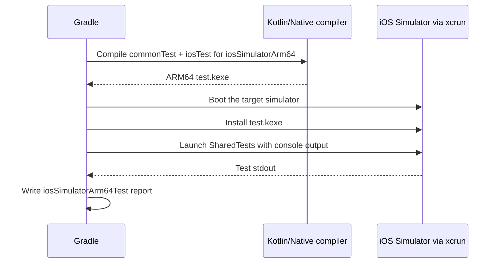

# Testing & Mocking in KMP

> A shared architecture is useless if it can only be tested on one platform. In KMP, a JSON parsing function that works perfectly on the JVM might crash on Kotlin/Native due to numeric precision differences. A coroutine test that passes on Android might deadlock on iOS due to dispatcher behavior. A Staff engineer must architect the test pipeline to verify `commonMain` logic on *every* target runtime, using `kotlin-test` instead of JUnit, concrete Fakes instead of MockK (which is JVM-only), and Gradle tasks that spin up the iOS Simulator from CI.

---

## Overview

The KMP test hierarchy mirrors the source set hierarchy:

```text
commonTest/         ← Tests that run on ALL platforms
androidUnitTest/    ← Tests that run only on JVM (can use JUnit, MockK, Robolectric)
iosTest/            ← Tests that run only on Kotlin/Native (iOS Simulator)
```

When you run `./gradlew :shared:allTests`, Gradle:
1. Compiles `commonTest` + `androidUnitTest` → runs on JVM.
2. Compiles `commonTest` + `iosTest` → compiles to ARM64 → boots iOS Simulator → runs natively.

---

## 1. `kotlin-test` vs JUnit

In `commonMain`, you cannot use JUnit (`org.junit.Test`). JUnit is a JVM library. Instead, you use **kotlin-test**, which is JetBrains' multiplatform test library.

### API Comparison

| JUnit (JVM only) | kotlin-test (KMP) | Notes |
|---|---|---|
| `@org.junit.Test` | `@kotlin.test.Test` | Same behavior |
| `assertEquals(expected, actual)` | `assertEquals(expected, actual)` | Identical |
| `assertThrows<E> { }` | `assertFailsWith<E> { }` | Different name |
| `@Before` / `@After` | `@BeforeTest` / `@AfterTest` | Different names |
| `@Ignore` | `@Ignore` | Same |
| `assertTrue(condition)` | `assertTrue(condition)` | Same |
| `assertNull(value)` | `assertNull(value)` | Same |

### Running Tests with Coroutines

`kotlinx-coroutines-test` provides `runTest` — a coroutine test builder that works on all KMP targets:

```kotlin
// shared/src/commonTest/kotlin/com/example/data/ProductRepositoryTest.kt

import kotlin.test.*
import kotlinx.coroutines.test.runTest

class ProductRepositoryTest {

    private lateinit var repository: ProductRepository
    private lateinit var fakeApi: FakeProductApi
    private lateinit var fakeDatabase: FakeProductDatabase

    @BeforeTest
    fun setup() {
        fakeApi = FakeProductApi()
        fakeDatabase = FakeProductDatabase()
        repository = ProductRepositoryImpl(fakeApi, fakeDatabase)
    }

    @Test
    fun `getProducts returns cached products when API fails`() = runTest {
        // Given: database has cached products
        fakeDatabase.insertProducts(listOf(
            Product(id = "1", name = "Laptop", priceCents = 99900, category = "electronics"),
            Product(id = "2", name = "Phone", priceCents = 79900, category = "electronics")
        ))
        
        // And: API is down
        fakeApi.shouldFail = true
        
        // When
        val result = repository.getProducts("electronics")
        
        // Then: returns cached data, not an error
        assertTrue(result is NetworkResult.Success)
        assertEquals(2, (result as NetworkResult.Success).data.size)
        assertEquals("Laptop", result.data[0].name)
    }

    @Test
    fun `getProducts syncs API data to database`() = runTest {
        // Given: API returns fresh data
        fakeApi.products = listOf(
            Product(id = "3", name = "Tablet", priceCents = 49900, category = "electronics")
        )
        
        // When
        val result = repository.getProducts("electronics")
        
        // Then: data is cached in the database
        val cached = fakeDatabase.getAll()
        assertEquals(1, cached.size)
        assertEquals("Tablet", cached[0].name)
    }

    @Test
    fun `getProducts handles empty response`() = runTest {
        fakeApi.products = emptyList()
        
        val result = repository.getProducts("electronics")
        
        assertTrue(result is NetworkResult.Success)
        assertTrue((result as NetworkResult.Success).data.isEmpty())
    }
}
```

---

## 2. Why MockK Fails on iOS (And What to Use Instead)

### The Technical Failure

MockK uses three JVM-specific mechanisms:
1. **`java.lang.reflect.Proxy`** — to create dynamic proxy objects at runtime.
2. **ByteBuddy** — to generate mock subclasses by manipulating JVM bytecode.
3. **`java.lang.reflect.Field`** — to access private fields for verification.

None of these exist in Kotlin/Native's LLVM runtime. Running a MockK test on iOS produces:

```
kotlin.native.internal.IrLinkageError: Unresolved reference: 
    java.lang.reflect.Proxy
```

### Strategy A: Concrete Fakes (Staff Recommended)

The most robust, Staff-level testing architecture avoids mocking libraries entirely. Write concrete implementations of your interfaces that simulate specific behaviors:

```kotlin
// shared/src/commonTest/kotlin/com/example/fakes/FakeProductApi.kt

class FakeProductApi : ProductApi {
    var products: List<Product> = emptyList()
    var shouldFail: Boolean = false
    var failureException: Exception = IOException("Network error")
    var callCount: Int = 0
        private set
    
    override suspend fun getProducts(
        category: String,
        page: Int,
        limit: Int
    ): ProductListResponse {
        callCount++
        
        if (shouldFail) throw failureException
        
        val filtered = products.filter { it.category == category }
        val paged = filtered.drop((page - 1) * limit).take(limit)
        
        return ProductListResponse(
            products = paged,
            total = filtered.size,
            page = page,
            limit = limit
        )
    }
    
    override suspend fun submitOrder(request: OrderRequest): OrderResponse {
        callCount++
        if (shouldFail) throw failureException
        return OrderResponse(orderId = "fake-order-${request.hashCode()}", status = "confirmed")
    }
}
```

```kotlin
// shared/src/commonTest/kotlin/com/example/fakes/FakeProductDatabase.kt

class FakeProductDatabase : ProductDatabase {
    private val products = mutableListOf<Product>()
    
    override fun observeProducts(category: String): Flow<List<Product>> {
        return MutableStateFlow(products.filter { it.category == category })
    }
    
    override suspend fun getProduct(id: String): Product? {
        return products.find { it.id == id }
    }
    
    override suspend fun insertProducts(newProducts: List<Product>) {
        newProducts.forEach { new ->
            products.removeAll { it.id == new.id }
            products.add(new)
        }
    }
    
    override suspend fun deleteAll() {
        products.clear()
    }
    
    fun getAll(): List<Product> = products.toList()
}
```

**Why Fakes are architecturally superior:**
1. **Compile-time safe:** If the interface changes, the Fake won't compile. MockK mocks compile but fail at runtime.
2. **Platform-agnostic:** Fakes are pure Kotlin — they run on JVM, Native, JS, and Wasm.
3. **Debuggable:** You can set breakpoints inside a Fake. You can't step into a MockK `every { }` block.
4. **Forced design:** Writing a Fake for a 20-method interface is painful. This pain signals that the interface is too large and should be split (Interface Segregation Principle).

### Strategy B: MocKMP / Mockative (Code-Generation Mocking)

If your team insists on mock-style tests, use a KSP-based mocking library that generates mock classes at compile time (before Kotlin/Native sees the code):

```kotlin
// Using Mockative

// The KSP plugin generates a `MockProductApi` class at compile time
@Mock
val mockApi = mock(classOf<ProductApi>())

@Test
fun `test with Mockative`() = runTest {
    // Configure the mock
    given(mockApi)
        .coroutine { getProducts("electronics", 1, 20) }
        .thenReturn(ProductListResponse(products = listOf(sampleProduct), total = 1, page = 1, limit = 20))
    
    val repository = ProductRepositoryImpl(mockApi, fakeDatabase)
    val result = repository.getProducts("electronics")
    
    assertTrue(result is NetworkResult.Success)
    
    // Verify the mock was called
    verify(mockApi)
        .coroutine { getProducts("electronics", 1, 20) }
        .wasInvoked(exactly = 1)
}
```

**Comparison:**

| Aspect | Concrete Fakes | MocKMP / Mockative |
|---|---|---|
| Setup effort | Write a class per interface | Annotate + auto-generate |
| Platform support | ✅ All | ✅ All (KSP generates before Native compile) |
| Verification (`verify`) | Manual (counter variables) | Built-in `verify()` API |
| IDE support | Full (it's just a class) | Partial (generated code may not show in IDE) |
| Test readability | Clear (behavior is in the Fake) | Compact (but `given/when/then` chains can get dense) |
| Recommended for | Production-critical shared code | Rapid prototyping, small modules |

---

## 3. Testing Ktor with MockEngine

Ktor provides a `MockEngine` that intercepts HTTP requests in-memory — no real network calls:

```kotlin
// shared/src/commonTest/kotlin/com/example/network/ApiIntegrationTest.kt

class ApiIntegrationTest {

    @Test
    fun `product API parses paginated response`() = runTest {
        val mockEngine = MockEngine { request ->
            when (request.url.encodedPath) {
                "/api/v1/products" -> {
                    assertEquals("electronics", request.url.parameters["category"])
                    respond(
                        content = """
                            {
                                "products": [
                                    {"id": "1", "name": "Laptop", "price_cents": 99900, "category": "electronics"}
                                ],
                                "total": 1, "page": 1, "limit": 20
                            }
                        """.trimIndent(),
                        headers = headersOf(HttpHeaders.ContentType, "application/json")
                    )
                }
                else -> respond("Not Found", HttpStatusCode.NotFound)
            }
        }
        
        val client = createHttpClient(mockEngine, "https://api.test.com") { "test-token" }
        val api = ProductApi(client)
        
        val response = api.getProducts("electronics", page = 1)
        assertEquals(1, response.products.size)
        assertEquals(99900L, response.products[0].priceCents)
    }

    @Test
    fun `auth header is injected`() = runTest {
        val mockEngine = MockEngine { request ->
            // Verify the auth header was added by the plugin
            assertEquals("Bearer my-secret-token", request.headers[HttpHeaders.Authorization])
            respond("{}", HttpStatusCode.OK)
        }
        
        val client = createHttpClient(mockEngine, "https://api.test.com") { "my-secret-token" }
        client.get("any-endpoint")
    }
}
```

---

## 4. Testing `expect`/`actual` Across Platforms

If you have an `expect fun generateUUID(): String`, you want to verify it works on both platforms:

```kotlin
// shared/src/commonTest/kotlin/com/example/PlatformTest.kt

class PlatformTest {
    
    @Test
    fun `UUID is not empty`() {
        val uuid = generateUUID()
        assertTrue(uuid.isNotBlank())
    }
    
    @Test
    fun `UUID format is valid`() {
        val uuid = generateUUID()
        // Standard UUID format: 8-4-4-4-12 hex characters
        val uuidRegex = Regex("[0-9a-fA-F]{8}-[0-9a-fA-F]{4}-[0-9a-fA-F]{4}-[0-9a-fA-F]{4}-[0-9a-fA-F]{12}")
        assertTrue(uuidRegex.matches(uuid), "UUID '$uuid' does not match expected format")
    }
    
    @Test
    fun `two UUIDs are different`() {
        val uuid1 = generateUUID()
        val uuid2 = generateUUID()
        assertNotEquals(uuid1, uuid2)
    }
}
```

When Gradle runs `allTests`:
- On JVM: `generateUUID()` resolves to `java.util.UUID.randomUUID()`.
- On iOS: `generateUUID()` resolves to `NSUUID().UUIDString()`.
- Both must pass all three assertions.

---

## 5. Compose Multiplatform UI Testing

If you're using Paradigm B (shared UI), you can test Compose screens in `commonTest`:

```kotlin
// shared/src/commonTest/kotlin/com/example/ui/LoginScreenTest.kt

@OptIn(ExperimentalTestApi::class)
class LoginScreenTest {

    @Test
    fun `login button is disabled when email is empty`() = runComposeUiTest {
        setContent {
            LoginScreen(viewModel = LoginViewModel(FakeAuthApi()))
        }
        
        onNodeWithTag("login_button").assertIsNotEnabled()
    }

    @Test
    fun `login button enables when email and password are valid`() = runComposeUiTest {
        setContent {
            LoginScreen(viewModel = LoginViewModel(FakeAuthApi()))
        }
        
        onNodeWithTag("email_field").performTextInput("user@example.com")
        onNodeWithTag("password_field").performTextInput("StrongPass1")
        
        onNodeWithTag("login_button").assertIsEnabled()
    }

    @Test
    fun `shows error message on login failure`() = runComposeUiTest {
        val fakeApi = FakeAuthApi().apply { shouldFail = true }
        
        setContent {
            LoginScreen(viewModel = LoginViewModel(fakeApi))
        }
        
        onNodeWithTag("email_field").performTextInput("user@example.com")
        onNodeWithTag("password_field").performTextInput("StrongPass1")
        onNodeWithTag("login_button").performClick()
        
        waitForIdle()
        
        onNodeWithText("Invalid credentials").assertExists()
    }
}
```

This test runs on **both** Android (JVM) and iOS (Simulator) — verifying UI behavior on both platforms from a single test file.

---

## 6. Running iOS Tests from Gradle

### Local Execution
```bash
# Run only iOS Simulator tests (requires Xcode installed)
./gradlew :shared:iosSimulatorArm64Test

# Run all tests (JVM + iOS)
./gradlew :shared:allTests

# Run with verbose output
./gradlew :shared:iosSimulatorArm64Test --info
```

### What Happens Under the Hood



**Requirement:** A macOS machine with Xcode and the iOS Simulator runtime installed. This cannot run on Linux or Windows CI runners.

---

## Common Pitfalls

### 1. Floating Point Precision
A test that passes on JVM might fail on Native:
```kotlin
@Test
fun `price calculation`() {
    val result = 0.1 + 0.2
    assertEquals(0.3, result)  // JVM: PASS (sometimes), Native: FAIL
}
```
On Native, `Double` follows IEEE 754 strictly. Use `assertEquals(0.3, result, absoluteTolerance = 0.0001)`.

### 2. The `runTest` Clock
`runTest` uses a virtual time scheduler. `delay(1000)` advances virtual time instantly. But on Kotlin/Native, the virtual clock implementation has subtle differences — specifically, `withTimeout` inside `runTest` behaves slightly differently regarding cancellation timing.

### 3. Test Execution Order
On JVM, test methods can run in any order (unless you use `@TestMethodOrder`). On Kotlin/Native, test methods always run in declaration order. If your tests have hidden dependencies on execution order, they'll pass on one platform and fail on the other.

---

## Probing Questions

1.  **MockK Failure:** Explain exactly what `java.lang.reflect.Proxy` does at runtime and why Kotlin/Native's LLVM backend cannot provide an equivalent. What would it take to make MockK work on iOS?
2.  **Fake Design:** You need to test a `CheckoutViewModel` that depends on `PaymentGateway`, `InventoryService`, and `NotificationService`. Design the Fakes. How do you simulate a payment timeout? How do you verify that the notification was sent after a successful payment?
3.  **Cross-Platform Parity:** You run `./gradlew :shared:allTests`. The JVM tests pass but the iOS tests fail with `kotlin.native.internal.IrLinkageError`. What is the most likely cause?
4.  **MockEngine Scope:** Can the Ktor `MockEngine` be used in `commonTest`? Does it run on iOS? If the mock returns a JSON string with a `Long` value of `9007199254740993`, does the deserialization produce the same result on JVM and Native?
5.  **CI Cost:** Running `iosSimulatorArm64Test` on every PR commit takes 3 minutes on a macOS runner that costs $0.08/minute. Your team makes 50 commits per day. Should you run iOS tests on every commit, or only on merge to main? What's the tradeoff?

## Further Reading

- [`ci-cd-for-kmp.md`](ci-cd-for-kmp.md) — How to configure macOS GitHub Action runners to execute `iosSimulatorArm64Test`.
- [`../../android/testing/unit-testing.md`](../../testing/unit-testing.md) — The JVM testing strategies (JUnit, MockK, Turbine) for Android-only code.
- [`networking-with-ktor.md`](../ecosystem/networking-with-ktor.md) — The `MockEngine` for testing Ktor HTTP calls.
- [`dependency-injection.md`](../ecosystem/dependency-injection.md) — How DI enables Fake injection in tests.
