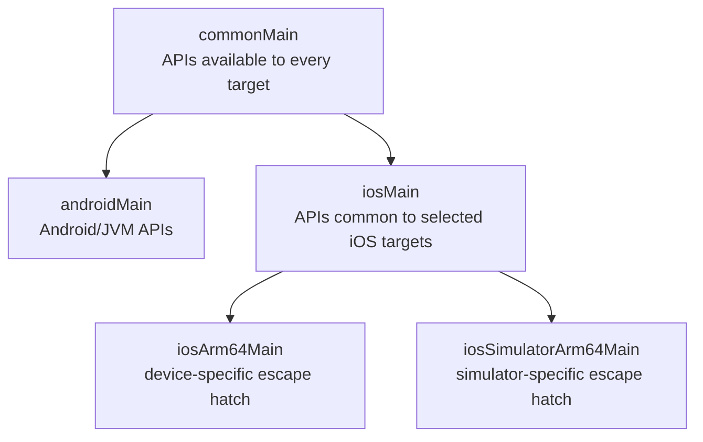
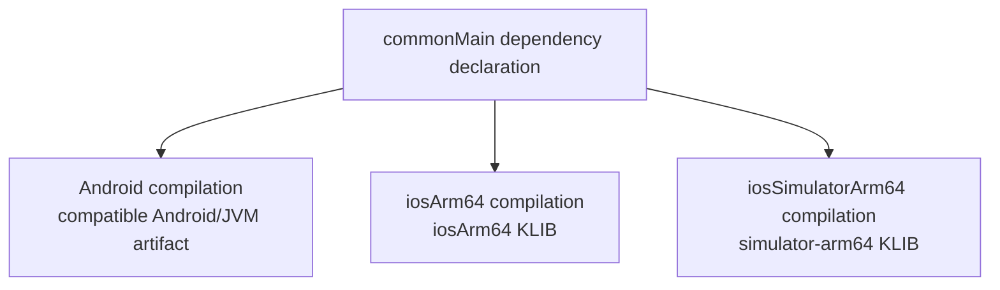
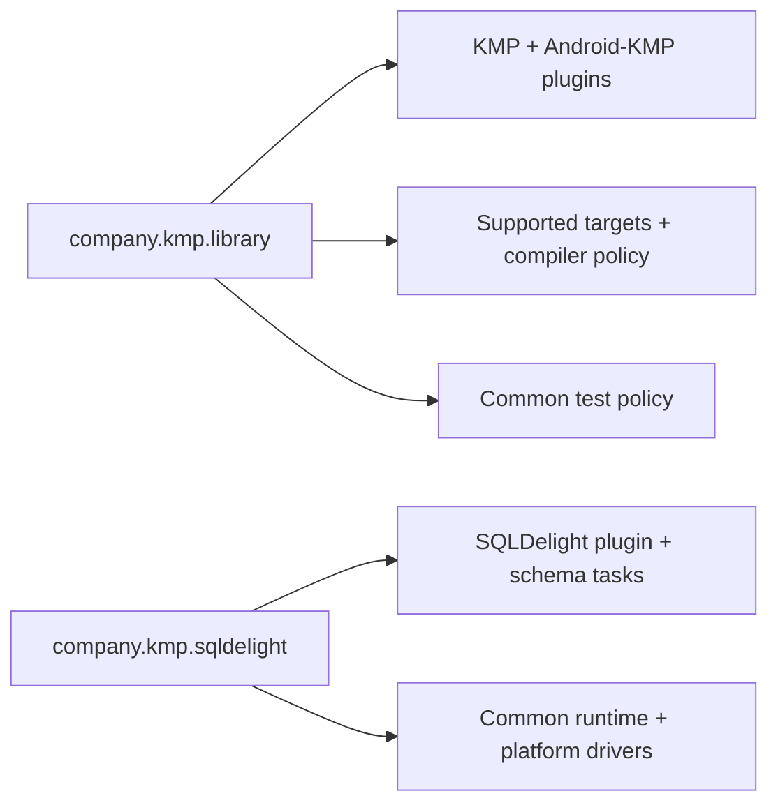

# KMP Build System & Source Sets

> A Kotlin Multiplatform build is a graph of target compilations, source sets, dependency variants, and native binaries. Staff-level fluency means being able to explain that graph, keep platform-only dependencies at the correct edge, and debug the generated artifact without relying on a copied build script.

---

## Overview

The Kotlin Multiplatform Gradle plugin (`org.jetbrains.kotlin.multiplatform`) creates compilations for the declared targets. Each compilation sees a hierarchy of source sets and resolves dependencies whose published variants match that target.

For a current Android library target, pair it with Google's purpose-built `com.android.kotlin.multiplatform.library` plugin. The older combination of `com.android.library` plus `androidTarget()` relies on deprecated integration APIs and is not the configuration to teach for a new AGP 9+ project. The new plugin has important constraints: one Android variant, no product flavors/build types, Java compilation opt-in, and host/device tests disabled until configured.

The target block is version-sensitive: plugin releases before AGP 8.12 used `androidLibrary {}`; AGP 8.12 introduced `android {}` as its replacement, and `androidLibrary {}` has been deprecated since AGP 9.1. The example below deliberately uses the current DSL.

Check the [Android-KMP plugin guide](https://developer.android.com/kotlin/multiplatform/plugin) and the [KMP compatibility guide](https://kotlinlang.org/docs/multiplatform/multiplatform-compatibility-guide.html) together before upgrading; the DSL and compatibility floors are version-sensitive.

## A Current Shared-Library Shape

This example shows the structure, not versions to copy blindly. Resolve compatible Kotlin, AGP, Gradle, and library versions in the project's version catalog.

```kotlin
// shared/build.gradle.kts
import org.jetbrains.kotlin.gradle.dsl.JvmTarget

plugins {
    alias(libs.plugins.kotlin.multiplatform)
    alias(libs.plugins.android.kotlin.multiplatform.library)
    alias(libs.plugins.kotlin.serialization)
}

kotlin {
    android {
        namespace = "com.example.shared"
        compileSdk = libs.versions.android.compileSdk.get().toInt()
        minSdk = libs.versions.android.minSdk.get().toInt()

        compilerOptions {
            jvmTarget.set(JvmTarget.JVM_17)
        }

        // Enable only what this module needs.
        withHostTestBuilder {}.configure {}
    }

    iosArm64()
    iosSimulatorArm64()
    // Add iosX64() only while Intel-simulator support is required.

    targets.withType<org.jetbrains.kotlin.gradle.plugin.mpp.KotlinNativeTarget>()
        .configureEach {
            binaries.framework {
                baseName = "SharedCode"
                isStatic = true

                // Export only API dependencies Swift must access directly.
                export(project(":core:model"))
            }
        }

    sourceSets {
        commonMain.dependencies {
            implementation(libs.kotlinx.coroutines.core)
            implementation(libs.kotlinx.serialization.json)

            // An exported dependency must also be an api dependency.
            api(project(":core:model"))
        }

        commonTest.dependencies {
            implementation(kotlin("test"))
            implementation(libs.kotlinx.coroutines.test)
        }

        androidMain.dependencies {
            implementation(libs.ktor.client.okhttp)
        }

        iosMain.dependencies {
            implementation(libs.ktor.client.darwin)
        }
    }
}
```

The Android configuration is inside `kotlin { android { ... } }`; there is no legacy top-level `android {}` block. If the shared module needs Android build variants, AIDL, data binding, or `externalNativeBuild`, keep those concerns in a separate `com.android.library` module and depend on it from `androidMain` where supported.

## Source Sets Are Visibility Boundaries

A source set has:

- Kotlin sources and resources.
- Dependencies and compiler options.
- A set of target compilations to which it contributes.
- Visibility of declarations from source sets it depends on.



Use the [default hierarchy template](https://kotlinlang.org/docs/multiplatform/multiplatform-hierarchy.html). It creates intermediate sets such as `iosMain` from the targets declared in the build. Manual `dependsOn()` edges disable automatic application of the template unless the build explicitly reapplies it, so custom hierarchies need deliberate review.

`commonMain` may use common Kotlin APIs and multiplatform dependencies that support all of its compilations. A JVM-only dependency belongs in `androidMain` or `jvmMain`; an Apple API belongs in an appropriate Apple source set. Folder placement alone is not proof—inspect the Gradle source-set graph and run every supported target compilation in CI.

## How Variant-Aware Dependency Resolution Works

Multiplatform libraries publish Gradle module metadata describing their variants and attributes. For each target compilation, Gradle matches the consumer's platform, usage, and other attributes to a compatible producer variant:



If no compatible variant exists, resolution fails. The exact diagnostic depends on Gradle and plugin versions; it typically reports that no matching variant could be selected and lists the requested versus provided attributes. Do not teach a single hard-coded error string.

Use `dependencyInsight` on the failing target configuration and inspect the producer's `.module` metadata when the choice is surprising. `commonMain` metadata does not magically make a JVM-only library portable.

### JAR vs KLIB

- A JVM artifact normally packages `.class` bytecode in a JAR.
- A Kotlin/Native dependency is normally a KLIB containing serialized Kotlin metadata/IR plus resources needed by the native toolchain; it is not the final device machine-code framework.
- A native link task combines the applicable KLIBs, performs target-specific compilation/linking through the Kotlin/Native LLVM-based backend, and emits the requested binary or framework.

## Why Device ARM64 and Simulator ARM64 Differ

`iosArm64` and `iosSimulatorArm64` use the same CPU instruction family but different Apple platform targets and SDKs. Their Mach-O metadata identifies different platforms, and they link against device versus simulator SDK libraries.

An `iosArm64` slice therefore cannot substitute for an `iosSimulatorArm64` slice. Depending on where the mistake enters the build, Xcode or the linker reports that the object/framework was built for iOS rather than the iOS Simulator, or that no compatible simulator slice exists. Correct tooling should reject it before launch; “the simulator crashes” is not the primary model.

Declare `iosX64` only if Intel Mac simulator builds remain supported. Most projects still need both `iosArm64` for physical devices and `iosSimulatorArm64` for Apple-silicon simulator development.

## Frameworks and XCFrameworks

Each Kotlin/Native Apple target can produce a framework slice. An XCFramework packages compatible slices under one distributable directory so Xcode selects the correct library for the build destination.

```kotlin
import org.jetbrains.kotlin.gradle.plugin.mpp.apple.XCFramework

kotlin {
    val xcf = XCFramework("SharedCode")

    listOf(iosArm64(), iosSimulatorArm64()).forEach { target ->
        target.binaries.framework {
            baseName = "SharedCode"
            isStatic = true
            xcf.add(this)
        }
    }
}
```

### Static vs Dynamic Is a Measurement and Integration Decision

`isStatic` controls whether the framework contains a static or dynamic library. Framework size alone does not supply a universal switching threshold.

Evaluate:

- Xcode embedding/signing and the chosen distribution mechanism.
- Release and debug build/link time.
- App launch measurements and the number of dynamic libraries loaded.
- Final thinned App Store download/install size, not an uncompressed framework directory.
- Whether multiple binaries would duplicate the Kotlin runtime/dependencies.

Apple notes that every additional third-party dynamic framework adds loader work. Xcode also supports mergeable libraries in modern toolchains. Measure the actual app and preserve the simplest integration that meets its constraints; do not use “8 MB static, 60 MB dynamic” as a rule.

### Export Only Deliberate Swift API Surface

A Kotlin/Native framework contains dependency code needed by the module, but dependency declarations are not automatically exposed as directly usable Swift/Objective-C API. To expose another module through an umbrella framework:

1. Declare it with `api(...)` in the relevant source set.
2. Add `export(...)` to the framework binary.
3. Review the generated header/module and Swift call site.

Export is non-transitive by default. `transitiveExport = true` is usually a poor shortcut because it increases compilation time and binary size and disables dead-code elimination for more code. Export only modules whose types are intentionally part of the Apple-facing contract. Prefer Swift-friendly facade types over exporting an entire implementation ecosystem such as coroutines.

When an expected type is missing, ask the iOS engineer for the generated header/module interface, the failing Swift declaration, build configuration, architecture, and framework/XCFramework version. “It became `KotlinBase`” is not a universal symptom; the result depends on how the type appears in the API and which export path is used.

## Version Catalogs Without Stale Copy-Paste Pins

Version catalogs centralize coordinates and plugin aliases, but they do not establish compatibility by themselves:

```toml
[versions]
kotlin = "<verified Kotlin version>"
agp = "<compatible AGP version>"

[plugins]
kotlin-multiplatform = { id = "org.jetbrains.kotlin.multiplatform", version.ref = "kotlin" }
android-kotlin-multiplatform-library = { id = "com.android.kotlin.multiplatform.library", version.ref = "agp" }
kotlin-serialization = { id = "org.jetbrains.kotlin.plugin.serialization", version.ref = "kotlin" }
```

Keep actual pins in the repository, update them through a tested dependency process, and verify compatibility matrices/release notes. Documentation examples should avoid presenting a bundle of old versions as a current “production stack.”

## Convention Plugin Design

Separate target policy from optional capabilities:



A normal feature applies only the base convention:

```kotlin
plugins { id("company.kmp.library") }
```

A persistence-owning feature composes both:

```kotlin
plugins {
    id("company.kmp.library")
    id("company.kmp.sqldelight")
}
```

This keeps the base convention small and prevents five SQLDelight users from imposing code generation, dependencies, and target setup on all twelve modules. Test convention plugins with Gradle TestKit or representative fixture projects, especially across AGP/KGP upgrades because the Android-KMP plugin exposes different target types from the legacy integration.

## Common Pitfalls

### 1. Copying the Legacy Android Target into a New AGP 9 Build

`com.android.library` plus `androidTarget()` is legacy integration. A current KMP library should migrate to `com.android.kotlin.multiplatform.library` and the nested `android {}` target, after checking its unsupported features and moving Android source/test directories as documented.

### 2. Assuming `iosMain` Is a Target

There is no single `ios` compilation target. `iosMain` is an intermediate source set created because multiple declared iOS targets can share it. Removing a leaf target removes the corresponding binary/test capability even if `iosMain` remains.

### 3. Exporting Every Dependency

`export()` is an Apple binary API decision, not the equivalent of Gradle `implementation`. Excess export expands headers, build work, and binary surface. Keep implementation types behind module-owned facades and export the minimum intentional API.

### 4. Debugging Only `commonMain`

Dependency resolution and compiler errors belong to a concrete compilation. Reproduce the failing Android, device, or simulator task; capture `dependencyInsight` for that target configuration; and inspect the exact binary slice/header consumed by Xcode.

## Probing Questions

1. **Source-set resolution:** A JVM-only HTTP library is added to `commonMain.dependencies`. Why can Android resolve it while an iOS compilation cannot, what information does Gradle use to reject it, and where should the dependency move?
2. **Static vs dynamic:** An uncompressed KMP framework directory is 8 MB and later grows to 60 MB. Why are those numbers insufficient to select static or dynamic linking, and what measurements/integration constraints make the decision?
3. **The `iosSimulatorArm64` question:** A developer removes `iosSimulatorArm64()` because the device and Apple-silicon simulator both use ARM64. What differs in the binaries, and where should the failure surface?
4. **Convention plugin design:** Twelve KMP feature modules share target policy, while only five use SQLDelight. How do you structure conventions so SQLDelight is not applied to every module?
5. **The `export()` problem:** An umbrella framework has an `api` dependency on `core-model`, but does not export it even though Swift must directly use `Product`. What contract is missing, how do you correct it, and what evidence should the iOS bug report contain?

## Answer Key

1. Gradle resolves each target compilation using attributes and variants published in Gradle module metadata. Android can select a compatible JVM/Android artifact; Kotlin/Native cannot select that artifact for `iosArm64` or `iosSimulatorArm64`, so the target configuration reports no compatible variant. Move the library to `androidMain` if it is an Android implementation detail, or choose a multiplatform library in `commonMain` and provide its platform engines/adapters in target source sets.
2. The directory size is neither the thinned App Store download nor proof of launch/runtime cost. Compare final archived/thinned app size, cold launch and dynamic-loader work, debug/release link time, embedding/signing/distribution requirements, runtime/dependency duplication, and supported Xcode features such as mergeable libraries. Select the simplest verified configuration; remeasure after material dependency changes rather than switching at a made-up threshold.
3. The CPU instructions are ARM64, but the Mach-O platform metadata, target triple, SDK libraries, and availability environment distinguish iOS devices from the iOS Simulator. Without a simulator target, the XCFramework has no compatible simulator slice. Xcode/Clang/the linker should reject the device object or report the missing slice during build/link; treating this as an expected runtime crash hides the real packaging error.
4. Put targets, compiler settings, Android-KMP defaults, and common test policy in a small `company.kmp.library` convention. Put SQLDelight plugin application, schema/task configuration, and platform drivers in a composable `company.kmp.sqldelight` convention. Apply the second plugin only to the five persistence modules, test both compositions with fixtures, and avoid making the optional plugin an implicit dependency of the base convention.
5. `api(...)` makes the dependency part of Kotlin/Gradle API visibility; `export(...)` makes the selected dependency's declarations available through that native framework to Swift/Objective-C. Add an explicit `export(project(":core:model"))` to every relevant framework slice (or the shared framework configuration), keep export non-transitive, rebuild the XCFramework, and review the generated Swift/Objective-C interface. The report should include the failing Swift code/diagnostic, generated interface/header, framework version, build configuration, and selected architecture so the issue is reproducible.

## Further Reading

- [`overview-and-k1-vs-k2.md`](../foundations/overview-and-k1-vs-k2.md) — Compiler targets and the default hierarchy model.
- [`ios-distribution.md`](ios-distribution.md) — How frameworks/XCFrameworks reach Xcode through local or remote integration.
- [`../../build-tooling/convention-plugins.md`](../../build-tooling/convention-plugins.md) — Convention plugin architecture and testing.
- [Android-KMP library plugin](https://developer.android.com/kotlin/multiplatform/plugin) — Current Android target DSL, migration, limitations, and version floors.
- [KMP compatibility guide](https://kotlinlang.org/docs/multiplatform/multiplatform-compatibility-guide.html) — Active deprecations and removals.
- [KMP dependencies](https://kotlinlang.org/docs/multiplatform/multiplatform-add-dependencies.html) — Source-set dependency placement and variants.
- [Build final native binaries](https://kotlinlang.org/docs/multiplatform/multiplatform-build-native-binaries.html) — Framework configuration and dependency export semantics.
- [Default hierarchy template](https://kotlinlang.org/docs/multiplatform/multiplatform-hierarchy.html) — Automatically created intermediate source sets.
- [Apple launch-time guidance](https://developer.apple.com/documentation/xcode/reducing-your-app-s-launch-time) — Dynamic library loading and mergeable libraries.
