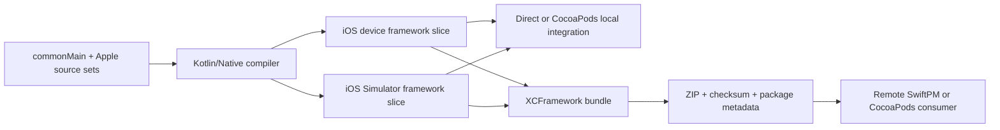
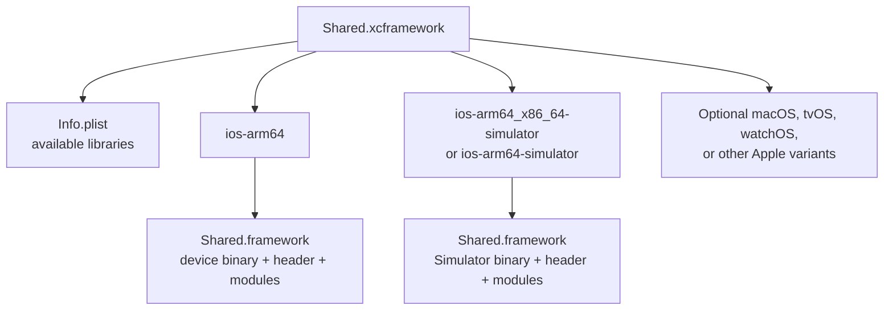
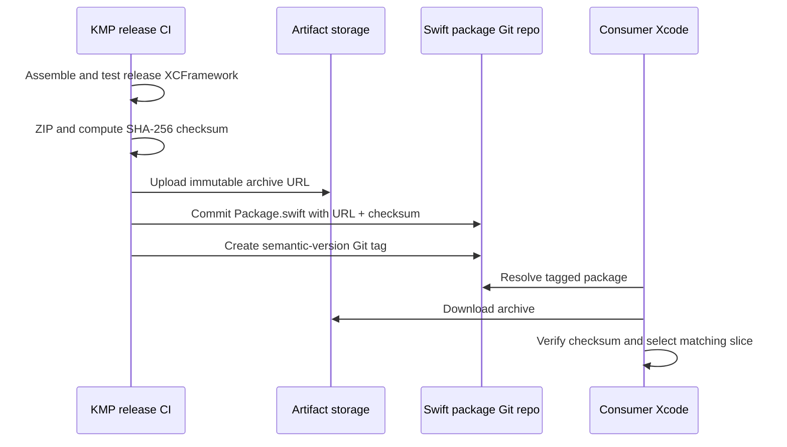

# iOS Distribution: From Kotlin Framework to Xcode

An iOS consumer should receive a predictable Apple artifact, a reviewed Swift-facing API, and a release process that can reproduce exactly what was tested. Kotlin compilation is only one step; target slices, linkage, exported modules, package metadata, checksums, resources, licenses, and symbols all belong to the distribution contract.

This chapter covers the established Kotlin/Native Objective-C framework path. Kotlin 2.4 Swift export is a separate Alpha path currently tied to direct Xcode integration; evaluate it with the constraints in [`swift-interop.md`](swift-interop.md) rather than assuming the packaging guidance here applies unchanged.

---

## The Artifact Pipeline

By default, a Kotlin/Native target produces a `.klib`, which is an input to other Kotlin/Native compilations—not a final artifact Xcode can link. Declaring `binaries.framework` creates Apple frameworks for the configured targets and build types.



The takeaway: local development integration and remote binary distribution can share the same public API, but they have different build ownership and release failure modes.

### What a framework contains

A Kotlin/Native Apple framework normally includes:

- a native binary for one Apple platform variant and build type;
- an Objective-C header describing the exported Kotlin API;
- a module map so Clang and Swift can import the module;
- an `Info.plist` with framework metadata.

A framework slice may contain more than one CPU architecture when they belong to the same platform variant. It cannot safely collapse device and Simulator variants merely because both use ARM64: `ios-arm64` and `ios-arm64-simulator` target different Apple platforms and carry different load-command/platform metadata.

### Why XCFramework exists

An XCFramework is a container that keeps platform variants separate and lets Xcode choose the matching library at build time.



If a consumer links a device slice into a Simulator build, the failure is normally a build/link error such as “building for iOS Simulator, but linking in object file built for iOS”—not an application crash after launch.

---

## Configure a Real XCFramework Task

Creating individual frameworks is not enough to register XCFramework assembly. Add each framework binary to an `XCFramework` instance:

```kotlin
import org.jetbrains.kotlin.gradle.plugin.mpp.apple.XCFramework

kotlin {
    val frameworkName = "Shared"
    val xcf = XCFramework(frameworkName)

    listOf(
        iosArm64(),
        iosSimulatorArm64(),
    ).forEach { iosTarget ->
        iosTarget.binaries.framework {
            baseName = frameworkName
            binaryOption("bundleId", "com.example.shared")
            isStatic = true
            xcf.add(this)
        }
    }
}
```

The Kotlin Gradle plugin then registers aggregate and build-type-specific tasks. For a release artifact, use the generated release task for the configured name:

```shell
./gradlew :shared:assembleSharedReleaseXCFramework
```

The conventional result is under `shared/build/XCFrameworks/release/Shared.xcframework`. Confirm the task names with `./gradlew :shared:tasks` when the framework name or plugin version changes; do not hard-code a task that the build never registered.

### Select targets deliberately

- `iosArm64` covers current physical iOS devices.
- `iosSimulatorArm64` covers Apple-silicon Simulator builds.
- Add `iosX64` only when the supported developer/CI matrix still requires Intel Simulator builds.
- Add macOS, tvOS, watchOS, or other variants only when they are part of the product contract and tested by a consumer.

More slices increase build and artifact work. They should follow an explicit support matrix, not an old template.

### Choose static or dynamic linkage explicitly

`isStatic` changes how the framework binary is linked and packaged. Static frameworks often simplify a single umbrella KMP artifact and avoid some duplicate-runtime/dynamic-linking problems; dynamic frameworks can be appropriate when runtime sharing or a specific dependency model requires them.

Neither choice is universally correct. Validate:

- final app linking and launch on device and Simulator;
- code signing and embedding for dynamic artifacts;
- resource and bundle inclusion;
- duplicate Kotlin/Native runtime or Objective-C class warnings;
- application size and symbolication;
- compatibility with the consumer's dependency graph.

---

## Choose Integration by Ownership

The first decision is local versus remote integration:

- **Local integration** makes the Kotlin build part of app development. It favors fast source iteration and one coordinated repository/team.
- **Remote integration** publishes a versioned binary. It favors independent repositories, multiple consumers, release isolation, and consumers that should not run Gradle.

**Economic trade-offs:** Local source integration avoids binary-publishing latency and supports direct Kotlin debugging, but iOS developers participate in the Gradle/JDK build. A coordinated editable checkout exposes source changes immediately; a pinned submodule, checkout, or composite build still has source-revision adoption lag when consumers update the pin. Remote binary integration shields consumers from the Kotlin toolchain and improves release isolation, but adds binary-publishing infrastructure, artifact latency, and explicit artifact-version adoption. These costs follow the integration and dependency-update modes, not repository topology: a monorepo can consume a published XCFramework, and a polyrepo can still integrate Kotlin sources directly.

| Factor | Direct Xcode integration | CocoaPods integration | Remote SwiftPM binary |
|---|---|---|---|
| Typical ownership | Coordinated monorepo | App or KMP code already depends on Pods | Independent or multiple iOS consumers |
| Consumer runs Gradle | Yes | Usually for local Kotlin pod development | No |
| Consumer needs Kotlin/JDK toolchain | Yes | Usually yes for local source integration | No |
| KMP module can consume Pods | No; migrate or retain CocoaPods when Pod dependencies are irreplaceable | Yes | The published binary must already contain/link its supported dependencies |
| Version boundary | Source commit | Pod/source or published Pod version | Git tag + immutable package manifest + binary checksum |
| Best feedback loop | Kotlin and Swift change together | Existing CocoaPods-based workflow | Released artifact tested like a third-party SDK |

SwiftPM is not automatically superior, and “Apple deprecated CocoaPods” is not a meaningful claim because Apple does not own CocoaPods. The CocoaPods maintainers describe it as being in maintenance mode, while Kotlin continues to document and support CocoaPods integration. Choose from dependency requirements, repository topology, consumer tooling, release cadence, maintenance risk, and failure isolation.

---

## Direct Xcode Integration

Direct integration uses the Kotlin Gradle plugin's `embedAndSignAppleFrameworkForXcode` task. The task is registered only when an Apple target declares `binaries.framework`.

Add the official build guard and Gradle task to an Xcode Run Script phase before Compile Sources:

```shell
if [ "YES" = "$OVERRIDE_KOTLIN_BUILD_IDE_SUPPORTED" ]; then
    echo "Skipping Gradle build; the Kotlin IDE already built the framework"
    exit 0
fi

cd "$SRCROOT/.."
./gradlew :shared:embedAndSignAppleFrameworkForXcode
```

The task reads Xcode's build environment, builds the correct target/build type, copies the framework into derived data, and handles embedding/signing. Do not pass CocoaPods-only Gradle properties to this direct-integration task.

Follow the current setup requirements:

1. place the phase before Compile Sources;
2. disable “Based on dependency analysis” so the phase is not incorrectly skipped;
3. disable User Script Sandboxing for the application target as documented by Kotlin;
4. map a custom Xcode configuration with `KOTLIN_FRAMEWORK_BUILD_TYPE=Debug` or `Release`;
5. use the Gradle wrapper and pin compatible Kotlin, Gradle, JDK, and Xcode versions.

This path is a strong monorepo development default because Kotlin changes appear in the iOS app without publishing. Its cost is build-system coupling: iOS developers and CI need the Kotlin toolchain, and Xcode builds invoke Gradle. Measure clean and incremental performance in the actual project rather than publishing universal “seconds added” claims.

---

## CocoaPods Integration

The Kotlin CocoaPods Gradle plugin can generate a Podspec, build the Kotlin framework with the iOS project, import Pod dependencies into Kotlin, and publish XCFramework-based Pods.

```kotlin
plugins {
    alias(libs.plugins.kotlinMultiplatform)
    alias(libs.plugins.kotlinCocoapods)
}

kotlin {
    iosArm64()
    iosSimulatorArm64()

    cocoapods {
        version = "1.0.0"
        summary = "Shared checkout domain"
        homepage = "https://example.com/shared"
        ios.deploymentTarget = "15.0"

        framework {
            baseName = "Shared"
            isStatic = true
            transitiveExport = false
        }
    }
}
```

Use this path when the iOS application already uses CocoaPods or the KMP module must consume Pod dependencies. Open the generated `.xcworkspace`, not the original `.xcodeproj`, after `pod install`.

Important constraints:

- CocoaPods integration and `embedAndSignAppleFrameworkForXcode` direct integration are alternative mechanisms; do not configure both for the same framework connection.
- Match the CocoaPods plugin version to the Kotlin plugin version.
- Pin Ruby/CocoaPods tooling in CI and verify a clean checkout, not only an incrementally configured workstation.
- For Compose Multiplatform resources, use the documented Gradle `podInstall` flow so generated resource directories exist when the Podspec is integrated.
- Remote CocoaPods distribution can use the plugin's `podPublishDebugXCFramework`, `podPublishReleaseXCFramework`, and `podPublishXCFramework` tasks.

---

## Remote SwiftPM Binary Distribution

Swift Package Manager can expose a zipped XCFramework as a remote binary target. The consumer downloads a released artifact and does not run the Kotlin build.



The takeaway: the Git tag, manifest, URL, checksum, and archive form one immutable release. Replacing the file behind an existing version breaks reproducibility and normally causes checksum verification to fail.

### Package manifest

```swift
// swift-tools-version: 5.9

import PackageDescription

let package = Package(
    name: "Shared",
    platforms: [.iOS(.v15)],
    products: [
        .library(name: "Shared", targets: ["Shared"]),
    ],
    targets: [
        .binaryTarget(
            name: "Shared",
            url: "https://downloads.example.com/shared/1.2.3/Shared.xcframework.zip",
            checksum: "<sha256-of-this-exact-archive>"
        ),
    ]
)
```

Release steps:

1. assemble and test the release XCFramework on macOS;
2. create the ZIP archive without modifying it afterward;
3. compute the checksum with `swift package compute-checksum Shared.xcframework.zip`;
4. upload the exact archive to a direct, immutable URL;
5. update `Package.swift` with that URL and checksum;
6. validate with `swift package reset && swift package show-dependencies --format json`;
7. commit the manifest and push a semantic-version Git tag;
8. resolve, archive, launch, and smoke-test a real consumer app.

Apple's checksum verifies that the downloaded archive matches the manifest. Trust still depends on the package repository, tag/revision controls, artifact hosting, and release credentials; a checksum alone is not artifact provenance.

Automation such as KMMBridge can create/publish XCFramework archives and SwiftPM metadata, but it should implement the team's versioning and approval policy—not silently define it. Pin the tool, review its current compatibility, and retain an end-to-end consumer test.

---

## Multi-Module Export and the Umbrella Framework

Swift consumers generally need one coherent KMP framework rather than an accidental framework per Gradle module. An umbrella module can export selected modules into one XCFramework:

```kotlin
import org.jetbrains.kotlin.gradle.plugin.mpp.apple.XCFramework

kotlin {
    val frameworkName = "Shared"
    val xcf = XCFramework(frameworkName)

    listOf(iosArm64(), iosSimulatorArm64()).forEach { iosTarget ->
        iosTarget.binaries.framework {
            baseName = frameworkName
            export(project(":core:model"))
            export(project(":feature:checkout"))
            transitiveExport = false
            xcf.add(this)
        }
    }

    sourceSets.commonMain.dependencies {
        api(project(":core:model"))
        api(project(":feature:checkout"))
    }
}
```

The export rules matter:

- only `api` dependencies of the relevant source set can be exported;
- `export(...)` makes that dependency's public API and code part of the framework API/artifact;
- export is non-transitive by default;
- `transitiveExport=true` can pull a large dependency graph into the framework, weaken dead-code elimination, and increase compile time and size;
- export only modules that Swift must call directly.

If a public Kotlin signature exposes a type from a dependency that is not correctly available in the framework API, the generated Apple API can be incomplete or unusable to the consumer. Treat header generation and a compiling Swift fixture as the proof; do not promise one universal mangled fallback type.

---

## Versioning and Release Governance

The shipped contract includes more than Kotlin source:

- exported Objective-C/Swift API and framework/module name;
- static versus dynamic linkage;
- supported platform variants, architectures, and minimum OS;
- exported dependency versions and native runtime;
- resources, privacy manifests, and license notices where applicable;
- release symbols and the metadata needed by crash symbolication;
- Swift package or Pod metadata, checksum, tag, and artifact URL.

Changing `baseName`, `bundleId`, `isStatic`, minimum OS, exported modules, or generated API can break consumers even when Kotlin callers still compile. Apply semantic versioning to the consumer-visible artifact and review generated API diffs.

Kotlin's documentation also warns that final native binaries can contain third-party code or derived work. Ship the required licenses with the distribution and preserve a software bill of materials or equivalent dependency record.

### Release gate

Before publishing:

1. build the release XCFramework from a clean checkout with pinned tools;
2. inspect its `Info.plist` and confirm every supported variant is present exactly once;
3. compile and link Swift fixtures against device and Simulator destinations;
4. archive and launch a representative application;
5. verify public headers/API snapshots, resources, privacy data, and licenses;
6. exercise errors, suspend/Flow lifecycle, and exported dependency types from Swift;
7. validate SwiftPM/Pod resolution from the published location;
8. upload and test matching symbol files in the crash pipeline;
9. compare artifact and final-app size against an approved baseline;
10. prohibit mutation of a published tag, checksum, or archive.

---

## Failure Modes to Catch Early

### Frameworks exist but no XCFramework task exists

Declaring `binaries.framework` creates per-target frameworks. The XCFramework tasks appear only after those binaries are added to an `XCFramework` configuration with `xcf.add(this)`.

### Simulator and device both say ARM64

Architecture alone is insufficient. Simulator and device are different platform variants; use the correct XCFramework slice and inspect the linker message before changing excluded architectures.

### A remote artifact is overwritten

The manifest checksum no longer matches, and consumers cannot resolve the binary. Publish a new immutable version instead of replacing the archive behind an existing URL/tag.

### Direct and CocoaPods integration are both enabled

The app can build or embed the framework twice, creating duplicate symbols/classes, stale outputs, or inconsistent resources. Choose one connection mechanism per consumer.

### `transitiveExport` is used as a shortcut

The framework grows, compilation and linking cost increase, and implementation dependencies become consumer API. Export an explicit umbrella surface and keep implementation dependencies internal.

### Debug works but release cannot symbolicate

The binary, dSYM/debug information, and uploaded crash metadata do not match. Make symbol publication part of the same immutable release transaction as the framework.

---

## Probing Questions

1. **XCFramework selection:** Why must an XCFramework keep `ios-arm64` and `ios-arm64-simulator` separate even though both use ARM64, and at what stage does Xcode reject the wrong slice?
2. **Task configuration:** A project declares three `binaries.framework` blocks but `assembleSharedReleaseXCFramework` is missing. What configuration is absent, and how do you prove the release artifact contains the intended variants?
3. **Integration choice:** A polyrepo has four iOS consumers whose engineers must not install a JDK. Which integration fits, what release infrastructure does it require, and when would CocoaPods still be the better choice?
4. **Checksum and immutability:** CI overwrites `Shared.xcframework.zip` for version `1.2.3` without changing `Package.swift`. What happens, what security property does the checksum provide, and how should the release be repaired?
5. **Umbrella export:** `Shared` exposes a `Product` from `core-model`, but that module is an `implementation` dependency and is not exported. What must change, and why should `transitiveExport=true` not be the default fix?
6. **Release safety:** Which tests and artifacts prove that a binary KMP release works for Swift consumers and can be diagnosed after it reaches production?

## Answer Key

1. CPU architecture does not identify the Apple platform variant. Device and Simulator ARM64 binaries carry different platform/ABI metadata, so they remain separate libraries in the XCFramework. Xcode selects a slice for the active destination and rejects a mismatched one during build/link, before the app launches.
2. The framework binaries were never added to an `XCFramework` instance. Create `XCFramework("Shared")` and call `xcf.add(this)` inside every intended framework block. Then run the named release assembly task, inspect the XCFramework `Info.plist`, and compile device and Simulator Swift fixtures from a clean build.
3. Publish an immutable zipped XCFramework through a remote SwiftPM binary target so consumers resolve a tag, manifest, URL, and checksum without Gradle/JDK. This requires macOS release CI, artifact hosting, a package Git repository/versioning flow, symbols, credentials, and consumer tests. CocoaPods remains appropriate when the KMP module must consume irreplaceable Pods or the consumer organization standardizes on CocoaPods and accepts its toolchain.
4. SwiftPM downloads the archive and rejects it when its SHA-256 does not match the manifest. The checksum protects integrity relative to the trusted manifest; it does not alone prove who produced the artifact. Restore the original archive or, preferably, publish a new immutable version with a new URL, checksum, manifest commit, and tag—never mutate `1.2.3`.
5. Make `core-model` an `api` dependency of the relevant source set and explicitly `export(project(":core:model"))` from each framework binary so Swift can use its public types. Transitive export can expose the whole downstream graph, inhibit dead-code elimination, and inflate build/artifact cost; export only the modules in the deliberate public boundary.
6. Build from pinned tools and a clean checkout; inspect slices and generated API; compile, link, archive, and launch representative Swift consumers for device and Simulator; test resource loading, exported types, errors, and async cancellation; validate package/Pod resolution and checksums; ship matching symbols, licenses, privacy metadata, and dependency records; and enforce artifact/final-app size plus immutability gates.

---

## Official Sources and Further Reading

- [Kotlin iOS integration methods](https://kotlinlang.org/docs/multiplatform/multiplatform-ios-integration-overview.html)
- [Build Kotlin/Native final binaries and XCFrameworks](https://kotlinlang.org/docs/multiplatform/multiplatform-build-native-binaries.html)
- [Kotlin direct Xcode integration](https://kotlinlang.org/docs/multiplatform/multiplatform-direct-integration.html)
- [Kotlin Swift package export setup](https://kotlinlang.org/docs/multiplatform/multiplatform-spm-export.html)
- [Kotlin CocoaPods overview and setup](https://kotlinlang.org/docs/multiplatform/multiplatform-cocoapods-overview.html)
- [Apple: distributing binary frameworks as Swift packages](https://developer.apple.com/documentation/xcode/distributing-binary-frameworks-as-swift-packages)
- [Apple: creating a multiplatform binary framework bundle](https://developer.apple.com/documentation/xcode/creating-a-multi-platform-binary-framework-bundle)
- [CocoaPods support and maintenance plans](https://blog.cocoapods.org/CocoaPods-Support-Plans/)
- [KMMBridge documentation](https://touchlab.co/kmmbridge/) — optional third-party publishing automation.
- [`swift-interop.md`](swift-interop.md) — generated API mappings, cancellation, SKIE, and Swift export.
- [`build-system-and-source-sets.md`](build-system-and-source-sets.md) — Gradle target and source-set ownership.
- [`../production/ci-cd-for-kmp.md`](../production/ci-cd-for-kmp.md) — CI execution, caching, and release automation.
- [`../binary-compatibility-api-evolution.md`](../binary-compatibility-api-evolution.md) — consumer API compatibility and versioning.
- [`../kmp-observability-crash-symbolication.md`](../kmp-observability-crash-symbolication.md) — matching native symbols to shipped builds.
