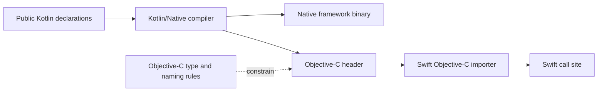

# Swift Interop, SKIE, and Swift Export

An iOS team experiences a Kotlin Multiplatform module through its exported API, not through the elegance of its Kotlin implementation. A boundary that leaks awkward names, erased types, unmanaged collectors, or surprising error behavior can make otherwise useful shared code expensive to adopt.

This chapter separates three paths that are easy to conflate:

1. the established Kotlin/Native Objective-C export consumed from Swift;
2. SKIE-generated Swift wrappers layered onto that export; and
3. Kotlin 2.4 Swift export, which is a separate Alpha integration path.

The right choice is a product and distribution decision. It is not simply “use the newest bridge.”

---

## Start With the Export Path

| Path | Appropriate when | Main constraint |
|---|---|---|
| Objective-C export | The module must use the established Apple framework and XCFramework toolchain, or needs the smallest dependency surface | Swift receives only what Objective-C can represent |
| Objective-C export + explicit wrappers | The public API is small and the iOS team wants to own a stable, hand-designed Swift facade | Wrapper lifecycle and parity are application responsibilities |
| Objective-C export + SKIE | A framework consumer needs typed Flow, cancellable suspend calls, exhaustive sealed handling, or selected Swift conveniences at scale | Compiler-plugin compatibility and generated API changes must be governed |
| Swift export | The app uses direct Xcode integration and can evaluate an Alpha feature behind a controlled boundary | It is incomplete, can change, and does not yet fit every distribution model or type shape |

Do not choose per function. Pick an export strategy per shipped module, define its public-API rules, and compile a representative Swift consumer in CI.

---

## The Established Objective-C Bridge

Kotlin/Native can compile a Kotlin module into an Apple framework. Its exported declarations are represented in an Objective-C header; Swift imports that API through Apple's Objective-C interoperability.



The takeaway: Swift cannot recover Kotlin semantics that were not representable in the intermediate Objective-C API. Inspecting only Kotlin source is therefore not enough; review the generated header and the Swift call site.

### Common mappings and losses

| Kotlin surface | Swift through Objective-C export | Design consequence |
|---|---|---|
| `class` | class | Keep exported inheritance deliberately small |
| `interface` | protocol | Avoid leaking implementation-oriented protocols |
| `enum class` | class-like API | Do not assume a native exhaustive Swift `switch` |
| sealed hierarchy | related classes | Swift has no compiler-proven exhaustiveness |
| `object` | class with `shared` instance | Document singleton ownership explicitly |
| `suspend fun` | completion-handler API, with an experimental Swift `async` import | Test error and cancellation behavior at the boundary |
| `@Throws fun` | Swift `throws` / Objective-C `NSError**` | Declare the expected exception contract |
| default argument | required parameter | Add a deliberate overload or Swift facade when omission matters |
| `List`, `Set`, `Map` | Apple collection equivalents | Conversion to Swift-native collections can copy data |
| generic class | Objective-C lightweight generic where representable | Some nullability, variance, bounds, function, and interface generic information is lost |
| inline/value class | not properly exposed as the Kotlin abstraction | Prefer a boundary DTO or primitive with semantic naming |

“Generics are erased” is too broad. Objective-C lightweight generics preserve useful information for some generic classes, but Objective-C cannot express the full Kotlin or Swift type system. Treat nested generic graphs and generic interfaces as warning signs, then inspect the generated API instead of guessing.

### Shape names intentionally

Use the Kotlin interop annotations to control what becomes public:

```kotlin
@ObjCName(swiftName = "CheckoutService")
class CheckoutApi {
    fun quote(cartId: String): CheckoutQuote = TODO()

    @ShouldRefineInSwift
    fun rawQuotePayload(cartId: String): ByteArray = TODO()
}

@HiddenFromObjC
fun internalRetryPolicy(): RetryPolicy = TODO()
```

- `@ObjCName` supplies a consumer-oriented exported name.
- `@ShouldRefineInSwift` marks a declaration as a low-level entry point intended to sit behind a Swift wrapper.
- `@HiddenFromObjC` removes a public Kotlin declaration from Objective-C export, and therefore from Swift through that bridge, while allowing it to remain public to other Kotlin modules.
- `internal` is preferable when no other Kotlin module needs the declaration.

Export KDoc for behavior that a Swift caller must understand, but verify its generated Xcode presentation. Not every KDoc block tag is supported.

### Errors are part of the ABI

Kotlin exceptions are unchecked; Swift errors are checked. Under Objective-C export:

- a non-suspending function needs `@Throws` to become a Swift `throws` function;
- an exception listed by `@Throws`, or its subclass, is converted to `NSError`;
- an unexpected Kotlin exception crossing the boundary terminates the process;
- a suspending export always has an error channel, but without `@Throws` only `CancellationException` is propagated as an error.

```kotlin
@Throws(CheckoutException::class)
fun validate(order: Order): Receipt = validator.validate(order)

@Throws(CheckoutException::class, CancellationException::class)
suspend fun submit(order: Order): Receipt = repository.submit(order)
```

Do not expose a large implementation exception hierarchy. Translate internal failures into a small, documented boundary contract and test the exact Swift error cases.

### Suspend is not automatically structured concurrency

The Swift compiler can import the Objective-C completion-handler form of a Kotlin `suspend` function with `async` syntax. That syntax does not by itself connect Swift `Task` cancellation to the Kotlin coroutine `Job`.

```swift
let task = Task {
    let receipt = try await checkout.submit(order: order)
    await render(receipt)
}

task.cancel()
```

With the plain Objective-C bridge, do not infer that `task.cancel()` cancels the in-flight Kotlin work. If cancellation matters, use an explicit cancellable API, a verified interop layer such as SKIE, or evaluate Swift export's structured-concurrency path. Test cancellation with an observable underlying operation rather than only checking `Task.isCancelled`.

### Flow needs a lifecycle owner

`Flow<T>` and `StateFlow<T>` are Kotlin interfaces; plain Objective-C export does not turn them into typed Swift `AsyncSequence` values. A manual facade should return an explicit cancellation handle and avoid making Swift know how Kotlin collection works:

```kotlin
class Observation internal constructor(
    private val job: Job,
) {
    fun cancel() = job.cancel()
}

class CheckoutPresenter(
    private val scope: CoroutineScope,
) {
    private val state: StateFlow<CheckoutState> = TODO()

    fun observeState(onEach: (CheckoutState) -> Unit): Observation {
        val job = scope.launch {
            state.collect { onEach(it) }
        }
        return Observation(job)
    }
}
```

```swift
@MainActor
final class CheckoutModel: ObservableObject {
    @Published private(set) var state: CheckoutState
    private var observation: Observation?

    init(presenter: CheckoutPresenter, initial: CheckoutState) {
        state = initial
        observation = presenter.observeState { [weak self] next in
            _ = Task { @MainActor in self?.state = next }
            return KotlinUnit()
        }
    }

    deinit {
        observation?.cancel()
    }
}
```

This is a boundary pattern, not a universal drop-in implementation. The Kotlin owner must define scope lifetime, dispatcher behavior, backpressure, and terminal errors. The Swift owner must cancel the handle and avoid a retain cycle.

---

## SKIE on the Objective-C Export Path

SKIE is a Kotlin/Native compiler plugin from Touchlab. It generates and bundles Swift wrappers around the Objective-C API produced by Kotlin/Native; it does not replace the underlying framework distribution path.

Apply it only to modules that create Apple frameworks, and select a version compatible with the project's Kotlin version:

```kotlin
plugins {
    id("co.touchlab.skie") version "0.10.14"
}
```

The version above matches the current official installation example. Do not copy it indefinitely: check the official installation, compatibility, migration, and changelog pages during each Kotlin upgrade.

### What SKIE can improve

- `Flow`, `StateFlow`, and `MutableStateFlow` become typed Swift `AsyncSequence` wrappers with two-way cancellation.
- suspend functions receive native Swift async wrappers with two-way cancellation and no main-thread-only call restriction.
- Kotlin sealed classes and interfaces receive generated Swift enum wrappers for exhaustive switching through `onEnum(of:)`.
- Kotlin enums can be presented as Swift enums.
- selected global functions, interface extensions, and overloads receive more idiomatic Swift entry points.
- default-argument overloads can be generated when explicitly enabled.
- project-authored Swift wrapper code can be bundled with the framework.

Default-argument generation is disabled by default because combinations can create many generated functions. Enable it selectively for a small consumer-facing surface rather than for an entire dependency graph.

### Typed Flow consumption

Suppose the exported Kotlin facade exposes a public, read-only state stream:

```kotlin
class CheckoutStore {
    private val mutableState = MutableStateFlow(CheckoutState.initial())
    val state: StateFlow<CheckoutState> = mutableState.asStateFlow()
}
```

SKIE lets the Swift adapter collect that property as a typed sequence:

```swift
@MainActor
final class CheckoutModel: ObservableObject {
    @Published private(set) var state: CheckoutState
    private let store: CheckoutStore

    init(store: CheckoutStore, initial: CheckoutState) {
        self.store = store
        self.state = initial
    }

    func activate() async {
        for await next in store.state {
            state = next
        }
    }
}
```

```swift
struct CheckoutScreen: View {
    @StateObject private var model: CheckoutModel

    init(model: CheckoutModel) {
        _model = StateObject(wrappedValue: model)
    }

    var body: some View {
        CheckoutContent(state: model.state)
            .task { await model.activate() }
    }
}
```

SwiftUI cancels the task created by `.task` when its lifetime ends; SKIE bridges that cancellation to the Kotlin collection. The observable Swift model still owns presentation adaptation—the bridge does not make a Kotlin class conform to `ObservableObject` automatically.

### Sealed hierarchy consumption

```swift
switch onEnum(of: paymentResult) {
case .authorized(let value):
    showReceipt(value.receipt)
case .declined(let value):
    showDecline(value.reason)
case .pending:
    showPending()
}
```

Adding a new sealed subtype changes the generated wrapper and makes an exhaustive Swift switch fail to compile. This is useful only if the generated Swift client is compiled in the same change; otherwise the incompatibility is discovered too late.

### Operational tradeoffs

SKIE changes the generated Swift-facing API and participates in Kotlin compiler/framework generation. Govern it like build infrastructure:

1. pin Kotlin, SKIE, Gradle, and Xcode versions;
2. read SKIE's compatibility matrix and changelog before upgrades;
3. migrate an existing framework using the documented migration guide;
4. compile representative Swift consumers and archive the framework in CI;
5. inspect known limitations, including custom cinterop types and lambda types nested in generic arguments;
6. measure build time and artifact size in your project instead of publishing invented universal numbers.

---

## Swift Export in Kotlin 2.4

Kotlin 2.4 promotes Swift export to **Alpha**. It exports Kotlin sources into Swift-facing modules with support for module names, packages, type aliases, improved primitive nullability, overloads, suspending functions, and `Flow` as `AsyncSequence`.

Alpha means the behavior is incomplete and breaking changes are expected. The current official setup supports projects using direct Xcode integration; do not present it as a drop-in replacement for every CocoaPods, Swift Package, framework, or XCFramework delivery pipeline.

### Gradle and Xcode integration

```kotlin
kotlin {
    iosArm64()
    iosSimulatorArm64()

    swiftExport {
        moduleName = "Shared"
        flattenPackage = "com.example.shared"

        export(project(":checkout")) {
            moduleName = "Checkout"
            flattenPackage = "com.example.checkout"
        }
    }
}
```

For direct integration, the Xcode run-script phase uses the generated embed task:

```shell
./gradlew :shared:embedSwiftExportForXcode
```

The compiler produces the Swift modules and native artifacts required by that integration. Keep the experiment isolated enough that an Alpha DSL or mapping change does not churn the entire iOS application.

### Current mapping strengths

| Kotlin declaration | Swift export result |
|---|---|
| package | nested Swift enums, optionally flattened |
| module | separately named Swift module |
| `typealias` | Swift type alias |
| overloaded function | directly callable overload |
| `suspend fun` | Swift `async` counterpart |
| `Flow<T>` | typed `AsyncSequence` via `asAsyncSequence()` |
| nullable primitive | native Swift optional primitive mapping |
| `enum class` | native Swift enum |
| `object` | class with a static `shared` accessor |

```kotlin
fun observeMessages(): Flow<Message> = repository.observeMessages()
```

```swift
Task {
    do {
        for try await message in observeMessages().asAsyncSequence() {
            await model.append(message)
        }
    } catch is CancellationError {
        // Expected when the owning task ends.
    } catch {
        await model.show(error)
    }
}
```

By default, exported suspend functions and `asAsyncSequence()` run Kotlin code in a coroutine context using `Dispatchers.Default`. If an operation requires another dispatcher, make that choice explicitly in Kotlin with `withContext` rather than relying on the Swift caller's actor.

### Current limitations that affect architecture

- Swift export supports only final classes that directly inherit from `Any`.
- generic type parameters are generally erased to their upper bounds, and generic declarations remain limited;
- cross-language inheritance is not supported in the Kotlin 2.4.0 stable release;
- types inheriting from `List`, `Set`, or `Map` have export limitations;
- IDE migration automation is not available;
- the integration is currently limited to direct Xcode integration;
- declarations requiring opt-in may require explicit module-level compiler opt-ins.

Preview-release improvements are signals, not stable contracts. Re-check the stable Swift export documentation when a new Kotlin release lands instead of copying Early Access behavior into production guidance.

---

## Designing a Swift-First Boundary

### Prefer a narrow facade

Do not export every public declaration in a shared implementation module. Create a final facade whose API is reviewed by both Kotlin and Swift owners; Kotlin classes are final unless declared `open`, which also fits Swift export's current class restriction:

```kotlin
class CheckoutClient(
    private val repository: CheckoutRepository,
) {
    suspend fun quote(cartId: String): CheckoutQuote =
        repository.quote(cartId)

    suspend fun submit(request: CheckoutRequest): CheckoutReceipt =
        repository.submit(request)

    fun observeStatus(orderId: String): Flow<CheckoutStatus> =
        repository.observeStatus(orderId)
}
```

Keep DTOs immutable and shallow. Prefer stable identifiers, strings, numbers, byte arrays, small lists, and explicit boundary enums/results over nested maps, `Any`, platform types, implementation exceptions, mutable collections, or public coroutine scopes.

### Decide ownership explicitly

For every async API, document:

- who starts and cancels the operation;
- which Swift task, Kotlin scope, or application service owns it;
- where callbacks or emissions execute;
- whether values represent durable state or lossy events;
- how terminal errors and cancellation differ;
- what keeps the Kotlin and Swift objects alive.

For UI state, a Kotlin `StateFlow` can remain the state owner while a Swift `ObservableObject` adapts it for SwiftUI. The adapter is not wasted boilerplate when it also owns actor isolation, formatting, navigation, and lifecycle.

### Treat generated APIs as artifacts

A meaningful compatibility gate includes:

1. a generated Objective-C header or Swift API snapshot for intentional review;
2. a small Swift fixture that calls each public API shape;
3. cancellation tests that observe the Kotlin operation stopping;
4. error tests for declared and unexpected failures;
5. collection-lifecycle tests that release the Swift owner;
6. release archive and link tests on device and simulator architectures;
7. artifact-size and clean/incremental build measurements from the real project.

Source compatibility in Kotlin does not guarantee compatibility for generated Swift. Changing a default, name annotation, sealed subtype, generic bound, exported dependency, or bridge tool can change the consumer API.

---

## Failure Modes to Catch in Review

### Assuming Swift syntax proves cancellation

An `async` call imported from an Objective-C completion handler can look native while the Kotlin job continues after Swift task cancellation. Verify the chosen bridge's behavior.

### Publishing undefined helper APIs

Examples such as `FlowUtilsKt.collect(...)` are not provided automatically by Kotlin/Native. If the project owns a manual bridge, show and test its implementation and cancellation handle.

### Treating `@Throws` as documentation only

The annotation changes the exported error ABI. Missing expected exceptions can terminate the process; exporting a broad exception tree creates a fragile Swift contract.

### Updating UI from an assumed thread

A Swift actor and a Kotlin dispatcher are different scheduling concepts. Swift export uses `Dispatchers.Default` by default for exported suspend and Flow work; move UI mutation to `MainActor` and make Kotlin dispatcher switches explicit.

### Enabling generated conveniences globally

Default-argument combinations, wrappers for dependencies, and a broad public Kotlin surface increase generated API volume. Start with the facade and enable features selectively.

### Claiming universal performance costs

Class count alone cannot predict compilation time or binary size. Tool versions, exported dependencies, architectures, optimization mode, caching, and generated feature selection all matter. Benchmark clean build, incremental build, archive, link, launch, and artifact size for the actual module.

---

## Probing Questions

1. **Export-path decision:** A shared SDK must ship as an XCFramework to three independent iOS apps. Why is Kotlin 2.4 Swift export not automatically the default, and what evidence would justify SKIE versus explicit Swift wrappers?
2. **Cancellation:** A Swift `Task` awaiting a Kotlin suspend function is cancelled. Compare the plain Objective-C bridge, SKIE, and Swift export paths, and describe the test that proves the underlying Kotlin work stopped.
3. **Flow lifecycle:** A SwiftUI screen collects `StateFlow`. Which objects own the task, collector, and UI state, and what must happen when the screen disappears?
4. **Error contract:** What happens when an exported Kotlin function throws an expected exception, an undeclared exception, or `CancellationException`, and how should the boundary be designed?
5. **Type shape:** Why is `Map<String, List<Pair<Int, Boolean>>>` a poor public KMP boundary even when some generic information survives Objective-C lightweight generics?
6. **Compatibility:** A Kotlin engineer adds a sealed subtype and changes an `@ObjCName`. Which CI artifacts and consumers should fail before release?

## Answer Key

1. Swift export is Alpha and currently limited to direct Xcode integration, so it does not replace an established multi-consumer XCFramework pipeline by default. Choose SKIE when its typed Flow, cancellation, sealed wrappers, or generated conveniences remove repeated boundary work and its compiler-plugin lifecycle is acceptable; choose explicit wrappers for a small, deliberately hand-owned facade. Prove the decision with a representative archive, Swift consumer, upgrade rehearsal, and measured build/artifact impact.
2. Plain Objective-C async import does not itself wire Swift task cancellation to the Kotlin job. SKIE documents two-way cancellation; Swift export provides its native structured-concurrency path but remains Alpha. In every case, cancel a Swift task while Kotlin is blocked in an instrumented delay or request, then assert that the Kotlin job completes with cancellation and the underlying operation is aborted—not merely that the Swift task's flag changed.
3. SwiftUI owns the `.task` lifetime, the bridge owns or starts the Kotlin collection job, a Swift observable model owns adapted UI state, and the Kotlin state holder owns the source `StateFlow`. When the view task ends, cancellation must reach the collector, captured references must be released, and no callback may mutate UI off `MainActor`. A manual bridge must cancel its explicit observation handle.
4. With Objective-C export, declared `@Throws` exceptions become `NSError`/Swift errors; unexpected exceptions crossing the boundary terminate the process. A suspending export always has an error channel, but without `@Throws` only `CancellationException` is propagated. Translate internal failures into a small documented error model, list expected thrown types, keep cancellation distinct from business failure, and test the generated Swift behavior.
5. The shape couples Swift to Kotlin `Pair`, nested collection conversion, integer-width mapping, boxing/nullability details, and difficult domain interpretation. It can also copy collections and lose type-system information the bridge cannot express. Replace it with a named immutable DTO such as `RuleResult(id, enabled)` inside a shallow collection.
6. Review the generated Objective-C header or Swift API snapshot and compile a Swift fixture/app in the same change. The name change should break affected call sites; the sealed addition should break SKIE-backed exhaustive switches. ABI/API comparison, device/simulator archive-and-link tests, and consumer compilation prevent the change from reaching release as a silent integration surprise.

---

## Official Sources and Further Reading

- [Kotlin interoperability with Swift/Objective-C](https://kotlinlang.org/docs/native-objc-interop.html)
- [Kotlin Swift export setup, mappings, concurrency, and limitations](https://kotlinlang.org/docs/native-swift-export.html)
- [Kotlin 2.4.0 release notes: Swift export Alpha](https://kotlinlang.org/docs/whatsnew24.html#swift-export-goes-alpha-with-improved-concurrency-support)
- [Kotlin/Native integration with Swift/Objective-C ARC](https://kotlinlang.org/docs/native-arc-integration.html)
- [SKIE overview and compatibility](https://skie.touchlab.co/intro)
- [SKIE feature behavior](https://skie.touchlab.co/features/)
- [SKIE installation](https://skie.touchlab.co/Installation)
- [SKIE known issues and limitations](https://skie.touchlab.co/category/known-issues-and-limitations)
- [`ios-distribution.md`](ios-distribution.md) — framework integration, packaging, and release verification.
- [`../production/concurrency-and-memory.md`](../production/concurrency-and-memory.md) — Kotlin/Native scheduling, GC, ARC, and collection lifetime.
- [`../shared-domain-boundaries.md`](../shared-domain-boundaries.md) — deciding what belongs in the shared public contract.
- [`../foundations/architecture-and-module-boundaries.md`](../foundations/architecture-and-module-boundaries.md) — module ownership and the Swift-facing presentation boundary.
