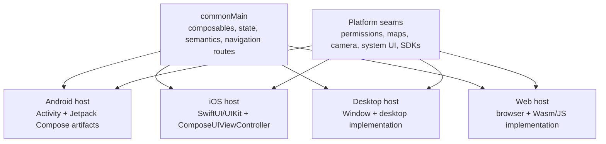
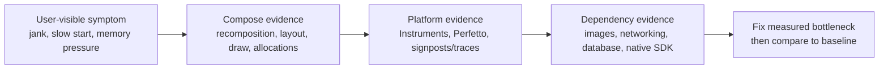

# Compose Multiplatform

> Compose Multiplatform lets a Kotlin Multiplatform project share Compose UI across Android, iOS, desktop, and web. It does not make every platform identical: the reusable programming model sits above different hosts, rendering paths, input systems, accessibility services, and native SDKs. A Staff engineer decides which UI surfaces to share, defines the platform seams, and validates the result on representative devices instead of assuming that code reuse guarantees product parity.

---

## Current Baseline

As of Compose Multiplatform 1.11.1:

- Android and iOS are supported from Android 5.0 (API 21) and iOS 14 respectively.
- Compose Multiplatform uses Jetpack Compose artifacts published by Google on Android and JetBrains-maintained implementations for other targets.
- The current line uses the K2 compiler and requires the Compose Compiler Gradle plugin to match the Kotlin plugin version.
- iOS support is stable. Web support has a different maturity and compatibility envelope, so do not infer web readiness from mobile readiness.
- Navigation, Lifecycle, ViewModel, resources, accessibility, and UI testing have multiplatform implementations, but some Android APIs remain Android-only.

Treat these as versioned facts. Pin the Kotlin, Compose Multiplatform, Android Gradle Plugin, Gradle, Xcode, and library versions validated by CI rather than copying the newest coordinates into a production branch without a compatibility check.

### What Is Actually Shared?



Compose Multiplatform shares the Compose compiler/runtime model and a large API surface. It does not turn a `Button` into `UIButton` on iOS or make Android-only libraries portable. On iOS, Compose is hosted by a `UIViewController`; UIKit or SwiftUI can surround that controller, and native views/controllers can also be embedded inside Compose.

---

## 1. Choose the UI-Sharing Boundary Deliberately

The decision is not limited to “all shared” versus “all native.” A product can share at several levels:

| Boundary | Good fit | Main cost |
|---|---|---|
| Domain/data only | Platform teams require fully native UI and release autonomy | UI behavior and presentation logic are duplicated |
| State holders plus native UI | Business behavior should match while SwiftUI and Compose own presentation | Two UI implementations and platform adapters remain |
| Selected shared screens | Flows such as onboarding, checkout, or internal tools benefit from reuse | Navigation, theming, analytics, and lifecycle seams need explicit ownership |
| Mostly shared UI | Products intentionally use one design system across platforms | Native-only experiences and OS changes require escape hatches |

Evaluate the boundary with evidence from representative screens:

1. Build one simple screen, one long list, one text-heavy form, and one native-SDK screen.
2. Test VoiceOver/TalkBack, keyboard and focus behavior, Dynamic Type/font scaling, reduced motion, dark mode, localization, restoration, and deep links.
3. Measure startup, frame timing, memory, binary/download impact, and build time on the oldest supported devices.
4. Record which platform owns navigation chrome, modals, system integrations, and analytics.
5. Define an exit strategy: a shared screen must be replaceable without rewriting the domain layer.

Do not publish universal size, memory, or FPS numbers. Those depend on architecture, compiler/linker settings, resources, dependencies, device, and workload. Capture a baseline from your own release-like build and enforce a regression budget.

---

## 2. Keep Platform Hosts and Escape Hatches Explicit

### Host Compose in SwiftUI

Expose a small Kotlin entry point that returns a `UIViewController`:

```kotlin
// iosMain/kotlin/Main.ios.kt
fun CheckoutViewController(
    orderId: String,
): UIViewController = ComposeUIViewController {
    CheckoutRoute(orderId = orderId)
}
```

Wrap it with `UIViewControllerRepresentable` in SwiftUI:

```swift
import Shared
import SwiftUI

struct ComposeCheckoutView: UIViewControllerRepresentable {
    let orderId: String

    func makeUIViewController(context: Context) -> UIViewController {
        Main_iosKt.CheckoutViewController(
            orderId: orderId
        )
    }

    func updateUIViewController(
        _ controller: UIViewController,
        context: Context
    ) {}
}
```

The generated Swift symbol depends on the Kotlin file/framework names. Keep the exported entry point small and stable; avoid making Swift construct a Kotlin object graph or reach into internal navigation state.

### Host UIKit Inside Compose

Use `UIKitView` for a native view such as `MKMapView`:

```kotlin
@OptIn(ExperimentalForeignApi::class)
@Composable
fun IosMap(
    latitude: Double,
    longitude: Double,
    modifier: Modifier = Modifier,
) {
    UIKitView(
        factory = { MKMapView() },
        modifier = modifier,
        update = { map ->
            map.setCenterCoordinate(
                CLLocationCoordinate2DMake(latitude, longitude),
                animated = false,
            )
        },
    )
}
```

For SwiftUI content inside Compose, Swift must wrap the view in `UIHostingController`; Kotlin receives a controller factory and hosts it with `UIKitViewController`. This keeps SwiftUI types on the Swift side of the interop boundary.

### Interop Ownership Rules

- Create native views/controllers in `factory`; apply changing state in `update`.
- Remember delegates and callbacks whose identity must survive recomposition.
- Dispose native resources and observers with the interop/lifecycle hook appropriate to the API.
- Treat camera sessions, players, maps, and web views as lifecycle owners, not passive pixels.
- Test touch arbitration when native views sit inside Compose scrolling containers.
- Keep permissions and `Info.plist`/manifest requirements in platform code.

---

## 3. Navigation: One Stack Owner per Surface

The multiplatform AndroidX Navigation implementation is no longer an experimental curiosity. It supports type-safe routes, deep links, back stacks, transitions, and platform back gestures. In `commonMain`, define serializable routes and pass only stable identifiers:

```kotlin
@Serializable
data object Home

@Serializable
data class Product(val id: String)

@Composable
fun AppNavigation() {
    val navController = rememberNavController()

    NavHost(
        navController = navController,
        startDestination = Home,
    ) {
        composable<Home> {
            HomeScreen(
                onProductClick = { id ->
                    navController.navigate(Product(id))
                },
            )
        }

        composable<Product> { entry ->
            val route = entry.toRoute<Product>()
            ProductScreen(
                productId = route.id,
                onBack = { navController.popBackStack() },
            )
        }
    }
}
```

Do not pass repositories, view models, images, or mutable domain objects as route arguments. Store complex state in the data layer and navigate with the minimum identifier needed to restore it.

### Shared Navigation vs Native Navigation

Choose one owner for each visible stack:

- **Shared stack:** a `NavHost` owns a run of shared screens. The platform host treats it as one surface and translates external deep links into typed routes.
- **Native stack:** SwiftUI `NavigationStack`/UIKit owns product navigation. Each shared screen is a hosted controller and reports semantic events such as `onCheckoutFinished` to the native coordinator.
- **Segmented hybrid:** native navigation owns top-level or system-styled transitions; an embedded shared flow owns only its internal stack.

Avoid maintaining mirrored SwiftUI and Compose stacks for the same surface. Two sources of truth create duplicate pushes, broken restoration, and inconsistent back behavior.

On iOS, multiplatform Navigation enables a back gesture by default and provides a native-like transition. Custom `NavHost` transitions replace that default animation. If the product requires system-rendered navigation effects or exact native chrome, let SwiftUI/UIKit own that navigation layer and keep Compose as screen content.

---

## 4. Accessibility and Platform Behavior Are Release Gates

Compose semantics are mapped to native objects/properties consumed by iOS Accessibility Services. Material-based interfaces generally obtain the mapping automatically, and `testTag` can map to `accessibilityIdentifier` for XCTest. This is a bridge to native accessibility—not evidence that the visual tree consists of UIKit widgets.

Every shared screen still needs product-level validation:

- meaningful roles, labels, state descriptions, headings, traversal order, and touch targets;
- VoiceOver, Switch Control/AssistiveTouch, Full Keyboard Access, and TalkBack;
- Dynamic Type/font scaling, clipping, large content sizes, contrast, and reduced motion;
- focus movement across Compose/native interop boundaries;
- native accessibility audits and task-based testing with assistive-technology users.

Material3 `ColorScheme` does not automatically provide an iOS high-contrast palette. Detect the platform setting and supply verified contrast colors when that requirement applies.

For debugging or XCTest setup, the iOS controller can force accessibility-tree synchronization, but always-on synchronization has a performance cost and should not be enabled blindly in production:

```kotlin
@OptIn(ExperimentalComposeApi::class)
ComposeUIViewController(
    configure = {
        accessibilitySyncOptions = AccessibilitySyncOptions.Always(
            debugLogger = null,
        )
    },
) {
    App()
}
```

---

## 5. Text, Input, Insets, and Native Feel

Avoid old blanket claims that Compose scrolling, selection, keyboard handling, or back gestures must be reimplemented by every app. Current Compose Multiplatform includes iOS-specific scroll behavior, accessibility mapping, window insets, navigation gestures, and text-editing integration.

The remaining rule is empirical: validate the interactions your product depends on. Compose Multiplatform 1.11 introduced an **experimental** native iOS text-input implementation backed by `UIView`; the stable cross-platform input remains the default choice. Opt in only after testing selection, caret movement, autofill/password flows, IME behavior, privacy requirements, and fallback behavior.

Insets belong to the surface owner. A shared full-screen surface can consume `WindowInsets.systemBars`; an embedded surface should agree with its SwiftUI/UIKit parent about which layer applies safe-area and keyboard padding. Double application is as harmful as omission.

---

## 6. Performance and Operability

Compose Multiplatform 1.11 enables concurrent iOS rendering by default, but no framework release removes the need to profile real workloads.

### Diagnose in Layers



For a slow image list, investigate at least:

- whether item keys and content types are stable;
- image decode size, caching, prefetching, and placeholder behavior;
- expensive work or unstable state causing avoidable recomposition;
- measure/layout/draw complexity and overdraw;
- allocations, garbage collection, Kotlin/Native work, and native memory;
- main-thread I/O or native SDK callbacks;
- release build settings and device thermal state.

Use Android system traces/Compose tooling on Android and Xcode Instruments plus signposts on iOS. Compare p50/p95 startup and frame metrics, peak memory, package/download size, and build duration against the native or pre-migration baseline. A single simulator FPS observation is not an acceptance test.

---

## 7. Production Adoption Checklist

- [ ] Pin a supported Kotlin/Compose/toolchain matrix and test upgrades in a canary branch.
- [ ] Inventory Android-only Compose APIs and third-party libraries before moving code to `commonMain`.
- [ ] Decide the shared UI boundary per journey, not per repository slogan.
- [ ] Define one navigation owner per surface and test restoration/deep links on both platforms.
- [ ] Provide explicit native escape hatches for platform SDKs and system-rendered experiences.
- [ ] Run accessibility checks with native tooling and representative users.
- [ ] Establish release-build baselines for startup, frames, memory, size, and build time.
- [ ] Exercise the oldest supported Android/iOS devices and high-refresh-rate devices.
- [ ] Test localization, large fonts, keyboard/IME, orientation, dark mode, and reduced motion.
- [ ] Keep callbacks and exported Swift APIs small, lifecycle-aware, and cancellation-safe.

---

## Common Failure Modes

### Assuming API parity means behavior parity

The same composable may use different fonts, input systems, native services, and platform implementations. Share intent and design tokens, then verify output per target.

### Treating interop views as ordinary leaves

Maps, cameras, players, and web views own resources and gestures. Without lifecycle and touch-policy design they leak, keep hardware active, or fight their parent scroller.

### Letting both native and shared code own navigation

Mirrored stacks make back, deep links, analytics, and restoration nondeterministic. Define a coordinator contract and a single owner for each stack segment.

### Shipping benchmark folklore

Fixed claims such as “Compose adds 15 MB” or “uses 30 MB” are not portable facts. Store measurements with device, build mode, compiler/linker settings, dependency set, and comparison baseline.

### Declaring accessibility complete because semantics exist

Automatic mapping is the foundation. Real completion requires correct semantics, focus order, contrast, scaling, platform audits, and task success.

---

## Probing Questions

1. **Architecture:** What does Compose Multiplatform share, and which responsibilities still belong to each platform host?
2. **Accessibility:** How does VoiceOver interact with Compose UI on iOS, and what must a team still test manually?
3. **Performance:** A shared image list is janky on iOS but smooth on Android. How would you isolate the bottleneck without relying on framework folklore?
4. **Hybrid navigation:** How would you combine 15 shared product screens with five platform-intensive screens while keeping back navigation and restoration deterministic?
5. **Adoption:** Product has a strict download-size and startup budget. What evidence is required before approving shared UI?

---

## Answer Key

1. Compose Multiplatform shares the declarative programming model, compiler/runtime behavior, and supported common UI/libraries. Each target still owns its entry point, artifact implementation, native SDK integration, lifecycle edges, packaging, system configuration, accessibility validation, and release measurements. On Android the build uses Google's Jetpack Compose artifacts; on iOS Compose is hosted in a `UIViewController` and can interoperate with UIKit/SwiftUI.
2. Compose semantics are mapped to native accessibility objects and properties, allowing VoiceOver and XCTest to discover the shared UI. The team must still verify labels, roles, state, traversal/focus order, touch targets, text scaling, contrast, reduced motion, keyboard/assistive input, interop boundaries, and real task completion. Automatic mapping does not repair missing or incorrect semantics.
3. Reproduce on a release-like build and representative device; capture Xcode Instruments/signpost evidence; inspect main/render-thread work, image decode/cache behavior, allocations, Kotlin/Native and native SDK work, recomposition, layout/draw cost, I/O, and thermal state. Change one suspected bottleneck, then compare frame/startup/memory metrics to the recorded baseline. Android smoothness narrows the investigation but does not prove the shared code is innocent.
4. Give the native coordinator ownership of the top-level product stack when camera/AR/NFC screens need native presentation. Host shared screens with `ComposeUIViewController`; let a shared `NavHost` own only a bounded internal flow if needed; communicate with typed events such as `onFinished`; translate deep links once at the owner; and persist one canonical route/back-stack state rather than mirroring SwiftUI and Compose stacks.
5. Measure the same representative app and journeys before and after enabling shared UI using release compiler/linker settings. Record installed/download size, startup distributions, frame timing, peak memory, build time, and oldest-device behavior; attribute resources and dependencies; set regression thresholds; and retain native-screen or domain-only alternatives. Generic internet size numbers are not approval evidence.

---

## Official Sources and Further Reading

- [Compose Multiplatform compatibility and supported platforms](https://kotlinlang.org/docs/multiplatform/compose-compatibility-and-versioning.html)
- [Relationship between Compose Multiplatform and Jetpack Compose](https://kotlinlang.org/docs/multiplatform/compose-multiplatform-and-jetpack-compose.html)
- [Navigation in Compose Multiplatform](https://kotlinlang.org/docs/multiplatform/compose-navigation.html)
- [Compose and SwiftUI integration](https://kotlinlang.org/docs/multiplatform/compose-swiftui-integration.html)
- [Compose and UIKit integration](https://kotlinlang.org/docs/multiplatform/compose-uikit-integration.html)
- [iOS accessibility support](https://kotlinlang.org/docs/multiplatform/compose-ios-accessibility.html)
- [Android-only Compose components](https://kotlinlang.org/docs/multiplatform/compose-android-only-components.html)
- [Compose Multiplatform 1.11.0 release](https://blog.jetbrains.com/kotlin/2026/05/compose-multiplatform-1-11-0/)
- [`resource-sharing.md`](resource-sharing.md) — resource packaging, localization, and platform overrides.
- [`swift-interop.md`](../tooling/swift-interop.md) — exported Kotlin APIs and Swift-facing boundaries.
- [`../../compose/compose-runtime.md`](../../compose/compose-runtime.md) — runtime and compiler mental model.
- [`../../performance/rendering.md`](../../performance/rendering.md) — Android rendering and measurement fundamentals.
