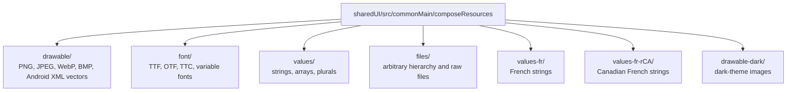
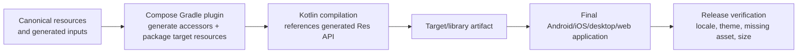

# Resource Sharing in KMP

> Resource sharing is a build-and-ownership decision, not merely an asset-copying convenience. Compose Multiplatform Resources gives Kotlin code generated, type-safe access to strings, images, fonts, and raw files across supported targets. Native SwiftUI/UIKit code does not automatically gain an idiomatic Apple resource API, and design tokens such as colors are not Compose resource values. A Staff engineer chooses one canonical source, generates the required target representations, and verifies the final application packages rather than coupling product code to undocumented bundle paths.

---

## Current Baseline

Compose Multiplatform 1.11.1 includes the `compose-multiplatform-resources` library and Gradle-plugin support. The important boundaries are:

- resources can live in `commonMain`, a target/intermediate source set, or a configured custom directory;
- generated accessors are `internal` by default and are regenerated by a build or IDE import;
- publication support introduced in 1.6.10 requires Kotlin 2.0.0+ and Gradle 7.6+;
- most native/desktop resource reads happen synchronously, while raw files and web resources use asynchronous paths;
- files under `files/` are not qualifier-aware;
- Compose Resources does not define color/design-token value resources.

Pin the Compose, Kotlin, Gradle, Android Gradle Plugin, and Xcode versions exercised by CI. Resource packaging is part of the delivered application, so a library compilation alone is not a release test.

### Choose the Runtime Owner

| Product UI | Recommended resource boundary | Why |
|---|---|---|
| Shared Compose UI | Compose Resources for shared strings, drawables, fonts, and files | Generated Kotlin accessors and common qualifier resolution match the UI owner |
| Native SwiftUI + Android Compose | Canonical translation/token source that generates Apple catalogs and Android/Compose inputs | Each platform keeps idiomatic localization, previews, and tooling |
| Selected shared screens | Compose Resources inside the shared surface; platform catalogs outside it | Avoids forcing the whole native app through a Kotlin resource wrapper |
| Published KMP UI library | Public, namespaced `Res` API plus publication verification | Consumers need stable accessors and packaged resources |

Compose Resources can be called from non-composable Kotlin code, but that does not make its generated types an ideal public Swift API. Do not select it solely to eliminate every native catalog.

---

## 1. Configure a Resource-Producing Module

Add the resource library to the source set that owns the resource API:

```kotlin
kotlin {
    sourceSets {
        commonMain.dependencies {
            implementation(compose.components.resources)
        }
    }
}
```

Use the default directory when possible:



The Gradle plugin generates a `Res` class and top-level accessors. Configure the API intentionally for a library:

```kotlin
compose.resources {
    publicResClass = true
    packageOfResClass = "com.example.design.resources"
    generateResClass = always
}
```

- Keep `publicResClass = false` for an application-internal module.
- Make it public only when another module or published consumer must reference it.
- Namespace the class to avoid generated-package collisions.
- Use unconditional generation only when the resource dependency is transitive and automatic generation would otherwise be skipped.

Custom directories are supported through `customDirectory(sourceSetName, directoryProvider)`. This is the supported seam for assets generated by a Gradle task; do not write generated files into source-controlled directories during every build.

---

## 2. Know the Supported Resource Types

| Type | Supported input | Kotlin access |
|---|---|---|
| Drawable | PNG, JPEG, BMP, WebP; Android XML vector without external Android resource references | `painterResource`, `imageResource`, `vectorResource` |
| Font | TTF, OTF, TTC, and variable fonts on all targets; WOFF/WOFF2 only where documented | `Font(Res.font.*)` |
| String | strings, numbered templates, arrays, plurals in XML | `stringResource`, `stringArrayResource`, `pluralStringResource`; suspend getters outside composition |
| Raw file | any file under `files/` | `Res.readBytes(path)` or `Res.getUri(path)` where a system API should consume the file |

### SVG Is Target-Dependent

Raw SVG drawables are supported on non-Android targets, not Android. Therefore, an SVG in a shared drawable set is not a portable choice when the module targets Android. For Android+iOS shared UI, prefer a supported Android XML vector without theme/resource references or a raster asset. On non-Android targets, an SVG stored as a raw file can also be decoded to a painter using the documented API.

Do not claim that an Android XML vector invokes a particular Skia method or is parsed at a specific packaging stage unless the release contract documents it. The public contract is the resource type and returned `Painter`/`ImageVector`, not an internal renderer implementation.

### Colors and Design Tokens

The `values` directory supports string resources, arrays, and plurals—not Android-style color resources. For shared Compose UI, define semantic colors and typography tokens in Kotlin. For a hybrid native/shared product, generate Kotlin and Swift representations from a neutral, versioned token source instead of exporting packed ARGB integers through Kotlin/Native.

Keep semantic names such as `surface`, `onSurface`, and `criticalAction`; avoid leaking palette coordinates such as `blue500` into product code. Validate contrast and platform appearance after generation.

---

## 3. Use Generated Accessors in Compose

Default and localized string files use XML:

```xml
<!-- commonMain/composeResources/values/strings.xml -->
<resources>
    <string name="app_name">Shop</string>
    <string name="welcome_message">Welcome, %1$s!</string>
    <plurals name="items_selected">
        <item quantity="one">%1$d item selected</item>
        <item quantity="other">%1$d items selected</item>
    </plurals>
</resources>
```

```xml
<!-- commonMain/composeResources/values-fr/strings.xml -->
<resources>
    <string name="app_name">Boutique</string>
    <string name="welcome_message">Bienvenue, %1$s !</string>
    <plurals name="items_selected">
        <item quantity="one">%1$d article sélectionné</item>
        <item quantity="other">%1$d articles sélectionnés</item>
    </plurals>
</resources>
```

Use numbered placeholders so translators can reorder arguments. Pass the quantity once for plural selection and again when the formatted text includes it:

```kotlin
import com.example.design.resources.Res
import com.example.design.resources.app_name
import com.example.design.resources.inter_semibold
import com.example.design.resources.items_selected
import com.example.design.resources.logo
import com.example.design.resources.welcome_message
import org.jetbrains.compose.resources.Font
import org.jetbrains.compose.resources.painterResource
import org.jetbrains.compose.resources.pluralStringResource
import org.jetbrains.compose.resources.stringResource

@Composable
fun Header(userName: String, selectedCount: Int) {
    val headingFont = FontFamily(Font(Res.font.inter_semibold))

    Column {
        Image(
            painter = painterResource(Res.drawable.logo),
            contentDescription = stringResource(Res.string.app_name),
        )
        Text(
            text = stringResource(Res.string.welcome_message, userName),
            fontFamily = headingFont,
        )
        Text(
            pluralStringResource(
                resource = Res.plurals.items_selected,
                quantity = selectedCount,
                selectedCount,
            ),
        )
    }
}
```

Resource names become generated identifiers, so renames are source changes. Keep access behind a design-system component when callers should not depend on the physical asset name.

---

## 4. Qualifiers and Localization

All resource types except raw `files/` support qualifiers. Compose Resources recognizes language, theme, and density qualifiers, and they can be combined. Examples include:

- `values-fr/` for French strings;
- `values-fr-rCA/` for a Canadian French variant;
- `drawable-dark/` for dark-theme imagery;
- `drawable-en-rUS-dark-mdpi/` for a combined qualified drawable.

Language and region codes are case-sensitive; the region uses a lowercase `r` prefix. Always provide an unqualified default resource. When a requested qualified resource is unavailable, the documented safety net is the default resource.

Do not encode currency, date, number, or measurement formatting into translated string concatenation. Locale-specific text selection and regional formatting are separate responsibilities; use the platform/Kotlin locale APIs appropriate to the target.

### In-App Language Selection

Changing an application's language is platform-specific. The official Compose guidance uses an `expect`/`actual` resource-environment boundary because Android, Apple, desktop, and web expose different locale mechanisms. Treat language choice as application state, recreate or re-key the relevant composition when required, and verify platform persistence and restoration.

### Translation Quality Gates

A useful pipeline performs both structural and runtime checks:

1. Parse every locale file and compare keys with the default catalog.
2. Validate placeholder indexes/types and plural categories per language.
3. Reject duplicate keys, malformed XML, and untranslated sentinel text.
4. Render representative screens under long text, RTL, large fonts, and locale-specific formats.
5. Run platform UI tests with the locale configured before app launch.

A `commonTest` that merely calls `getString()` without controlling the resource environment does not prove that a particular locale was loaded.

---

## 5. Outside Composition and Native UI

Compose Resources exposes suspend functions such as `getString`, `getStringArray`, `getPluralString`, and `Res.readBytes` for non-composable Kotlin code. Keep localization at the presentation boundary:

```kotlin
sealed interface CheckoutFailure {
    data object NetworkUnavailable : CheckoutFailure
    data class PaymentRejected(val code: String) : CheckoutFailure
}

suspend fun CheckoutFailure.message(): String = when (this) {
    CheckoutFailure.NetworkUnavailable ->
        getString(Res.string.error_network)
    is CheckoutFailure.PaymentRejected ->
        getString(Res.string.error_payment_rejected, code)
}
```

The domain type remains stable and testable; the UI resolves it under the current locale.

### Do Not Hide Suspension with `runBlocking`

Blocking the iOS or Android main thread to make a suspend resource API appear synchronous is not a supported design shortcut. It can stall rendering and makes latency assumptions part of the API. Prefer one of these boundaries:

- resolve strings in a Kotlin state holder and expose already-resolved presentation state;
- expose an asynchronous/cancellable Swift-facing API using the project's chosen interop mechanism;
- let native SwiftUI/UIKit use Apple String Catalogs generated from the same canonical translation source.

For a predominantly native iOS UI, the last option usually preserves better platform tooling, preview support, and OS localization behavior than exporting the generated `Res` graph to Swift.

---

## 6. Packaging, Publication, and Raw Files



Do not couple application code or interview answers to an internal `.xcframework` subpath. The plugin owns target packaging and generated lookup. What the team must verify is observable behavior:

- the final application contains and can load each required resource;
- direct, CocoaPods, or remote XCFramework integration preserves resources for the chosen distribution path;
- a published KMP library exposes the intended `Res` API and includes its resources;
- shrinkers, packaging filters, and asset pipelines do not remove required files;
- app size changes are measured from comparable release artifacts.

Large media files are a poor fit for `Res.readBytes()` because the resource API does not provide streaming for large raw files. Use `Res.getUri()` to hand a packaged file to an appropriate system/library API, or use a dedicated media/download pipeline.

On web, resource loading differs: `painterResource()` may initially return an empty painter and update after loading. Use the documented preload APIs for resources that must be ready before first meaningful paint, and test caching/CDN path configuration in the deployed environment.

---

## 7. Design-to-Code Pipeline

Automate from a versioned contract, not directly from a designer's mutable canvas:

1. Export approved icons/tokens/translations to a reviewed schema or asset package.
2. Validate names, licenses, dimensions, supported vector features, and duplicate content.
3. Generate target-compatible XML vectors/raster assets, Kotlin tokens, and Apple catalog inputs as required.
4. Write generated Compose inputs through a cacheable Gradle task and `customDirectory()`.
5. Produce a manifest/checksum so reviews can distinguish intended design changes from generator churn.
6. Run visual regression, accessibility, localization, and package-size checks before publication.

Do not silently convert complex SVG filters, masks, text, gradients, or animations into a supposedly equivalent XML vector. Fail the pipeline or deliberately rasterize with documented density/quality rules.

---

## Common Failure Modes

### Treating Compose Resources as a universal native catalog

The generated API is Kotlin-oriented and internal by default. Native UI may be better served by generated platform catalogs from the same source.

### Blocking the main thread for strings

`runBlocking` turns a suspend boundary into UI-thread risk and hides cancellation. Resolve asynchronously or keep localization native to the UI owner.

### Assuming every SVG is portable

SVG drawable support excludes Android, and complex SVG features may not map to Android XML vectors. Choose a cross-target format and validate conversion.

### Testing only the default locale

Key parity does not prove placeholder, plural, layout, RTL, or locale-selection correctness. Combine structural checks with platform runs.

### Depending on internal package paths or cache behavior

Those are implementation details. Depend on generated APIs and verify final artifacts under every supported integration method.

### Publishing invented performance numbers

Resource count alone does not determine incremental build time, first render, memory, or package size. Measure the actual module, generator, build mode, device, and artifact.

---

## Probing Questions

1. **Boundary choice:** When should a hybrid SwiftUI/Compose product generate native Apple catalogs instead of making Swift call Compose Resources?
2. **Formats:** Which drawable formats are portable to an Android+iOS shared module, and why is a raw SVG not a universal answer?
3. **Qualifiers:** What guarantees safe behavior when a locale/theme/density-specific resource is absent, and what must CI validate beyond fallback?
4. **API design:** Why is a `runBlocking { getString(...) }` Swift wrapper unsafe, and what alternatives preserve lifecycle and cancellation?
5. **Distribution:** What should a team verify when publishing a resource-owning KMP library or XCFramework without relying on undocumented paths?
6. **Pipeline:** How would you build a deterministic design-to-code resource pipeline that supports both shared Compose and native UI?

---

## Answer Key

1. Generate Apple catalogs when native SwiftUI/UIKit owns substantial presentation and needs Xcode previews, String Catalog workflows, OS localization behavior, and idiomatic synchronous lookup. Use Compose Resources inside shared Compose surfaces. Both outputs can come from one reviewed translation/token source, avoiding runtime Kotlin wrappers without duplicating ownership.
2. Raster formats documented by Compose Resources and Android XML vectors without external Android resource references work across Android and iOS. SVG drawables are supported only on non-Android targets, so a shared mobile module that includes Android cannot treat raw SVG as portable. Complex SVG features may also fail conversion; validate or deliberately rasterize them.
3. Every qualified resource needs an unqualified default; when the requested qualified resource is inaccessible, Compose Resources can use the default. CI must additionally check key parity, placeholder indexes/types, plural categories, qualifier spelling/case, layout under long and RTL text, target locale selection, and final package contents.
4. `runBlocking` stalls the calling thread, hides cancellation, and bakes an unverified latency assumption into the Swift API. Resolve localized presentation state in Kotlin asynchronously, export a cancellable async boundary supported by the interop stack, or let native UI load a generated platform catalog.
5. Verify the public/namespaced generated API, resource inclusion in the published artifact and final app, each chosen iOS integration path, runtime lookup across locales/themes, missing-resource failure behavior, and comparable release-artifact size. The plugin's internal folder layout and caching are not contracts.
6. Start from a versioned schema/package; validate names, rights, dimensions, placeholders, and supported vector features; generate Compose inputs, Kotlin tokens, and Apple catalogs with cacheable tasks; connect generated resource directories through supported Gradle configuration; emit manifests/checksums; and gate with visual, localization, accessibility, and package tests.

---

## Official Sources and Further Reading

- [Compose Multiplatform resources overview](https://kotlinlang.org/docs/multiplatform/compose-multiplatform-resources.html)
- [Resource setup, qualifiers, custom directories, and publication](https://kotlinlang.org/docs/multiplatform/compose-multiplatform-resources-setup.html)
- [Generated accessors and supported resource APIs](https://kotlinlang.org/docs/multiplatform/compose-multiplatform-resources-usage.html)
- [Manage the local resource environment](https://kotlinlang.org/docs/multiplatform/compose-resource-environment.html)
- [Localizing strings](https://kotlinlang.org/docs/multiplatform/compose-localize-strings.html)
- [Handling web resources](https://kotlinlang.org/docs/multiplatform/compose-web-resources.html)
- [`compose-multiplatform.md`](compose-multiplatform.md) — choosing the shared UI boundary and native interop.
- [`../tooling/ios-distribution.md`](../tooling/ios-distribution.md) — iOS framework integration and distribution.
- [`../tooling/build-system-and-source-sets.md`](../tooling/build-system-and-source-sets.md) — source-set and Gradle ownership.
- [`../../../mobile-system-design/localization-and-internationalization.md`](../../../mobile-system-design/localization-and-internationalization.md) — localization governance beyond resource files.
