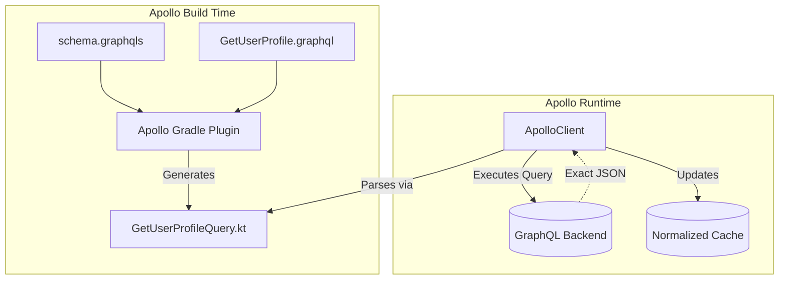

# GraphQL (Apollo)

## Overview

GraphQL is a query language for APIs developed by Facebook. Unlike REST, where the server dictates exactly what data is returned for a given endpoint, GraphQL allows the *client* (the Android app) to specify exactly what fields it needs, and nothing more.

In the Android ecosystem, the absolute standard for GraphQL is the **Apollo Kotlin** client. A Staff Engineer must understand the massive architectural shift GraphQL brings: it completely eliminates the need for manual JSON parsing and Data Class definitions, as Apollo generates perfectly typed Kotlin code directly from the server's schema.

## Why It Matters

REST APIs are historically plagued by two massive problems on mobile devices:
1.  **Over-fetching:** You hit `/users/123` just to get the user's name, but the server returns a 5MB JSON payload containing their entire post history, bio, and settings. This wastes battery, CPU parsing time, and the user's mobile data quota.
2.  **Under-fetching (The N+1 Problem):** You hit `/users/123` to get the user, then you have to make 5 separate REST calls to `/users/123/posts/` to get their recent posts.

GraphQL solves both. You send a single query explicitly asking for the `name` and the `first 5 posts`. The server executes the joins and returns a tiny, exact JSON payload in a single network round-trip.

## Historical Context

In the mid-2010s, as mobile apps became incredibly complex (like the Facebook app Newsfeed), the Backend-For-Frontend (BFF) pattern emerged. Companies built entirely separate Backend servers just to format REST JSON specifically for the iOS and Android apps to prevent over-fetching. 

GraphQL was invented to eliminate the need for BFFs. The backend exposes a single "Graph" of all data in the company. The client writes a query to traverse that graph.

Apollo Kotlin (formerly Apollo Android) was built to act as the bridge. It integrates heavily with Kotlin Coroutines and Kotlin Multiplatform (KMP), making it one of the most advanced networking libraries available.

## First Principles

1.  **The Schema (`schema.graphqls`):** The server's contract. It defines every possible Type, Query, and Mutation available.
2.  **The Query (`.graphql` file):** Written by the Android developer. It specifies exactly what subset of the Schema the app wants to fetch.
3.  **Code Generation:** Apollo reads your `.graphql` query, checks it against the `schema`, and generates a strongly-typed Kotlin Data Class specifically for that query.
4.  **Normalized Cache:** Apollo's superpower. It breaks down the nested JSON responses into flat objects stored by ID in a local SQLite database, allowing multiple screens to instantly reflect updates to a single object.

## Mental Model

Think of REST as ordering a **Pre-Set Meal** at a restaurant.
- You order "Meal 3" (Hitting an endpoint). 
- You get a burger, fries, and a drink. Even if you only wanted the burger, you get the whole tray and throw the rest away (Over-fetching).

Think of GraphQL as a **Buffet with a Personal Shopper**.
- You hand the shopper a highly specific list: "I want one burger patty, no bun, and exactly 3 french fries." (The Query).
- The shopper (the GraphQL Server) runs around the kitchen, assembles exactly what you asked for, and brings it back on one tiny plate.

## Internal Mechanics

### 1. The Code Generation
Unlike Retrofit where you write the Kotlin Data Classes manually, with Apollo, you write GraphQL syntax:

```graphql
// GetUserProfile.graphql
query GetUserProfile($id: ID!) {
  user(id: $id) {
    name
    avatarUrl
  }
}
```

During the Gradle build, Apollo generates a Kotlin class:
```kotlin
// GENERATED CODE - DO NOT EDIT
class GetUserProfileQuery(val id: String) : Query<GetUserProfileQuery.Data> {
    data class Data(val user: User?)
    data class User(val name: String, val avatarUrl: String)
}
```
If the backend changes `avatarUrl` to `profileImageUrl` in the schema, your Android project will **fail to compile**. This provides absolute safety against runtime JSON parsing errors.

### 2. Executing the Query
```kotlin
// In your Repository
val apolloClient = ApolloClient.Builder()
    .serverUrl("https://api.example.com/graphql")
    .build()

suspend fun fetchUser(id: String) {
    val response = apolloClient.query(GetUserProfileQuery(id)).execute()
    
    // It is fully type-safe!
    val name = response.data?.user?.name 
}
```

## Architecture



## Production Example

**The Normalized Cache (Offline First)**

The true power of Apollo lies in its `apollo-normalized-cache-sqlite` module.

If Screen A fetches a User, and Screen B executes a "RenameUser" mutation, how does Screen A know to update?

In REST, you'd use an `EventBus` or rely on `Room` triggers. In Apollo, the Normalized Cache handles this instantly.

```kotlin
// 1. Setup the Cache
val sqlNormalizedCacheFactory = SqlNormalizedCacheFactory(context, "apollo.db")

val apolloClient = ApolloClient.Builder()
    .serverUrl("https://api.example.com/graphql")
    .normalizedCache(sqlNormalizedCacheFactory)
    .build()

// 2. Observe the Data Reactively
fun observeUser(id: String): Flow<GetUserProfileQuery.Data> {
    // watch() turns a one-off query into an infinite Flow!
    return apolloClient.query(GetUserProfileQuery(id))
        .fetchPolicy(FetchPolicy.CacheAndNetwork) // Read DB first, then hit Network
        .watch()
}
```
If *any* mutation anywhere in the app updates the `name` field for this specific User ID, the Normalized Cache instantly detects it and re-emits the Flow, updating the UI.

## Tradeoffs

**GraphQL vs REST**

- **GraphQL (Apollo):**
    - *Pros:* Zero over-fetching. Zero manual JSON parsing. Compile-time schema validation. Phenomenal caching via Normalized Cache.
    - *Cons:* Heavy caching complexity (requires understanding object IDs). HTTP Caching (like ETags) is broken because all requests are POSTs. Harder to handle massive file uploads (Multipart). The Apollo Gradle plugin can slow down build times.
- **REST (Retrofit):**
    - *Pros:* Simple. The absolute industry standard. Excellent support for HTTP-level caching. Easy to debug via Charles/Proxyman.
    - *Cons:* N+1 query problem. Over-fetching. Prone to `NullPointerException` if the backend silently changes a field name.

## Failure Modes

- **The Cache ID Nightmare:**
  The Normalized Cache only works if it knows how to identify an object. By default, it expects every object in the Graph to have a globally unique `id` field.
  If the Backend returns a `UserSettings` object that doesn't have an `id`, Apollo cannot normalize it properly. It will store it alongside the parent object. If you update the settings, the UI won't react.
  *(Fix: You must implement a `CacheKeyGenerator` in Apollo to tell the cache how to uniquely identify objects that don't have standard "id" fields).*
- **Massive Payload Parsing:**
  GraphQL makes it very easy for a Junior developer to write a query that joins 10 deep tables. 
  ```graphql
  query { users { posts { comments { author { friends } } } } }
  ```
  While the Backend might manage to assemble this, the resulting JSON might be 20MB. When Apollo tries to parse this into Kotlin objects on the mobile device, it will freeze the UI or trigger an OutOfMemoryError. 
  *(Fix: Enforce query depth limits on the Backend, and enforce strict Pagination (`Paging 3`) on the Android client).*

## Staff Engineer Thinking

When reviewing GraphQL integrations, a Staff engineer focuses on Cache policies and Schema management:

1.  **Schema Syncing:** I verify that the Android team is not manually downloading the `schema.graphqls` file and pasting it into the repository. I enforce a Gradle task (`downloadApolloSchema`) that pulls the schema directly from the Staging server during CI builds. If the Staging server introduces a breaking change, the Android PR fails to compile immediately.
2.  **Fetch Policies:** I heavily review `FetchPolicy` usage. If a developer uses `NetworkOnly` on a query, I push back. GraphQL shines when we use `CacheFirst` or `CacheAndNetwork`. We must strive for offline-first architecture.
3.  **Error Handling:** In REST, a 404 or 500 status code tells you everything. In GraphQL, the HTTP status is almost always 200 OK. Errors are returned inside the JSON payload in an `errors` array. I ensure the team's networking layer actually inspects `response.hasErrors()` and handles partial data failures gracefully.

## Common Misconceptions

- **"GraphQL replaces Retrofit."** Yes, if you use Apollo, you do not use Retrofit. However, Apollo uses `OkHttp` under the hood! All of your OkHttp Interceptors, Authenticators, and connection pools still apply perfectly to Apollo.
- **"GraphQL is faster than REST."** Not inherently. If you fetch the exact same data, the payload size is the same, and the backend DB queries might actually be slower in GraphQL due to complex join resolution. GraphQL is "faster" for the client because it eliminates *unnecessary* data transfer.

## Probing Questions

1.  Explain the "Over-fetching" and "Under-fetching" problems in REST, and exactly how GraphQL solves them.
2.  How does Apollo Kotlin provide compile-time safety that Retrofit/Moshi cannot provide?
3.  Describe the "Normalized Cache" in Apollo. How does it enable reactive UI updates across different screens?
4.  In GraphQL, why is relying on standard HTTP status codes (like 404 or 500) insufficient for error handling?
5.  If a GraphQL query returns an object that does not have an `id` field, how does the Apollo Normalized Cache handle it, and what problem does this create?
6.  Explain the difference between the `CacheFirst` and `CacheAndNetwork` fetch policies.
7.  Why is standard HTTP Caching (using Headers like `ETag` or `Cache-Control`) difficult to implement with GraphQL compared to REST?
8.  How does the Apollo Gradle plugin know how to generate the correct Kotlin Data Classes for your queries?
9.  If you are using Apollo, do you still need to understand and configure `OkHttp`? Why or why not?
10. Describe an architectural scenario where sticking to a legacy REST API via Retrofit would actually be superior to migrating to GraphQL.

## Answer Key

1. **Explain the "Over-fetching" and "Under-fetching" problems in REST, and exactly how GraphQL solves them.**
   Over-fetching pulls excessive unused data; under-fetching requires multiple API calls to get nested data (N+1 problem). GraphQL solves this by allowing the client to define a single, precise query requesting exact fields across related entities in one payload.
2. **How does Apollo Kotlin provide compile-time safety that Retrofit/Moshi cannot provide?**
   Apollo validates the client's `.graphql` query against the backend `schema.graphqls` during the Gradle build, generating strongly-typed Kotlin classes. If a field changes on the server, the app fails to compile immediately.
3. **Describe the "Normalized Cache" in Apollo. How does it enable reactive UI updates across different screens?**
   It flattens nested JSON responses into individual entities mapped by their unique ID in SQLite. If a mutation updates an entity's field, the cache detects the change and automatically emits new data to all active queries (Flows) observing that ID, updating the UI reactively.
4. **In GraphQL, why is relying on standard HTTP status codes (like 404 or 500) insufficient for error handling?**
   GraphQL typically returns an HTTP 200 OK even if the query fails completely or partially. Errors are returned inside the JSON payload within an `errors` array, requiring explicit manual inspection of the response object.
5. **If a GraphQL query returns an object that does not have an `id` field, how does the Apollo Normalized Cache handle it, and what problem does this create?**
   Apollo treats it as a nested object tied to its parent instead of an independent entity. This breaks cache normalization; updating the child won't automatically update other screens observing it unless you define a custom `CacheKeyGenerator`.
6. **Explain the difference between the `CacheFirst` and `CacheAndNetwork` fetch policies.**
   `CacheFirst` reads from the cache and only hits the network if the data is missing. `CacheAndNetwork` reads and emits from the cache immediately for a fast UI, while concurrently hitting the network and emitting a second time when fresh data arrives.
7. **Why is standard HTTP Caching (using Headers like `ETag` or `Cache-Control`) difficult to implement with GraphQL compared to REST?**
   Standard HTTP caching relies on unique URLs and GET requests. GraphQL typically uses a single endpoint (`/graphql`) and sends queries inside POST request bodies, which are generally not cached by CDNs or standard HTTP mechanisms.
8. **How does the Apollo Gradle plugin know how to generate the correct Kotlin Data Classes for your queries?**
   The plugin reads your `schema.graphqls` file and the `.graphql` query files, parses the AST, resolves the requested fields against the schema types, and outputs strict Kotlin Data Classes matching the specific query shape.
9. **If you are using Apollo, do you still need to understand and configure `OkHttp`? Why or why not?**
   Yes. Apollo uses `OkHttp` as its underlying HTTP engine. You must configure OkHttp to handle connection timeouts, interceptors, authenticators, and TLS settings just as you would with Retrofit.
10. **Describe an architectural scenario where sticking to a legacy REST API via Retrofit would actually be superior to migrating to GraphQL.**
    A media-heavy app focused on massive file uploads (Multipart), where strict HTTP-level ETag caching on a CDN is essential, and the backend data models are already perfectly tailored to the UI without over-fetching.

## Further Reading

- [`retrofit-and-okhttp.md`](retrofit-and-okhttp.md) — The REST alternative and the underlying engine (OkHttp).
- [`paging.md`](../data-and-di/paging.md) — How to handle massive data feeds, which integrates cleanly with Apollo.
- [Apollo Kotlin Documentation](https://www.apollographql.com/docs/kotlin/)
