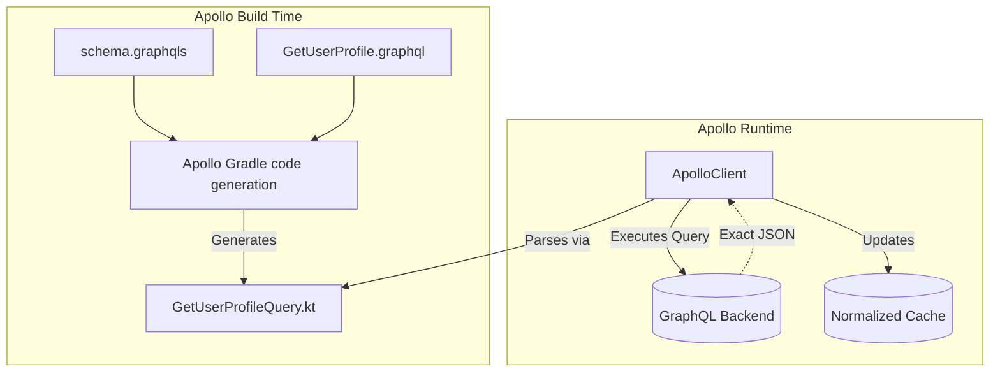

# GraphQL (Apollo)

## Overview

GraphQL is a query language for APIs developed at Facebook. A GraphQL operation selects requested data fields from a server-defined schema; the complete response can also contain errors or extensions, and tooling may add fields needed for execution or caching.

**Apollo Kotlin** is an established GraphQL client for Android and Kotlin Multiplatform. It validates operations against a pinned schema and generates operation-specific Kotlin models, reducing manual wire parsing while leaving schema compatibility, domain mapping, and runtime failure handling as explicit responsibilities.

## Why It Matters

REST APIs are historically plagued by two massive problems on mobile devices:
1.  **Over-fetching:** You hit `/users/123` just to get the user's name, but the server returns a 5MB JSON payload containing their entire post history, bio, and settings. This wastes battery, CPU parsing time, and the user's mobile data quota.
2.  **Under-fetching (The N+1 Problem):** You hit `/users/123` to get the user, then you have to make 5 separate REST calls to `/users/123/posts/` to get their recent posts.

GraphQL can reduce both problems when the schema and resolver design let one bounded operation request the needed fields. It does not guarantee one round trip, a small payload, efficient backend joins, or the removal of a mobile BFF; measure the actual contract and resolver cost.

## Historical Context

In the mid-2010s, as mobile apps became incredibly complex (like the Facebook app Newsfeed), the Backend-For-Frontend (BFF) pattern emerged. Companies built entirely separate Backend servers just to format REST JSON specifically for the iOS and Android apps to prevent over-fetching. 

GraphQL offers a client-shaped query contract over a graph of fields. Some organizations expose it directly, while others retain a BFF or gateway for mobile compatibility, policy, aggregation, and operational ownership.

Apollo Kotlin (formerly Apollo Android) was built to act as the bridge. It integrates heavily with Kotlin Coroutines and Kotlin Multiplatform (KMP), making it one of the most advanced networking libraries available.

## First Principles

1.  **The Schema (`schema.graphqls`):** The server's contract. It defines every possible Type, Query, and Mutation available.
2.  **The Query (`.graphql` file):** Written by the Android developer. It specifies exactly what subset of the Schema the app wants to fetch.
3.  **Code Generation:** Apollo reads your `.graphql` query, checks it against the `schema`, and generates a strongly-typed Kotlin Data Class specifically for that query.
4.  **Normalized Cache:** Apollo can normalize response objects under configured cache keys. Watchers re-emit when a write affects fields in their selection; missing keys, omitted fields, or custom mutation behavior may require an explicit cache update or refetch.

## Mental Model

Think of REST as ordering a **Pre-Set Meal** at a restaurant.
- You order "Meal 3" (Hitting an endpoint). 
- You get a burger, fries, and a drink. Even if you only wanted the burger, you get the whole tray and throw the rest away (Over-fetching).

Think of GraphQL as a **Buffet with a Personal Shopper**.
- You hand the shopper a highly specific list: "I want one burger patty, no bun, and exactly 3 french fries." (The Query).
- The shopper (the GraphQL server) attempts to assemble the requested fields. The resulting plate can still be large or require several kitchen trips when pagination, resolver fan-out, or operation splitting applies.

## Internal Mechanics

### 1. The Code Generation
Unlike Retrofit where you write the Kotlin Data Classes manually, with Apollo, you write GraphQL syntax:

```graphql
// GetUserProfile.graphql
query GetUserProfile($id: ID!) {
  user(id: $id) {
    name
    avatarUrl
  }
}
```

During the Gradle build, Apollo generates a Kotlin class:
```kotlin
// GENERATED CODE - DO NOT EDIT
class GetUserProfileQuery(val id: String) : Query<GetUserProfileQuery.Data> {
    data class Data(val user: User?)
    data class User(val name: String, val avatarUrl: String)
}
```
When CI refreshes or checks the pinned schema, Apollo validation fails a new build whose operations still select a removed or renamed field. That protects builds checked against the new schema; already-shipped clients still require server-side compatibility, supported-operation checks, and a deprecation policy.

### 2. Executing the Query
```kotlin
// In your Repository
val apolloClient = ApolloClient.Builder()
    .serverUrl("https://api.example.com/graphql")
    .build()

suspend fun fetchUser(id: String) {
    val response = apolloClient.query(GetUserProfileQuery(id)).execute()
    
    // It is fully type-safe!
    val name = response.data?.user?.name 
}
```

## Architecture



## Production Example

**The Normalized Cache (Offline First)**

The true power of Apollo lies in its `apollo-normalized-cache-sqlite` module.

If Screen A fetches a User, and Screen B executes a "RenameUser" mutation, how does Screen A know to update?

With Apollo, a normalized-cache write can notify affected watchers without a separate app-wide event bus.

```kotlin
// 1. Setup the Cache
val sqlNormalizedCacheFactory = SqlNormalizedCacheFactory(context, "apollo.db")

val apolloClient = ApolloClient.Builder()
    .serverUrl("https://api.example.com/graphql")
    .normalizedCache(sqlNormalizedCacheFactory)
    .build()

// 2. Observe the Data Reactively
fun observeUser(id: String): Flow<GetUserProfileQuery.Data> {
    // watch() turns a one-off query into an infinite Flow!
    return apolloClient.query(GetUserProfileQuery(id))
        .fetchPolicy(FetchPolicy.CacheAndNetwork) // Read DB first, then hit Network
        .watch()
}
```
When a mutation result is written under the same stable cache key and includes the changed `name` field, affected watchers can re-emit. Otherwise, configure cache keys and perform an explicit cache update or refetch.

## Tradeoffs

**GraphQL vs REST**

- **GraphQL (Apollo):**
    - *Pros:* Client-selected fields, generated operation models, build-time operation validation against a pinned schema, and optional normalized caching.
    - *Cons:* Cache-key and schema-governance complexity. GraphQL commonly uses POST to a shared endpoint, which weakens default URL-based caching; GET queries and persisted/APQ hashes can enable HTTP/CDN caching. File upload and build-time tooling add separate tradeoffs.
- **REST (Retrofit):**
    - *Pros:* Mature ecosystem, familiar HTTP semantics, strong tooling, and straightforward HTTP caching when resources and validators are designed for it.
    - *Cons:* Resource contracts can create request fan-out or over-fetching, and unsafe schema changes still require defensive decoding and compatibility tests.

## Failure Modes

- **The Cache ID Nightmare:**
  A normalized cache needs a stable cache key to share an entity across operation results. If a `UserSettings` object has no configured key, Apollo normally stores it as an embedded record associated with its parent; updating another occurrence will not automatically update this one.
  *(Fix: Define an appropriate cache-key policy when the domain has stable identity, or perform an explicit cache write/refetch when it does not.)*
- **Massive Payload Parsing:**
  GraphQL makes it very easy for a Junior developer to write a query that joins 10 deep tables. 
  ```graphql
  query { users { posts { comments { author { friends } } } } }
  ```
  The backend may assemble a deeply nested response whose transfer, resolver, parsing, and allocation costs exceed product budgets. UI impact or memory failure depends on payload, dispatcher, device, and object graph rather than a fixed size.
  *(Fix: Apply server-side depth/complexity and result limits, require bounded pagination in the contract, and measure representative operations on the client.)*

## Staff Engineer Thinking

When reviewing GraphQL integrations, a Staff engineer focuses on Cache policies and Schema management:

1.  **Schema and operation checks:** Keep a reviewed, reproducible schema input or registry reference for builds. CI should validate changed operations and proposed server schemas against persisted operations and supported client cohorts; pulling mutable Staging state during every build is not a substitute for production compatibility governance.
2.  **Fetch policies:** Review each `FetchPolicy` against freshness, privacy, invalidation, and offline requirements. `CacheFirst` or `CacheAndNetwork` often suits read-heavy screens; `NetworkOnly` can be correct for sensitive or strictly fresh data. Offline-first is a product and data-lifecycle decision, not a GraphQL invariant.
3.  **Error Handling:** Neither REST nor GraphQL can be handled from the HTTP status alone. HTTP describes the request/response exchange; an API payload still carries domain-specific failures. A well-formed GraphQL response can contain `data`, `errors`, or both, while transport, parsing, validation, and execution failures can use different HTTP statuses under GraphQL-over-HTTP. The networking layer must inspect both the HTTP response and the GraphQL response, preserve partial data when the product can use it, and map domain errors explicitly.

## Common Misconceptions

- **"GraphQL replaces Retrofit."** Apollo can replace Retrofit for GraphQL operations while both may coexist for REST or file-transfer APIs. Apollo Kotlin can use OkHttp as its HTTP engine, so compatible transport policies and resources can be shared deliberately rather than assumed to apply automatically.
- **"GraphQL is faster than REST."** Not inherently. Field selection can reduce unnecessary transfer, but total latency and payload depend on operation shape, pagination, caching, resolver execution, compression, and the equivalent REST contract.

## Probing Questions

1.  Explain over-fetching and under-fetching in resource-oriented APIs. How can GraphQL reduce them, and what conditions limit the benefit?
2.  How does Apollo Kotlin provide compile-time safety that Retrofit/Moshi cannot provide?
3.  Describe the "Normalized Cache" in Apollo. How does it enable reactive UI updates across different screens?
4.  In GraphQL, why is relying on standard HTTP status codes (like 404 or 500) insufficient for error handling?
5.  If a GraphQL object has no configured stable cache key, how does Apollo's normalized cache store it, and what update limitation results?
6.  Explain the difference between the `CacheFirst` and `CacheAndNetwork` fetch policies.
7.  Why is standard HTTP Caching (using Headers like `ETag` or `Cache-Control`) difficult to implement with GraphQL compared to REST?
8.  How does the Apollo Gradle plugin know how to generate the correct Kotlin Data Classes for your queries?
9.  If you are using Apollo, do you still need to understand and configure `OkHttp`? Why or why not?
10. Describe an architectural scenario where sticking to a legacy REST API via Retrofit would actually be superior to migrating to GraphQL.

## Answer Key

1. **Explain over-fetching and under-fetching in resource-oriented APIs. How can GraphQL reduce them, and what conditions limit the benefit?**
   Over-fetching returns fields a client does not need; under-fetching requires additional requests for a screen. GraphQL lets a bounded operation select fields across related types and can reduce both, but the result still depends on schema shape, pagination, caching, resolver behavior, and query splitting.
2. **How does Apollo Kotlin provide compile-time safety that Retrofit/Moshi cannot provide?**
   Apollo validates operations against the schema available to the build and generates operation-specific Kotlin models. A refreshed/pinned-schema check catches incompatible operations in new builds; shipped binaries still depend on the server honoring its supported-client compatibility policy.
3. **Describe the "Normalized Cache" in Apollo. How does it enable reactive UI updates across different screens?**
   It stores response objects under configured cache keys. When a mutation or explicit cache write updates a field selected by a watcher under the same key, affected queries can re-emit; missing keys or omitted fields require an explicit update or refetch.
4. **In GraphQL, why is relying on standard HTTP status codes (like 404 or 500) insufficient for error handling?**
   HTTP status reports the HTTP exchange, not the complete GraphQL or domain outcome. A GraphQL response may contain `data`, `errors`, or both; transport, request, validation, and execution failures do not all have identical status behavior. The client therefore evaluates the HTTP response and GraphQL payload together and decides whether partial data is usable.
5. **If a GraphQL object has no configured stable cache key, how does Apollo's normalized cache store it, and what update limitation results?**
   Apollo normally stores it as an embedded/path-associated record rather than one shared entity. Separate occurrences therefore do not automatically share updates. Define a type/key-fields policy or cache-key generator when stable identity exists; otherwise use an explicit cache write or refetch.
6. **Explain the difference between the `CacheFirst` and `CacheAndNetwork` fetch policies.**
   `CacheFirst` reads from the cache and only hits the network if the data is missing. `CacheAndNetwork` reads and emits from the cache immediately for a fast UI, while concurrently hitting the network and emitting a second time when fresh data arrives.
7. **Why is standard HTTP Caching (using Headers like `ETag` or `Cache-Control`) difficult to implement with GraphQL compared to REST?**
   Many GraphQL clients send POST requests to one endpoint, which does not naturally produce distinct cacheable URLs. Query operations may use GET, and persisted/APQ hashes can create stable cache keys, while Apollo's normalized cache remains a separate application-level mechanism.
8. **How does the Apollo Gradle plugin know how to generate the correct Kotlin Data Classes for your queries?**
   The plugin reads your `schema.graphqls` file and the `.graphql` query files, parses the AST, resolves the requested fields against the schema types, and outputs strict Kotlin Data Classes matching the specific query shape.
9. **If you are using Apollo, do you still need to understand and configure `OkHttp`? Why or why not?**
   Yes. When Apollo Kotlin uses OkHttp as its HTTP engine, the application still owns appropriate timeout, authentication, TLS, and observability policy. Which interceptors or pools should be shared depends on the clients' security and lifecycle boundaries.
10. **Describe an architectural scenario where sticking to a legacy REST API via Retrofit would actually be superior to migrating to GraphQL.**
    A media-heavy app focused on massive file uploads (Multipart), where strict HTTP-level ETag caching on a CDN is essential, and the backend data models are already perfectly tailored to the UI without over-fetching.

## Further Reading

- [`retrofit-and-okhttp.md`](retrofit-and-okhttp.md) — The REST alternative and the underlying engine (OkHttp).
- [GraphQL: Response](https://graphql.org/learn/response/) — `data`, `errors`, and partial responses.
- [GraphQL over HTTP specification](https://graphql.github.io/graphql-over-http/draft/) — HTTP status and media-type semantics.
- [`paging.md`](../data-and-di/paging.md) — How to handle massive data feeds, which integrates cleanly with Apollo.
- [Apollo Kotlin Documentation](https://www.apollographql.com/docs/kotlin/)
