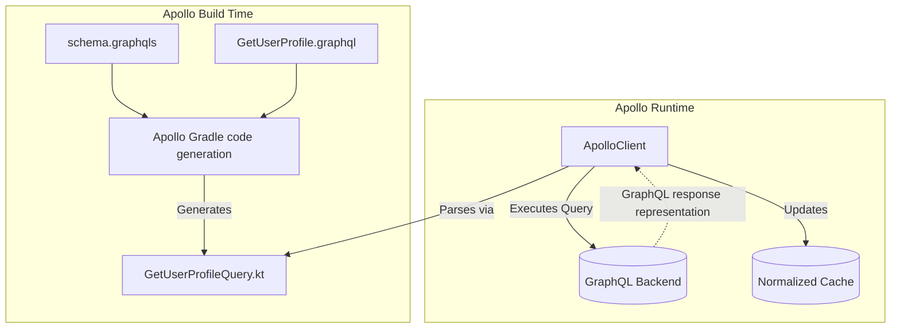

# GraphQL (Apollo)

> **Android application:** canonical mobile error layers, compatibility, and deprecation policy live in [`../../backend-for-mobile/api-design-for-mobile.md`](../../backend-for-mobile/api-design-for-mobile.md#canonical-response-and-evolution-contract). The REST-vs-GraphQL choice lives in [`../../backend-for-mobile/graphql-vs-rest.md`](../../backend-for-mobile/graphql-vs-rest.md). This chapter owns Apollo Kotlin schema inputs, generated operation models, execution, and normalized-cache behavior.

## Overview

GraphQL is a query language for APIs developed at Facebook. A GraphQL operation selects requested data fields from a server-defined schema; the complete response can also contain errors or extensions, and tooling may add fields needed for execution or caching.

**Apollo Kotlin** is an established GraphQL client for Android and Kotlin Multiplatform. It validates operations against a pinned schema and generates operation-specific Kotlin models, reducing manual wire parsing while leaving schema compatibility, domain mapping, and runtime failure handling as explicit responsibilities.

## Why It Matters

Resource-oriented APIs can expose two mobile costs when their contracts do not match a screen:
1.  **Over-fetching:** A broad representation transfers and parses fields the screen does not use. The cost depends on compressed bytes, decoder behavior, modeled fields, device, and network rather than one universal payload size.
2.  **Client request fan-out:** A resource contract can require several dependent requests to assemble one screen. This is distinct from a server-side GraphQL resolver N+1 problem.

GraphQL can reduce both problems when the schema and resolver design let one bounded operation request the needed fields. It does not guarantee one round trip, a small payload, efficient backend joins, or the removal of a mobile BFF; measure the actual contract and resolver cost.

## Historical Context

Backend-for-Frontend services and screen-shaped endpoints are established ways to adapt backend contracts to mobile payload, compatibility, and failure needs. They can reduce client fan-out or over-fetching without requiring GraphQL.

GraphQL offers a client-shaped query contract over a graph of fields. Some organizations expose it directly, while others retain a BFF or gateway for mobile compatibility, policy, aggregation, and operational ownership.

Apollo Kotlin (formerly Apollo Android) supplies GraphQL operation validation, generated Kotlin models, execution APIs, and optional normalized caching for Kotlin and supported multiplatform targets.

## First Principles

1.  **The schema input (`schema.graphqls` or supported equivalent):** A reviewed snapshot or registry/source artifact describing the types and operation roots available to the build.
2.  **The operation (`.graphql` file):** Written by the client team. It selects fields from that schema; tooling may add fields required for execution or normalized caching.
3.  **Apollo compiler/code generation:** The Apollo Gradle plugin invokes Apollo's compiler to validate checked operations against the pinned schema input and generate operation-specific Kotlin models.
4.  **Normalized Cache:** Apollo can normalize response objects under configured cache keys. Watchers re-emit when a write affects fields in their selection; missing keys, omitted fields, or custom mutation behavior may require an explicit cache update or refetch.

## Mental Model

Think of REST as ordering a **Pre-Set Meal** at a restaurant.
- You order "Meal 3" (Hitting an endpoint). 
- You get a burger, fries, and a drink. Even if you only wanted the burger, you get the whole tray and throw the rest away (Over-fetching).

Think of GraphQL as a **Buffet with a Personal Shopper**.
- You hand the shopper a highly specific list: "I want one burger patty, no bun, and exactly 3 french fries." (The Query).
- The shopper (the GraphQL server) attempts to assemble the requested fields. The resulting plate can still be large or require several kitchen trips when pagination, resolver fan-out, or operation splitting applies.

## Internal Mechanics

### 1. Operation validation and code generation

With Apollo, the client checks GraphQL operation documents into the project. REST clients may likewise generate models from OpenAPI; the distinction is the contract artifact and operation-specific selection, not that Retrofit requires handwritten models.

```graphql
// GetUserProfile.graphql
query GetUserProfile($id: ID!) {
  user(id: $id) {
    name
    avatarUrl
  }
}
```

During the Gradle build, Apollo generates a Kotlin class:
```kotlin
// GENERATED CODE - DO NOT EDIT
class GetUserProfileQuery(val id: String) : Query<GetUserProfileQuery.Data> {
    data class Data(val user: User?)
    data class User(val name: String, val avatarUrl: String)
}
```
When CI deliberately updates or checks the pinned schema, Apollo's compiler fails a new build whose checked operations are incompatible with that input. It does not contact the live server implicitly. Already-shipped clients still require server-side compatibility, supported-operation checks, and a deprecation policy.

### 2. Executing the Query
```kotlin
// In your Repository
val apolloClient = ApolloClient.Builder()
    .serverUrl("https://api.example.com/graphql")
    .build()

suspend fun fetchUser(id: String): UserResult {
    val response = apolloClient.query(GetUserProfileQuery(id)).execute()
    val user = response.data?.user
    val failures = response.errors.orEmpty().mapNotNull(::toStableDomainFailure)

    // This operation permits partial content when `user` is present.
    return when {
        user != null -> UserResult.Content(user.toDomain(), warnings = failures)
        failures.isNotEmpty() -> UserResult.Failure(failures)
        else -> UserResult.Empty
    }
}
```

The repository separately maps transport/parsing failures from the client's execution API. Another screen may reject all partial data; the policy belongs to the operation's product contract, not to GraphQL globally. Raw server error messages are diagnostic input, not user-facing copy.

## Architecture



## Production Example

**Optional normalized cache for observed data**

Apollo's normalized-cache modules can reduce duplicate entity storage and notify operation watchers when cache identity and selected fields align. Persistence, offline behavior, conflict handling, freshness, privacy, and migration remain application concerns.

If Screen A fetches a User, and Screen B executes a "RenameUser" mutation, how does Screen A know to update?

With Apollo, a normalized-cache write can notify affected watchers without a separate app-wide event bus.

```kotlin
// 1. Setup the Cache
val sqlNormalizedCacheFactory = SqlNormalizedCacheFactory(context, "apollo.db")

val apolloClient = ApolloClient.Builder()
    .serverUrl("https://api.example.com/graphql")
    .normalizedCache(sqlNormalizedCacheFactory)
    .build()

// 2. Observe the Data Reactively
fun observeUser(id: String): Flow<GetUserProfileQuery.Data> {
    // watch() returns a Flow that emits according to the fetch policy and
    // relevant normalized-cache changes while it is collected.
    return apolloClient.query(GetUserProfileQuery(id))
        .fetchPolicy(FetchPolicy.CacheAndNetwork) // Read DB first, then hit Network
        .watch()
}
```
When a mutation result is written under the same stable cache key and includes the changed `name` field, affected watchers can re-emit. Otherwise, configure cache keys and perform an explicit cache update or refetch.

## Tradeoffs

**GraphQL vs REST**

- **GraphQL (Apollo):**
    - *Pros:* Client-selected fields, generated operation models, build-time operation validation against a pinned schema, and optional normalized caching.
    - *Cons:* Cache-key and schema-governance complexity. GraphQL commonly uses POST to a shared endpoint, which weakens default URL-based caching; GET queries and persisted/APQ hashes can enable HTTP/CDN caching. File upload and build-time tooling add separate tradeoffs.
- **REST (Retrofit):**
    - *Pros:* Mature ecosystem, familiar HTTP semantics, strong tooling, and straightforward HTTP caching when resources and validators are designed for it.
    - *Cons:* Resource contracts can create request fan-out or over-fetching, and unsafe schema changes still require defensive decoding and compatibility tests.

## Failure Modes

- **Missing cache identity:**
  A normalized cache needs a stable cache key to share an entity across operation results. If a `UserSettings` object has no configured key, Apollo normally stores it as an embedded record associated with its parent; updating another occurrence will not automatically update this one.
  *(Fix: Define an appropriate cache-key policy when the domain has stable identity, or perform an explicit cache write/refetch when it does not.)*
- **Unbounded nested operation:**
  A client operation can select a deeply nested graph without pagination or result limits.
  ```graphql
  query { users { posts { comments { author { friends } } } } }
  ```
  The backend may assemble a deeply nested response whose transfer, resolver, parsing, and allocation costs exceed product budgets. UI impact or memory failure depends on payload, dispatcher, device, and object graph rather than a fixed size.
  *(Fix: Apply server-side depth/complexity and result limits, require bounded pagination in the contract, and measure representative operations on the client.)*

## Staff Engineer Thinking

When reviewing GraphQL integrations, a Staff engineer focuses on Cache policies and Schema management:

1.  **Schema and operation checks:** Keep a reviewed, reproducible schema input or registry reference for builds. CI should validate changed operations and proposed server schemas against persisted operations and supported client cohorts; pulling mutable Staging state during every build is not a substitute for production compatibility governance.
2.  **Fetch policies:** Review each `FetchPolicy` against freshness, privacy, invalidation, and offline requirements. `CacheFirst` or `CacheAndNetwork` often suits read-heavy screens; `NetworkOnly` can be correct for sensitive or strictly fresh data. Offline-first is a product and data-lifecycle decision, not a GraphQL invariant.
3.  **Error Handling:** Neither REST nor GraphQL can be handled from the HTTP status alone. HTTP describes the request/response exchange; an API payload still carries domain-specific failures. A well-formed GraphQL response can contain `data`, `errors`, or both, while transport, parsing, validation, and execution failures can use different HTTP statuses under GraphQL-over-HTTP. The networking layer must inspect both the HTTP response and the GraphQL response, preserve partial data when the product can use it, and map domain errors explicitly.

## Common Misconceptions

- **"GraphQL replaces Retrofit."** Apollo can replace Retrofit for GraphQL operations while both may coexist for REST or file-transfer APIs. Apollo Kotlin can use OkHttp as its HTTP engine, so compatible transport policies and resources can be shared deliberately rather than assumed to apply automatically.
- **"GraphQL is faster than REST."** Not inherently. Field selection can reduce unnecessary transfer, but total latency and payload depend on operation shape, pagination, caching, resolver execution, compression, and the equivalent REST contract.

## Probing Questions

1.  Explain over-fetching and under-fetching in resource-oriented APIs. How can GraphQL reduce them, and what conditions limit the benefit?
2.  How does Apollo Kotlin validate and generate operation models from a pinned schema, and how does that compare with generated REST/OpenAPI clients?
3.  Describe the "Normalized Cache" in Apollo. How does it enable reactive UI updates across different screens?
4.  In GraphQL, why is relying on standard HTTP status codes (like 404 or 500) insufficient for error handling?
5.  If a GraphQL object has no configured stable cache key, how does Apollo's normalized cache store it, and what update limitation results?
6.  Explain the difference between the `CacheFirst` and `CacheAndNetwork` fetch policies.
7.  Compare HTTP caching for a REST `GET`, a GraphQL `POST`, and a GraphQL query sent as `GET`. Where does Apollo's normalized cache fit?
8.  Which inputs does the Apollo Gradle plugin/compiler use to generate operation-specific Kotlin models, and what does it not verify?
9.  If you are using Apollo, do you still need to understand and configure `OkHttp`? Why or why not?
10. Describe an architectural scenario where retaining an existing REST API via Retrofit is preferable to migrating to GraphQL.

## Answer Key

1. **Explain over-fetching and under-fetching in resource-oriented APIs. How can GraphQL reduce them, and what conditions limit the benefit?**
   Over-fetching returns fields a client does not need; under-fetching requires additional requests for a screen. GraphQL lets a bounded operation select fields across related types and can reduce both, but the result still depends on schema shape, pagination, caching, resolver behavior, and query splitting.
2. **How does Apollo Kotlin validate and generate operation models from a pinned schema, and how does that compare with generated REST/OpenAPI clients?**
   Apollo's Gradle plugin invokes the Apollo compiler to validate checked operations against the schema pinned to that build and generate operation-specific Kotlin models. OpenAPI tooling can provide analogous generated REST models and calls. Either approach depends on a reviewed reproducible artifact and provider-side validation; neither protects shipped binaries by itself.
3. **Describe the "Normalized Cache" in Apollo. How does it enable reactive UI updates across different screens?**
   It stores response objects under configured cache keys. When a mutation or explicit cache write updates a field selected by a watcher under the same key, affected queries can re-emit; missing keys or omitted fields require an explicit update or refetch.
4. **In GraphQL, why is relying on standard HTTP status codes (like 404 or 500) insufficient for error handling?**
   HTTP status reports the HTTP exchange, not the complete GraphQL or domain outcome. A GraphQL response may contain `data`, `errors`, or both; transport, request, validation, and execution failures do not all have identical status behavior. The client therefore evaluates the HTTP response and GraphQL payload together and decides whether partial data is usable.
5. **If a GraphQL object has no configured stable cache key, how does Apollo's normalized cache store it, and what update limitation results?**
   Apollo normally stores it as an embedded/path-associated record rather than one shared entity. Separate occurrences therefore do not automatically share updates. Define a type/key-fields policy or cache-key generator when stable identity exists; otherwise use an explicit cache write or refetch.
6. **Explain the difference between the `CacheFirst` and `CacheAndNetwork` fetch policies.**
   `CacheFirst` reads the normalized cache and uses the network when the required operation data is unavailable under that policy. `CacheAndNetwork` can emit a cache result and then a network result. Exact cache-miss, partial-data, error, and emission behavior depends on the selected Apollo Kotlin version and configuration, so test the states the UI consumes.
7. **Compare HTTP caching for a REST `GET`, a GraphQL `POST`, and a GraphQL query sent as `GET`. Where does Apollo's normalized cache fit?**
   Eligible REST `GET` representations map naturally to standard HTTP caches when directives and authorization permit. GraphQL commonly uses `POST`, which is not normally cached by shared HTTP caches, while query-over-GET and persisted/APQ identifiers can form cacheable representations under an explicit key/directive policy. Apollo's normalized cache is a separate application data cache keyed by records and selected fields.
8. **Which inputs does the Apollo Gradle plugin/compiler use to generate operation-specific Kotlin models, and what does it not verify?**
   It reads the pinned schema input and checked `.graphql` operations, validates their type selections, and generates models for those operation shapes. It does not prove the live server matches that artifact, validate operations absent from the build, or protect already-shipped binaries from a later breaking server change.
9. **If you are using Apollo, do you still need to understand and configure `OkHttp`? Why or why not?**
   Yes. When Apollo Kotlin uses OkHttp as its HTTP engine, the application still owns appropriate timeout, authentication, TLS, and observability policy. Which interceptors or pools should be shared depends on the clients' security and lifecycle boundaries.
10. **Describe an architectural scenario where retaining an existing REST API via Retrofit is preferable to migrating to GraphQL.**
    Keep the existing REST contract when measured screen payloads and request counts already meet budgets, resource `GET` responses benefit from established HTTP/CDN caching, multipart transfers are mature, compatibility governance is working, and GraphQL would add schema, resolver, registry, and cache-identity operations without a demonstrated product benefit.

## Further Reading

- [`retrofit-and-okhttp.md`](retrofit-and-okhttp.md) — The REST alternative and the underlying engine (OkHttp).
- [`../../backend-for-mobile/api-design-for-mobile.md`](../../backend-for-mobile/api-design-for-mobile.md#canonical-response-and-evolution-contract) — canonical response/error and compatibility contract.
- [`../../backend-for-mobile/graphql-vs-rest.md`](../../backend-for-mobile/graphql-vs-rest.md) — API-shape decision and tradeoffs.
- [GraphQL: Response](https://graphql.org/learn/response/) — `data`, `errors`, and partial responses.
- [GraphQL over HTTP specification](https://graphql.github.io/graphql-over-http/draft/) — HTTP status and media-type semantics.
- [`paging.md`](../data-and-di/paging.md) — How to design bounded pagination for large result sets, including Apollo-backed repositories.
- [Apollo Kotlin Documentation](https://www.apollographql.com/docs/kotlin/)
