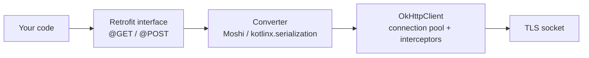
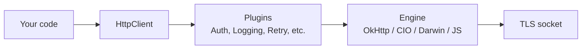

# Ktor vs Retrofit+OkHttp — Android Networking Decision

> Retrofit with OkHttp is an established Android stack; Ktor adds a multiplatform client API and selectable platform engines. Choose from platform targets, protocol and serialization needs, operational evidence, team capability, ecosystem constraints, and migration cost—not novelty or a universal winner.

---

> [!NOTE]
> **Kotlin Multiplatform Deep Dive:** For a comprehensive guide on using Ktor across Android and iOS within a shared KMP module, including engine selection and cross-platform patterns, see [`../kotlin-multiplatform/ecosystem/networking-with-ktor.md`](../kotlin-multiplatform/ecosystem/networking-with-ktor.md).

---

## TL;DR

| Need | Pick |
|---|---|
| Android-only app, no KMP plans | **Retrofit + OkHttp** |
| KMP app (Android + iOS shared logic) | **Ktor** |
| Brand-new app, fast iteration, willing to bet on KMP later | **Ktor** |
| Mature app on Retrofit, no KMP need | **Stay on Retrofit** |
| You need the largest plugin ecosystem and OkHttp's specific connection-pool tuning | **Retrofit + OkHttp** |
| You want one client API across Android, iOS, Desktop, Web | **Ktor** |
| Strict binary-size budget | Measure both release variants with the required converters/plugins and selected engine |
| Easy WebSocket + SSE + HTTP in one client | **Ktor** |

Retrofit + OkHttp remains a strong Android-focused default; KMP-shared networking makes Ktor's multiplatform client model compelling. Both choices are valid when they match the actual boundary and operational needs.

---

## Architecture at a Glance

### Retrofit + OkHttp



Two layers:
- **Retrofit** — declarative service interface, runtime Java proxy and method parsing, with body converters.
- **OkHttp** — HTTP client with HTTP/1.1 and HTTP/2 transport, connection pooling and interceptors; an HTTP_3 enum value does not establish native HTTP/3 support.

You can use OkHttp alone (for raw HTTP), but rarely Retrofit alone. They're sold separately, designed to compose.

### Ktor Client



Three concepts:
- **`HttpClient`** — the high-level API.
- **Engine** — pluggable; Android projects commonly select OkHttp, CIO, or the Android engine.
- **Plugins** — install via `install(Logging) { ... }`, similar to Express middleware.

Ktor is one client API with selectable engines. Pass an engine to `HttpClient(engine)`, or let `HttpClient()` choose from the engine dependencies available to that source set.

---

## Declarative vs Imperative

### Retrofit — declarative

```kotlin
interface UserApi {
    @GET("/users/{id}")
    suspend fun getUser(@Path("id") id: String): User

    @POST("/users")
    suspend fun createUser(@Body user: NewUser): User

    @GET("/users")
    suspend fun listUsers(@Query("page") page: Int = 0): PagedUsers
}

val api: UserApi = retrofit.create(UserApi::class.java)
val user = api.getUser("u_123")
```

Annotations describe each call. Standard Retrofit implements the service interface through a Java dynamic proxy at runtime, parses and caches method metadata, and delegates calls to OkHttp. A converter may separately generate adapters for body serialization; that is not Retrofit interface code generation.

### Ktor — imperative

```kotlin
val user: User = client.get("https://api.example.com/users/u_123").body()

val created: User = client.post("https://api.example.com/users") {
    contentType(ContentType.Application.Json)
    setBody(NewUser(name = "Alice"))
}.body()

val pages: PagedUsers = client.get("https://api.example.com/users") {
    parameter("page", 0)
}.body()
```

Direct calls. Each request is a function call returning a `HttpResponse`. Body deserialization via `body()`.

The tradeoff:
- Retrofit forces an API surface — you define the shape once, callers use it. Refactoring is mechanical.
- Ktor is more flexible — you can construct dynamic URLs and bodies inline, but a 50-endpoint app becomes 50 free-floating call sites without convention.

Most teams wrap Ktor in interface-like API classes to recover Retrofit's structure:

```kotlin
class UserApi(private val client: HttpClient) {
    suspend fun getUser(id: String): User = client.get("/users/$id").body()
    suspend fun createUser(user: NewUser): User = client.post("/users") { setBody(user) }.body()
}
```

Now it looks like Retrofit again, just hand-written.

---

## Interceptors vs Plugins

The mechanism for cross-cutting concerns (auth, logging, retry, caching).

### OkHttp interceptor chain

The store, interceptor, authenticator and refresh adapter below are the [session-bound implementation in Retrofit and OkHttp](retrofit-and-okhttp.md#production-example). Each login owns a fresh store and client; no callback reads a global current account. The refresh adapter has independent origin and I/O bounds and no auth interceptor, authenticator, or request-body logger.

```kotlin
fun newSessionOkHttp(
    store: SessionTokenStore,
    apiOrigin: HttpUrl,
    refreshApi: AuthApi,
): OkHttpClient = OkHttpClient.Builder()
    .followRedirects(false)
    .followSslRedirects(false)
    .retryOnConnectionFailure(false)
    .callTimeout(30, TimeUnit.SECONDS)
    .addInterceptor(AuthInterceptor(store, apiOrigin))
    .authenticator(TokenAuthenticator(store, apiOrigin, refreshApi))
    .build()
```

OkHttp application interceptors wrap a logical call; network interceptors see individual network exchanges. `Authenticator` supplies a bounded follow-up after a 401, or declines with `null` so the caller receives the response. Unlike the Ktor sample below, this `TokenAuthenticator` can replay a write with a replayable request body after a 401. Use it on a write path only when the API contract makes replay safe, for example with a server-enforced idempotency key. Keep general 5xx retry separate and limited to retry-safe requests.

### Ktor plugins

This Android/JVM example reuses `SessionTokenStore`, `SessionTokens` and the bounded synchronous `AuthApi` adapter above. It deliberately uses `Dispatchers.IO` for that blocking adapter. A common-code implementation needs an equivalent suspending platform adapter. Configure the token endpoint separately; it must never pass through this authenticated resource client.

```kotlin
fun newSessionKtorClient(
    store: SessionTokenStore,
    apiOrigin: Url,
    refreshApi: AuthApi,
): HttpClient {
    require(apiOrigin.protocol == URLProtocol.HTTPS)
    fun URLBuilder.isApiOrigin(): Boolean =
        build().let { it.protocol == apiOrigin.protocol &&
            it.host.equals(apiOrigin.host, ignoreCase = true) && it.port == apiOrigin.port }

    return HttpClient(OkHttp) {
        followRedirects = false
        engine {
            config {
                followRedirects(false)
                followSslRedirects(false)
                retryOnConnectionFailure(false)
            }
        }
        install(Logging) {
            level = LogLevel.HEADERS
            sanitizeHeader { name ->
                name.equals(HttpHeaders.Authorization, ignoreCase = true) ||
                    name.equals(HttpHeaders.Cookie, ignoreCase = true) ||
                    name.equals(HttpHeaders.SetCookie, ignoreCase = true)
            }
        }
        install(ContentNegotiation) { json(Json { ignoreUnknownKeys = true }) }
        install(Auth) {
            bearer {
                loadTokens { store.current()?.let { BearerTokens(it.accessToken, it.refreshToken) } }
                sendWithoutRequest { it.url.isApiOrigin() }
                refreshTokens {
                    if (response.request.method !in setOf(HttpMethod.Get, HttpMethod.Head) ||
                        response.request.content !is OutgoingContent.NoContent) return@refreshTokens null
                    // Finish a bounded rotation and conditional commit even if its caller cancels.
                    withContext(NonCancellable) {
                        withContext(Dispatchers.IO) refresh@ {
                            val current = store.current() ?: return@refresh null
                            val retry = if (current.accessToken != oldTokens?.accessToken) {
                                current
                            } else {
                                val replacement = refreshApi.refreshSynchronouslyOrNull(current.refreshToken)
                                if (replacement == null) {
                                    store.invalidateIfCurrent(current)
                                    return@refresh null
                                }
                                store.replaceIfCurrent(current, replacement) ?: return@refresh null
                            }
                            if (store.current() != retry) null
                            else BearerTokens(retry.accessToken, retry.refreshToken)
                        }
                    }
                }
            }
        }
        install(HttpRequestRetry) {
            maxRetries = 2
            retryOnExceptionIf { _, _ -> false }
            retryIf { request, response ->
                request.method in setOf(HttpMethod.Get, HttpMethod.Head) &&
                    request.content is OutgoingContent.NoContent &&
                    response.status.value in setOf(502, 503, 504) &&
                    response.headers[HttpHeaders.RetryAfter] == null
            }
            exponentialDelay()
        }
        install(HttpTimeout) { requestTimeoutMillis = 30_000 }
    }.also { client ->
        client.plugin(HttpSend).intercept { request ->
            if (!request.url.isApiOrigin()) throw IOException("Outside session API origin")
            if (store.current() == null) throw IOException("Session ended")
            execute(request)
        }
    }
}
```

`sendWithoutRequest` controls preemptive attachment; it is not an origin firewall for a later 401 challenge. The send guard rejects other schemes, hosts and ports before network I/O, and redirects are disabled at both layers. Keep this client private to the session's API adapter; public/content calls use another client. Ktor's bearer plugin coordinates concurrent 401s, while the store's conditional replacement prevents logout or account switch from restoring old credentials. Only confirmed terminal credential rejection returns `null` from the refresh adapter; transient failures throw `IOException` and retain tokens.

`NonCancellable` surrounds only the bounded refresh/commit, not the whole call or a detached coroutine. Cancellation can wait for that section to finish; it does not cancel an already-performed server rotation. Logout invalidates the store before closing the client and clearing its auth cache. A request already past the guard can still be in flight: cancel old-session calls and reject old-session results at persistence/UI boundaries. Test that storage implementations preserve the same atomic guarantees. A timeout or process death after server-side rotation is ambiguous and can require re-login under the IdP's recovery policy.

Header sanitisation does not redact secrets embedded in URLs or arbitrary response headers. Keep tokens out of URLs and disable or further restrict logging for sensitive endpoints. The token endpoint has no body logging. The retry example permits only bodyless reads after the selected HTTP responses and returns `Retry-After` responses for caller scheduling. Thrown I/O failures propagate to the caller without retry. This example also declines authentication follow-ups for writes or request bodies. A production write path needs an explicit replay-safety contract. Test the combined deadline and attempt budget.

### Equivalence and gotchas

Pattern | OkHttp interceptor | Ktor plugin
---|---|---
Bearer token attach | `AuthInterceptor` | `Auth.bearer { loadTokens }` |
Token refresh on 401 | `Authenticator` | `Auth.bearer { refreshTokens }` |
Request logging | `HttpLoggingInterceptor` | `install(Logging)` |
Response caching | `Cache` + `CACHE_CONTROL` header | `install(HttpCache)` |
Timeouts | `OkHttpClient.Builder().connectTimeout(...)` | `install(HttpTimeout) { ... }` |
Retry on 5xx | Custom interceptor | `install(HttpRequestRetry)` |
Custom headers per call | Per-call via `Request.Builder` | Inline in `client.get { headers { } }` |
Response decompression | Built-in | `install(ContentEncoding)` |

Both ecosystems can do everything. Ktor's plugin DSL is more discoverable; OkHttp's interceptor API is more battle-tested.

---

## KMP — The Decisive Factor

This is where Retrofit can't compete.

### Retrofit

```kotlin
// JVM-only. Cannot compile for iosX64, iosArm64, jsBrowser, mingwX64.
val retrofit = Retrofit.Builder()
    .baseUrl("https://api.example.com/")
    .build()
```

Retrofit uses reflection and dynamic proxies that don't exist on Native or JS targets. It's Android/JVM only.

### Ktor

```kotlin
// commonMain
expect class HttpClientFactory {
    fun create(): HttpClient
}

class UserApi(private val client: HttpClient) {
    suspend fun getUser(id: String): User = client.get("/users/$id").body()
}

// androidMain
actual class HttpClientFactory {
    actual fun create(): HttpClient = HttpClient(OkHttp) { /* ... */ }
}

// iosMain
actual class HttpClientFactory {
    actual fun create(): HttpClient = HttpClient(Darwin) { /* ... */ }
}
```

`UserApi` is in `commonMain` — shared across Android, iOS, Desktop. Each platform plugs in its own engine.

If a KMP app shares HTTP code, Ktor is a common option because its API lives in common source sets and delegates to platform engines. Compare it with other maintained multiplatform clients or a project-owned boundary; Retrofit itself remains JVM/Android-oriented.

---

## Engines on Android

Ktor requires a client engine dependency. `OkHttp` is a common Android choice when its transport behavior and API-level floor fit the product:

```kotlin
val client = HttpClient(OkHttp) {
    engine {
        config { /* native OkHttpClient.Builder */ }
    }
}
```

Inside that `config { }` block, you have the full OkHttp builder API. So Ktor on Android is "Ktor's API + OkHttp's reliability."

Alternative engines:
- **`CIO`** — Ktor's coroutine-based engine. Official Ktor documentation lists Android 7.0+ support, with Java API desugaring required for older Android versions; it currently supports HTTP/1.x rather than HTTP/2.
- **`Android`** — the supported `io.ktor:ktor-client-android:$ktor_version` artifact, backed by `HttpURLConnection`. It currently lacks HTTP/2 and WebSocket support.

**Contextual default:** Evaluate the OkHttp engine first for an Android application already standardized on OkHttp behavior. Choose another engine only from explicit platform floors, protocol needs, proxy/TLS requirements, footprint measurements, and operational evidence.

When a Retrofit+OkHttp application selects Ktor's OkHttp engine, the migration replaces Retrofit's API layer while retaining OkHttp as the transport engine. Selecting CIO or the Android engine changes that transport choice as well.

---

## Serialization

### Retrofit

Plug in a converter factory:

```kotlin
// Choose kotlinx.serialization for this instance.
// import retrofit2.converter.kotlinx.serialization.asConverterFactory
// import okhttp3.MediaType.Companion.toMediaType
.addConverterFactory(Json.asConverterFactory("application/json".toMediaType()))
```

A Retrofit instance can register multiple converter factories, but selection follows order and supported types. Moshi assumes it can handle all types; place any specialized factories before it, or choose one general JSON converter for the instance.

### Ktor

Install ContentNegotiation:

```kotlin
install(ContentNegotiation) {
    json(Json {
        ignoreUnknownKeys = true
        coerceInputValues = true
    })
    // Could also register XML, ProtoBuf, CBOR adapters
}
```

Both support kotlinx.serialization through their respective converters. Retrofit also has an official Moshi converter. Ktor documents first-party kotlinx.serialization, Gson and Jackson integrations; Moshi would require a separate integration rather than an assumed first-party converter.

For shared KMP models, `kotlinx.serialization` is a common default because it supports Kotlin multiplatform. Moshi is JVM-oriented; other formats or platform adapters remain possible when their target and maintenance constraints fit.

---

## WebSocket and SSE Integration

### OkHttp / Retrofit

WebSocket is OkHttp-native:

```kotlin
client.newWebSocket(request, listener)
```

Retrofit doesn't model WebSockets — you drop to OkHttp for them.

Retrofit does not model SSE; the OkHttp SSE module can be used alongside it:

```kotlin
EventSources.createFactory(client).newEventSource(request, listener)
```

Two libraries; two APIs.

### Ktor

Both are first-class:

```kotlin
val client = HttpClient(OkHttp) { install(WebSockets); install(SSE) }

// WebSocket
client.webSocket("wss://api.example.com/chat") {
    while (isActive) {
        when (val frame = incoming.receive()) {
            is Frame.Text -> println(frame.readText())
            else -> { }
        }
    }
}

// SSE
client.serverSentEventsSession("https://api.example.com/ticker").apply {
    incoming.collect { event -> println(event.data) }
}
```

Ktor can expose HTTP, WebSocket, and SSE through one client API. Whether that is simpler than Retrofit plus OkHttp modules depends on existing abstractions, lifecycle policy, and the selected engine/plugins.

---

## Binary Size and Method Count

There is no portable stack delta: versions, engine, converters/plugins, desugaring, min SDK, ABIs, resources, consumer rules, and R8 optimization all change the result. Measure release artifacts for the two complete configurations with the same app code and toolchain.

Record at least the signed download/install size by ABI, DEX method/reference change, mapping/configuration, and the exact dependency graph. Remove unused plugins/dependencies and keep rules only when runtime behavior requires them—`-keep` rules preserve code and can reduce shrinking.

---

## Error Handling

### Retrofit

Two main patterns:

```kotlin
// Pattern A: Response<T> for known errors
@GET("/users/{id}")
suspend fun getUser(@Path("id") id: String): Response<User>

val response = api.getUser(id)
if (response.isSuccessful) {
    val user = response.body()!!
} else {
    when (response.code()) {
        404 -> /* not found */
        401 -> /* unauthorized */
    }
}
```

```kotlin
// Pattern B: throw HttpException via NetworkResult wrapper
suspend fun <T> safe(call: suspend () -> T): NetworkResult<T> = try {
    NetworkResult.Success(call())
} catch (e: HttpException) {
    NetworkResult.HttpError(e.code(), e.message())
} catch (e: IOException) {
    NetworkResult.NetworkError
}
```

### Ktor

```kotlin
val response = client.get("/users/$id")
when (response.status.value) {
    in 200..299 -> response.body<User>()
    404 -> /* not found */
    in 500..599 -> /* server error */
}
```

Or via `expectSuccess = true`:

```kotlin
val client = HttpClient(OkHttp) {
    expectSuccess = true   // 3xx: RedirectResponseException; 4xx: ClientRequestException; 5xx: ServerResponseException
}

try {
    val user: User = client.get("/users/$id").body()
} catch (e: ClientRequestException) {
    // 4xx
}
```

Both ecosystems support both patterns. Ktor's typed exceptions (`ClientRequestException` for 4xx, `ServerResponseException` for 5xx) are slightly cleaner than Retrofit's generic `HttpException`.

---

## Testing

### Retrofit

[OkHttp `MockWebServer`](https://github.com/square/okhttp/tree/master/mockwebserver) is the standard:

```kotlin
val server = MockWebServer()
server.start()
server.enqueue(MockResponse().setBody("""{"id":"u1","name":"Alice"}"""))

val retrofit = Retrofit.Builder().baseUrl(server.url("/")).build()
val api = retrofit.create(UserApi::class.java)
val user = api.getUser("u1")
```

Real OkHttp client makes real HTTP calls to localhost. Battle-tested; works with Retrofit and Ktor (Android engine).

### Ktor

Two approaches.

**`MockEngine`** — Ktor-native, no real HTTP:

```kotlin
val mockEngine = MockEngine { request ->
    respond(
        content = """{"id":"u1","name":"Alice"}""",
        status = HttpStatusCode.OK,
        headers = headersOf(HttpHeaders.ContentType, "application/json"),
    )
}
val client = HttpClient(mockEngine) {
    install(ContentNegotiation) { json() }
}
val user: User = client.get("/users/u1").body()
```

Faster than MockWebServer; KMP-compatible.

**`MockWebServer`** also works with Ktor's OkHttp engine — same as Retrofit.

`MockEngine` is the portable Ktor common-test option. Interface fakes are also portable, while platform test source sets can use loopback servers or engine-specific tools such as MockWebServer on JVM/Android.

---

## Coroutine Cancellation

Both stacks integrate cleanly with structured concurrency:

```kotlin
viewModelScope.launch {
    val user = api.getUser("u_123")    // suspends
}
```

When the scope cancels, a correctly integrated suspending call should stop delivering a result and cancel the in-flight request/stream. The engine decides whether to reset one HTTP/2 stream, close a socket, or retain a healthy pooled connection for reuse. Test cancellation, resource cleanup, callback suppression, and connection reuse on the selected versions.

One subtle difference: Ktor's WebSocket session is more naturally bound to coroutine scope (`client.webSocket { ... }` is a suspend function whose body is the session lifetime). OkHttp's WebSocket has a callback API requiring manual cleanup. Net win for Ktor in real-time scenarios.

---

## Migration Patterns

### From Retrofit to Ktor

Mostly a wrap-with-adapter exercise:

```kotlin
// Step 1: Keep Retrofit interface, build a Ktor-backed implementation
interface UserApi {
    suspend fun getUser(id: String): User
}

class KtorUserApi(private val client: HttpClient) : UserApi {
    override suspend fun getUser(id: String): User = client.get("/users/$id").body()
}

// Step 2: Swap the DI binding
@Provides
fun provideUserApi(client: HttpClient): UserApi = KtorUserApi(client)
```

Endpoints migrate one at a time. After all endpoints are migrated, remove Retrofit.

Estimate from a representative slice that includes authentication, streaming, error mapping, serialization, caching, observability, tests, and rollout. Endpoint count alone does not predict migration effort.

### From Ktor to Retrofit

The same boundary-and-adapter approach can support a reverse migration when Android-only ecosystem or operational requirements justify it.

---

## When Each Wins (Concrete Scenarios)

| Scenario | Pick | Why |
|---|---|---|
| Android-only consumer app, 30 endpoints | Retrofit + OkHttp | Largest ecosystem; battle-tested; less code per call |
| KMP cross-platform business logic | Ktor | Retrofit can't compile to iOS |
| Brand-new SDK shipped to Android consumers | Retrofit + OkHttp | Larger ecosystem; familiar to consuming apps |
| Backend-shared client library targeting JVM + Android | Ktor | One client, two platforms |
| App with heavy real-time (chat, live trading) | Ktor | Unified WebSocket + SSE + HTTP API |
| App with strict APK size limits | Compare complete release builds | Measure the selected engine, converters/plugins, dependencies and R8 output against the same product budget |
| New team, no legacy code, KMP optional later | Evaluate Ktor for shared client code | Shared APIs can reduce migration work; target engines, authentication, serialization and tests still need implementation and validation |
| Existing Retrofit codebase, no KMP plans | Stay on Retrofit | Migration cost > benefits |
| OkHttp-specific tuning needed (connection pool sizes, TLS-specific quirks) | Retrofit + OkHttp | Direct OkHttp access; Ktor still allows but adds a layer |
| Want one library for HTTP/WebSocket/SSE | Ktor | Three protocols in one client |

---

## Production Patterns

### Pattern 1: Reuse the session Ktor factory

```kotlin
// These values are captured for this login; they are not a mutable global account.
val client = newSessionKtorClient(sessionStore, Url("https://api.example.com/"), refreshApi)
```

Add measured transport/cache tuning inside that factory, retaining its origin, logging, refresh and retry policies. Retire it on logout; do not copy an abbreviated auth block that omits those policies.

### Pattern 2: Retrofit with the session OkHttp factory

```kotlin
val okHttp = newSessionOkHttp(sessionStore, "https://api.example.com/".toHttpUrl(), refreshApi)

val retrofit = Retrofit.Builder()
    .baseUrl("https://api.example.com/")
    .client(okHttp)
    .addConverterFactory(MoshiConverterFactory.create(moshi))
    .build()

val api = retrofit.create(UserApi::class.java)
```

### Pattern 3: KMP API wrapper (Ktor)

```kotlin
// commonMain
class ApiClient(private val client: HttpClient) {
    suspend fun getUser(id: String): User = client.get("/users/$id").body()
    suspend fun listOrders(userId: String): List<Order> = 
        client.get("/users/$userId/orders").body()
}

// commonMain (Repository)
class UserRepository(private val api: ApiClient) {
    suspend fun load(id: String): User = api.getUser(id)
}

// androidMain + iosMain — different HttpClient providers, same Repository
```

Same `UserRepository` runs on iOS, Android, JVM, and JS. Retrofit can't do this.

---

## Failure Modes

| Symptom | Cause | Fix |
|---|---|---|
| Ktor migration painful for 50+ endpoints | Lift-and-shift instead of incremental wrap-adapter | Wrap Retrofit interface; migrate endpoint-at-a-time |
| Ktor body<T>() accepts an unexpected payload | Unknown properties, coercion/defaults and missing domain validation are different policies | Set ignoreUnknownKeys for extra-field compatibility, coerceInputValues for supported coercions, and validate required domain semantics with contract fixtures |
| OkHttp `Authenticator` competes with Ktor's `Auth` plugin | Both attached; double-refresh | Pick one layer — Auth plugin OR OkHttp Authenticator |
| HttpRequestRetry retries an undesired response | Custom retry predicates are broader than the intended transient failures | For retry-safe requests, retryIf { _, response -> response.status.value in 500..599 }; bound attempts and handle auth separately. retryOnServerErrors itself only retries 5xx |
| Different engines on Android vs iOS for KMP | OkHttp on Android, Darwin on iOS | Expected; test on both |
| Release artifact exceeds its size budget after a stack change | Engine, plugins, converters, transitive dependencies, or keep rules changed | Compare reproducible release artifacts and dependency/R8 reports; remove only unused components |
| Parsing contributes to frame latency | Deserialization or mapping executes on a frame-sensitive path | Profile the selected engine/converter and move owned CPU work to an appropriate dispatcher when needed |
| Tests pass with MockEngine, fail in prod | MockEngine doesn't simulate timeouts | Add `delay()` in mock; or test with MockWebServer |
| Converter accepts an invalid/underspecified payload | Model and converter policy do not enforce required semantics | Validate critical fields and test missing/null/unknown values against provider fixtures |
| Scope cancellation still delivers a result or leaks work | Adapter/engine/version integration does not propagate cancellation as expected | Test the maintained selected versions and fix the integration; do not infer behavior from a major-version label |
| Ktor connection leak | Forgot to use `use { }` for streaming responses | `client.prepareGet(url).execute { response -> ... }` |
| Retrofit/Kotlin integration fails after a toolchain update | Unsupported or incompatible library/compiler combination | Check the maintained release compatibility notes and upgrade through a tested dependency change |
| Bearer token attached to refresh-token request | `Auth` plugin's refresh endpoint also intercepted | Use a separate bounded refresh client with no Auth, automatic retry, or body logging; an explicitly marked refresh request can avoid auth recursion but still needs its own origin and logging policy |

---

## Common Pitfalls

- **Migrating without a measured objective.** KMP sharing, protocol support, testability, engine behavior, or a common client API can justify Ktor; a working Retrofit stack can remain the lower-risk choice. Write the decision and success measures first.
- **Choosing a Ktor engine by reputation alone.** Verify Android/API floors, protocol and proxy/TLS support, cancellation, streaming, footprint, and behavior on representative network cohorts.
- **Unowned long-term coexistence.** Retrofit and Ktor can coexist during migration or for distinct boundaries, but duplicate auth, caching, pools, telemetry, and policy need owners and an exit/steady-state decision.
- **Trusting `ignoreUnknownKeys = true` blindly.** Hides bugs. Validate explicitly for critical fields.
- **Not testing the auth-refresh path.** Token expiry happens in production; tests should cover the refresh flow.
- **Defining endpoints inline everywhere with Ktor.** Without a wrapper class, you have 50 free-floating call sites. Adopt a Retrofit-like API class convention.
- **One client per call site.** Reuse compatible clients/engines and pools. Separate clients can still be appropriate for different trust material, proxies, authentication, engine configuration, or lifecycle boundaries.
- **Cache without `Cache-Control` validation.** Cached responses can be stale; tune per-endpoint.
- **No coroutine cancellation testing.** Network calls should cancel cleanly when the user navigates away.

---

## Probing Questions

1. Walk through what each layer does in `your code → Retrofit → OkHttp → socket`.
2. Walk through the same for `your code → Ktor → engine → socket`.
3. KMP — why can't Retrofit compile to iOS? What does Ktor do differently?
4. Compare OkHttp interceptor chain vs Ktor plugin model. Strengths of each?
5. You inherit a Retrofit codebase; the team wants KMP. Walk through your migration plan.
6. Bearer token refresh on 401 — implement in both OkHttp `Authenticator` and Ktor `Auth.bearer.refreshTokens`. Compare.
7. Design a reproducible release-artifact comparison for Ktor and Retrofit. Which inputs and outputs must be recorded?
8. Mock testing: `MockWebServer` vs Ktor's `MockEngine`. Pick each.
9. WebSocket + SSE + HTTP in one app — which stack creates the simpler owned boundary for this product, and how would you prove it?
10. Coroutine cancellation: prove a `viewModelScope.cancel()` actually cancels an in-flight HTTP request.
11. Both stacks have an `Auth` story. When does it accidentally retry the refresh endpoint itself? How to prevent?
12. A team wants Ktor "to be modern." No KMP plans. Walk through your code-review pushback.

---

## Answer Key

1. **Walk through what each layer does in `your code → Retrofit → OkHttp → socket`.**
   Your code defines a declarative interface. Retrofit converts the call parameters into an OkHttp Request and delegates. OkHttp handles connection pooling, interceptors, and TCP/TLS via sockets, then returns the response which Retrofit deserializes.
2. **Walk through the same for `your code → Ktor → engine → socket`.**
   Your code calls the Ktor `HttpClient` imperatively. The client passes the request through its configured plugins (auth, logging), then hands it to a platform engine (like OkHttp on Android or Darwin on iOS) which manages the raw socket connections.
3. **KMP — why can't Retrofit compile to iOS? What does Ktor do differently?**
   Retrofit relies on JVM reflection and dynamic proxies which are incompatible with iOS (Kotlin/Native). Ktor uses platform-agnostic abstractions (`commonMain`) and delegates HTTP execution to actual platform-specific engines.
4. **Compare OkHttp interceptor chain vs Ktor plugin model. Strengths of each?**
   OkHttp interceptors are a straightforward chain of responsibility, well-tested and native to the engine. Ktor plugins provide a broader, richer DSL for configuring things like WebSockets, Retries, and Auth, working uniformly across multiple platforms.
5. **You inherit a Retrofit codebase; the team wants KMP. Walk through your migration plan.**
   Wrap the existing Retrofit interfaces with Ktor-backed implementations via adapters. Migrate endpoint by endpoint, injecting the new Ktor wrapper, until Retrofit can be safely removed.
6. **Bearer token refresh on 401 — implement in both OkHttp `Authenticator` and Ktor `Auth.bearer.refreshTokens`. Compare.**
   OkHttp uses `Authenticator` which triggers on a 401 and synchronously generates a new Request. Ktor's `Auth` plugin uses a DSL to define `loadTokens` and `refreshTokens`, which feels more declarative but can easily conflict if mixed with an underlying OkHttp Authenticator.
7. **Design a reproducible release-artifact comparison for Ktor and Retrofit. Which inputs and outputs must be recorded?**
   Build equivalent minified release variants with pinned library/toolchain versions, engine, converters/plugins, min SDK, ABIs, keep rules, and app code. Compare signed download/install size, DEX references, dependency/R8 reports, startup/runtime measurements, and the product's size budget rather than reusing a universal delta.
8. **Mock testing: `MockWebServer` vs Ktor's `MockEngine`. Pick each.**
   Use `MockWebServer` for JVM-only integration tests that need real HTTP loopback. Use `MockEngine` for KMP tests since it mocks the engine directly in memory and compiles natively for all platforms.
9. **WebSocket + SSE + HTTP in one app — which stack creates the simpler owned boundary for this product, and how would you prove it?**
   Ktor offers one plugin/client model; Retrofit plus OkHttp uses declarative HTTP APIs with OkHttp WebSocket/SSE modules. Compare lifecycle, cancellation, auth, replay, telemetry, test fixtures, engine needs, team support, and measured code/size rather than deciding from API aesthetics alone.
10. **Coroutine cancellation: prove a `viewModelScope.cancel()` actually cancels an in-flight HTTP request.**
   Hold a test response open, cancel the owning job, assert prompt coroutine cancellation and no later delivery, and inspect server/engine events for request or stream cancellation. Do not require the pooled TCP connection to close: an implementation may retain a healthy connection for reuse.
11. **Both stacks have an `Auth` story. When does it accidentally retry the refresh endpoint itself? How to prevent?**
   This happens if the token refresh request itself is routed through the same client/interceptor handling auth, causing an infinite 401 loop. Use a dedicated bounded refresh client without auth handling or body logging. In Ktor, `markAsRefreshTokenRequest()` also excludes a request from auth retry; it does not establish origin trust or make refresh retries safe.
12. **A team wants Ktor "to be modern." No KMP plans. Walk through your code-review pushback.**
   Ask for the concrete problem, alternatives, representative spike, migration/rollback plan, ownership, and measurable success criteria. KMP is one possible benefit, not the only one; reject a migration whose demonstrated value does not exceed its compatibility, learning, artifact, and operational cost.

## Further Reading

- [`retrofit-and-okhttp.md`](retrofit-and-okhttp.md) — Retrofit + OkHttp deep dive.
- [`graphql.md`](graphql.md) — Apollo Kotlin (separate alternative).
- [`security-and-keystore.md`](security-and-keystore.md) — certificate pinning on each stack.
- [`../data-and-di/hilt-vs-koin-vs-manual-di.md`](../data-and-di/hilt-vs-koin-vs-manual-di.md) — providing the HTTP client.
- [`../../backend-for-mobile/graphql-vs-rest.md`](../../backend-for-mobile/graphql-vs-rest.md) — REST vs GraphQL axis (orthogonal to this decision).
- [`../../backend-for-mobile/transport-protocols.md`](../../backend-for-mobile/transport-protocols.md) — HTTP/2 / HTTP/3 / gRPC at the transport layer.
- [`../../backend-for-mobile/sse-vs-websockets.md`](../../backend-for-mobile/sse-vs-websockets.md) — real-time protocols.
- [`../../platform-engineering/library-versioning.md`](../../platform-engineering/library-versioning.md) — versioning shared HTTP clients.
- [`../../kotlin/coroutines-and-flow/coroutines.md`](../../kotlin/coroutines-and-flow/coroutines.md) — coroutine cancellation semantics.
- [Ktor client documentation](https://ktor.io/docs/getting-started-ktor-client.html) — official.
- [Ktor client engines](https://ktor.io/docs/client-engines.html) — supported engines, dependency-driven selection, platform floors, and protocol capabilities.
- [Ktor Android engine API](https://api.ktor.io/ktor-client-android/io.ktor.client.engine.android/-android/index.html) — current `HttpURLConnection`-backed engine contract.
- [Ktor releases](https://ktor.io/docs/releases.html) — current stable and supported release lines.
- [Retrofit repository and documentation](https://github.com/square/retrofit) — official.
- [OkHttp repository and documentation](https://github.com/square/okhttp) — official.
- [Ktor + KMP guide](https://kotlinlang.org/docs/multiplatform-mobile-ktor-sqldelight.html) — KMP integration.
- [Ktor — Creating a cross-platform mobile application](https://ktor.io/docs/client-create-multiplatform-application.html) — shared networking in KMP.

### Official verification references

- [Primary documentation or owning implementation](https://github.com/square/okhttp/blob/master/okhttp/src/commonJvmAndroid/kotlin/okhttp3/Protocol.kt)
- [Primary documentation or owning implementation](https://github.com/square/retrofit/blob/trunk/retrofit-converters/moshi/src/main/java/retrofit2/converter/moshi/MoshiConverterFactory.java)
- [Primary documentation or owning implementation](https://github.com/square/retrofit/blob/trunk/retrofit/src/main/java/retrofit2/Retrofit.java)
- [Primary documentation or owning implementation](https://github.com/square/retrofit/tree/trunk/retrofit-converters/kotlinx-serialization)
- [Primary documentation or owning implementation](https://kotlinlang.org/api/kotlinx.serialization/kotlinx-serialization-json/kotlinx.serialization.json/-json-builder/)
- [Primary documentation or owning implementation](https://ktor.io/docs/client-request-retry.html)
- [Primary documentation or owning implementation](https://ktor.io/docs/client-response-validation.html)
- [Primary documentation or owning implementation](https://ktor.io/docs/client-serialization.html)
- [Primary documentation or owning implementation](https://raw.githubusercontent.com/square/retrofit/trunk/retrofit/src/main/java/retrofit2/Retrofit.java)

- [Ktor bearer authentication](https://ktor.io/docs/client-bearer-auth.html) — callbacks, concurrent refresh, and refresh-request marking.
- [Ktor token caching](https://ktor.io/docs/client-auth.html#token-caching) — cached credentials and explicit clearing.
- [Ktor client logging](https://ktor.io/docs/client-logging.html) — sensitive-header sanitisation.
- [Ktor HttpSend interception](https://ktor.io/docs/client-http-send.html) and [redirect policy](https://ktor.io/docs/client-redirect.html) — send guards and disabling redirects.
- [Kotlin NonCancellable](https://kotlinlang.org/api/kotlinx.coroutines/kotlinx-coroutines-core/kotlinx.coroutines/-non-cancellable/) — protecting a bounded commit without launching detached work.
- [Ktor 3.6.0 retry implementation](https://github.com/ktorio/ktor/blob/3.6.0/ktor-client/ktor-client-core/common/src/io/ktor/client/plugins/HttpRequestRetry.kt) — separate response and exception predicates; this example explicitly disables exception retries.
