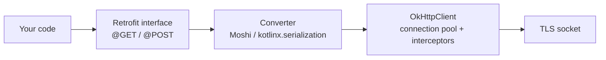
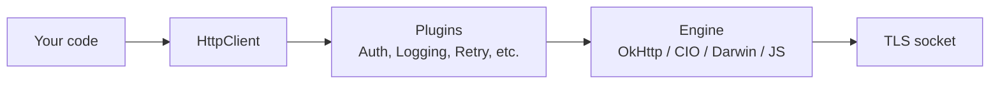

# Ktor vs Retrofit+OkHttp — Android Networking Decision

> For ~10 years, Retrofit + OkHttp was the only sensible Android networking stack. Then Kotlin Multiplatform happened and Ktor became a serious option. The decision isn't religion — it's about KMP needs, ecosystem maturity, and which weaknesses you'd rather work around. Staff-level mastery is knowing each stack's plugin/interceptor model deeply, when KMP makes Ktor non-optional, and the migration cost when you've picked wrong.

---

> [!NOTE]
> **Kotlin Multiplatform Deep Dive:** For a comprehensive guide on using Ktor across Android and iOS within a shared KMP module, including engine selection and cross-platform patterns, see [`../kotlin-multiplatform/ecosystem/networking-with-ktor.md`](../kotlin-multiplatform/ecosystem/networking-with-ktor.md).

---

## TL;DR

| Need | Pick |
|---|---|
| Android-only app, no KMP plans | **Retrofit + OkHttp** |
| KMP app (Android + iOS shared logic) | **Ktor** |
| Brand-new app, fast iteration, willing to bet on KMP later | **Ktor** |
| Mature app on Retrofit, no KMP need | **Stay on Retrofit** |
| You need the largest plugin ecosystem and OkHttp's specific connection-pool tuning | **Retrofit + OkHttp** |
| You want one client API across Android, iOS, Desktop, Web | **Ktor** |
| Maximum binary size sensitivity | **Retrofit + OkHttp** (Ktor pulls more code) |
| Easy WebSocket + SSE + HTTP in one client | **Ktor** |

Retrofit + OkHttp remains a strong Android-focused default; KMP-shared networking makes Ktor's multiplatform client model compelling. Both choices are valid when they match the actual boundary and operational needs.

---

## Architecture at a Glance

### Retrofit + OkHttp



Two layers:
- **Retrofit** — declarative API interface, code-generated implementation, response converters.
- **OkHttp** — actual HTTP/2/3 client, connection pool, interceptor chain.

You can use OkHttp alone (for raw HTTP), but rarely Retrofit alone. They're sold separately, designed to compose.

### Ktor Client



Three concepts:
- **`HttpClient`** — the high-level API.
- **Engine** — pluggable; on Android usually OkHttp (so you don't escape OkHttp on this platform).
- **Plugins** — install via `install(Logging) { ... }`, similar to Express middleware.

Ktor is one library, not two. On Android it still uses OkHttp under the hood — but the API you write against is Ktor-shaped.

---

## Declarative vs Imperative

### Retrofit — declarative

```kotlin
interface UserApi {
    @GET("/users/{id}")
    suspend fun getUser(@Path("id") id: String): User

    @POST("/users")
    suspend fun createUser(@Body user: NewUser): User

    @GET("/users")
    suspend fun listUsers(@Query("page") page: Int = 0): PagedUsers
}

val api: UserApi = retrofit.create(UserApi::class.java)
val user = api.getUser("u_123")
```

Annotations describe each call. Retrofit's code generator (or proxy) creates the implementation. Type-safe; refactor-safe; concise.

### Ktor — imperative

```kotlin
val user: User = client.get("https://api.example.com/users/u_123").body()

val created: User = client.post("https://api.example.com/users") {
    contentType(ContentType.Application.Json)
    setBody(NewUser(name = "Alice"))
}.body()

val pages: PagedUsers = client.get("https://api.example.com/users") {
    parameter("page", 0)
}.body()
```

Direct calls. Each request is a function call returning a `HttpResponse`. Body deserialization via `body()`.

The tradeoff:
- Retrofit forces an API surface — you define the shape once, callers use it. Refactoring is mechanical.
- Ktor is more flexible — you can construct dynamic URLs and bodies inline, but a 50-endpoint app becomes 50 free-floating call sites without convention.

Most teams wrap Ktor in interface-like API classes to recover Retrofit's structure:

```kotlin
class UserApi(private val client: HttpClient) {
    suspend fun getUser(id: String): User = client.get("/users/$id").body()
    suspend fun createUser(user: NewUser): User = client.post("/users") { setBody(user) }.body()
}
```

Now it looks like Retrofit again, just hand-written.

---

## Interceptors vs Plugins

The mechanism for cross-cutting concerns (auth, logging, retry, caching).

### OkHttp interceptor chain

```kotlin
val client = OkHttpClient.Builder()
    .addInterceptor(LoggingInterceptor())
    .addInterceptor(AuthInterceptor(tokenProvider))
    .addInterceptor(RetryInterceptor(maxAttempts = 3))
    .authenticator(TokenRefreshAuthenticator(tokenProvider))
    .build()

class AuthInterceptor(private val tokens: TokenProvider) : Interceptor {
    override fun intercept(chain: Interceptor.Chain): Response {
        val token = tokens.current() ?: return chain.proceed(chain.request())
        val req = chain.request().newBuilder()
            .header("Authorization", "Bearer $token")
            .build()
        return chain.proceed(req)
    }
}
```

OkHttp has two chains: **application interceptors** (top of stack, see your code's request shape) and **network interceptors** (bottom, see actual wire-level request after retries / redirects). The split matters for logging.

Special case: `Authenticator` handles 401 → refresh → retry automatically. Tightly coupled to OkHttp's retry policy.

### Ktor plugins

```kotlin
val client = HttpClient(OkHttp) {
    install(Logging) {
        logger = Logger.SIMPLE
        level = LogLevel.HEADERS
    }
    install(ContentNegotiation) {
        json(Json { ignoreUnknownKeys = true })
    }
    install(Auth) {
        bearer {
            loadTokens { BearerTokens(tokens.access, tokens.refresh) }
            refreshTokens {
                val newTokens = refreshTokenApi.refresh(oldTokens?.refreshToken)
                BearerTokens(newTokens.access, newTokens.refresh)
            }
        }
    }
    install(HttpRequestRetry) {
        retryOnServerErrors(maxRetries = 3)
        exponentialDelay()
    }
}
```

Plugins are first-class. The DSL is cleaner. Many plugins ship with Ktor (`Auth`, `Logging`, `ContentNegotiation`, `HttpTimeout`, `HttpRequestRetry`, `HttpCache`, `Resources`, `WebSockets`).

### Equivalence and gotchas

Pattern | OkHttp interceptor | Ktor plugin
---|---|---
Bearer token attach | `AuthInterceptor` | `Auth.bearer { loadTokens }` |
Token refresh on 401 | `Authenticator` | `Auth.bearer { refreshTokens }` |
Request logging | `HttpLoggingInterceptor` | `install(Logging)` |
Response caching | `Cache` + `CACHE_CONTROL` header | `install(HttpCache)` |
Timeouts | `OkHttpClient.Builder().connectTimeout(...)` | `install(HttpTimeout) { ... }` |
Retry on 5xx | Custom interceptor | `install(HttpRequestRetry)` |
Custom headers per call | Per-call via `Request.Builder` | Inline in `client.get { headers { } }` |
Response decompression | Built-in | `install(ContentEncoding)` |

Both ecosystems can do everything. Ktor's plugin DSL is more discoverable; OkHttp's interceptor API is more battle-tested.

---

## KMP — The Decisive Factor

This is where Retrofit can't compete.

### Retrofit

```kotlin
// JVM-only. Cannot compile for iosX64, iosArm64, jsBrowser, mingwX64.
val retrofit = Retrofit.Builder()
    .baseUrl("https://api.example.com/")
    .build()
```

Retrofit uses reflection and dynamic proxies that don't exist on Native or JS targets. It's Android/JVM only.

### Ktor

```kotlin
// commonMain
expect class HttpClientFactory {
    fun create(): HttpClient
}

class UserApi(private val client: HttpClient) {
    suspend fun getUser(id: String): User = client.get("/users/$id").body()
}

// androidMain
actual class HttpClientFactory {
    actual fun create(): HttpClient = HttpClient(OkHttp) { /* ... */ }
}

// iosMain
actual class HttpClientFactory {
    actual fun create(): HttpClient = HttpClient(Darwin) { /* ... */ }
}
```

`UserApi` is in `commonMain` — shared across Android, iOS, Desktop. Each platform plugs in its own engine.

If you're building a KMP app and want to share networking code, Ktor isn't a preference — it's the only practical option. Retrofit can't go where Ktor can.

---

## Engines on Android

Ktor's engine on Android is **`OkHttp`** by default:

```kotlin
val client = HttpClient(OkHttp) {
    engine {
        config { /* native OkHttpClient.Builder */ }
    }
}
```

Inside that `config { }` block, you have the full OkHttp builder API. So Ktor on Android is "Ktor's API + OkHttp's reliability."

Alternative engines:
- **`CIO`** — Ktor-native, pure Kotlin, no OkHttp dependency. Smaller; less battle-tested on Android cellular networks.
- **`Android`** — `HttpURLConnection`-based. Don't use; deprecated.

**Recommendation: stick with `OkHttp` engine on Android.** You get Ktor's API and OkHttp's mature networking.

This means: switching from Retrofit+OkHttp to Ktor doesn't actually replace OkHttp on Android. It replaces Retrofit with Ktor's API on top of the same OkHttp.

---

## Serialization

### Retrofit

Plug in a converter factory:

```kotlin
.addConverterFactory(MoshiConverterFactory.create(moshi))
.addConverterFactory(KotlinSerializationConverter(Json))
```

Multiple converters per Retrofit instance.

### Ktor

Install ContentNegotiation:

```kotlin
install(ContentNegotiation) {
    json(Json {
        ignoreUnknownKeys = true
        coerceInputValues = true
    })
    // Could also register XML, ProtoBuf, CBOR adapters
}
```

Both work with kotlinx.serialization. Both work with Moshi. The mechanics differ but the result is the same: `response.body<User>()` works.

For KMP: kotlinx.serialization is the only practical choice. Moshi is JVM-only.

---

## WebSocket and SSE Integration

### OkHttp / Retrofit

WebSocket is OkHttp-native:

```kotlin
client.newWebSocket(request, listener)
```

Retrofit doesn't model WebSockets — you drop to OkHttp for them.

SSE was awkward until Retrofit added OkHttp's SSE module. Today:

```kotlin
EventSources.createFactory(client).newEventSource(request, listener)
```

Two libraries; two APIs.

### Ktor

Both are first-class:

```kotlin
val client = HttpClient(OkHttp) { install(WebSockets); install(SSE) }

// WebSocket
client.webSocket("wss://api.example.com/chat") {
    while (isActive) {
        when (val frame = incoming.receive()) {
            is Frame.Text -> println(frame.readText())
            else -> { }
        }
    }
}

// SSE
client.serverSentEventsSession("https://api.example.com/ticker").apply {
    incoming.collect { event -> println(event.data) }
}
```

One client, three protocols (HTTP, WebSocket, SSE), unified suspend API. This is genuinely nicer than mixing OkHttp + Retrofit + OkHttp-SSE.

---

## Binary Size and Method Count

| Stack | Approx. methods (release, R8) | APK size impact |
|---|---|---|
| OkHttp 4.x + Retrofit 2.x | ~4,500 methods | ~700 KB |
| OkHttp 4.x + Retrofit 2.x + Moshi codegen | ~5,500 methods | ~900 KB |
| Ktor client (OkHttp engine) + kotlinx.serialization | ~7,500 methods | ~1.4 MB |

Ktor pulls in more code — it's a richer library with optional plugins, and the engine still includes OkHttp. R8 with `-keep` rules trims significant fat in release builds, but at debug-build time the difference is visible.

For most apps, ~700 KB difference is irrelevant. For embedded / SDK use cases, it can matter.

---

## Error Handling

### Retrofit

Two main patterns:

```kotlin
// Pattern A: Response<T> for known errors
@GET("/users/{id}")
suspend fun getUser(@Path("id") id: String): Response<User>

val response = api.getUser(id)
if (response.isSuccessful) {
    val user = response.body()!!
} else {
    when (response.code()) {
        404 -> /* not found */
        401 -> /* unauthorized */
    }
}
```

```kotlin
// Pattern B: throw HttpException via NetworkResult wrapper
suspend fun <T> safe(call: suspend () -> T): NetworkResult<T> = try {
    NetworkResult.Success(call())
} catch (e: HttpException) {
    NetworkResult.HttpError(e.code(), e.message())
} catch (e: IOException) {
    NetworkResult.NetworkError
}
```

### Ktor

```kotlin
val response = client.get("/users/$id")
when (response.status.value) {
    in 200..299 -> response.body<User>()
    404 -> /* not found */
    in 500..599 -> /* server error */
}
```

Or via `expectSuccess = true`:

```kotlin
val client = HttpClient(OkHttp) {
    expectSuccess = true   // 4xx/5xx throw RedirectResponseException, ClientRequestException, ServerResponseException
}

try {
    val user: User = client.get("/users/$id").body()
} catch (e: ClientRequestException) {
    // 4xx
}
```

Both ecosystems support both patterns. Ktor's typed exceptions (`ClientRequestException` for 4xx, `ServerResponseException` for 5xx) are slightly cleaner than Retrofit's generic `HttpException`.

---

## Testing

### Retrofit

[OkHttp `MockWebServer`](https://github.com/square/okhttp/tree/master/mockwebserver) is the standard:

```kotlin
val server = MockWebServer()
server.start()
server.enqueue(MockResponse().setBody("""{"id":"u1","name":"Alice"}"""))

val retrofit = Retrofit.Builder().baseUrl(server.url("/")).build()
val api = retrofit.create(UserApi::class.java)
val user = api.getUser("u1")
```

Real OkHttp client makes real HTTP calls to localhost. Battle-tested; works with Retrofit and Ktor (Android engine).

### Ktor

Two approaches.

**`MockEngine`** — Ktor-native, no real HTTP:

```kotlin
val mockEngine = MockEngine { request ->
    respond(
        content = """{"id":"u1","name":"Alice"}""",
        status = HttpStatusCode.OK,
        headers = headersOf(HttpHeaders.ContentType, "application/json"),
    )
}
val client = HttpClient(mockEngine) {
    install(ContentNegotiation) { json() }
}
val user: User = client.get("/users/u1").body()
```

Faster than MockWebServer; KMP-compatible.

**`MockWebServer`** also works with Ktor's OkHttp engine — same as Retrofit.

For KMP tests, `MockEngine` is the only option (MockWebServer is JVM-only).

---

## Coroutine Cancellation

Both stacks integrate cleanly with structured concurrency:

```kotlin
viewModelScope.launch {
    val user = api.getUser("u_123")    // suspends
}
```

When the scope cancels (ViewModel cleared), the suspending HTTP call is cancelled — TCP connection closes, no pending callbacks. Both stacks handle this correctly.

One subtle difference: Ktor's WebSocket session is more naturally bound to coroutine scope (`client.webSocket { ... }` is a suspend function whose body is the session lifetime). OkHttp's WebSocket has a callback API requiring manual cleanup. Net win for Ktor in real-time scenarios.

---

## Migration Patterns

### From Retrofit to Ktor

Mostly a wrap-with-adapter exercise:

```kotlin
// Step 1: Keep Retrofit interface, build a Ktor-backed implementation
interface UserApi {
    suspend fun getUser(id: String): User
}

class KtorUserApi(private val client: HttpClient) : UserApi {
    override suspend fun getUser(id: String): User = client.get("/users/$id").body()
}

// Step 2: Swap the DI binding
@Provides
fun provideUserApi(client: HttpClient): UserApi = KtorUserApi(client)
```

Endpoints migrate one at a time. After all endpoints are migrated, remove Retrofit.

Net effort: ~1 engineer-week per 50 endpoints for a careful migration.

### From Ktor to Retrofit

Rarely happens (most teams migrate the other way for KMP). Same shape — wrap and swap.

---

## When Each Wins (Concrete Scenarios)

| Scenario | Pick | Why |
|---|---|---|
| Android-only consumer app, 30 endpoints | Retrofit + OkHttp | Largest ecosystem; battle-tested; less code per call |
| KMP cross-platform business logic | Ktor | Retrofit can't compile to iOS |
| Brand-new SDK shipped to Android consumers | Retrofit + OkHttp | Larger ecosystem; familiar to consuming apps |
| Backend-shared client library targeting JVM + Android | Ktor | One client, two platforms |
| App with heavy real-time (chat, live trading) | Ktor | Unified WebSocket + SSE + HTTP API |
| App with strict APK size limits | Retrofit + OkHttp | Smaller method count + bytecode |
| New team, no legacy code, KMP optional later | Ktor | Migration to KMP later is free |
| Existing Retrofit codebase, no KMP plans | Stay on Retrofit | Migration cost > benefits |
| OkHttp-specific tuning needed (connection pool sizes, TLS-specific quirks) | Retrofit + OkHttp | Direct OkHttp access; Ktor still allows but adds a layer |
| Want one library for HTTP/WebSocket/SSE | Ktor | Three protocols in one client |

---

## Production Patterns

### Pattern 1: Ktor with cached OkHttp tuning

```kotlin
val client = HttpClient(OkHttp) {
    engine {
        config {
            connectTimeout(15, TimeUnit.SECONDS)
            readTimeout(15, TimeUnit.SECONDS)
            connectionPool(ConnectionPool(maxIdleConnections = 10, keepAliveDuration = 5, TimeUnit.MINUTES))
            cache(Cache(File(context.cacheDir, "http-cache"), 10 * 1024 * 1024))
        }
    }
    install(Logging) { level = LogLevel.HEADERS }
    install(ContentNegotiation) { json() }
    install(Auth) {
        bearer {
            loadTokens { BearerTokens(authStore.access, authStore.refresh) }
            refreshTokens { /* call auth API */ }
        }
    }
    install(HttpRequestRetry) {
        retryOnServerErrors(maxRetries = 3)
        exponentialDelay()
    }
    install(HttpTimeout) {
        requestTimeoutMillis = 30_000
    }
}
```

### Pattern 2: Retrofit with full OkHttp interceptor chain

```kotlin
val okHttp = OkHttpClient.Builder()
    .connectTimeout(15, TimeUnit.SECONDS)
    .readTimeout(15, TimeUnit.SECONDS)
    .cache(Cache(File(context.cacheDir, "http-cache"), 10 * 1024 * 1024))
    .addInterceptor(LoggingInterceptor())
    .addInterceptor(AuthInterceptor(authStore))
    .authenticator(TokenRefreshAuthenticator(authStore, refreshApi))
    .addInterceptor(RetryInterceptor(maxAttempts = 3))
    .build()

val retrofit = Retrofit.Builder()
    .baseUrl("https://api.example.com/")
    .client(okHttp)
    .addConverterFactory(MoshiConverterFactory.create(moshi))
    .build()

val api = retrofit.create(UserApi::class.java)
```

### Pattern 3: KMP API wrapper (Ktor)

```kotlin
// commonMain
class ApiClient(private val client: HttpClient) {
    suspend fun getUser(id: String): User = client.get("/users/$id").body()
    suspend fun listOrders(userId: String): List<Order> = 
        client.get("/users/$userId/orders").body()
}

// commonMain (Repository)
class UserRepository(private val api: ApiClient) {
    suspend fun load(id: String): User = api.getUser(id)
}

// androidMain + iosMain — different HttpClient providers, same Repository
```

Same `UserRepository` runs on iOS, Android, JVM, and JS. Retrofit can't do this.

---

## Failure Modes

| Symptom | Cause | Fix |
|---|---|---|
| Ktor migration painful for 50+ endpoints | Lift-and-shift instead of incremental wrap-adapter | Wrap Retrofit interface; migrate endpoint-at-a-time |
| Ktor `body<T>()` returns malformed object | `ignoreUnknownKeys = true` masks schema mismatch | Use `coerceInputValues = false`; explicit field validation |
| OkHttp `Authenticator` competes with Ktor's `Auth` plugin | Both attached; double-refresh | Pick one layer — Auth plugin OR OkHttp Authenticator |
| `HttpRequestRetry` retries on 401 | Plugin retries before Auth refresh | Configure: `retryIf { request, response -> response.status.value !in 400..499 }` |
| Different engines on Android vs iOS for KMP | OkHttp on Android, Darwin on iOS | Expected; test on both |
| Ktor binary size much larger than Retrofit | Many plugins installed | R8 with proper `-keep` rules; strip unused plugins |
| Compose recomposes from Ktor body parsing | Big JSON parsing on Main thread | `withContext(Dispatchers.IO) { body() }` |
| Tests pass with MockEngine, fail in prod | MockEngine doesn't simulate timeouts | Add `delay()` in mock; or test with MockWebServer |
| Retrofit `@Body` of nullable returns null on parse failure | Loose Moshi config | Use codegen Moshi adapters; non-null in `data class` |
| Coroutine cancel doesn't cancel HTTP call (OkHttp 3.x) | Old OkHttp version | Upgrade to OkHttp 4.x+ (cancels socket on coroutine cancel) |
| Ktor connection leak | Forgot to use `use { }` for streaming responses | `client.prepareGet(url).execute { response -> ... }` |
| Retrofit error: "Method has dropped resolution" | Older Retrofit + newer Kotlin | Update Retrofit to 2.10+ |
| Bearer token attached to refresh-token request | `Auth` plugin's refresh endpoint also intercepted | Use a separate HttpClient for refresh; or exclude path from Auth |

---

## Common Pitfalls

- **Migrating to Ktor without KMP intent.** Adds binary size + complexity with no benefit. Stay on Retrofit.
- **Using Ktor's `CIO` engine on Android.** Less mature; use `OkHttp` engine.
- **Mixing Retrofit and Ktor in one codebase.** Doubles the deps; doubles the configuration surface. Pick one.
- **Trusting `ignoreUnknownKeys = true` blindly.** Hides bugs. Validate explicitly for critical fields.
- **Not testing the auth-refresh path.** Token expiry happens in production; tests should cover the refresh flow.
- **Defining endpoints inline everywhere with Ktor.** Without a wrapper class, you have 50 free-floating call sites. Adopt a Retrofit-like API class convention.
- **Multiple `HttpClient` instances per app.** Each opens its own connection pool. Singleton in DI.
- **Cache without `Cache-Control` validation.** Cached responses can be stale; tune per-endpoint.
- **No coroutine cancellation testing.** Network calls should cancel cleanly when the user navigates away.

---

## Probing Questions

1. Walk through what each layer does in `your code → Retrofit → OkHttp → socket`.
2. Walk through the same for `your code → Ktor → engine → socket`.
3. KMP — why can't Retrofit compile to iOS? What does Ktor do differently?
4. Compare OkHttp interceptor chain vs Ktor plugin model. Strengths of each?
5. You inherit a Retrofit codebase; the team wants KMP. Walk through your migration plan.
6. Bearer token refresh on 401 — implement in both OkHttp `Authenticator` and Ktor `Auth.bearer.refreshTokens`. Compare.
7. Ktor's binary size is ~700 KB larger than Retrofit. When does it matter and when not?
8. Mock testing: `MockWebServer` vs Ktor's `MockEngine`. Pick each.
9. WebSocket + SSE + HTTP in one app — which stack is cleaner and why?
10. Coroutine cancellation: prove a `viewModelScope.cancel()` actually cancels an in-flight HTTP request.
11. Both stacks have an `Auth` story. When does it accidentally retry the refresh endpoint itself? How to prevent?
12. A team wants Ktor "to be modern." No KMP plans. Walk through your code-review pushback.

---

## Answer Key

1. **Walk through what each layer does in `your code → Retrofit → OkHttp → socket`.**
   Your code defines a declarative interface. Retrofit converts the call parameters into an OkHttp Request and delegates. OkHttp handles connection pooling, interceptors, and TCP/TLS via sockets, then returns the response which Retrofit deserializes.
2. **Walk through the same for `your code → Ktor → engine → socket`.**
   Your code calls the Ktor `HttpClient` imperatively. The client passes the request through its configured plugins (auth, logging), then hands it to a platform engine (like OkHttp on Android or Darwin on iOS) which manages the raw socket connections.
3. **KMP — why can't Retrofit compile to iOS? What does Ktor do differently?**
   Retrofit relies on JVM reflection and dynamic proxies which are incompatible with iOS (Kotlin/Native). Ktor uses platform-agnostic abstractions (`commonMain`) and delegates HTTP execution to actual platform-specific engines.
4. **Compare OkHttp interceptor chain vs Ktor plugin model. Strengths of each?**
   OkHttp interceptors are a straightforward chain of responsibility, well-tested and native to the engine. Ktor plugins provide a broader, richer DSL for configuring things like WebSockets, Retries, and Auth, working uniformly across multiple platforms.
5. **You inherit a Retrofit codebase; the team wants KMP. Walk through your migration plan.**
   Wrap the existing Retrofit interfaces with Ktor-backed implementations via adapters. Migrate endpoint by endpoint, injecting the new Ktor wrapper, until Retrofit can be safely removed.
6. **Bearer token refresh on 401 — implement in both OkHttp `Authenticator` and Ktor `Auth.bearer.refreshTokens`. Compare.**
   OkHttp uses `Authenticator` which triggers on a 401 and synchronously generates a new Request. Ktor's `Auth` plugin uses a DSL to define `loadTokens` and `refreshTokens`, which feels more declarative but can easily conflict if mixed with an underlying OkHttp Authenticator.
7. **Ktor's binary size is ~700 KB larger than Retrofit. When does it matter and when not?**
   It matters for highly size-constrained SDKs or Instant Apps. It rarely matters for standard consumer apps where modern devices and networks easily absorb a ~700 KB penalty.
8. **Mock testing: `MockWebServer` vs Ktor's `MockEngine`. Pick each.**
   Use `MockWebServer` for JVM-only integration tests that need real HTTP loopback. Use `MockEngine` for KMP tests since it mocks the engine directly in memory and compiles natively for all platforms.
9. **WebSocket + SSE + HTTP in one app — which stack is cleaner and why?**
   Ktor is significantly cleaner because it treats WebSocket, SSE, and HTTP as first-class citizens in a single unified suspendable client API, rather than dropping down to raw OkHttp callbacks.
10. **Coroutine cancellation: prove a `viewModelScope.cancel()` actually cancels an in-flight HTTP request.**
   When `viewModelScope` is cancelled, it propagates to the suspending Retrofit/Ktor function. Both clients hook into the coroutine's cancellation block and physically close the underlying socket/TCP connection immediately.
11. **Both stacks have an `Auth` story. When does it accidentally retry the refresh endpoint itself? How to prevent?**
   This happens if the token refresh request itself is routed through the same client/interceptor handling auth, causing an infinite 401 loop. Prevent it by using a separate un-intercepted client for the refresh call.
12. **A team wants Ktor "to be modern." No KMP plans. Walk through your code-review pushback.**
   Without KMP, migrating to Ktor adds binary size, learning curves, and rewrites functional Retrofit code for zero architectural benefit. A staff engineer blocks "modern for the sake of modern" changes if there is no concrete KMP roadmap.

## Further Reading

- [`retrofit-and-okhttp.md`](retrofit-and-okhttp.md) — Retrofit + OkHttp deep dive.
- [`graphql.md`](graphql.md) — Apollo Kotlin (separate alternative).
- [`security-and-keystore.md`](security-and-keystore.md) — certificate pinning on each stack.
- [`../data-and-di/hilt-vs-koin-vs-manual-di.md`](../data-and-di/hilt-vs-koin-vs-manual-di.md) — providing the HTTP client.
- [`../../backend-for-mobile/graphql-vs-rest.md`](../../backend-for-mobile/graphql-vs-rest.md) — REST vs GraphQL axis (orthogonal to this decision).
- [`../../backend-for-mobile/transport-protocols.md`](../../backend-for-mobile/transport-protocols.md) — HTTP/2 / HTTP/3 / gRPC at the transport layer.
- [`../../backend-for-mobile/sse-vs-websockets.md`](../../backend-for-mobile/sse-vs-websockets.md) — real-time protocols.
- [`../../platform-engineering/library-versioning.md`](../../platform-engineering/library-versioning.md) — versioning shared HTTP clients.
- [`../../kotlin/coroutines-and-flow/coroutines.md`](../../kotlin/coroutines-and-flow/coroutines.md) — coroutine cancellation semantics.
- [Ktor client documentation](https://ktor.io/docs/getting-started-ktor-client.html) — official.
- [Retrofit repository and documentation](https://github.com/square/retrofit) — official.
- [OkHttp repository and documentation](https://github.com/square/okhttp) — official.
- [Ktor + KMP guide](https://kotlinlang.org/docs/multiplatform-mobile-ktor-sqldelight.html) — KMP integration.
- [Roman Elizarov — Network architecture in KMP apps](https://elizarov.medium.com/) — design patterns.
