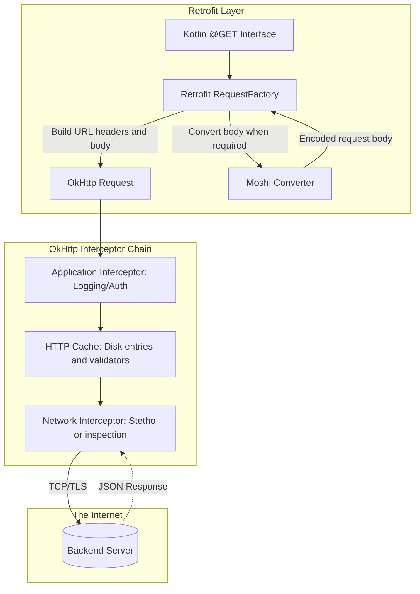

# Retrofit and OkHttp

## Overview

`OkHttp` and `Retrofit`, both from Square, are established choices in Android networking.

While Junior developers use these libraries to simply fetch JSON from a server, a Staff Engineer understands the deep architectural split between the two. `OkHttp` is the low-level HTTP client (handling sockets, connection pooling, and caching), while `Retrofit` is the high-level declarative wrapper (handling URL routing, serialization, and coroutine integration).

Understanding how to manipulate the `OkHttp` interceptor chain is critical for building resilient apps that gracefully handle authentication token refresh, offline caching, and massive file uploads.

## Why It Matters

Mobile networks are hostile. Users walk onto elevators, drive through tunnels, and connect to captive Wi-Fi portals (like Starbucks) that intercept HTTPS traffic.

If a networking layer treats every failure as a crash, the experience is brittle. Centralize shared HTTP concerns such as authentication and cache policy, but retry only transient failures under a bounded policy when the operation and body are safe to replay. Honor cancellation, deadlines, backoff, and server hints; offline behavior depends on deliberately cached or persisted data.

## Historical Context

Before OkHttp became common, Android applications often used `HttpURLConnection` or Apache HTTP Client and had to account for platform-version behavior and lower-level HTTP details. Historical Android releases included connection-reuse defects that libraries and applications worked around.

Square built `OkHttp` to bypass these OS bugs by bundling a complete, heavily-tested HTTP client directly into the app APK. 

Square later built Retrofit as a declarative API layer over OkHttp. Compared with hand-built URLs and ad hoc parsing, generated request mappings and converter boundaries can reduce construction and decoding mistakes, though contracts still require tests and error handling.

## First Principles

1.  **`OkHttp` (The Engine):** Responsible for making the physical TCP/TLS connection to the server. It manages connection pooling, HTTP/2 multiplexing, and GZIP compression.
2.  **`Retrofit` (The Steering Wheel):** Responsible for translating a Kotlin interface (`@GET("/users")`) into a raw `okhttp3.Request` object, and translating the raw `okhttp3.Response` back into Kotlin Data Classes using a Converter (like Moshi or Gson).
3.  **Interceptors:** A powerful middleware pattern in `OkHttp` that allows you to inspect, modify, or completely rewrite requests and responses before they hit the network.
4.  **Converters:** Pluggable factories in `Retrofit` that handle serialization (JSON to Kotlin).
5. **CallAdapters:** Factories adapting Call<T> to supported return types such as RxJava types or third-party adapters. Retrofit handles suspend service methods through built-in suspend support, not a Coroutine CallAdapter.

## Mental Model

Think of networking as **Shipping a Package**.
- **Retrofit:** The Front Desk clerk. You hand them a Kotlin object. They translate it into a standard cardboard box (Serialization), write the address on it (Routing), and hand it to the delivery driver.
- **OkHttp:** The Delivery Driver. They get in the truck, choose the fastest highway (Connection Pooling), stop at toll booths (Interceptors), physically drive to the destination (TCP Socket), and bring the response box back.

## Internal Mechanics

### The Interceptor Chain

The most powerful feature of `OkHttp` is the Interceptor chain. It is an implementation of the Chain of Responsibility pattern.

```kotlin
import java.io.IOException
import okhttp3.*

// Dedicated authenticated client: one store per login session, never reused
// for another account. Public/third-party requests use a separate client.
class AuthInterceptor(
    private val store: SessionTokenStore,
    private val apiOrigin: HttpUrl,
) : Interceptor {
    override fun intercept(chain: Interceptor.Chain): Response {
        val request = chain.request()
        if (!request.url.sameOriginAs(apiOrigin)) {
            throw IOException("Authenticated client used outside its API origin")
        }
        val tokens = store.current() ?: throw IOException("Session ended")
        return chain.proceed(request.newBuilder()
            .header("Authorization", "Bearer ${tokens.accessToken}")
            .build())
    }
}

fun HttpUrl.sameOriginAs(other: HttpUrl): Boolean =
    scheme == "https" && scheme == other.scheme && host == other.host && port == other.port
```

The origin policy intentionally requires HTTPS, including local auth tests. For socket tests, configure MockWebServer with `useHttps`, a certificate for its test hostname, and a client that trusts only the test CA; set `apiOrigin` from that HTTPS server URL. In-memory interceptor tests can use an HTTPS URL without opening a socket. Plain-HTTP tests use a separate unauthenticated client; do not weaken this production origin check for them.

There are two types of Interceptors:
1.  **Application Interceptors:** The first thing to run. Best for adding headers (like Auth) or logging the exact request the app made.
2.  **Network Interceptors:** The last thing to run before hitting the wire. They see exactly what is sent over the network (including injected headers like `Accept-Encoding: gzip` added automatically by OkHttp). Best for inspecting caching and redirect behavior.

## Architecture



## Production Example

**The Authenticator (Token Refresh)**

A classic Junior mistake is handling Token Refresh inside the ViewModel or Repository using `try/catch(401)`. 

For challenge-based renewal, an OkHttp `Authenticator` can centralise a bounded refresh attempt and follow-up for each call. Queued calls share a successful refresh or a terminal rejection; transient failures can be retried by later calls under the caller's bounded retry policy. Account ownership must survive the whole exchange: a request made as A must never be retried using B's credentials.

The following design creates a fresh store and authenticated client for **each login session**, including a re-login to the same account. Logout/account switch invalidates the old store before publishing the new session. No code repopulates an invalidated store or swaps another account into it. The operation retains its original session's client; UI/result persistence also checks that session before accepting results.

```kotlin
data class SessionTokens(val accessToken: String, val refreshToken: String) {
    init { require(accessToken.isNotBlank() && refreshToken.isNotBlank()) }
    override fun toString(): String = "SessionTokens(accessToken=[redacted], refreshToken=[redacted])"
}

class SessionTokenStore(initial: SessionTokens) {
    private var tokens: SessionTokens? = initial

    @Synchronized fun current(): SessionTokens? = tokens
    @Synchronized fun invalidate() { tokens = null }

    @Synchronized fun invalidateIfCurrent(expected: SessionTokens): Boolean {
        if (tokens != expected) return false
        tokens = null
        return true
    }

    // Login/logout and refresh share this atomic storage boundary.
    // Once invalidated, this store cannot be resurrected by a late refresh.
    @Synchronized fun replaceIfCurrent(
        expected: SessionTokens,
        replacement: SessionTokens,
    ): SessionTokens? {
        if (tokens != expected) return null
        tokens = replacement
        return replacement
    }
}

// App-defined adapter on a dedicated, bounded refresh client. It uses ONLY
// the captured session's refresh token, returns rotated credentials, and
// returns null ONLY for a confirmed terminal credential rejection. Transient
// transport/HTTP failures throw IOException instead. It never reads a global account.
fun interface AuthApi {
    @Throws(IOException::class)
    fun refreshSynchronouslyOrNull(refreshToken: String): SessionTokens?
}

class TokenAuthenticator(
    private val store: SessionTokenStore,
    private val apiOrigin: HttpUrl,
    private val refreshApi: AuthApi,
) : Authenticator {
    override fun authenticate(route: Route?, response: Response): Request? {
        val request = response.request
        if (!request.url.sameOriginAs(apiOrigin)) return null
        val failedAuthorization = request.header("Authorization") ?: return null
        val challengeCount = generateSequence(response) { it.priorResponse }
            .count { it.code == 401 }
        if (challengeCount >= 2) return null
        if (request.body?.isOneShot() == true || request.body?.isDuplex() == true) return null

        return synchronized(this) {
            val current = store.current() ?: return@synchronized null
            val retryTokens = if ("Bearer ${current.accessToken}" != failedAuthorization) {
                current // Another call refreshed this same login session.
            } else {
                // IOException propagates without changing the store.
                val replacement = refreshApi.refreshSynchronouslyOrNull(current.refreshToken)
                if (replacement == null) {
                    store.invalidateIfCurrent(current)
                    return@synchronized null
                }
                store.replaceIfCurrent(current, replacement) ?: return@synchronized null
            }
            if (store.current() != retryTokens) return@synchronized null
            request.newBuilder()
                .header("Authorization", "Bearer ${retryTokens.accessToken}")
                .build()
        }
    }
}
```

A confirmed terminal refresh rejection conditionally invalidates only the token pair that was refreshed. Later queued 401s see the ended session and return null without another refresh. Returning null from the authenticator delivers the challenged 401 response to the caller. Re-login is triggered by invalidation of that operation's session, not by every 401: if the conditional invalidation fails because a newer token pair was installed, that newer pair stays valid. A new call after invalidation fails locally with `IOException("Session ended")`.

A transient refresh I/O failure leaves the store intact and propagates `IOException` to `execute()` or `enqueue()` failure handling (and through Retrofit's suspend call). It does not trigger re-login by itself. The adapter must distinguish terminal credential rejection from transport failure, rate limiting, or a temporary server outage; it must not map every unsuccessful HTTP response to null. A later call may retry within a bounded backoff policy.

This store illustrates process-local synchronisation, not secure persistent token storage. A production store must preserve the same session identity, invalidation, and conditional-update guarantees across its actual storage boundary. The refresh adapter must not fall back to another account. The explicit `toString()` redacts both values while data-class equality still compares them; it does not protect property access, destructuring, or generic serialisation. Do not log tokens.

For DI, inject a factory/session manager whose lifetime may be the application's; that owner creates and retains a fresh client, Retrofit service, and store for each login, invalidates the old store on logout, and discards the old graph. Hilt's `@Singleton` follows `SingletonComponent` (the application), not login/logout. Do not bind one authenticated session client as the application singleton or infer a login lifetime from `@ActivityScoped`. A process-lived neutral/public client can be shared separately. See [Hilt component lifetimes](https://developer.android.com/training/dependency-injection/hilt-android#component-lifetimes).

Construct refresh and authenticated clients independently. The refresh client must have neither the auth interceptor nor this authenticator; disabling only the authenticator on a cloned client does not remove inherited interceptors. Bound refresh I/O (for example, `callTimeout`) and restrict its origin. Disabling redirects on these dedicated clients simplifies the origin policy; public/content clients can have a separate policy.

Only replay when the API contract makes a 401 follow-up safe, the body is replayable, and write operations have their required idempotency protection. Cancellation of old calls and rejection of old-session results on account switch are additional controls: invalidating local tokens cannot retract a request already sent to the server or revoke a server session by itself.

## Tradeoffs

**Moshi vs Gson vs Kotlin Serialization**

Choosing the `Converter` for Retrofit is a critical architectural decision.

- **Gson:** The legacy Google library. 
    - *Tradeoffs:* Reflection-based mappings can bypass Kotlin constructor/nullability expectations unless suitable adapters and tests are used. Existing Gson systems may remain viable, but new Kotlin models should make null, default, and unknown-value behavior explicit.
- **Moshi:** Built by Square (the creators of Retrofit).
    - *Pros:* Kotlin-aware adapters and code generation can enforce declared constructor/nullability behavior without reflection for generated models.
    - *Tradeoffs:* Adapter setup, defaults, qualifiers, and performance depend on configuration and schema.
- **Kotlinx Serialization:** The official JetBrains library.
    - *Pros:* Compiler-plugin-generated serializers and Kotlin Multiplatform support.
    - *Tradeoffs:* Its JSON configuration rejects unknown keys by default, and annotation/configuration choices become part of the wire contract. Benchmark representative models rather than assuming a universal speed ranking.

## Failure Modes

- **The DI Circular Dependency Loop:**
  If your `TokenAuthenticator` injects your `Retrofit` instance (to make the refresh call), and your `Retrofit` instance injects your `OkHttpClient` (which requires the `TokenAuthenticator`), you have a circular dependency loop. Dagger/Hilt will refuse to compile.
  *(Fix: Build the refresh API on a dedicated bounded client with no token authenticator, then inject that API into the authenticated client. `Lazy`/`Provider` can defer a construction cycle but does not prevent runtime authenticator recursion if both APIs share the same authenticated client.)*
- **Reading the Interceptor Body Twice:**
  ```kotlin
  val bodyString = response.body?.string() // 1. Read the stream
  Log.d("API", bodyString)
  return response // 2. Pass to Retrofit
  ```
  *(Fix: In OkHttp, the response body is a one-time-use byte stream. If you call `.string()`, the stream is consumed and closed. When Retrofit tries to read it to parse the JSON, it crashes with `IllegalStateException: closed`. You must `peek()` the body or clone the buffer for logging).*
- **Leaking response-body resources:**
  If you download a large file (`@Streaming`) but fail to close its `ResponseBody`, the response does not promptly release its stream/socket resources. That may prevent connection reuse or consume HTTP/2 stream capacity until cleanup occurs. Repeated leaks increase connection churn and may eventually hit file-descriptor, dispatcher, peer, or network limits. The default connection-pool setting of five refers to **idle** connections, not a five-request maximum, so there is no universal “five leaks and every request hangs” threshold.

## Staff Engineer Thinking

When reviewing the Network layer, a Staff engineer focuses on resilience and global configurations:

1.  **Timeouts:** Review connect, read, write, and whole-call deadlines against the operation and supported network cohorts. Defaults and appropriate values vary by OkHttp version, request type, UX, and backend budget; verify behavior with fault tests.
2.  **Mocking via interceptors:** An interceptor-backed fake can exercise URL paths, verbs, converters, and response handling. Interface fakes are faster and more focused for domain tests; choose the boundary that matches the behavior under test.
3. **Error classification:** Map transport failures at an owned repository boundary and retain their cause. DNS failure, connection refusal and timeout do not prove the device is offline. If an interceptor wraps failures, preserve IOException compatibility for OkHttp's asynchronous failure contract. Use connectivity observations as context rather than a substitute for request results.

## Common Misconceptions

- **"A raw Retrofit `Call<T>` is entirely synchronous."** A raw call supports asynchronous `enqueue()` and blocking `execute()`. The blocking form must not run on the main thread; a Retrofit `suspend` service method uses OkHttp's asynchronous execution path.
- **"I need Dispatchers.IO around every Retrofit suspend call."** Retrofit's built-in suspend support enqueues the HTTP call through OkHttp. That network wait does not need an extra IO wrapper; separately owned blocking work and CPU-heavy parsing/mapping still need an appropriate execution policy.

## Probing Questions

1.  What is the architectural distinction between `OkHttp` and `Retrofit`? Why did Square separate them?
2.  Explain the "Chain of Responsibility" pattern as it applies to `OkHttp` Interceptors.
3.  What is the difference between an Application Interceptor and a Network Interceptor?
4.  Why is Gson considered dangerous to use with Kotlin Data Classes, and what library should you use instead?
5.  If you write an Interceptor to log the JSON response body using `response.body()?.string()`, why will your application crash when Retrofit attempts to parse the object?
6.  Describe how you would implement a transparent OAuth Token Refresh mechanism without putting `try/catch` logic inside your ViewModels or Repositories.
7.  What is a Circular Dependency, and how does it commonly occur when setting up an `OkHttp` Authenticator with Dependency Injection (Hilt)?
8.  Why is it unnecessary to wrap a Retrofit `suspend` function inside a `withContext(Dispatchers.IO)` block?
9.  If you use `@Streaming` to download a large response, what ownership step prevents socket, file-descriptor, and response-body resource leaks?
10. Describe how you could use an `OkHttp` Interceptor to implement a complete "Offline First" mock backend for your Android application.

## Answer Key

1. **What is the architectural distinction between `OkHttp` and `Retrofit`? Why did Square separate them?**
   `OkHttp` is the low-level engine handling TCP sockets, HTTP multiplexing, and caching. `Retrofit` is a high-level API for declarative URL routing and serialization. They were separated to follow the single responsibility principle and allow each layer to be highly optimized and composable.
2. **Explain the "Chain of Responsibility" pattern as it applies to `OkHttp` Interceptors.**
   Each interceptor can inspect, modify, or rewrite a request before passing it to `chain.proceed()`, and then process the response when it returns. It delegates execution step-by-step to the network boundary and back.
3. **What is the difference between an Application Interceptor and a Network Interceptor?**
   Application Interceptors run first, intercepting the original call, ideal for auth headers and app-level logging. Network Interceptors run last, seeing exactly what is sent/received over the wire (including redirects and caching headers).
4. **Why is Gson considered dangerous to use with Kotlin Data Classes, and what library should you use instead?**
   Gson uses reflection and ignores Kotlin null-safety rules, potentially instantiating non-null fields as `null` if they are missing in JSON. Use Moshi or kotlinx.serialization instead.
5. **If you write an Interceptor to log the JSON response body using `response.body()?.string()`, why will your application crash when Retrofit attempts to parse the object?**
   `response.body()?.string()` consumes and closes the one-time-use byte stream. Retrofit will crash with an `IllegalStateException` when trying to read the already-closed stream.
6. **Describe how you would implement a transparent OAuth Token Refresh mechanism without putting `try/catch` logic inside your ViewModels or Repositories.**
   Use an OkHttp `Authenticator`, which runs synchronously on the call's execution thread after an authentication challenge. Coalesce refreshes: inside a bounded single-flight/mutex, re-read storage and reuse a credential changed since the failed request; only the first caller refreshes. Return a follow-up request with the new credential, cap follow-ups, and return `null` when recovery is unsafe or fails.
7. **What is a Circular Dependency, and how does it commonly occur when setting up an `OkHttp` Authenticator with Dependency Injection (Hilt)?**
   It occurs when the authenticator needs a Retrofit refresh API, that Retrofit needs the authenticated OkHttp client, and the client needs the authenticator. Build the refresh API on a separate bounded client without this authenticator. `Lazy`/`Provider` can defer construction but does not prevent runtime recursion when refresh uses the same authenticated client.
8. **Why is it unnecessary to wrap a Retrofit `suspend` function inside a `withContext(Dispatchers.IO)` block?**
   Retrofit's Coroutine integration automatically offloads the network call to a background thread natively through OkHttp's asynchronous execution.
9. **If you use `@Streaming` to download a large response, what ownership step prevents socket, file-descriptor, and response-body resource leaks?**
   Close the `ResponseBody`, preferably with `use { ... }`. OkHttp may reuse the connection when the protocol and body state permit; otherwise closing promptly releases or discards the underlying resources. There is no fixed five-leak pool-capacity threshold.
10. **Describe how you could use an `OkHttp` Interceptor to implement a complete "Offline First" mock backend for your Android application.**
   Write a MockInterceptor that intercepts requests, checks the URL path or method, and returns a crafted `Response` containing hardcoded JSON using `ResponseBody.create()` without ever calling `chain.proceed()` to the real network.

## Further Reading

- [`dependency-injection.md`](../data-and-di/dependency-injection.md) — Hilt provider and lifetime mechanics; authenticated clients here are owned by a per-login factory rather than the process-wide Retrofit example.
- [`coroutines-under-the-hood.md`](../concurrency/coroutines-under-the-hood.md) — How Retrofit automatically bridges `Call<T>` into Coroutine State Machines.
- [OkHttp Interceptor API](https://github.com/square/okhttp/blob/master/okhttp/src/commonJvmAndroid/kotlin/okhttp3/Interceptor.kt)
- [OkHttp `ResponseBody`](https://lysine.dev/okhttp/5.x/okhttp/okhttp3/-response-body/index.html) — Closing response bodies and resource ownership.
- [OkHttp `ConnectionPool`](https://lysine.dev/okhttp/5.x/okhttp/okhttp3/-connection-pool/index.html) — Idle-connection configuration.

### Official verification references

- [Primary documentation or owning implementation](https://github.com/square/okhttp/blob/master/okhttp/src/commonJvmAndroid/kotlin/okhttp3/internal/connection/RealCall.kt)
- [Primary documentation or owning implementation](https://github.com/square/okhttp/blob/master/okhttp/src/commonJvmAndroid/kotlin/okhttp3/internal/http/BridgeInterceptor.kt)
- [Primary documentation or owning implementation](https://github.com/square/retrofit/blob/trunk/retrofit/src/main/java/retrofit2/HttpServiceMethod.java)
- [Primary documentation or owning implementation](https://github.com/square/retrofit/blob/trunk/retrofit/src/main/java/retrofit2/RequestFactory.java)
- [Primary documentation or owning implementation](https://raw.githubusercontent.com/square/retrofit/trunk/retrofit/src/main/java/retrofit2/RequestFactory.java)
- [OkHttp Authenticator contract](https://github.com/square/okhttp/blob/master/okhttp/src/commonJvmAndroid/kotlin/okhttp3/Authenticator.kt)
- [OkHttp RequestBody replayability](https://github.com/square/okhttp/blob/master/okhttp/src/commonJvmAndroid/kotlin/okhttp3/RequestBody.kt)
- [Kotlin shared mutable state](https://kotlinlang.org/docs/shared-mutable-state-and-concurrency.html)
- [Kotlin data-class generated members](https://kotlinlang.org/docs/data-classes.html)
- [Hilt lifetimes and scopes](https://developer.android.com/training/dependency-injection/hilt-android#component-lifetimes)
- [MockWebServer 4.12 HTTPS configuration](https://github.com/square/okhttp/blob/parent-4.12.0/mockwebserver/src/main/kotlin/okhttp3/mockwebserver/MockWebServer.kt)
- [OkHttp TLS test certificates](https://github.com/square/okhttp/blob/parent-4.12.0/okhttp-tls/src/main/kotlin/okhttp3/tls/HandshakeCertificates.kt)
