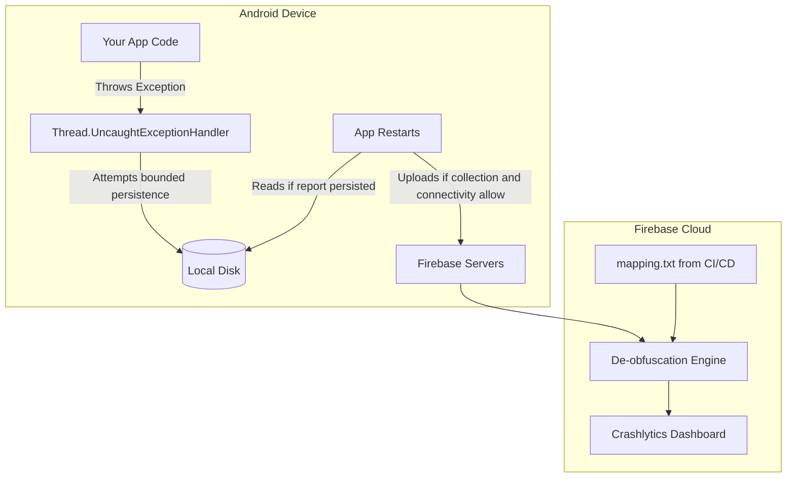

# Crash Monitoring (Firebase Crashlytics)

## Overview

A mobile application in production is a hostile environment. You do not control the hardware. You do not control the OS version. You do not control the network. And you do not control the user's battery-saving settings.

At fleet scale, crashes and process failures are operational risks to measure and reduce, not events that one SDK can universally capture.

A Staff Engineer does not view crashes as moral failings. They view them as operational evidence. The goal is not "Zero Crashes," but a **Crash Monitoring System** with measured capture coverage, symbolication, useful grouping, privacy controls, ownership, and alerts aligned to user impact. No client-side reporter can guarantee capture under every storage, process, consent, or device failure.

Firebase Crashlytics is one widely used Android crash-reporting service; teams should evaluate it against platform vitals, privacy/consent, native coverage, retention, export, and operational requirements.

## Why It Matters

If a user tweets: *"Your app crashed when I tried to buy tickets!"*

Without Crashlytics, you have to ask them: *"What phone do you have? What OS? Did you have Wi-Fi? Can you plug it into a laptop and run `adb logcat`?"* (They will ignore you).

Once reports arrive and symbolication/grouping succeed, a dashboard can reveal affected versions, devices, and cohorts. Diagnosis and remediation time still depends on report quality, reproduction, ownership, rollback controls, and release propagation.

## Historical Context

- **The Dark Ages (Pre-2012):** Developers relied on the Google Play Developer Console, which only showed crashes if the user explicitly clicked "Send Report" on the Android OS crash dialog (less than 5% of users did this).
- **Crashlytics (2012):** A startup created a magic SDK that automatically intercepted uncaught exceptions and uploaded them. It was so revolutionary that Twitter bought them in 2013 for over $100 million.
- **Firebase Acquisition (2017):** Google bought Fabric/Crashlytics from Twitter and deeply integrated it into Firebase, sunsetting their own inferior "Firebase Crash Reporting" tool.

## First Principles

1.  **Uncaught Exception Handler:** A managed-runtime callback for uncaught exceptions. It does not cover every native signal, low-memory/process termination, persistence failure, or disabled-collection case.
2.  **De-obfuscation (`mapping.txt`):** Converting meaningless minified class names (`a.b.c`) back into readable Kotlin names (`UserRepository`).
3.  **Fatal vs Non-Fatal:** A Fatal crash kills the app. A Non-Fatal crash is an exception you caught (`try/catch`), but still want to report to the dashboard.
4.  **Breadcrumbs (Logs):** Custom log messages attached to a crash report to tell you what the user did *before* the crash.

## Mental Model

Think of Crashlytics as a **Crime Scene Investigator (CSI)**.
- A murder (Crash) happens in your app. The Android OS arrives and puts yellow tape around the area (kills the process).
- The investigator attempts a minimal local record through the mechanism available for that managed or native failure.
- If capture succeeds, the record can contain a stack, approved device/app context, and bounded, redacted breadcrumbs.
- On a later launch, the SDK may upload a persisted report when collection settings, retention, storage, and connectivity allow.

## Internal Mechanics

### 1. The Global Interceptor

For supported uncaught managed exceptions, one relevant mechanism is registration of a default uncaught-exception handler. This conceptual sketch omits other SDK initialization, persistence, consent, and native-reporting paths:

```java
// Simplified conceptual overview of the Crashlytics SDK
Thread.UncaughtExceptionHandler defaultHandler = Thread.getDefaultUncaughtExceptionHandler();

Thread.setDefaultUncaughtExceptionHandler(new Thread.UncaughtExceptionHandler() {
    @Override
    public void uncaughtException(Thread thread, Throwable throwable) {
        // 1. App is about to die!
        // 2. Quickly write the Throwable stack trace and device state to the local Disk (SQLite/File).
        saveCrashToDisk(thread, throwable); 
        
        // 3. We cannot upload it to the network right now, because the OS is killing us!
        
        // 4. Hand control back to the OS to actually crash the app.
        defaultHandler.uncaughtException(thread, throwable);
    }
});
```

Crashlytics normally persists a bounded report locally and attempts upload on a later launch when collection and connectivity allow. Persistence, consent/collection settings, retention limits, storage exhaustion, or process failure can still lose a report; do not treat local capture as indefinite durable delivery.

### 2. The NDK (C++) Crash Handler

An uncaught managed exception follows the runtime's uncaught-exception path. A fatal native signal such as `SIGSEGV` instead terminates the Linux app process and produces native crash diagnostics; Java's `UncaughtExceptionHandler` is not the interception mechanism for that signal. Native crash reporters use signal-aware native handling and symbol files, subject to the severe safety constraints of a crashing process.

Native crash reporting uses low-level signal handling and platform crash infrastructure to capture a minimal diagnostic record before termination. `SIGSEGV` is a synchronous fault signal, not a “kill signal,” and arbitrary work is unsafe in a signal handler. Android's debuggerd/tombstone pipeline and an SDK's own persisted native report are related diagnostic mechanisms but should not be described as the SDK simply writing the platform tombstone itself.

## Architecture



## Production Example

**Breadcrumbs and Custom Keys**

A stack trace often needs context. Add a small, schema-reviewed set of redacted or pseudonymous breadcrumbs/keys whose collection purpose, access, retention, consent, and cardinality are approved.

```kotlin
class PaymentRepository {
    fun processPayment(cartId: String, method: PaymentMethod) {
        // 1. Add a Breadcrumb (A trail of breadcrumbs leading to the crash)
        FirebaseCrashlytics.getInstance().log("Started payment")
        
        // 2. Set a Custom Key (A global variable attached to the crash report)
        FirebaseCrashlytics.getInstance().setCustomKey("payment_method", method.name)
        
        try {
            api.execute(cartId)
        } catch (e: Exception) {
            // 3. Log a Non-Fatal exception
            FirebaseCrashlytics.getInstance().recordException(e)
            throw e // Or handle it
        }
    }
}
```

If collection succeeds, the report can include the redacted breadcrumb and approved payment-method category. Avoid raw cart/business identifiers unless their diagnostic need and governance controls are explicit.

## Tradeoffs

**Non-Fatal Logging vs Quota/Noise**

- **Tradeoff:** Code can call `recordException()` for handled failures, but SDK retention and delivery are bounded, so selection and sampling still matter.
- **The Problem:** If you catch `java.net.UnknownHostException` (the user lost Wi-Fi) and log it as a Non-Fatal, your dashboard will be flooded with 50,000 "crashes" a day. The engineering team will experience "Alert Fatigue" and stop looking at the dashboard entirely. Real, fatal crashes will be buried under the noise of network timeouts.
- **The Staff Decision:** Protect the non-fatal signal budget. Record exceptions when they identify an actionable product defect or violated invariant, and apply sampling, grouping, privacy classification, and volume limits. Expected environmental outcomes such as routine timeouts or unavailable location normally belong in operational metrics or structured diagnostic events—not automatically in product analytics and not as one exception per occurrence. Escalate them to exception reporting only when the context makes them actionable, such as a regression in a specific code path.

## Failure Modes

- **The Obfuscated Nightmare:**
  As discussed in [App Size and R8](../performance/app-size-and-r8.md), a missing matching `mapping.txt` leaves managed frames obfuscated and much harder to interpret, though other context may still be useful.
  *(Fix: Ensure the `firebase-crashlytics-gradle` plugin is correctly configured in your `build.gradle` so it automatically uploads the mapping file during the `assembleRelease` task).*
- **Crashing the Crash Handler:**
  If capture or persistence fails during termination—for example because storage is unavailable—the report may be incomplete or lost.
  *(Fix: Prefer a maintained capture SDK unless product requirements justify a carefully tested custom layer; still monitor capture coverage and complement it with platform telemetry.)*

## Staff Engineer Thinking

When reviewing Crash Monitoring strategy, a Staff engineer focuses on Workflow and Accountability.

1.  **Crash-free sessions and users:** Track both and segment by journey/cohort. Repeated crashes for one user can expose a severe loop even when fleet-wide user percentage looks small.
2.  **Velocity metrics:** Define paging thresholds from baseline, affected journey, cohort size, severity, sample confidence, and rollback capability rather than a universal percentage.
3.  **Velocity and rollouts:** Choose rollout steps and halt criteria from product risk and observability latency. A new or growing crash may justify pause, kill switch, rollback, or investigation; no fixed 10% step fits every release.

### Triage policy

Crash triage needs rules before the incident, not during it.

| Signal | Route | First action |
|---|---|---|
| New fatal crash in current rollout, growing faster than baseline | Page release owner | Evaluate predeclared halt/rollback criteria; inspect affected feature flags and cohort |
| Existing crash steady across many versions | Backlog with owner | Fix by priority; do not page |
| Crash isolated to one OEM/API cohort | Release/performance channel | Gate rollout or disable cohort-specific feature |
| Non-fatal volume spike from expected network/device failures | Usually no page | Prefer operational metrics or sampled structured diagnostics; use product analytics only for a defined product event |
| Crash in checkout/login/onboarding | Page feature owner | Kill switch, server fallback, or hotfix |

Every top crash cluster should have an owner, a first-seen version, a last-seen version, and a decision: fix, monitor, suppress, or accept. Suppression must be rare and documented; otherwise the dashboard becomes a landfill.

## Common Misconceptions

- **"I caught the exception, so there is nothing to observe."** False. A handled failure can still harm the experience, but the signal should match its actionability, volume, privacy, and ownership: sampled exception reporting, an operational metric, a structured diagnostic event, or a product event are different choices.
- **"Crashlytics requires the user to be online at crash time."** Not normally. The SDK can persist a bounded report and attempt upload on a later launch, but storage, retention, collection/consent, process failure, or the absence of a later launch can still prevent delivery.

## Probing Questions

1.  For supported uncaught managed exceptions, what role can `Thread.setDefaultUncaughtExceptionHandler` play before process termination, and what failures use different paths?
2.  Why does Crashlytics save the crash payload to the local disk instead of immediately uploading it to the network when the crash occurs?
3.  How does a missing matching R8 `mapping.txt` affect diagnosis of minified managed stack frames?
4.  What is the difference between a Fatal crash and a Non-Fatal exception in the context of the Firebase dashboard?
5.  When should an expected network timeout be kept out of per-occurrence non-fatal reporting, and when might aggregated or sampled diagnostics make it actionable?
6.  Explain how a Staff Engineer utilizes "Breadcrumbs" and "Custom Keys" to debug a `NullPointerException` that only happens randomly.
7.  How does catching a C++ (NDK) `SIGSEGV` crash differ fundamentally from catching a standard Java `RuntimeException`?
8.  Describe the difference between "Crash-Free Sessions" and "Crash-Free Users." Why should a team inspect both by journey and cohort?
9.  How can you use Firebase Crashlytics in conjunction with the Google Play Store's "Staged Rollout" feature to protect your user base from a bad release?
10. If the user's phone is completely out of physical storage space, what happens to the Crashlytics report when the app crashes?

## Answer Key

1. **For supported uncaught managed exceptions, what role can `Thread.setDefaultUncaughtExceptionHandler` play before process termination, and what failures use different paths?**
   For supported uncaught managed exceptions, a registered handler receives the throwable before normal termination continues and can attempt bounded local capture. Native signals, abrupt process death, disabled collection, or failed persistence use different paths or may escape capture.
2. **Why does Crashlytics save the crash payload to the local disk instead of immediately uploading it to the network when the crash occurs?**
   Network work is unsafe and unlikely to finish during termination, so the SDK attempts bounded local persistence and later upload. This improves capture probability but cannot ensure a report survives storage, consent, retention, or process failures.
3. **How does a missing matching R8 `mapping.txt` affect diagnosis of minified managed stack frames?**
   Reports can still arrive, but affected managed frames remain obfuscated (for example, `a.b.c.d(Unknown Source)`), greatly reducing class/method readability and grouping quality. Other approved context may remain useful.
4. **What is the difference between a Fatal crash and a Non-Fatal exception in the context of the Firebase dashboard?**
   A fatal event represents a captured process-terminating managed or native failure through its relevant reporting path. A non-fatal is a handled throwable the application explicitly records; recording it does not terminate the process.
5. **When should an expected network timeout be kept out of per-occurrence non-fatal reporting, and when might aggregated or sampled diagnostics make it actionable?**
   Routine connectivity loss is usually too frequent and environment-dependent for one exception report per occurrence; use bounded operational metrics or structured diagnostics instead. Sampled exception context can be appropriate when a specific code path regresses, violates a product invariant, or gives an owner enough evidence to act.
6. **Explain how a Staff Engineer utilizes "Breadcrumbs" and "Custom Keys" to debug a `NullPointerException` that only happens randomly.**
   Breadcrumbs show the sequence of user actions leading up to the crash, and Custom Keys attach specific state (e.g., `user_tier=premium`). This context explains *why* the random state occurred, beyond just the stack trace.
7. **How does catching a C++ (NDK) `SIGSEGV` crash differ fundamentally from catching a standard Java `RuntimeException`?**
   Uncaught managed exceptions pass through the runtime's `UncaughtExceptionHandler`. A fatal NDK signal terminates the app's Linux process through a different native-crash path, so Java exception handling cannot capture it. Native tooling relies on signal-safe capture/tombstones plus matching native symbols for diagnosis.
8. **Describe the difference between the "Crash-Free Sessions" metric and the "Crash-Free Users" metric. Why should a team inspect both?**
   Crash-free users measures unique-user reach, while crash-free sessions reflects recurrence across sessions. Inspect both by journey and cohort: a small user cohort can still suffer a severe repeat-crash loop.
9. **How can you use Firebase Crashlytics in conjunction with the Google Play Store's "Staged Rollout" feature to protect your user base from a bad release?**
   Define staged cohorts, observation windows, and halt/rollback criteria from baseline and feature risk. Segment new crash velocity by release and journey, then pause, roll back, disable a feature, or continue based on severity and confidence.
10. **If the user's phone is completely out of physical storage space, what happens to the Crashlytics report when the app crashes?**
    Local persistence may fail, so Crashlytics may be unable to deliver that report after termination. Platform crash telemetry or a previously persisted partial record may still provide evidence, but client-side delivery is not guaranteed.

## Further Reading

- [`app-size-and-r8.md`](../performance/app-size-and-r8.md) — The matching mapping used to de-obfuscate minified managed frames.
- [`mobile-apm-and-rum.md`](mobile-apm-and-rum.md) — The APM/RUM layer that monitors performance when the app *isn't* crashing.
- [`../../observability/telemetry-taxonomy.md`](../../observability/telemetry-taxonomy.md) — Canonical choice among exception reports, operational metrics, logs, traces, product events, and breadcrumbs.
- [Firebase: Crashlytics Documentation](https://firebase.google.com/docs/crashlytics)
- [AOSP: Diagnose native crashes](https://source.android.com/docs/core/tests/debug/native-crash) — Signals, tombstones, and native symbols.
- [OpenTelemetry: Signals](https://opentelemetry.io/docs/concepts/signals/) — Logs, metrics, and traces as distinct operational signals.
