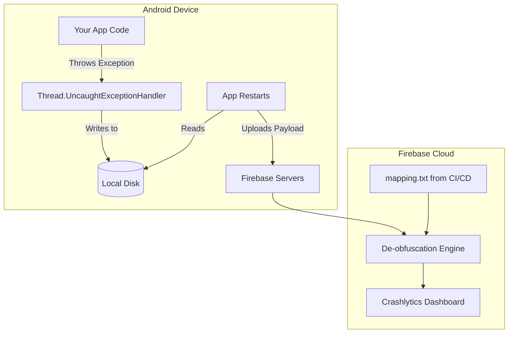

# Crash Monitoring (Firebase Crashlytics)

## Overview

A mobile application in production is a hostile environment. You do not control the hardware. You do not control the OS version. You do not control the network. And you do not control the user's battery-saving settings.

Because of this, your app *will* crash. It is a mathematical certainty.

A Staff Engineer does not view crashes as moral failings. They view them as data points. The goal is not "Zero Crashes." The goal is a highly tuned **Crash Monitoring System** that captures every fatal exception, de-obfuscates the bytecode, aggregates the stack traces by root cause, and alerts the engineering team before a 1-star review storm begins.

In the Android ecosystem, the undisputed industry standard for this is **Firebase Crashlytics**.

## Why It Matters

If a user tweets: *"Your app crashed when I tried to buy tickets!"*

Without Crashlytics, you have to ask them: *"What phone do you have? What OS? Did you have Wi-Fi? Can you plug it into a laptop and run `adb logcat`?"* (They will ignore you).

With Crashlytics, you open the dashboard and immediately see: `java.lang.NullPointerException at com.example.CartViewModel.checkout(CartViewModel.kt:42)`. You also see that this specific crash only happens on Android 11, only when the device has less than 10% RAM available, and 450 other users have experienced it in the last hour. You deploy a hotfix in 10 minutes.

## Historical Context

- **The Dark Ages (Pre-2012):** Developers relied on the Google Play Developer Console, which only showed crashes if the user explicitly clicked "Send Report" on the Android OS crash dialog (less than 5% of users did this).
- **Crashlytics (2012):** A startup created a magic SDK that automatically intercepted uncaught exceptions and uploaded them. It was so revolutionary that Twitter bought them in 2013 for over $100 million.
- **Firebase Acquisition (2017):** Google bought Fabric/Crashlytics from Twitter and deeply integrated it into Firebase, sunsetting their own inferior "Firebase Crash Reporting" tool.

## First Principles

1.  **Uncaught Exception Handler:** The core mechanism. A global thread interceptor that acts as the absolute last line of defense before the OS murders your app.
2.  **De-obfuscation (`mapping.txt`):** Converting meaningless minified class names (`a.b.c`) back into readable Kotlin names (`UserRepository`).
3.  **Fatal vs Non-Fatal:** A Fatal crash kills the app. A Non-Fatal crash is an exception you caught (`try/catch`), but still want to report to the dashboard.
4.  **Breadcrumbs (Logs):** Custom log messages attached to a crash report to tell you what the user did *before* the crash.

## Mental Model

Think of Crashlytics as a **Crime Scene Investigator (CSI)**.
- A murder (Crash) happens in your app. The Android OS arrives and puts yellow tape around the area (kills the process).
- The CSI arrives fractions of a millisecond before the OS shuts everything down.
- The CSI takes photos of the weapon (Stack Trace), checks the victim's pockets (Device State: RAM, Battery, OS version), and interviews the witnesses (Breadcrumb logs: "The user tapped the checkout button 3 seconds ago").
- The CSI securely uploads this entire dossier to the Police Station (Firebase Dashboard) for the detectives (You) to solve the case.

## Internal Mechanics

### 1. The Global Interceptor

When you initialize Crashlytics, it does one very specific thing inside the JVM:

```java
// Simplified conceptual overview of the Crashlytics SDK
Thread.UncaughtExceptionHandler defaultHandler = Thread.getDefaultUncaughtExceptionHandler();

Thread.setDefaultUncaughtExceptionHandler(new Thread.UncaughtExceptionHandler() {
    @Override
    public void uncaughtException(Thread thread, Throwable throwable) {
        // 1. App is about to die!
        // 2. Quickly write the Throwable stack trace and device state to the local Disk (SQLite/File).
        saveCrashToDisk(thread, throwable); 
        
        // 3. We cannot upload it to the network right now, because the OS is killing us!
        
        // 4. Hand control back to the OS to actually crash the app.
        defaultHandler.uncaughtException(thread, throwable);
    }
});
```

Because the network is unreliable and slow, Crashlytics does *not* upload the crash immediately. It saves the JSON payload to the local disk. The next time the user opens the app (or via a background `WorkManager` job), Crashlytics silently uploads the dossier in the background.

### 2. The NDK (C++) Crash Handler

Java crashes are easy to catch. C++ (NDK) crashes are brutal. If you use an external SDK (like a WebRTC video engine or a custom OpenGL game engine) and it causes a `SIGSEGV` (Segmentation Fault), the entire JVM is instantly vaporized. The `UncaughtExceptionHandler` never runs.

Crashlytics handles this by using low-level Linux signal handlers (`sigaction`). When the Linux kernel sends the `SIGSEGV` kill signal, the Crashlytics C++ library intercepts it, writes a "Tombstone" file to disk, and allows the kill.

## Architecture



## Production Example

**Breadcrumbs and Custom Keys**

A stack trace only tells you *where* the code broke. It doesn't tell you *why* the data was corrupt. A Staff Engineer litters the architecture with Breadcrumbs and Keys.

```kotlin
class PaymentRepository {
    fun processPayment(cartId: String, method: PaymentMethod) {
        // 1. Add a Breadcrumb (A trail of breadcrumbs leading to the crash)
        FirebaseCrashlytics.getInstance().log("Started payment for cart: $cartId")
        
        // 2. Set a Custom Key (A global variable attached to the crash report)
        FirebaseCrashlytics.getInstance().setCustomKey("payment_method", method.name)
        
        try {
            api.execute(cartId)
        } catch (e: Exception) {
            // 3. Log a Non-Fatal exception
            FirebaseCrashlytics.getInstance().recordException(e)
            throw e // Or handle it
        }
    }
}
```

If this crashes, the dashboard will show the stack trace, PLUS a log saying "Started payment...", PLUS a metadata tag `payment_method = CREDIT_CARD`. This context is often the only way to solve the bug.

## Tradeoffs

**Non-Fatal Logging vs Quota/Noise**

- **Tradeoff:** You can log every single handled `try/catch` exception to Crashlytics using `recordException()`.
- **The Problem:** If you catch `java.net.UnknownHostException` (the user lost Wi-Fi) and log it as a Non-Fatal, your dashboard will be flooded with 50,000 "crashes" a day. The engineering team will experience "Alert Fatigue" and stop looking at the dashboard entirely. Real, fatal crashes will be buried under the noise of network timeouts.
- **The Staff Decision:** You must ruthlessly guard the Non-Fatal queue. We *only* record Non-Fatals for mathematically impossible states (e.g., "The database says the user is logged in, but the Auth token is null"). We NEVER record expected environmental failures (Network timeouts, GPS unavailable) to Crashlytics. Those belong in standard Analytics.

## Failure Modes

- **The Obfuscated Nightmare:**
  As discussed in [App Size and R8](../performance/app-size-and-r8.md), if you fail to upload your `mapping.txt` file to Firebase during your CI/CD release pipeline, the dashboard will show `a.b.c.d(Unknown Source)`. You will be completely incapable of fixing the crash.
  *(Fix: Ensure the `firebase-crashlytics-gradle` plugin is correctly configured in your `build.gradle` so it automatically uploads the mapping file during the `assembleRelease` task).*
- **Crashing the Crash Handler:**
  If your custom `UncaughtExceptionHandler` throws an exception while trying to write the crash to disk (e.g., the phone is 100% out of storage space), the OS instantly terminates the process. The crash is lost forever.
  *(Fix: Crashlytics engineers spend years writing bulletproof, zero-allocation C/Java code for the interception layer. Never try to write your own custom crash reporter).*

## Staff Engineer Thinking

When reviewing Crash Monitoring strategy, a Staff engineer focuses on Workflow and Accountability.

1.  **Crash-Free Sessions vs Users:** I monitor "Crash-Free Users", not "Crash-Free Sessions". If one user has a corrupt database and the app crashes 50 times in a row, the "Session" metric plummets, causing panic. But the "Users" metric remains at 99.9%, indicating the overall health of the platform is fine.
2.  **Velocity Metrics:** A crash is an incident. I integrate Firebase Crashlytics directly into Jira and Slack via webhooks. If a new crash spikes above 1% of users, it automatically pages the on-call engineer and creates a Jira ticket.
3.  **Velocity and Rollouts:** When we release v2.0 of the app to the Play Store, we do a Staged Rollout (10% of users). I sit and watch the Crashlytics "Velocity Alert" dashboard. If a new crash appears in the 10% cohort, we halt the rollout instantly, fix the bug, and release v2.0.1. We use 10% of our users as guinea pigs to protect the other 90%.

### Triage policy

Crash triage needs rules before the incident, not during it.

| Signal | Route | First action |
|---|---|---|
| New fatal crash in current rollout, growing faster than baseline | Page release owner | Halt rollout and inspect affected feature flags |
| Existing crash steady across many versions | Backlog with owner | Fix by priority; do not page |
| Crash isolated to one OEM/API cohort | Release/performance channel | Gate rollout or disable cohort-specific feature |
| Non-fatal volume spike from expected network/device failures | No page | Move to analytics or sampled telemetry |
| Crash in checkout/login/onboarding | Page feature owner | Kill switch, server fallback, or hotfix |

Every top crash cluster should have an owner, a first-seen version, a last-seen version, and a decision: fix, monitor, suppress, or accept. Suppression must be rare and documented; otherwise the dashboard becomes a landfill.

## Common Misconceptions

- **"I caught the exception, so the app didn't crash."** Correct, but the user experience might still be destroyed (e.g., they tapped a button and nothing happened). This is why Non-Fatal logging is critical for tracking "silent" failures.
- **"Crashlytics requires the user to be online."** No. Crashlytics saves the crash to the local SQLite database. If the user is on an airplane, the crash is safely stored. It will be uploaded weeks later if necessary, the next time the app is opened with an active connection.

## Probing Questions

1.  Explain the exact mechanism (`Thread.setDefaultUncaughtExceptionHandler`) that Crashlytics uses to intercept an application crash before the Android OS terminates the process.
2.  Why does Crashlytics save the crash payload to the local disk instead of immediately uploading it to the network when the crash occurs?
3.  Describe the severe consequences of failing to upload the R8 `mapping.txt` file to the Firebase Console.
4.  What is the difference between a Fatal crash and a Non-Fatal exception in the context of the Firebase dashboard?
5.  Why is it an architectural anti-pattern to log standard network timeout exceptions (`UnknownHostException`) as Non-Fatal errors in Crashlytics?
6.  Explain how a Staff Engineer utilizes "Breadcrumbs" and "Custom Keys" to debug a `NullPointerException` that only happens randomly.
7.  How does catching a C++ (NDK) `SIGSEGV` crash differ fundamentally from catching a standard Java `RuntimeException`?
8.  Describe the difference between the "Crash-Free Sessions" metric and the "Crash-Free Users" metric. Why is the latter more important for judging platform health?
9.  How can you use Firebase Crashlytics in conjunction with the Google Play Store's "Staged Rollout" feature to protect your user base from a bad release?
10. If the user's phone is completely out of physical storage space, what happens to the Crashlytics report when the app crashes?

## Further Reading

- [`app-size-and-r8.md`](../performance/app-size-and-r8.md) — The compiler that necessitates the upload of the `mapping.txt` file for Crashlytics to function.
- [`mobile-apm-and-rum.md`](mobile-apm-and-rum.md) — The APM/RUM layer that monitors performance when the app *isn't* crashing.
- [Firebase: Crashlytics Documentation](https://firebase.google.com/docs/crashlytics)
