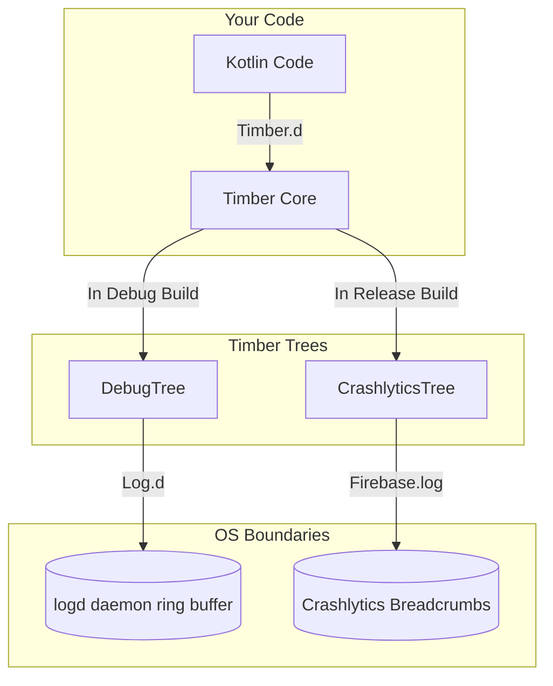

# Logging (Logcat and Timber)

## Overview

Logging is the fundamental heartbeat of debugging. It is the act of printing text to a console so that a developer can understand the state of the application at a specific moment in time.

A Junior Engineer uses `System.out.println("Here")` or `Log.d("TAG", "Value: " + value)`.

A Staff Engineer understands that `Log.d` is a dangerous, blocking system call that crosses the JNI boundary into C++ and writes to a circular memory buffer managed by the Linux kernel. If you leave `Log.d` calls in your production release build, you are actively degrading the user's battery life, slowing down the Main Thread, and potentially leaking highly sensitive Personal Identifiable Information (PII) to malicious third-party apps reading the system log.

To manage this, Android engineers rely on wrapper libraries like **Timber** to route, format, and mathematically strip logging calls based on the build variant.

## Why It Matters

Imagine you write this in a `RecyclerView` adapter that binds 60 times a second:
```kotlin
Log.d("UserAdapter", "Binding user: ${user.firstName} ${user.lastName}")
```

In Kotlin, String interpolation (`"..."`) compiles down to a `StringBuilder`.
Every frame, you allocate a new `StringBuilder`, append three strings, convert it to a String, pass it to the Android OS, which crosses into C++, acquires a mutex lock on the `logd` daemon, writes the bytes to a ring buffer, and releases the lock.

If you ship this to production, the app will drop frames due to Garbage Collection thrashing (from the StringBuilders) and lock contention (from `logd`). You must have an architecture that entirely removes these calls from the Release APK.

## Historical Context

- **Java `System.out.println`:** Standard Java logging writes to `stdout`. On Android, this is redirected to `/dev/null` (it disappears) or poorly routed to Logcat without a proper tag or priority level.
- **`android.util.Log`:** The official Android logging class. It writes to the `logd` daemon. However, it requires you to manually provide a `TAG` for every single call (`Log.d(TAG, "msg")`), which led to developers copy/pasting the wrong TAGs across files.
- **Timber (2013):** Created by Jake Wharton at Square. Timber is a tiny, extensible logging tree. It automatically figures out the `TAG` based on the calling class name, and more importantly, it allows you to dynamically "plant" different logging behaviors depending on whether the app is running in Debug or Release mode.

## First Principles

1.  **Logcat:** The command-line tool (`adb logcat`) used to read the continuous stream of system messages.
2.  **`logd` Daemon:** The background Linux process running on the Android device that manages the circular memory buffers where logs are stored.
3.  **Priority Levels:**
    - `Verbose (V)`: Extreme detail, never compiled into production.
    - `Debug (D)`: Helpful debug info, stripped in production.
    - `Info (I)`: Expected system events.
    - `Warn (W)`: Potential issues that aren't fatal.
    - `Error (E)`: Fatal exceptions or broken invariants.
    - `Assert (A)`: Things that should never happen.
4.  **Timber Tree:** A behavioral implementation of logging. You can plant a `DebugTree` that writes to Logcat, and a `ReleaseTree` that writes to Firebase Crashlytics.

## Mental Model

Think of standard Android Logging (`Log.d`) as a **Public Megaphone**.
- You stand in the town square and shout into the megaphone.
- Everyone in the square (any app with the `READ_LOGS` permission via ADB) can hear you.
- Shouting takes physical energy (Battery/CPU).

Think of Timber as a **Smart Dispatcher**.
- You hand a written note to the Dispatcher.
- The Dispatcher looks at the calendar. If it is a "Debug" day, the Dispatcher reads it into the Public Megaphone.
- If it is a "Release" day, the Dispatcher throws the note in the shredder instantly, saving energy and maintaining privacy.

## Internal Mechanics

### How Timber Automatically Finds the TAG

When you call `Timber.d("Hello")`, how does it know the TAG is `MainActivity`?

Timber uses a brilliant (but computationally heavy) trick. It creates a dummy `Throwable` object and inspects the stack trace.

```java
// Simplified Timber internal logic
Throwable t = new Throwable();
StackTraceElement[] elements = t.getStackTrace();
// The 0th element is Timber itself. The 1st element is the class that called Timber!
String className = elements[1].getClassName(); 
```

Because walking the stack trace is incredibly slow, Timber *caches* the TAG locally, and you only plant the `DebugTree` (which does this trick) in `Debug` builds.

### ProGuard / R8 Stripping

The most powerful feature of `android.util.Log` and `Timber` is their interaction with R8 (the code shrinker).

If you configure your `proguard-rules.pro` file correctly, R8 will literally delete the logging calls from your bytecode.

```proguard
# Tell R8 to delete any method call to android.util.Log
-assumenosideeffects class android.util.Log {
    public static boolean isLoggable(java.lang.String, int);
    public static int v(...);
    public static int d(...);
    public static int i(...);
    public static int w(...);
}
```

If R8 deletes the method call, the Kotlin compiler also deletes the `StringBuilder` string interpolation that was passed as an argument. The performance penalty is reduced to absolute zero in production.

## Architecture



## Production Example

**Planting the Trees**

A Staff Engineer isolates logging behavior entirely within the `Application.onCreate` method based on the `BuildConfig.DEBUG` flag.

```kotlin
class MyApplication : Application() {
    override fun onCreate() {
        super.onCreate()

        if (BuildConfig.DEBUG) {
            // In Debug mode, print everything to the Android Logcat
            Timber.plant(Timber.DebugTree())
        } else {
            // In Release mode, send Errors and Warnings to Crashlytics as breadcrumbs.
            // Ignore Debug and Verbose entirely.
            Timber.plant(CrashReportingTree())
        }
    }
}

// Custom Tree for Production
class CrashReportingTree : Timber.Tree() {
    override fun log(priority: Int, tag: String?, message: String, t: Throwable?) {
        if (priority == Log.VERBOSE || priority == Log.DEBUG) {
            return // Throw away useless noise
        }

        // Send to Firebase Crashlytics as a breadcrumb
        FirebaseCrashlytics.getInstance().log("$tag: $message")

        if (t != null && priority == Log.ERROR) {
            // Send caught exceptions as Non-Fatal reports
            FirebaseCrashlytics.getInstance().recordException(t)
        }
    }
}
```

Now, the entire engineering team just types `Timber.d("Loaded")` anywhere in the app. They don't have to think about `if (DEBUG)`. The architecture handles the routing automatically.

## Tradeoffs

**Timber vs Native Kotlin `expect/actual` or Custom Wrappers**

- **Timber:**
    - *Pros:* The absolute industry standard. Every Android developer knows how to use it. Extremely reliable.
    - *Cons:* It is a 3rd party dependency. Getting R8 to strip it perfectly requires specific ProGuard configurations because Timber uses varargs. It is not currently compatible with Kotlin Multiplatform (KMP) out of the box (though forks like `Kermit` exist).
- **Custom Wrapper (`AppLog.d`):**
    - *Pros:* Zero dependencies. Easily mocked in Unit Tests. Easy to implement KMP `expect/actual` patterns.
    - *Cons:* You have to write and maintain the `StackTrace` walking logic yourself if you want automatic TAG generation.

*Staff Decision:* For pure Android apps, Timber is still the correct choice. For Kotlin Multiplatform apps, the industry is shifting towards libraries like `Kermit` or building custom lightweight wrappers to handle the iOS `os_log` vs Android `Logcat` routing.

## Failure Modes

- **String Interpolation Evaluation Leak:**
  ```kotlin
  // BAD: Even if Timber.d is ignored in Release, 'calculateMassiveData()' is STILL EXECUTED!
  Timber.d("Result: ${calculateMassiveData()}") 
  ```
  While R8 can strip the `Log.d` call, it is very difficult for R8 to prove that `calculateMassiveData()` has no side effects. Therefore, the CPU still executes the heavy math function in production just to create a String that is immediately thrown away.
  *(Fix: If the calculation is heavy, wrap the log in an explicit `if (BuildConfig.DEBUG)` check, or use a lazily evaluated lambda logging wrapper).*
- **PII Leakage in Production Logs:**
  If you log `Timber.i("User logged in with email: ${user.email}")`, and your Release Tree pushes `INFO` logs to Crashlytics or Logcat, you have just uploaded Plain Text PII to a 3rd party server and exposed it to the local device. This is a severe GDPR violation and a fireable offense.
  *(Fix: Enforce strict PR review guidelines: Never log Usernames, Emails, Passwords, or Auth Tokens. Log user IDs or hashed equivalents).*
- **The Logcat Buffer Overflow:**
  The Android OS limits the `logd` ring buffer (usually to 256KB or 1MB). If you write a `while(true) { Log.d(...) }` loop, you will instantly flush out all the logs from the rest of the system, including critical OS-level crash traces, making debugging impossible.

## Staff Engineer Thinking

When reviewing Logging architecture, a Staff engineer focuses on Signal-to-Noise Ratio and CI/CD enforcement.

1.  **Custom Lint Rules:** I write a custom Android Lint rule that physically fails the CI build if a developer types `android.util.Log`. The entire codebase must go through the `Timber` abstraction layer to guarantee release-stripping.
2.  **Breadcrumb Tracing:** As discussed in [Crash Monitoring](crash-monitoring.md), logs in production are only useful if they provide context to a crash. I ensure the `ReleaseTree` translates `INFO` and `WARN` logs into Crashlytics Breadcrumbs, so when a `NullPointerException` occurs, we see the last 10 things the user did leading up to it.
3.  **Strict Mode Exceptions:** I ensure that Android `StrictMode` violations (e.g., Disk I/O on the Main Thread) are heavily logged as `ERROR` during Debug builds, so they immediately appear red in the Logcat and catch the developer's attention before the PR is even opened.

## Common Misconceptions

- **"Nobody can read my logs unless they have the source code."** Dangerously false. Any user can plug their phone into a computer and run `adb logcat`. Any app that is granted the `READ_LOGS` permission via ADB or root can read every single log your app outputs. Production logs must be entirely stripped or completely sanitized.
- **"Log.d is free."** False. It involves cross-language JNI calls, mutex locks, and object allocation. It is highly expensive in hot loops (like RecyclerView binding or Compose Recomposition).

## Probing Questions

1.  Explain why leaving `Log.d` calls with String interpolation inside a `RecyclerView.onBindViewHolder` severely degrades scrolling performance.
2.  How does the Android `logd` daemon handle memory, and what happens to old logs when the buffer is filled?
3.  Describe the exact architectural pattern Timber uses (The `Tree` abstraction) to differentiate logging behavior between Debug and Release builds.
4.  How does Timber's `DebugTree` automatically determine the correct `TAG` (class name) without the developer explicitly providing it? Why is this trick slow?
5.  What is the purpose of the `proguard-rules.pro` `-assumenosideeffects` configuration regarding the `android.util.Log` class?
6.  Explain the "String Interpolation Evaluation Leak" and why `Timber.d("Val: ${heavyMath()}")` might still cause a performance penalty in a Release build even if the log isn't printed.
7.  Why is it a severe architectural and legal failure to log a user's plain-text email address using `Log.i()`?
8.  How does a Staff Engineer use a custom `ReleaseTree` to enhance Firebase Crashlytics crash reports without polluting the public Android Logcat?
9.  Why would a large engineering team write a custom Lint rule that explicitly bans the usage of `android.util.Log` across the entire codebase?
10. Describe the tradeoff between using a 3rd party dependency like Timber versus writing a native Kotlin `expect/actual` logging wrapper for a Kotlin Multiplatform project.

## Further Reading

- [`crash-monitoring.md`](crash-monitoring.md) — How the `ReleaseTree` converts logs into Breadcrumbs for fatal exception context.
- [`jank.md`](../performance/jank.md) — The dropped frames caused by allocating `StringBuilder` objects for logs inside tight rendering loops.
- [Timber GitHub Repository](https://github.com/JakeWharton/timber)
