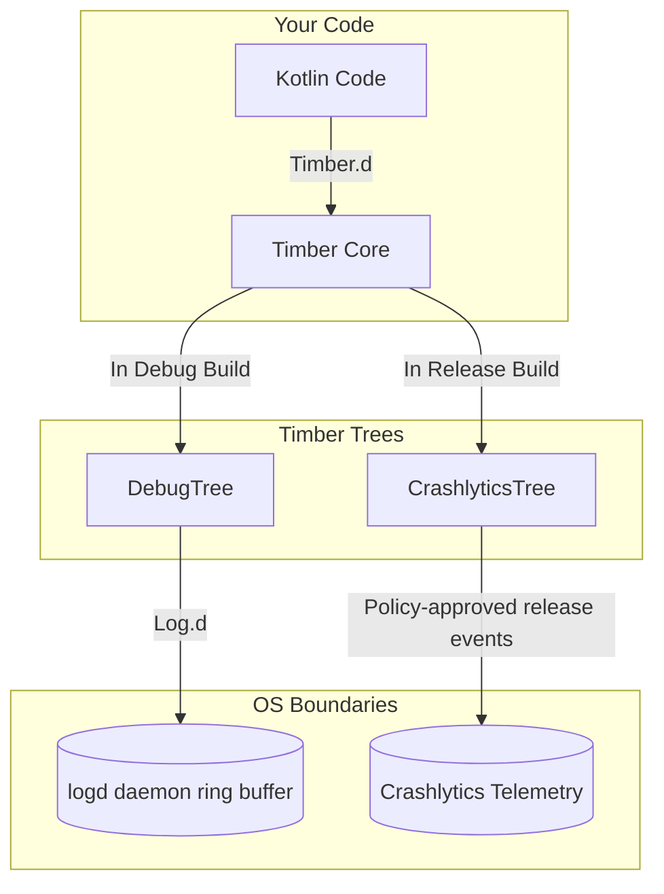

# Logging (Logcat and Timber)

## Overview

Logging is the fundamental heartbeat of debugging. It is the act of printing text to a console so that a developer can understand the state of the application at a specific moment in time.

The starting point for most of us is `System.out.println("Here")` or `Log.d("TAG", "Value: " + value)`.

A Staff Engineer treats logging cost and exposure as contextual. Argument construction and active output can add overhead on hot paths, while retained unsanitized messages can disclose sensitive data through device logs or telemetry sinks. Priority alone does not decide whether a call is retained, emitted, or safe; release behavior depends on source sets, the selected facade, runtime policy, and verified shrinker configuration.

Teams often enforce a common logging boundary to route, structure, redact, sample, or suppress messages. **Timber** is one Android facade; a project-owned wrapper or multiplatform library may be a better fit. No facade mathematically guarantees stripping—inspect the release artifact and test runtime behavior.

## Why It Matters

Imagine you write this in a `RecyclerView` adapter that binds 60 times a second:
```kotlin
Log.d("UserAdapter", "Binding user: ${user.firstName} ${user.lastName}")
```

Eager interpolation may allocate or perform other argument work before the logging facade decides whether to emit. Enabled output adds sink/daemon work. On a measured hot path, the combination can contribute to frame pressure; compiler lowering, loggability, sink behavior, and cost vary by build and device.

If a hot path ships with expensive log argument construction and active output, it can add allocation and logging overhead. Define release behavior explicitly: remove or suppress noisy calls where appropriate, lazily evaluate expensive arguments, sanitize retained telemetry, and verify the resulting artifact.

## Historical Context

- **Java `System.out.println`:** Android commonly routes Java `System.out` through Logcat with generic attribution such as the `System.out` tag and `INFO` priority, making it less structured and controllable than an explicit logging API.
- **`android.util.Log`:** The official Android logging class. It writes to the `logd` daemon. However, it requires you to manually provide a `TAG` for every single call (`Log.d(TAG, "msg")`), which led to developers copy/pasting the wrong TAGs across files.
- **Timber (2013):** Created by Jake Wharton at Square. Timber is a tiny, extensible logging tree. It automatically figures out the `TAG` based on the calling class name, and more importantly, it allows you to dynamically "plant" different logging behaviors depending on whether the app is running in Debug or Release mode.

## First Principles

1.  **Logcat:** The command-line tool (`adb logcat`) used to read the continuous stream of system messages.
2.  **`logd` Daemon:** The background Linux process running on the Android device that manages the circular memory buffers where logs are stored.
3.  **Priority Levels:**
    - `Verbose (V)`: Extremely detailed diagnostics. Log priority does not determine whether a call is compiled into a production artifact; build configuration and code shrinking may remove or retain it.
    - `Debug (D)`: Helpful diagnostic information. It is retained unless the build, source-set, logging facade, or shrinker configuration deliberately removes or suppresses it.
    - `Info (I)`: Expected system events.
    - `Warn (W)`: Potential issues that aren't fatal.
    - `Error (E)`: Fatal exceptions or broken invariants.
    - `Assert (A)`: Things that should never happen.
4.  **Timber Tree:** A behavioral implementation of logging. You can plant a `DebugTree` that writes to Logcat, and a `ReleaseTree` that writes to Firebase Crashlytics.

## Mental Model

Think of standard Android Logging (`Log.d`) as a **Public Megaphone**.
- You stand in the town square and shout into the megaphone.
- Everyone in the square (any app with the `READ_LOGS` permission via ADB) can hear you.
- Shouting takes physical energy (Battery/CPU).

Think of Timber as a **Smart Dispatcher**.
- You hand a written note to the Dispatcher.
- The configured Debug tree can send the note to Logcat.
- A Release tree can suppress it, redact it, or route selected messages to a telemetry sink. The dispatcher policy does not prove that argument construction was removed from the binary or that retained data is safe.

## Internal Mechanics

### How Timber Automatically Finds the TAG

When you call `Timber.d("Hello")`, how does it know the TAG is `MainActivity`?

Timber's `DebugTree` derives tags from call-site information. The exact stack-inspection implementation and cost are library-version details, so treat automatic attribution as debug-oriented and verify current source before depending on the mechanism.

```java
// Simplified Timber internal logic
Throwable t = new Throwable();
StackTraceElement[] elements = t.getStackTrace();
// The 0th element is Timber itself. The 1st element is the class that called Timber!
String className = elements[1].getClassName(); 
```

The simplified sketch illustrates why call-site attribution can cost more than an explicit tag; it is not a stable guarantee that a particular Timber version caches tags or that every project plants the tree only in Debug builds.

### ProGuard / R8 Stripping

R8 can remove selected logging calls when optimization is enabled and the configured assumptions match the called methods.

For example, `-assumenosideeffects` permits R8 to treat the listed methods as side-effect free when their results are unused:

```proguard
# Permit R8 to remove unused calls to these android.util.Log methods.
-assumenosideeffects class android.util.Log {
    public static boolean isLoggable(java.lang.String, int);
    public static int v(...);
    public static int d(...);
    public static int i(...);
    public static int w(...);
}
```

This rule is an optimizer assertion, not a platform guarantee or a Timber rule. R8 may remove the call and pure argument construction, but it must retain argument evaluation with observable side effects. Keep the rule aligned with the invoked API, use source-set/runtime suppression or lazy logging where appropriate, and inspect the optimized release artifact.

## Architecture



## Production Example

**Planting the Trees**

In this example, application startup plants variant-specific trees. Other applications may configure routing through dependency injection, generated initialization, or platform-specific adapters.

```kotlin
class MyApplication : Application() {
    override fun onCreate() {
        super.onCreate()

        if (BuildConfig.DEBUG) {
            // In Debug mode, print everything to the Android Logcat
            Timber.plant(Timber.DebugTree())
        } else {
            Timber.plant(CrashReportingTree(breadcrumbPolicy, nonFatalPolicy))
        }
    }
}

// Custom Tree for Production
fun interface BreadcrumbPolicy {
    // Return a redacted breadcrumb, or null when schema/sampling policy rejects it.
    fun approvedValue(priority: Int, tag: String?, message: String): String?
}

fun interface NonFatalPolicy {
    fun shouldRecord(priority: Int, throwable: Throwable): Boolean
}

class CrashReportingTree(
    private val breadcrumbPolicy: BreadcrumbPolicy,
    private val nonFatalPolicy: NonFatalPolicy,
) : Timber.Tree() {
    override fun log(priority: Int, tag: String?, message: String, t: Throwable?) {
        breadcrumbPolicy.approvedValue(priority, tag, message)?.let { breadcrumb ->
            FirebaseCrashlytics.getInstance().log(breadcrumb)
        }

        if (t != null && nonFatalPolicy.shouldRecord(priority, t)) {
            FirebaseCrashlytics.getInstance().recordException(t)
        }
    }
}
```

In this example, callers use the chosen facade and the planted tree handles routing. Callers still own data classification and expensive argument evaluation; a facade does not make arbitrary messages safe or free.

## Tradeoffs

**Timber vs Native Kotlin `expect/actual` or Custom Wrappers**

- **Timber:**
    - *Pros:* Established Android library with a small API and pluggable trees.
    - *Cons:* Third-party dependency with Android-oriented APIs. Suppression or removal still requires an explicit tree/source-set/shrinker policy; KMP projects need a multiplatform facade or adapter.
- **Custom Wrapper (`AppLog.d`):**
    - *Pros:* Zero dependencies. Easily mocked in Unit Tests. Easy to implement KMP `expect/actual` patterns.
    - *Cons:* You have to write and maintain the `StackTrace` walking logic yourself if you want automatic TAG generation.

*Staff Decision:* Choose a logging facade from the product's platform, privacy, structured-data, performance, and maintenance requirements. Timber is one established Android option; KMP projects may prefer a multiplatform library or an `expect`/`actual` wrapper for Android Logcat and Apple unified logging.

## Failure Modes

- **String Interpolation Evaluation Leak:**
  ```kotlin
  // Risk: a Release tree may ignore the message after this argument is evaluated.
  Timber.d("Result: ${calculateMassiveData()}") 
  ```
  A runtime tree receives its arguments after Kotlin evaluates them. A shrinker can remove pure construction only when it proves that doing so preserves behavior; a call with possible side effects may remain even when the logging method is removed.
  *(Fix: If the calculation is heavy, wrap the log in an explicit `if (BuildConfig.DEBUG)` check, or use a lazily evaluated lambda logging wrapper).*
- **PII Leakage in Production Logs:**
  If a Release tree forwards an email, token, username, or stable identifier to Logcat or remote telemetry, it creates confidentiality and regulatory risk whose severity depends on purpose, access, consent, retention, and jurisdiction. Hashed or stable IDs can still be personal data.
  *(Fix: Apply an approved data-classification/minimization policy, redact secrets and direct identifiers, restrict access and retention, and review whether any stable pseudonymous identifier is necessary.)*
- **The Logcat Buffer Overflow:**
  Logcat buffers are bounded circular buffers whose configured sizes vary by device/build. Sustained high-volume logging can evict older diagnostic records quickly and obscure the evidence needed for debugging.

## Staff Engineer Thinking

When reviewing Logging architecture, a Staff engineer focuses on Signal-to-Noise Ratio and CI/CD enforcement.

1.  **Enforced logging boundary:** When the product benefits from a common facade, I use Android Lint to prevent direct `android.util.Log` calls outside approved adapters. The facade might be Timber or a project-owned abstraction; lint enforces routing, while release stripping or suppression still depends on source sets, runtime policy, and verified shrinker configuration.
2.  **Breadcrumb tracing:** As discussed in [Crash Monitoring](crash-monitoring.md), forward only schema-approved, redacted, sampled breadcrumbs whose diagnostic value justifies Crashlytics quota, retention, and privacy cost. Priority alone does not decide whether an `INFO` or `WARN` event belongs there.
3.  **Strict Mode Exceptions:** I ensure that Android `StrictMode` violations (e.g., Disk I/O on the Main Thread) are heavily logged as `ERROR` during Debug builds, so they immediately appear red in the Logcat and catch the developer's attention before the PR is even opened.

## Common Misconceptions

- **"Nobody can read my logs unless they have the source code."** False. Log access depends on Android version, build type, device state, privileges, and tooling, while remote telemetry has its own access path. Treat retained production messages as potentially exposed: minimize and sanitize them, apply access/retention controls, and suppress messages that have no production purpose.
- **"Log.d is free."** False. Eager arguments may allocate, and enabled output adds logging work. Cost varies by message, loggability, sink, device, and workload; measure frame-sensitive paths in a release-equivalent build.

## Probing Questions

1.  How can eager log arguments and active output contribute to jank in `RecyclerView.onBindViewHolder`, and what determines whether the effect is measurable?
2.  How does the Android `logd` daemon handle memory, and what happens to old logs when the buffer is filled?
3.  Describe the exact architectural pattern Timber uses (The `Tree` abstraction) to differentiate logging behavior between Debug and Release builds.
4.  How can Timber's `DebugTree` derive call-site attribution, and why can stack inspection cost more than an explicit tag?
5.  What is the purpose of the `proguard-rules.pro` `-assumenosideeffects` configuration regarding the `android.util.Log` class?
6.  Explain the "String Interpolation Evaluation Leak" and why `Timber.d("Val: ${heavyMath()}")` might still cause a performance penalty in a Release build even if the log isn't printed.
7.  Why is logging a user's plain-text email address through a production sink a security and governance risk?
8.  How does a Staff Engineer use a custom `ReleaseTree` to enhance Firebase Crashlytics crash reports without polluting the public Android Logcat?
9.  Why would a large engineering team write a custom Lint rule that explicitly bans the usage of `android.util.Log` across the entire codebase?
10. Describe the tradeoff between using a 3rd party dependency like Timber versus writing a native Kotlin `expect/actual` logging wrapper for a Kotlin Multiplatform project.

## Answer Key

1. **How can eager log arguments and active output contribute to jank in `RecyclerView.onBindViewHolder`, and what determines whether the effect is measurable?**
   Repeated string construction and active logging add allocation and system-call/daemon work to a frame-sensitive path. Whether that produces measurable jank depends on call frequency, payload, runtime policy, device, and whether the release artifact removes or suppresses the work; verify it with profiling.
2. **How does the Android `logd` daemon handle memory, and what happens to old logs when the buffer is filled?**
   `logd` uses bounded circular buffers whose configured sizes can vary. As a buffer fills, newer records evict older ones, so sustained noise can quickly remove useful diagnostic history.
3. **Describe the exact architectural pattern Timber uses (The `Tree` abstraction) to differentiate logging behavior between Debug and Release builds.**
   Timber routes calls through `Tree` implementations selected by application configuration. A debug build may plant `DebugTree`; a release tree can apply explicit breadcrumb and non-fatal policies that redact, sample, forward, or reject events rather than deriving behavior from priority alone.
4. **How can Timber's `DebugTree` derive call-site attribution, and why can stack inspection cost more than an explicit tag?**
   `DebugTree` derives attribution from call-site/stack information rather than a caller-supplied tag. Stack inspection can be more expensive than an explicit tag, but the exact implementation and caching behavior are version-specific.
5. **What is the purpose of the `proguard-rules.pro` `-assumenosideeffects` configuration regarding the `android.util.Log` class?**
   It asserts that the listed methods have no observable side effects, permitting R8 to remove an unused call when optimization proves the transformation safe. It does not automatically cover a facade such as Timber or guarantee removal of argument expressions with side effects, so teams must inspect and test the optimized artifact.
6. **Explain the "String Interpolation Evaluation Leak" and why `Timber.d("Val: ${heavyMath()}")` might still cause a performance penalty in a Release build even if the log isn't printed.**
   Kotlin evaluates the interpolation before a runtime tree decides whether to print it. A shrinker may also retain `heavyMath()` when removing it could change observable behavior. Use lazy arguments, an explicit guard, or a source-set abstraction when the calculation is material.
7. **Why is logging a user's plain-text email address through a production sink a security and governance risk?**
   Device-log access varies by Android version, privileges, build, ADB/root state, and telemetry destination, but a retained email creates unnecessary exposure. Treat raw, hashed, and stable identifiers as potentially personal data and apply approved purpose, minimization, access, retention, and consent controls.
8. **How does a Staff Engineer use a custom `ReleaseTree` to enhance Firebase Crashlytics crash reports without polluting the public Android Logcat?**
   Define a Release tree that suppresses device output where appropriate and forwards only schema-approved, redacted, sampled breadcrumbs to Crashlytics. Selection should follow diagnostic value, privacy, retention, and quota policy rather than forwarding every `INFO`/`WARN` message.
9. **Why would a large engineering team write a custom Lint rule that explicitly bans the usage of `android.util.Log` across the entire codebase?**
   To enforce a chosen logging boundary so privacy filtering, structured fields, sampling, and release behavior are reviewed consistently. The rule reduces bypasses but cannot guarantee that no sensitive data or expensive argument evaluation remains; tests, code review, shrinker inspection, and runtime controls are still required.
10. **Describe the tradeoff between using a 3rd party dependency like Timber versus writing a native Kotlin `expect/actual` logging wrapper for a Kotlin Multiplatform project.**
    Timber provides an established Android facade and tree model but does not itself define an iOS implementation or guarantee release stripping. A multiplatform library or `expect`/`actual` wrapper can present one API across Android and Apple platforms, at the cost of owning routing, metadata, privacy policy, and maintenance.

## Further Reading

- [`crash-monitoring.md`](crash-monitoring.md) — How selected, approved release logs can become crash breadcrumbs.
- [`jank.md`](../performance/jank.md) — How allocation and logging work can contribute to frame pressure on measured hot paths.
- [Timber GitHub Repository](https://github.com/JakeWharton/timber)
- [Android `Log` reference](https://developer.android.com/reference/android/util/Log) — Platform priorities and behavior.
- [Android app optimization with R8](https://developer.android.com/topic/performance/app-optimization/enable-app-optimization) — Build-time shrinking and optimization.
