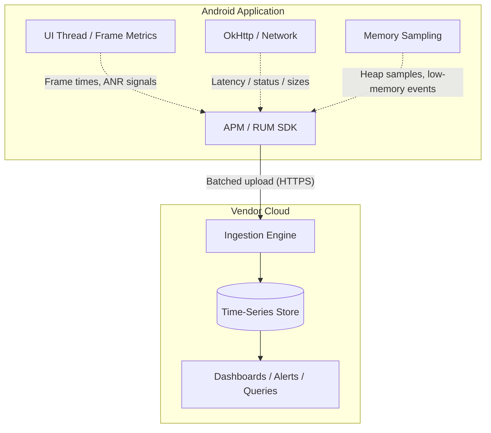

# Mobile APM & RUM (Application Performance Monitoring)

## Overview

Once an app hits production and is installed on 10 million devices across 5,000 different Android OEM variants, running on 3G networks in emerging markets, it fails in ways you cannot replicate locally. Crash reporters tell you when the app died. They tell you nothing about the app that is *surviving but suffering* — slow screens, degraded APIs, dropped frames, memory pressure.

**Application Performance Monitoring (APM)** — often called **Real User Monitoring (RUM)** when focused on the client side — closes that gap. Vendors in this space include New Relic, Datadog, Dynatrace, Embrace, Sentry, and Firebase Performance Monitoring; Google's own Android vitals provides a free baseline from Play. Whatever the vendor, the shape is the same: an SDK observes the network stack, the main thread, screen transitions, and memory signals on real devices, aggregates the measurements, and streams them to a queryable dashboard.

This file is about the *category* — the mechanics, tradeoffs, and failure modes are vendor-independent. Concrete examples name specific products where syntax matters.

## Why It Matters

If the CEO asks: *"Our iOS team says the login API takes 200ms. The backend team says it takes 50ms. How long does it take on Android?"* — without RUM data you have to guess. With it, you run one query (e.g., New Relic's NRQL: `SELECT average(duration) FROM MobileRequest WHERE requestUrl LIKE '%/login' AND deviceOs = 'Android'`) and discover the average is 450ms because an interceptor is doing heavy JSON serialization on the main thread before the request ever hits the radio.

APM provides the shared, queryable evidence that ends arguments between mobile, backend, and product teams. The backend measures from its front door; RUM measures from the user's hand. The difference between those two numbers — DNS, TLS, radio wake-up, interceptor overhead, main-thread scheduling — is precisely the part only the client can see.

## Historical Context

- **Pre-2015:** Mobile performance monitoring was practically non-existent. Crashlytics covered fatal crashes; if the app was merely "slow," the only signal was Play Store reviews containing the word "laggy."
- **The Web APM pivot:** APM vendors built their businesses monitoring server workloads (Rails, JVM), then moved to mobile by adapting bytecode-instrumentation techniques to Android's Dalvik/ART toolchain.
- **Modern RUM:** Today's SDKs auto-instrument `OkHttp`, `Retrofit`, screen transitions, and app startup without manual tracking calls, and correlate client spans with backend traces through standard headers.

## First Principles

1.  **Instrumentation:** The act of observing app behavior — either by code you write (manual spans) or code the toolchain injects.
2.  **Bytecode weaving:** Most mobile APM SDKs ship a Gradle plugin that rewrites compiled classes during the build, inserting hooks into network calls and lifecycle transitions so you get coverage without hand-written tracking.
3.  **Sampling & batching:** The SDK aggregates measurements on-device and uploads compressed batches periodically — per-event uploads would destroy the battery and the radio.
4.  **Query layer:** A time-series store with a SQL-like query language on top (NRQL, Datadog queries, BigQuery for Firebase). The dashboard is only as good as the questions you ask it.

## Mental Model

Think of RUM as putting a **GPS tracker and a heart-rate monitor on a delivery truck**.

- You (the developer) are the dispatcher at HQ.
- The truck (the app) leaves the warehouse and drives across the country.
- With only a crash reporter, you know just one thing: the truck arrived, or it exploded.
- With RUM, the truck pings you continuously: *"Going 45mph. Engine temperature normal. That last bridge took 12 seconds instead of the expected 5."*

You stop debugging from the morgue and start debugging from the telemetry.

## Internal Mechanics

### What the SDK actually observes

- **Network:** interceptors or woven wrappers around `OkHttp`/`HttpURLConnection` record URL, latency, status, and payload sizes — including calls made by third-party SDKs you don't own.
- **Rendering:** frame metrics via the platform's `FrameMetrics`/JankStats-style APIs — dropped and frozen frames per screen.
- **Main thread:** ANR and long-task detection by watching the main looper.
- **Memory:** periodic sampling of heap and native usage via runtime APIs, plus low-memory callbacks. (SDKs *sample* memory state; they do not hook the allocator itself.)
- **Lifecycle:** activity/fragment/composable screen transitions, app startup phases, session boundaries.

### How bytecode weaving works

The vendor's Gradle plugin runs a transformation step (ASM-based) over compiled classes before R8:

```java
// What you wrote:
public void fetchUser() {
    URL url = new URL("https://api.com/user");
    HttpURLConnection conn = (HttpURLConnection) url.openConnection();
    conn.connect();
}

// What the plugin rewrites it to during the build (conceptually):
public void fetchUser() {
    URL url = new URL("https://api.com/user");
    HttpURLConnection conn = ApmHttpWrapper.wrap((HttpURLConnection) url.openConnection());
    long start = System.currentTimeMillis();
    conn.connect();                          // wrapper records bytes and status
    ApmClient.recordNetworkMetric(url, System.currentTimeMillis() - start);
}
```

Because the weaving is automated, you get visibility into every network call in the process — including those made by SDKs (ads, attribution, analytics) whose source you cannot modify.

## Architecture



## Production Example

**Distributed tracing across the mobile/backend boundary**

A user taps "Checkout." The app spins for 10 seconds and times out. Where did it fail? The app's serialization? The API gateway? The payment service? The database?

With distributed tracing, the client SDK injects the **W3C Trace Context headers** (`traceparent`, `tracestate`) into the outgoing request — vendors may add their own legacy headers (e.g., New Relic's `newrelic` header) for backward compatibility, but W3C is the interoperable standard. Each backend hop propagates the same trace ID down the call chain.

In the dashboard, you search for that trace ID and read the waterfall:

- Android app: `15ms`
- API gateway: `5ms`
- Payment service: `9,980ms` ← timeout

The bug is assigned to the payments team in thirty seconds, with evidence. Canonical treatment: [`../../observability/distributed-tracing.md`](../../observability/distributed-tracing.md).

## Tradeoffs

**Automated weaving vs build time and app size**

- The Gradle plugin scans and rewrites classes across the build; on a large monorepo that can add minutes to release builds. The SDK itself adds APK size and a runtime footprint.
- **Staff decision:** disable weaving for local `debug` builds (developers don't need it, and it slows iteration); enable it for staging and release CI pipelines only.

**Vendor SDK vs first-party baseline**

- Android vitals (free, no SDK) already reports crash rate, ANR rate, excessive wakeups, and startup times from Play devices — and it is the dataset Play uses to rank your app. A paid RUM SDK adds per-screen, per-endpoint, per-session depth and custom dimensions.
- **Staff decision:** treat Android vitals as the non-negotiable floor; add a RUM vendor when you need screen-level attribution, custom funnels, or unified mobile+backend tracing — and revisit the contract yearly against what first-party tooling has absorbed.

## Failure Modes

- **Environmental noise read as backend failure:**
  A user walks into a subway tunnel mid-request; the call fails with `UnknownHostException`. Ten thousand users a day do this, the dashboard shows a 5% "network error rate," and executives panic.
  *(Fix: segment environmental failures — `UnknownHostException`, `SocketTimeoutException` on flaky radios — from server failures (HTTP 5xx). Alert on the second class, trend the first.)*
- **PII leaking into a third-party system:**
  APMs record request URLs by default. If an API passes sensitive data in query strings (`GET /user?email=…`), the SDK uploads it to the vendor — a GDPR incident manufactured by tooling.
  *(Fix: configure URL redaction rules before the payload leaves the device; treat the APM config as part of the privacy review. See [`../../security/privacy-gdpr-data-residency.md`](../../security/privacy-gdpr-data-residency.md).)*
- **The observer harming the observed:**
  An over-eager configuration (per-frame custom events, unsampled session replay, synchronous logging) makes the SDK itself the jank source.
  *(Fix: budget the SDK like any dependency — measure its main-thread time and payload volume in a macrobenchmark before and after integration.)*

## Staff Engineer Thinking

1.  **Custom attributes (breadcrumbs):** a crash report without context is a corpse without a story. Mandate that architectural boundaries (navigation changes, network responses) attach attributes (`last_screen`, `ab_bucket`, `sync_state`) to the session so any incident can be reconstructed by query.
2.  **Alert tuning:** an alert that pages on every 1% crash-rate blip wakes the on-call five times a night with `OutOfMemoryError`s from budget devices — and gets muted within a month. Page only on movements that are abnormal for the segment (latest version, healthy device tier); trend everything else on dashboards.
3.  **Measure UX, not just APIs:** wrap user-meaningful operations ("tap Add-to-Cart → cart visually updated") in custom interaction traces. A flow can be slow with every individual API fast.
4.  **Own the taxonomy:** screen names, event names, and attribute keys are an API. Version them, document them, and lint them — or the dashboard becomes a junk drawer within two quarters.

## Common Misconceptions

- **"Crashlytics and an APM do the same thing."** No. A crash reporter tells you when the app fatally died. APM/RUM tells you when the app is surviving but suffering — slow networks, dropped frames, memory pressure, degraded flows.
- **"APMs slow down the app."** The SDK does consume memory and CPU, but modern SDKs sample, batch, and upload off the main thread; the typical overhead is small. The real risks are misconfiguration (see Failure Modes) and unbounded custom events — both are yours to control.
- **"The backend dashboard already shows API latency."** It shows latency from the load balancer inward. It cannot see DNS, TLS, radio state, interceptor overhead, or main-thread scheduling — the parts of latency the user actually experiences first.

## Probing Questions

1.  What is the fundamental difference between a crash-reporting tool and an APM/RUM tool, and why do you need both?
2.  Explain bytecode weaving and how it lets an APM observe network requests made by third-party SDKs you don't control.
3.  Why should APM bytecode weaving be disabled for local debug builds?
4.  Describe how distributed tracing works across the mobile/backend boundary, and name the standard headers that make it vendor-interoperable.
5.  A dashboard shows a spike in network errors. Why must you separate `UnknownHostException` from HTTP 500 before paging the backend team?
6.  Explain the privacy risk of an APM recording full request URLs, and where the redaction must happen.
7.  What are custom attributes (breadcrumbs), and why are they critical for debugging complex user journeys?
8.  How does alert fatigue destroy an APM integration's value, and how do you tune alerts to prevent it?
9.  Android vitals is free and SDK-less. When does paying for a RUM vendor become justified, and what would make you reverse that decision?
10. The CEO asks you to prove that migrating a screen from XML to Compose improved checkout speed. What exact metric do you query, and how do you isolate the migration's effect?

## Further Reading

- [`jank.md`](../performance/jank.md) — the dropped-frame metrics RUM SDKs monitor and upload.
- [`retrofit-and-okhttp.md`](../networking-and-security/retrofit-and-okhttp.md) — the network stack the SDK intercepts.
- [`../../observability/distributed-tracing.md`](../../observability/distributed-tracing.md) — canonical distributed-tracing treatment.
- [`crash-monitoring.md`](crash-monitoring.md) — the complementary fatal-failure pipeline.
- [W3C Trace Context](https://www.w3.org/TR/trace-context/) — the standard propagation headers.
- [Android vitals](https://developer.android.com/topic/performance/vitals) — the first-party baseline every app gets for free.
- [New Relic: Mobile Monitoring](https://docs.newrelic.com/docs/mobile-monitoring/) / [Datadog RUM for Android](https://docs.datadoghq.com/real_user_monitoring/android/) — representative vendor docs.
