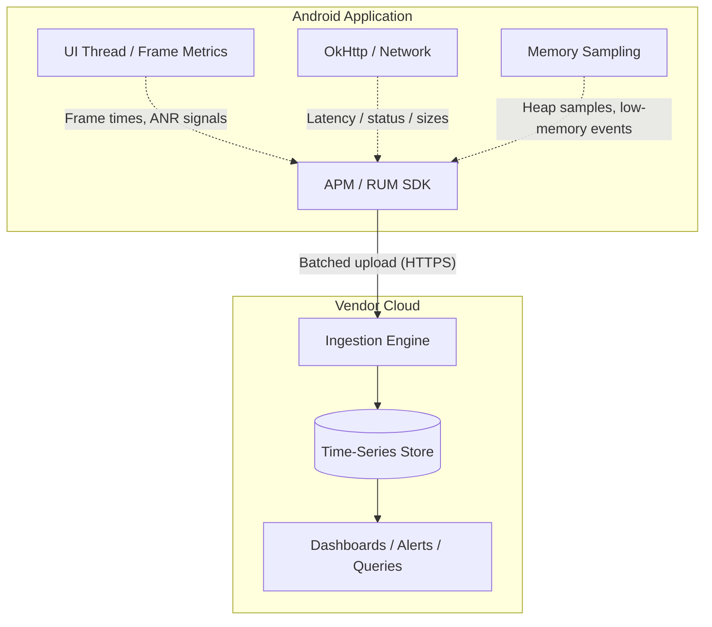

# Mobile APM & RUM (Application Performance Monitoring)

## Overview

Production fleets contain device, OS, network, locale, thermal, and workload combinations that a lab cannot reproduce exhaustively. Crash and exception reporters focus on failure diagnostics; real-user performance signals add evidence about slow screens, degraded APIs, frame behavior, startup, and other experiences that may not terminate the process.

**Application Performance Monitoring (APM)** covers performance and dependency behavior across an application system; **Real User Monitoring (RUM)** commonly refers to measurements from real client sessions. Vendors in this space include New Relic, Datadog, Dynatrace, Embrace, Sentry, and Firebase Performance Monitoring; Android vitals provides a Play-derived first-party dataset. Coverage differs by product, SDK version, enabled instrumentation, supported libraries, sampling, consent, and device/process conditions, so inventory the signals actually captured rather than assuming every vendor observes the same stack.

This file is about the *category* and the questions an evaluation must answer. Signal names, automatic coverage, build instrumentation, sampling, retention, and query semantics are vendor- and version-dependent; concrete examples name products where those differences matter.

## Why It Matters

If mobile and backend latency measurements disagree, define their boundaries before comparing them. A client measurement may include some combination of scheduling, interception, DNS, connection establishment, transfer, and parsing, while a server measurement begins at a different boundary. Segment distributions by app version, endpoint template, device/network cohort, cache state, and negotiated protocol; an average alone does not identify the cause.

APM/RUM can provide shared evidence for mobile, backend, and product teams. Client spans and interaction measurements can cover work outside a backend's server span, but the exact difference depends on where each timer starts and stops and which stages are instrumented.

## Historical Context

- **Earlier mobile monitoring:** Platform vitals, device profiling, logs, analytics, and vendor crash/performance products evolved at different times; avoid treating a vendor timeline as the technical model.
- **Mobile instrumentation:** Some APM vendors adapted server-side concepts and bytecode instrumentation to Android, while others use explicit SDK calls, interceptors, platform APIs, or a combination.
- **Current RUM:** Supported SDKs can instrument selected network libraries, screen transitions, startup, and custom interactions. Cross-system correlation requires compatible context propagation, sampling, and backend instrumentation.

## First Principles

1.  **Instrumentation:** The act of observing app behavior — either by code you write (manual spans) or code the toolchain injects.
2.  **Bytecode instrumentation:** Some mobile APM SDKs use a Gradle plugin to rewrite selected compiled classes and insert hooks. Others use library interceptors, explicit APIs, or platform callbacks; inspect the chosen product and version.
3.  **Sampling and batching:** Mobile telemetry commonly samples and batches to bound device, network, ingest, and storage cost. The exact delivery, offline buffering, and retry policy is product- and configuration-specific.
4.  **Query layer:** A time-series store with a SQL-like query language on top (NRQL, Datadog queries, BigQuery for Firebase). The dashboard is only as good as the questions you ask it.

## Mental Model

Think of RUM as putting a **GPS tracker and a heart-rate monitor on a delivery truck**.

- You (the developer) are the dispatcher at HQ.
- The truck (the app) leaves the warehouse and drives across the country.
- A crash/exception reporter emphasizes captured failures and their diagnostic context.
- With RUM, the truck pings you continuously: *"Going 45mph. Engine temperature normal. That last bridge took 12 seconds instead of the expected 5."*

You stop debugging from the morgue and start debugging from the telemetry.

## Internal Mechanics

### What the SDK actually observes

- **Network:** supported interceptors or wrappers can record approved URL templates, latency, status, and sizes for instrumented clients. Coverage of third-party, native, custom, or dynamically loaded networking code must be verified.
- **Rendering:** a product may use platform `FrameMetrics`, JankStats-style signals, or its own supported hooks. Definitions such as slow, janky, or frozen frames and their screen attribution are product-specific.
- **Main thread:** some products infer long tasks or collect ANR-related evidence; Android vitals and vendor SDKs have different collection populations, thresholds, and reporting latency.
- **Memory:** products may sample selected heap/native counters or low-memory callbacks. Do not assume allocator-level visibility, leak diagnosis, or coverage in every process.
- **Lifecycle:** automatic Activity, Fragment, Compose, startup, and session tracking varies by SDK and configuration. Verify names and boundaries from captured release data.

### How bytecode weaving works

When a selected product uses bytecode instrumentation, its Gradle plugin can transform supported compiled classes during the Android build. The exact Android Gradle Plugin API, ordering relative to optimization, and covered call sites depend on that plugin version. Conceptually, a transformation can look like this:

```java
// What you wrote:
public void fetchUser() {
    URL url = new URL("https://api.com/user");
    HttpURLConnection conn = (HttpURLConnection) url.openConnection();
    conn.connect();
}

// What the plugin rewrites it to during the build (conceptually):
public void fetchUser() {
    URL url = new URL("https://api.com/user");
    HttpURLConnection conn = ApmHttpWrapper.wrap((HttpURLConnection) url.openConnection());
    long start = System.currentTimeMillis();
    conn.connect();                          // wrapper records bytes and status
    ApmClient.recordNetworkMetric(url, System.currentTimeMillis() - start);
}
```

Automated instrumentation can cover supported call sites without source changes, including some closed-source SDK traffic. It can miss unsupported clients, native code, excluded packages, incompatible bytecode, or calls removed by privacy configuration; test coverage against the release artifact.

## Architecture



## Production Example

**Distributed tracing across the mobile/backend boundary**

A user taps "Checkout." The app spins for 10 seconds and times out. Where did it fail? The app's serialization? The API gateway? The payment service? The database?

With compatible distributed-tracing configuration, a client instrumentation layer can inject **W3C Trace Context** (`traceparent` and optionally `tracestate`) into an approved outgoing request. Automatic injection is not universal: the client integration, destination allowlist, gateways, and backend instrumentation must preserve the context. Each participating backend hop must extract and propagate valid context, and sampling/export policy determines which spans are available. Vendors may also support proprietary headers, but W3C Trace Context is the interoperable propagation standard.

In the dashboard, you search for that trace ID and read the waterfall:

- Android app: `15ms`
- API gateway: `5ms`
- Payment service: `9,980ms` ← timeout

The waterfall provides evidence that the sampled payment span consumed most of this trace's observed duration; ownership and diagnosis still depend on span boundaries, clock/timing data, errors, and service context. Canonical treatment: [`../../observability/distributed-tracing.md`](../../observability/distributed-tracing.md).

## Tradeoffs

**Automated weaving vs build time and app size**

- A Gradle plugin that scans and rewrites classes can add build work; the SDK can add artifact size and runtime overhead. Measure the selected version in representative clean and incremental builds and in release-equivalent runtime benchmarks.
- **Decision:** choose local, staging, and release instrumentation from debugging needs, build latency, environment separation, and the ability to validate release-only behavior. A lightweight or isolated debug configuration may be more useful than universally disabling instrumentation.

**Vendor SDK vs first-party baseline**

- Android vitals reports supported stability, startup, rendering, battery, and permission metrics from eligible Play data. A RUM SDK may add faster or deeper per-screen, endpoint, interaction, trace, or custom dimensions, depending on the product and configuration.
- **Decision:** use Android vitals when its coverage, latency, cohorts, and retention meet the operational need; add or retain another SDK when the incremental evidence justifies privacy, performance, build, vendor, and financial cost. Re-evaluate both coverage and exit strategy periodically.

## Failure Modes

- **Environmental noise read as backend failure:**
  `UnknownHostException` can reflect device connectivity or DNS failure, but it can also expose a bad hostname, DNS configuration, or service outage. HTTP 5xx identifies an HTTP server/proxy response but still needs route and ownership context.
  *(Fix: classify by stage, endpoint template, resolver/network state, cohort, and correlated server evidence. Alert when the segmented signal violates a service or journey objective rather than paging solely by exception class.)*
- **PII leaking into a third-party system:**
  An SDK may capture request URLs or attributes that contain identifiers, tokens, search text, or other sensitive data. Uploading an unapproved query string creates a data-exposure and governance incident whose legal consequences depend on the product and jurisdiction.
  *(Fix: use endpoint templates and an allowlist of approved attributes before data leaves the device; test the release configuration and include exports, retention, and deletion in privacy review. See [`../../security/privacy-gdpr-data-residency.md`](../../security/privacy-gdpr-data-residency.md).)*
- **The observer harming the observed:**
  An over-eager configuration (per-frame custom events, unsampled session replay, synchronous logging) makes the SDK itself the jank source.
  *(Fix: budget the SDK like any dependency — measure its main-thread time and payload volume in a macrobenchmark before and after integration.)*

## Staff Engineer Thinking

1.  **Custom attributes and breadcrumbs:** define a small allowlisted schema at useful boundaries and attach only context whose diagnostic value justifies its cardinality, privacy, retention, and volume. Bounded sampled context cannot reconstruct every incident.
2.  **Alert tuning:** page on user-impacting deviations with sufficient confidence, an owner, and a response. Segment by relevant version, journey, and device/network cohort without excluding affected users merely because their device tier is inconvenient.
3.  **Measure UX, not just APIs:** wrap user-meaningful operations ("tap Add-to-Cart → cart visually updated") in custom interaction traces. A flow can be slow with every individual API fast.
4.  **Own the taxonomy:** screen names, event names, and attribute keys are an API. Version them, document them, and lint them — or the dashboard becomes a junk drawer within two quarters.

## Common Misconceptions

- **"Crashlytics and an APM do the same thing."** Their capabilities can overlap, but exception reporting emphasizes grouped failure diagnostics while RUM emphasizes measured performance and interaction experience. Compare actual signal coverage rather than vendor category names; use the canonical [telemetry taxonomy](../../observability/telemetry-taxonomy.md).
- **"APMs slow down the app."** Any SDK can consume CPU, memory, storage, network, build time, and startup budget. Sampling and batching can reduce cost but do not prove it is negligible; benchmark the selected release configuration and cap custom instrumentation.
- **"The backend dashboard already shows the same API latency."** Backend telemetry starts and ends at the boundaries its instrumentation defines; it normally cannot observe client-only scheduling, DNS, connection setup, radio/network conditions, parsing, or rendering. Compare explicitly named spans or journey boundaries instead of subtracting unrelated dashboard numbers.

## Probing Questions

1.  Compare crash/exception reporting with APM/RUM signal coverage. When is one product sufficient, and when are complementary tools justified?
2.  Explain bytecode instrumentation and the conditions under which it can observe requests made by a third-party SDK.
3.  How do you decide whether bytecode instrumentation is enabled, reduced, or disabled in local debug builds?
4.  Describe how distributed tracing works across the mobile/backend boundary, and name the standard headers that make it vendor-interoperable.
5.  A dashboard shows a spike in network errors. Why must you separate `UnknownHostException` from HTTP 500 before paging the backend team?
6.  Explain the privacy risk of an APM recording full request URLs, and where the redaction must happen.
7.  What can custom attributes and breadcrumbs add to a diagnosis, and what prevents them from being a complete incident history?
8.  How does alert fatigue destroy an APM integration's value, and how do you tune alerts to prevent it?
9.  Android vitals is free and SDK-less. When does paying for a RUM vendor become justified, and what would make you reverse that decision?
10. The CEO asks you to prove that migrating a screen from XML to Compose improved checkout speed. What exact metric do you query, and how do you isolate the migration's effect?

## Answer Key

1. **Compare crash/exception reporting with APM/RUM signal coverage. When is one product sufficient, and when are complementary tools justified?**
   Exception reporting emphasizes grouped failures, stacks, and diagnostic context. RUM emphasizes measured performance and interactions such as startup, request latency, frames, and custom journeys. Products overlap, so one product is sufficient when its verified signals, sampling, retention, privacy, and workflows meet the objectives; complementary tools are justified only for an identified coverage or ownership gap.
2. **Explain bytecode instrumentation and the conditions under which it can observe requests made by a third-party SDK.**
   A bytecode-instrumenting plugin modifies selected compiled classes and inserts supported hooks during the build. It can cover a closed-source SDK only when that SDK's relevant bytecode is present and transformable and the network path matches a supported hook; native code, dynamic loading, exclusions, optimization, unsupported clients, and privacy configuration can leave gaps. Verify the packaged release artifact and captured traffic.
3. **How do you decide whether bytecode instrumentation is enabled, reduced, or disabled in local debug builds?**
   Measure clean and incremental build cost, decide whether developers need local telemetry or instrumentation-specific reproduction, and preserve environment/data separation. A team may disable it, use a reduced configuration, or keep it enabled; staging and release-equivalent validation are still required because a debug-only decision does not prove release coverage.
4. **Describe how distributed tracing works across the mobile/backend boundary, and name the standard headers that make it vendor-interoperable.**
   Compatible client instrumentation injects valid W3C `traceparent` and optionally `tracestate`; each participating backend extracts and propagates that context. Sampling/export and broken propagation can leave partial traces, so correlation is conditional rather than automatic.
5. **A dashboard shows a spike in network errors. Why must you separate `UnknownHostException` from HTTP 500 before paging the backend team?**
   `UnknownHostException` identifies name-resolution failure, which can originate from connectivity, a resolver, a bad hostname, or DNS/service configuration. HTTP 500 is a server/proxy response. Segment by stage, endpoint, cohort, and correlated service evidence before assigning ownership or paging.
6. **Explain the privacy risk of an APM recording full request URLs, and where the redaction must happen.**
   URLs can contain identifiers, tokens, or sensitive search/input values. Prefer endpoint templates and allowlisted attributes on-device before upload, then apply approved access, retention, export, and deletion controls; the applicable legal classification depends on product and jurisdiction.
7. **What can custom attributes and breadcrumbs add to a diagnosis, and what prevents them from being a complete incident history?**
   Breadcrumbs and attributes provide bounded, possibly sampled context such as an approved screen category or sync state. They can improve a report but cannot guarantee reconstruction of an exact sequence, so schemas, privacy, cardinality, and retention need explicit limits.
8. **How does alert fatigue destroy an APM integration's value, and how do you tune alerts to prevent it?**
   Repeated non-actionable alerts train responders to mute or ignore them. Alert on a defined user-impact or service objective with an owner, minimum evidence, and runbook; segment by version, journey, device, and network without excluding the cohort actually harmed. Route lower-confidence or non-actionable signals to dashboards or investigation rather than pretending they do not matter.
9. **Android vitals is free and SDK-less. When does paying for a RUM vendor become justified, and what would make you reverse that decision?**
   Add a vendor when a verified gap—such as timely screen/interaction attribution, supported network detail, cross-system correlation, or custom measurements—changes an operational decision enough to justify SDK, privacy, performance, retention, integration, and financial cost. Remove or replace it when the gap closes, signal quality or coverage is inadequate, or total cost exceeds demonstrated value.
10. **The CEO asks you to prove that migrating a screen from XML to Compose improved checkout speed. What exact metric do you query, and how do you isolate the migration's effect?**
    Define one user-visible boundary—for example, checkout tap to the first frame containing the ready state—and instrument both implementations with the same start/end semantics. Compare distributions in randomized buckets when possible, or matched versions/cohorts while controlling for device, network, cache, backend, and rollout changes; report uncertainty and sample coverage rather than relying on an average or an app-version filter alone.

## Further Reading

- [`jank.md`](../performance/jank.md) — the dropped-frame metrics RUM SDKs monitor and upload.
- [`retrofit-and-okhttp.md`](../networking-and-security/retrofit-and-okhttp.md) — the network stack the SDK intercepts.
- [`../../observability/distributed-tracing.md`](../../observability/distributed-tracing.md) — canonical distributed-tracing treatment.
- [`crash-monitoring.md`](crash-monitoring.md) — the complementary fatal-failure pipeline.
- [W3C Trace Context](https://www.w3.org/TR/trace-context/) — the standard propagation headers.
- [Android vitals](https://developer.android.com/topic/performance/vitals) — the first-party baseline every app gets for free.
- [Firebase Performance Monitoring for Android](https://firebase.google.com/docs/perf-mon/get-started-android) — one concrete example of SDK-only versus Gradle-plugin instrumentation and documented coverage limits.
- [Android JankStats](https://developer.android.com/topic/performance/jankstats) — platform-backed frame timing, jank heuristics, and application-provided UI state.
- [New Relic: Mobile Monitoring](https://docs.newrelic.com/docs/mobile-monitoring/) / [Datadog RUM for Android](https://docs.datadoghq.com/real_user_monitoring/android/) — representative vendor docs.
- [`../../observability/telemetry-taxonomy.md`](../../observability/telemetry-taxonomy.md) — canonical signal selection, cardinality, sampling, privacy, retention, and deletion.
