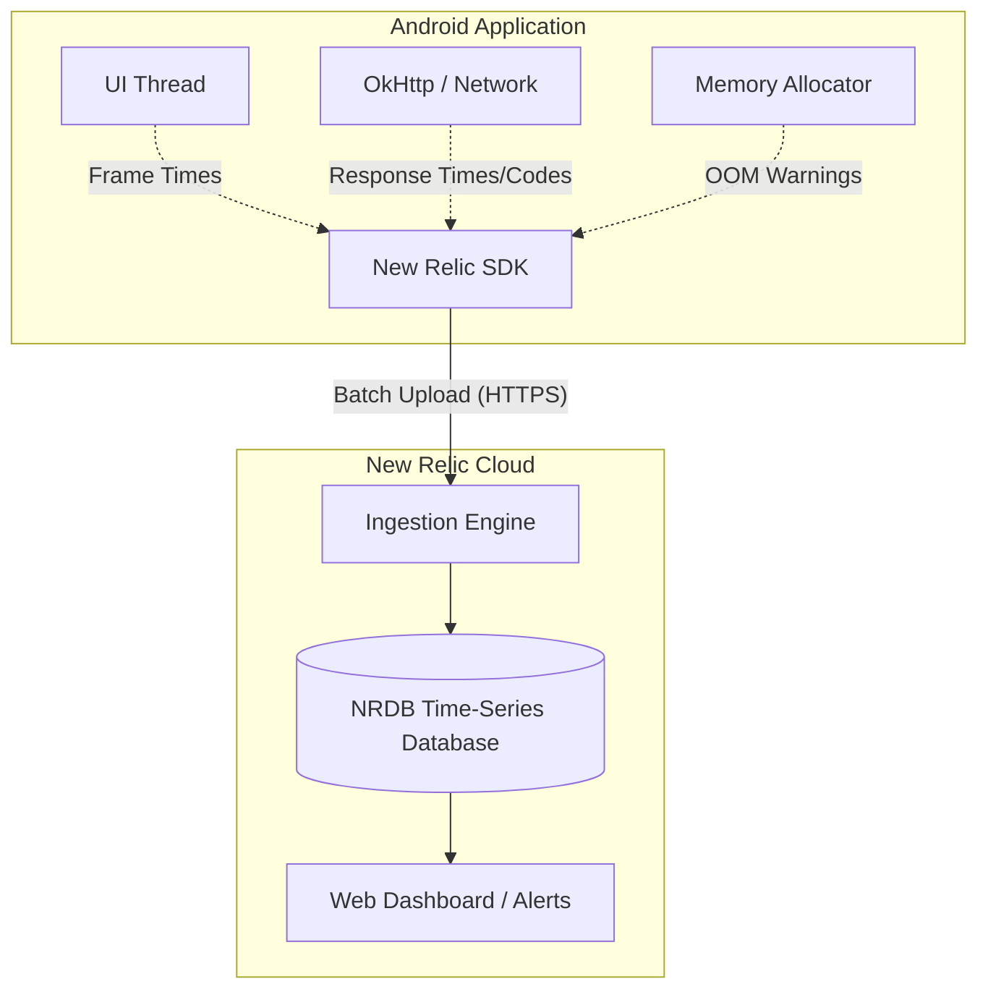

# New Relic (Application Performance Monitoring)

## Overview

A Junior Engineer thinks their job is done when the code merges and the QA team signs off.

A Staff Engineer knows that the job has just begun. Once an app hits production and is installed on 10 million devices across 5,000 different Android OEM variants, running on 3G networks in emerging markets, things will fail in ways you cannot possibly replicate locally. 

**New Relic** (or competitors like Datadog, Dynatrace, and AppDynamics) provides **Application Performance Monitoring (APM)**. It acts as a black box flight recorder for your app. It injects itself into the network stack, the UI thread, and the memory allocator to stream real-time performance metrics back to a dashboard.

## Why It Matters

If the CEO asks: *"Our iOS team says the login API takes 200ms. The backend team says it takes 50ms. How long does it take on Android?"*

Without an APM, you have to guess. With New Relic, you open the dashboard and query: `SELECT average(duration) FROM MobileRequest WHERE requestUrl = 'https://api.com/login' AND deviceOs = 'Android'`. You instantly see that the average is 450ms because the Android `OkHttp` interceptor chain is doing heavy JSON serialization on the main thread before the request even hits the network.

APM provides the irrefutable mathematical proof required to end arguments between mobile, backend, and product teams.

## Historical Context

- **Pre-2015:** Mobile performance monitoring was practically non-existent. We had Crashlytics for fatal crashes, but if the app was just "slow," we had no idea. We relied entirely on Google Play Console reviews containing the word "laggy."
- **The Web APM Pivot:** Companies like New Relic originally built their empires monitoring Ruby on Rails and Java backend servers. They pivoted to Mobile by acquiring smaller startups and adapting their bytecode injection techniques to Android's Dalvik/ART runtime.
- **Modern APM:** Today, mobile APMs are incredibly sophisticated. They automatically instrument `OkHttp`, `Retrofit`, `Room`, and `Fragment` lifecycles without requiring you to write a single line of manual tracking code.

## First Principles

1.  **Instrumentation:** The act of injecting tracking code into the app.
2.  **Bytecode Weaving:** New Relic does not rely on you manually calling `track()`. It uses a Gradle Plugin to physically rewrite your compiled `.class` files during the build process, inserting its own tracking hooks into every network call and UI transition.
3.  **Payload:** The packet of JSON data the New Relic SDK securely uploads to the cloud every few minutes containing the aggregated metrics.
4.  **NRQL (New Relic Query Language):** A SQL-like language used to query the billions of data points flowing into the dashboard.

## Mental Model

Think of New Relic as putting a **GPS Tracker and a Heart Rate Monitor on a Delivery Truck**.
- You (The Developer) are the Dispatcher sitting at HQ.
- The Truck (The App) leaves the warehouse and drives across the country.
- Without New Relic, you only know if the truck arrives safely or if it explodes (Crashlytics).
- With New Relic, the GPS tracker pings you every 60 seconds: *"I am currently going 45mph. My engine temperature is normal. The last bridge I crossed took 12 seconds instead of the expected 5 seconds."*

## Internal Mechanics

### How Bytecode Weaving Works

When you add the New Relic Gradle Plugin, it executes an ASM (or previously, Javassist) transformation step right before the R8/ProGuard shrinker runs.

```java
// What you wrote:
public void fetchUser() {
    URL url = new URL("https://api.com/user");
    HttpURLConnection conn = (HttpURLConnection) url.openConnection();
    conn.connect();
}

// What the New Relic Plugin rewrites it to during the build:
public void fetchUser() {
    URL url = new URL("https://api.com/user");
    // New Relic replaces the standard connection with a Wrapped connection!
    HttpURLConnection conn = NewRelicHttpWrapper.wrap((HttpURLConnection) url.openConnection());
    
    long startTime = System.currentTimeMillis();
    conn.connect(); // The wrapper records the bytes sent/received
    long endTime = System.currentTimeMillis();
    
    NewRelic.recordNetworkMetric("https://api.com/user", endTime - startTime);
}
```

Because of this automated weaving, you get 100% visibility into every network call your app makes, even the ones made by 3rd party SDKs (like Facebook or AppsFlyer) that you don't have the source code for!

## Architecture



## Production Example

**Tracking Distributed Traces**

A user taps "Checkout". The app spins for 10 seconds and throws a timeout error. Where did it fail?
Did the Android app fail to serialize the payload? Did the API Gateway drop the packet? Did the Payment Microservice crash? Did the Postgres Database lock up?

A Staff Engineer implements **Distributed Tracing**. 
When the Android app makes the `POST /checkout` call, the New Relic SDK injects a special HTTP Header (`newrelic-trace-id: 12345`). 
When the backend Java Spring Boot server (also running New Relic) receives the request, it extracts `12345`. It passes that ID down to the Payment Microservice, which passes it to the Database.

In the New Relic Dashboard, you search for `12345`. You see a beautiful, unified waterfall chart:
- Android App: `15ms`
- API Gateway: `5ms`
- Payment Service: `9980ms` (TIMEOUT)

The bug is instantly assigned to the Payment backend team. The mobile team is exonerated in 30 seconds.

## Tradeoffs

**Automated Weaving vs SDK Size and Build Time**

- **Tradeoff:** New Relic's automated bytecode weaving is magical, but it comes with a massive penalty.
- **The Penalty:** The New Relic Gradle plugin has to scan and rewrite *every single class* in your application. On a massive monorepo, this can add 1-2 minutes to your `assembleRelease` build time. Furthermore, the New Relic SDK itself is a hefty dependency that increases your APK size.
- **The Staff Decision:** You configure the New Relic Gradle Plugin to completely disable itself during `Debug` builds. Developers do not need bytecode weaving slowing down their local incremental builds. It is strictly enabled only for `Staging` and `Release` CI pipelines.

## Failure Modes

- **The `java.net.UnknownHostException` Spam:**
  If a user opens your app while walking onto a subway train and losing cellular signal, the network call fails. New Relic records this as a Network Failure. If 10,000 users do this a day, your dashboard will show a 5% "Network Error Rate", causing executives to panic.
  *(Fix: You must write NRQL queries that explicitly filter out `UnknownHostException` and `SocketTimeoutException`. These are environmental ISP failures, not application backend failures. You only alert on `HTTP 500` or `HTTP 401` errors).*
- **PII (Personally Identifiable Information) Leaks:**
  By default, APMs might record the full URL of network requests. If your backend team designed a terrible API like `GET /user?email=john@doe.com&password=123`, New Relic will record that URL and upload it to the dashboard. You have just committed a massive GDPR violation and leaked user passwords into a 3rd party logging system.
  *(Fix: The Android SDK must be configured with strict Regex filters to redact sensitive URL query parameters before the payload leaves the device).*

## Staff Engineer Thinking

When integrating an APM, a Staff engineer focuses on actionable metrics, not vanity dashboards.

1.  **Custom Attributes (Breadcrumbs):** Knowing an app crashed is useless if I don't know *how* the user got there. I mandate that every major architectural boundary (Navigation changes, Network responses) attaches a custom attribute to the New Relic session (e.g., `NewRelic.setAttribute("last_screen", "Checkout")`). When a crash happens, I can query the exact sequence of screens the user visited beforehand.
2.  **Alert Fatigue:** If you set a New Relic alert to trigger a PagerDuty call every time the app's crash rate exceeds 1%, the on-call engineer will be woken up 5 times a night by random OS-level `OutOfMemory` errors on $50 budget phones. They will quickly mute the pager. I aggressively tune alerts. We only trigger PagerDuty if the crash rate of *users on Flagship devices running the latest version* spikes unexpectedly.
3.  **Interaction Tracing:** I use the APM to measure UX, not just APIs. I wrap the `onClick` listener of the "Add to Cart" button in a custom New Relic interaction trace. If it takes 4 seconds for the cart animation to finish and the database to update, the APM flags it as a UX violation, even if no network call failed.

## Common Misconceptions

- **"Crashlytics and New Relic do the same thing."** No. Crashlytics (Firebase) is a Crash Reporter. It tells you when the app fatally died. New Relic is an APM. It tells you when the app is surviving, but suffering (slow network, dropped frames, high memory usage).
- **"APMs slow down the app."** While it is true that the SDK consumes memory and CPU to aggregate metrics, modern APMs batch their uploads and run heavily on background threads. The performance penalty is usually < 1%, which is an acceptable tradeoff for the visibility gained.

## Probing Questions

1.  What is the fundamental difference between a Crash Reporting tool (like Firebase Crashlytics) and an Application Performance Monitoring (APM) tool like New Relic?
2.  Explain the concept of "Bytecode Weaving" and how it allows an APM to track network requests made by 3rd party SDKs that you do not own the source code for.
3.  Why is it an architectural requirement to disable APM bytecode weaving during local `Debug` builds?
4.  Describe how "Distributed Tracing" works and how it resolves disputes between Mobile and Backend engineering teams.
5.  If an APM dashboard shows a sudden spike in Network Errors, why must an engineer differentiate between `UnknownHostException` and `HTTP 500` errors before waking up the backend team?
6.  Explain the severe security risk of an APM automatically logging the full URLs of all `GET` requests made by the Android application.
7.  What is a "Custom Attribute" (or Breadcrumb) in the context of APM, and why are they critical for debugging complex user journeys?
8.  How does "Alert Fatigue" destroy the effectiveness of an APM integration, and how can you tune alerts to prevent it?
9.  Why did early mobile APMs transition from requiring manual `trackNetworkCall()` boilerplate to automated Gradle plugin transformations?
10. If the CEO asks you to prove that migrating from XML to Jetpack Compose improved the speed of the Checkout screen, exactly what kind of APM metric would you query to prove it?

## Further Reading

- [`jank.md`](../performance/jank.md) — The dropped frame metrics that the APM SDK actively monitors and uploads.
- [`retrofit-and-okhttp.md`](../networking-and-security/retrofit-and-okhttp.md) — The network stack that the APM intercepts via Bytecode Weaving.
- [New Relic: Mobile Monitoring](https://docs.newrelic.com/docs/mobile-monitoring/)
