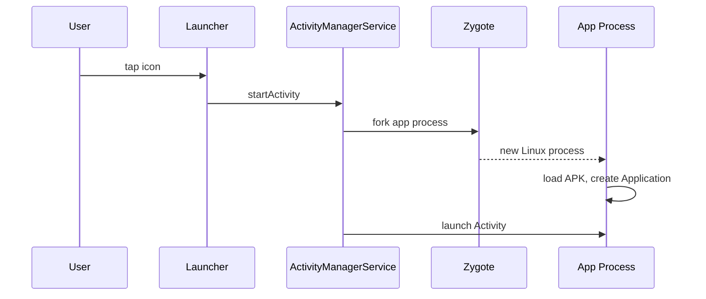

# ActivityManager and Process Lifecycle

## Overview

Android does not treat your app as a permanently running program. It treats your app as a package of components that can be launched, paused, stopped, killed, and later recreated depending on user interaction, memory pressure, background restrictions, and system policy.

`ActivityManagerService` (AMS), running inside `system_server`, coordinates this lifecycle. It starts processes through Zygote, launches activities, manages services and receivers, tracks process importance, and decides which processes are safe to kill when memory gets tight.

Staff-level Android architecture starts from this premise: your process is temporary; your product state must survive without it.

---

## Why It Matters

1. **Process death is normal.** Android may kill cached/background processes without calling your component teardown methods.
2. **Component state determines process priority.** A foreground activity, foreground service, bound service, receiver, or provider changes kill risk.
3. **In-memory singletons are temporary.** They are caches, not durable state.
4. **Background work is policy-controlled.** A coroutine is not a background execution guarantee.
5. **Startup path is OS-driven.** Your first code may be a provider, receiver, service, or activity.

---

## Process Creation



The process is forked from Zygote so it inherits preloaded framework classes and warmed runtime state. This is why cold start is faster than starting a JVM from scratch.

---

## Process Importance

Android ranks processes by user impact. Simplified:

| Importance | Example | Kill risk |
|---|---|---|
| Foreground | Resumed activity, running receiver, foreground service | Lowest |
| Visible | Paused but visible activity | Low |
| Service | Started service doing background work | Medium |
| Cached | No active component, kept for speed | High |

The exact internal categories and thresholds vary across Android versions and devices, but the principle is stable: the less user-visible your process is, the more killable it becomes.

---

## Component Effects

### Activity

A resumed activity makes the process foreground. A stopped activity can become cached. `onStop()` does not mean process death; it means the UI is no longer visible.

### Service

A started service can keep the process more important than a cached app, but modern Android heavily restricts background service starts. Use WorkManager for deferrable durable work and foreground services for immediate user-visible ongoing work.

### BroadcastReceiver

A running receiver temporarily raises process importance. Once `onReceive()` returns, the process may become killable again.

### ContentProvider

A provider being used by another process can keep your process alive while the call is active.

---

## Process Death vs Configuration Change

Configuration change:

- Activity destroyed and recreated.
- Process usually stays alive.
- ViewModel survives.
- In-memory singletons survive.

Process death:

- Linux process is killed.
- All memory is gone.
- ViewModels, singletons, coroutines, caches are gone.
- OS may later recreate an activity with saved instance state.

Do not confuse them. Rotation tests do not prove process-death safety.

---

## Durable State Rule

| State | Owner |
|---|---|
| Screen text input / selected tab | `SavedStateHandle` or `rememberSaveable` |
| Domain data | Room/DataStore/files/server |
| In-flight durable work | WorkManager/outbox |
| Auth/session token | Encrypted storage / account layer |
| Cache | Memory or disk cache, rebuildable |

Anything the user would be angry to lose cannot live only in RAM.

---

## Background Work Reality

Bad:

```kotlin
viewModelScope.launch {
    repository.uploadDraft(draft)
}
```

This is fine only while the ViewModel is alive. If the process dies, the upload dies.

Better for durable work:

```kotlin
DraftOutbox.insert(draft)
WorkManager.getInstance(context).enqueueUniqueWork(
    "draft-upload",
    ExistingWorkPolicy.KEEP,
    OneTimeWorkRequestBuilder<DraftUploadWorker>().build()
)
```

The database is the source of truth; WorkManager is the scheduler.

---

## Low Memory Killer and Cached Processes

Android keeps recently used processes cached for fast return. When memory pressure rises, cached processes are killed first. This is not a crash; it is resource management.

Implication: never rely on "the app was only in recents" as proof that process state still exists.

---

## Testing Process Death

Useful approaches:

- Enable "Don't keep activities" to catch activity recreation issues, but remember it is not full process death.
- Use `adb shell am kill <package>` to simulate process kill while preserving task state.
- Use Android Studio App Inspection / system tools to stop process.
- Build automated tests around saved state and repository rehydration.

Staff rule: every critical flow should define what survives process death and how it is restored.

---

## Failure Modes

| Failure | Cause | Fix |
|---|---|---|
| User returns to blank screen | State lived only in ViewModel | Save IDs/UI state; reload domain data |
| Upload lost | Coroutine died with process | Persistent outbox + WorkManager |
| Crash on restore | Required singleton not initialized | Rehydrate from durable owner |
| Duplicate submission | Retry after process death without idempotency | Client operation ID |
| Battery drain | Trying to keep process alive | Use OS-sanctioned scheduler |
| Foreground service abuse | Background work disguised as visible work | Use WorkManager or redesign |

---

## Staff Engineer Thinking

1. **Assume process death in every architecture review.** What happens if the OS kills us here?
2. **RAM is a cache.** Important state needs a durable owner.
3. **Component lifecycle is not process lifecycle.** Activity callbacks are not global process guarantees.
4. **Use OS contracts.** WorkManager, foreground services, saved state, and Room exist because the OS is hostile to ad hoc background execution.
5. **Make restoration boring.** Reconstruct screens from route IDs and repositories, not serialized object graphs.

---

## Probing Questions

1. How does Android start a new app process?
2. What makes a process foreground, visible, service, or cached?
3. Why is `onDestroy()` not a persistence callback?
4. What survives configuration change but not process death?
5. Why is `viewModelScope.launch` insufficient for durable upload?
6. How would you test process-death restoration?
7. What state belongs in `SavedStateHandle` vs Room?
8. Why does Android keep cached processes at all?

## Further Reading

- [`the-zygote.md`](the-zygote.md)
- [`../architecture/process-death-and-state-restoration.md`](../architecture/process-death-and-state-restoration.md)
- [`../concurrency/workmanager.md`](../concurrency/workmanager.md)
- [`../concurrency/services.md`](../concurrency/services.md)
- [Android Developers: Processes and app lifecycle](https://developer.android.com/guide/components/activities/process-lifecycle)
