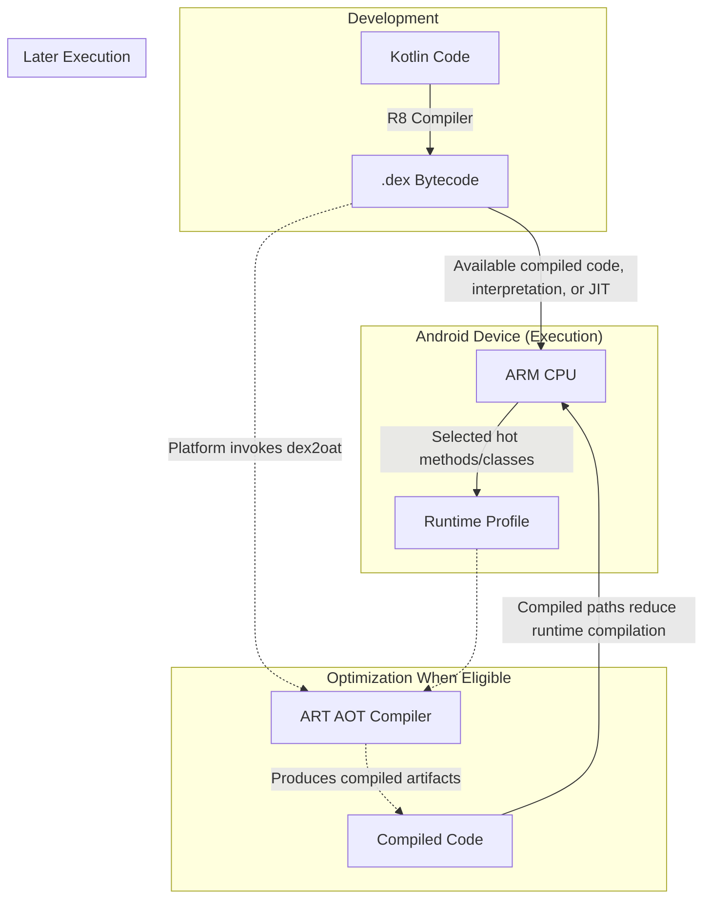

# ART and Dalvik (The Android Runtime)

## Overview

You do not write "Android code". You write Kotlin or Java code. The CPU in your phone (usually an ARM processor) has absolutely no idea what Kotlin or Java is. It only speaks Machine Code (binary instructions like `ADD Register1, Register2`).

The gap between your Kotlin code and the CPU's Machine Code is bridged by **The Android Runtime**. 

A Staff Engineer understands that Android's runtime evolution is the story of a massive, decade-long war against battery drain, RAM limitations, and startup lag. Understanding how Dalvik (the original runtime) was replaced by ART (the modern runtime), and how ART utilizes JIT, AOT, and Profile-Guided Optimization, is crucial for writing high-performance code and debugging bizarre OS-level crashes.

## Why It Matters

A deeply nested loop may execute differently in an interpreter, JIT-compiled runtime, or ahead-of-time compiled binary. Language implementation, optimization, algorithm, workload, and hardware all matter; “interpreted is slow” and “compiled is instant” are not useful performance guarantees.

Android sits in the middle. Your Kotlin code is compiled into `.dex` (Dalvik Executable) bytecode. But *when* and *how* does that bytecode become Machine Code? 
- Runtime interpretation or JIT work can contribute to [jank](../performance/jank.md) when it lands on a critical path, but the user-visible result depends on the workload and device.
- If more translation happens during installation, installation and compiled-code storage increase; the magnitude depends on the app, device, OS release, and compilation filter.
- If you don't understand how the runtime balances this, your attempts to optimize your app's performance will be based on fundamentally incorrect assumptions.

## Historical Context

- **Early Android constraints:** Java source commonly compiled to JVM `.class` files, while Android introduced DEX bytecode and Dalvik for its process, memory, packaging, and mobile-runtime goals. Register-versus-stack encoding is one design dimension; it is not enough by itself to explain total RAM use or legal history.
- **Android 1.0 (Dalvik):** Dalvik used register-oriented DEX bytecode designed for early mobile process, memory, storage, and packaging constraints. Actual memory and artifact-size differences depend on the application and packaging. Early Dalvik was interpreter-first; Android 2.2 added a trace-based **JIT (Just-In-Time)** compiler for selected hot paths, trading runtime compilation work for potential execution gains.
- **Android 5.0 (ART and install-time AOT):** ART replaced Dalvik as the runtime and relied substantially on ahead-of-time compilation during installation. That reduced runtime compilation work but increased installation time and compiled-code storage. The compiler filter, app, device, and release determine how much code is compiled; startup is not literally instant and no universal battery or duration multiplier follows from the runtime change.
- **Android 7.0+ (ART - Profile-Guided Optimization):** Android moved to a hybrid of interpretation, JIT, AOT, and profiles so compilation effort could focus on code observed as important instead of relying as heavily on broad install-time compilation.

## First Principles

1.  **DEX (Dalvik Executable):** The highly optimized bytecode format specific to Android. The `d8` / `R8` compiler turns your Kotlin into DEX.
2.  **JIT (Just-In-Time):** Translating selected bytecode while the app runs, shifting some compilation CPU into runtime without defining total installation cost.
3.  **AOT (Ahead-Of-Time):** Translating selected bytecode before execution, shifting compilation work earlier and consuming compiled-code storage without guaranteeing a fixed runtime result.
4.  **Profile (`.prof`):** Runtime profiles contain selected hot methods and classes observed under ART's profiling policy; they are not a complete execution history. Developer-authored Baseline Profile rules are human-readable before build tooling packages them into runtime-consumable profile assets.

## Mental Model

Think of your app's DEX code as a **French Novel**. The CPU only speaks **English**.
- **Dalvik (Interpreter-first):** Every time the user opens the book, a translator stands next to them, translating each French sentence into English out loud (Interpreter). Later versions added a notepad to remember frequent translations (JIT). Reading is slow and exhausting for the translator (Battery).
- **Early ART (heavier install-time AOT):** Before handing over the book, the translator prepares a substantial English edition selected by the current compilation filter. That can reduce translation while reading, but adds variable delivery time and storage rather than guaranteeing a complete copy or instant reading.
- **Modern ART (PGO):** You take the French version home and begin with interpretation/JIT translation. Profiles identify useful chapters, which can later receive AOT translations. Those chapters need less runtime compilation on later reads, while uncompiled code still uses the rest of ART's execution modes.

## Internal Mechanics

### The Modern ART Pipeline (Android 7.0+)

1. **Install:** The OS installs the APK's DEX code and may perform compilation work according to the Android release, installer, and active compiler filter; install cost is not universally zero.
2. **First Run (interpretation/JIT):** ART executes available compiled code and interprets or JIT-compiles other methods as they become important.
3. **Profiling:** Runtime profiles record selected hot methods and classes rather than every method called.
4. **Background optimization (AOT):** When device and scheduler conditions permit, ART uses profiles and compiler filters to optimize selected code ahead of later runs.
5. **Later runs:** Previously compiled paths can avoid some interpretation/JIT work, while startup still includes process, I/O, framework, and application costs.

### Cloud Profiles

Google realized that waiting for *your* phone to generate a profile took too long. 
For eligible Play-distributed apps, Google Play can aggregate representative profiles and deliver a Cloud Profile to new installs. ART can use it to optimize important paths earlier, reducing—not universally eliminating—first-run interpretation and JIT work.

*(Staff Note: A developer-supplied [Baseline Profile](../performance/baseline-profiles.md) gives ART useful rules before Cloud Profile aggregation, subject to delivery and compilation conditions.)*

## Architecture

## Production Example

**Garbage Collection (Dalvik vs ART)**

Memory management is handled by the Runtime. The evolution of Garbage Collection (GC) from Dalvik to ART is staggering.

Legacy Dalvik collectors included stop-the-world work that could pause application threads and contribute to missed frames under allocation pressure. Behavior varied across Android releases and collector implementations.

ART introduced increasingly concurrent collectors and other runtime improvements that generally reduce pause work. Stop-the-world phases still exist, and pause duration depends on collector, heap, allocation rate, Android release, device, and workload; use runtime traces instead of a universal millisecond ceiling.

*(Staff Note: Even with concurrent GC, sustained allocation churn can add CPU, memory, and energy pressure. Avoid per-frame allocation in measured rendering hot paths such as `onDraw`; confirm the effect with allocation and frame traces.)*

## Tradeoffs

**Registers vs Stacks**

Why did Android use a Register-based VM (Dalvik/ART) instead of a Stack-based VM (like the standard Oracle JVM)?

- **Stack-Based (Standard JVM):**
    - *Pros:* The bytecode is extremely compact. The compiler is simple to write.
    - *Cons:* Some operations require more VM bytecode instructions because operands move through an operand stack.
- **Register-Based (Dalvik/ART):**
    - *Pros:* Some operations can be encoded with fewer VM instructions by naming virtual registers directly, trading instruction density and implementation complexity. End-to-end CPU and energy effects still require measurement.
    - *Cons:* Register-oriented instructions can be wider, while DEX cross-class pooling, archive compression, and the input class set also change total size. Compare final artifacts rather than assuming DEX or class/JAR output is universally smaller.

## Failure Modes

- **The Verification Error (`VerifyError`):**
  ART verifies DEX bytecode before executing it. Invalid generated or transformed bytecode can raise `VerifyError` when the affected class is verified or loaded; whether that terminates the process depends on where and how the error is handled.
  *(Fix: Validate bytecode-transforming tools and shrinker configuration against the affected build and Android versions.)*
- **Install-time AOT pressure (Pre-Android 7):**
  Android 5 and 6 relied more heavily on install-time AOT. Depending on the compiler filter, app, device, and OS build, `dex2oat` could add substantial installation CPU, latency, and compiled-code storage. Do not turn a measured incident into a universal “compile everything” rule or fixed APK-size/duration claim; this tradeoff was one motivation for later hybrid profile-guided compilation.
- **Exception-heavy control flow:**
  Throwing an exception and constructing its stack trace can cost more than an ordinary branch, with cost depending on runtime, stack depth, and whether a trace is filled. Avoid exception-driven logic in measured hot paths; do not infer whole-app performance from an isolated throw.

## Staff Engineer Thinking

When thinking about the Runtime, a Staff engineer focuses on how code translates to bare-metal execution.

1.  **DEX reference limits and Multidex:** Individual DEX reference tables have 16-bit limits, so large apps may need multiple DEX files. Older Dalvik releases required application-level multidex support and had additional loading costs. ART supports multidex directly, but DEX layout, verification, loading, and compiled-artifact state can still affect startup; ART does not promise one flattened `.oat` file.
2.  **Compilation monitoring:** If ANRs or resource contention rise after an update, ART compilation is one hypothesis to verify with system traces and device evidence—not a conclusion from timing alone. [Baseline Profiles](../performance/baseline-profiles.md) can identify important paths for earlier optimization, but compiler filters and device state still determine the work performed.
3.  **String constants:** A DEX file uses a string table, so repeated constants within that DEX can share an entry; multidex packaging and runtime objects still matter. Dynamically constructed strings allocate according to execution and lifetime, so inspect allocation profiles before optimizing them.

## Common Misconceptions

- **"ART converts Java to C++."** No. Android build tools produce DEX bytecode, and ART may interpret or compile selected DEX methods to target machine code according to runtime policy. C++ is not an intermediate language in that pipeline.
- **"JIT is always slower than AOT."** Neither strategy wins universally. JIT can use observed runtime behavior to select and optimize hot code, while AOT can move selected compilation work out of the interactive path. Android combines interpretation, JIT, profiles, and AOT according to OS policy and device state.

## Probing Questions

1.  Explain the fundamental difference between a Just-In-Time (JIT) compiler and an Ahead-Of-Time (AOT) compiler regarding CPU usage and app startup times.
2.  Why did Google choose to build Dalvik as a Register-Based Virtual Machine instead of using a standard Stack-Based Java Virtual Machine?
3.  Describe the profile-guided optimization pipeline in modern ART. How can runtime profiles influence later compilation?
4.  When can Cloud Profiles provided by Google Play reduce first-run compilation work for new installs, and what limits apply?
5.  What tradeoff did early ART's heavier install-time AOT strategy create, and how did profile-guided compilation change it?
6.  How did garbage collection evolve from Dalvik to ART, and why can collection still contribute to UI jank?
7.  What is the 64k reference-index limit, and how does modern ART multidex support differ from legacy Dalvik loading?
8.  If an application relies heavily on throwing and catching Java Exceptions for standard logic flow, how might the ART runtime react in terms of performance optimization?
9.  Describe the role of the `dex2oat` ART compiler during installation and background optimization.
10. How does packaging a Baseline Profile with an app release interact with ART compilation?

## Answer Key

1. **Explain the fundamental difference between a Just-In-Time (JIT) compiler and an Ahead-Of-Time (AOT) compiler regarding CPU usage and app startup times.**
   JIT compiles selected bytecode while the app runs, shifting some compilation CPU into runtime. AOT compiles selected bytecode before execution, shifting that work earlier and increasing compiled-code storage. Startup and CPU outcomes depend on which code is compiled and on the workload; neither mode guarantees a fixed result.
2. **Why did Google choose to build Dalvik as a Register-Based Virtual Machine instead of using a standard Stack-Based Java Virtual Machine?**
   Register bytecode can encode some operations with fewer VM instructions by naming virtual registers, while stack bytecode can be denser and simpler. The tradeoff affects interpreter/compiler design and code representation; end-to-end CPU, memory, and energy outcomes depend on the implementation and workload.
3. **Describe the profile-guided optimization pipeline in modern ART. How can runtime profiles influence later compilation?**
   ART records selected hot methods and classes in runtime profiles. Subject to Android version, compiler filter, scheduler, and device conditions, later optimization can use matching rules to compile important paths; it is not fixed to an “overnight” event or a universal set of methods.
4. **When can Cloud Profiles provided by Google Play reduce first-run compilation work for new installs, and what limits apply?**
   For eligible apps, Google Play aggregates representative usage profiles and can deliver a Cloud Profile to new installs. ART may use it to optimize important paths earlier, reducing first-run interpretation/JIT work without guaranteeing that all needed code is already compiled.
5. **What tradeoff did early ART's heavier install-time AOT strategy create, and how did profile-guided compilation change it?**
   Doing more compilation at install time can improve runtime execution but increases install latency and compiled-code storage, including for cold code. Later ART releases combine interpretation, JIT, runtime profiles, and selective AOT so hot paths receive optimization while avoiding a universal compile-everything cost. Results remain workload- and device-dependent.
6. **How did garbage collection evolve from Dalvik to ART, and why can collection still contribute to UI jank?**
   ART evolved collectors, allocation handling, and concurrent work to reduce many pause times compared with older Dalvik behavior. Collection still includes pause phases and can cause jank under allocation pressure; duration depends on Android release, collector, heap, device, and workload rather than a universal single-digit-millisecond bound.
7. **What is the 64k reference-index limit, and how does modern ART multidex support differ from legacy Dalvik loading?**
   The limit applies to 16-bit reference indexes within an individual DEX file, so large applications split references across multiple DEX files. Older Dalvik versions required application-level multidex loading; ART supports multiple DEX files directly, though layout, loading, verification, and compilation can still affect performance.
8. **If an application relies heavily on throwing and catching Java Exceptions for standard logic flow, how might the ART runtime react in terms of performance optimization?**
   Frequent exception creation and throwing on a measured hot path can add stack-capture and control-flow cost. The effect depends on runtime, trace construction, frequency, and placement; profile before attributing a regression, and use ordinary branches for expected high-frequency outcomes.
9. **Describe the role of the `dex2oat` ART compiler during installation and background optimization.**
   `dex2oat` is an ART compiler used to produce compiled artifacts under platform-selected compiler filters. Installation, background optimization, runtime profiles, scheduler policy, and device state can all influence when it runs and which matching code it compiles.
10. **How does packaging a Baseline Profile with an app release interact with ART compilation?**
    It supplies developer-defined rules for important startup and interaction paths before local or Cloud Profiles accumulate. When the profile is delivered, installed, and accepted, `dex2oat` may use matching rules during installation or later optimization; Android version, installer, compiler filter, device state, and rule matching determine when and how much code is compiled.

## Further Reading

- [`the-zygote.md`](the-zygote.md) — The master process that initializes ART and preloads classes to avoid booting the JVM from scratch for every app.
- [`baseline-profiles.md`](../performance/baseline-profiles.md) — How developer-supplied profile rules can enable earlier ART optimization when delivery and compilation conditions permit.
- [Android Open Source Project: Android Runtime (ART) and Dalvik](https://source.android.com/docs/core/runtime)
- [AOSP: ART JIT compiler](https://source.android.com/docs/core/runtime/jit-compiler) — Hybrid JIT/AOT and profile-guided compilation.
- [AOSP: Configure ART](https://source.android.com/docs/core/runtime/configure) — Compiler filters and runtime configuration.
