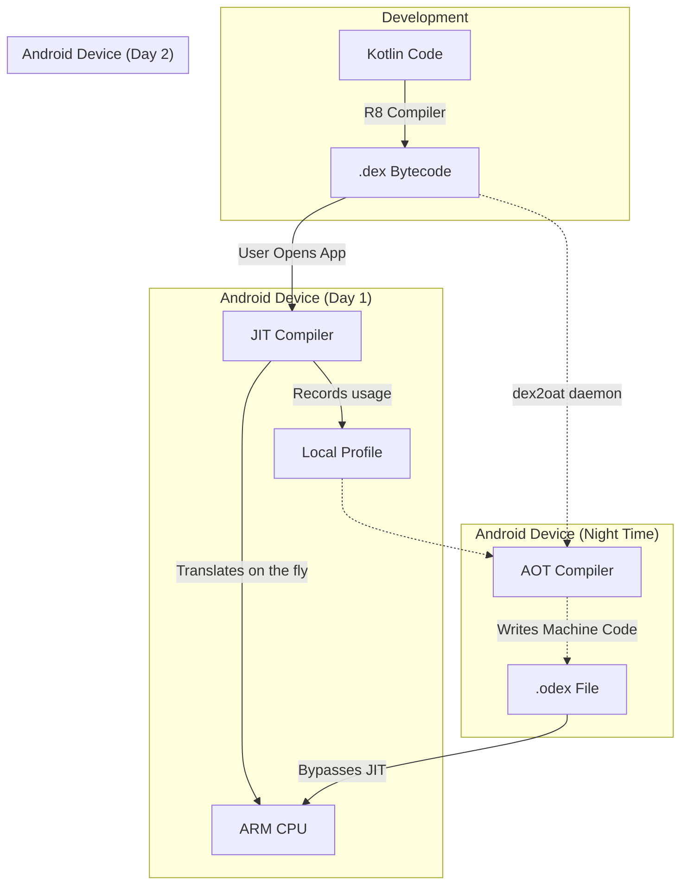

# ART and Dalvik (The Android Runtime)

## Overview

You do not write "Android code". You write Kotlin or Java code. The CPU in your phone (usually an ARM processor) has absolutely no idea what Kotlin or Java is. It only speaks Machine Code (binary instructions like `ADD Register1, Register2`).

The gap between your Kotlin code and the CPU's Machine Code is bridged by **The Android Runtime**. 

A Staff Engineer understands that Android's runtime evolution is the story of a massive, decade-long war against battery drain, RAM limitations, and startup lag. Understanding how Dalvik (the original runtime) was replaced by ART (the modern runtime), and how ART utilizes JIT, AOT, and Profile-Guided Optimization, is crucial for writing high-performance code and debugging bizarre OS-level crashes.

## Why It Matters

If you write a deeply nested `for` loop in Python, it runs slowly because Python is an interpreted language. If you write that same loop in C++, it runs instantly because C++ is compiled directly to Machine Code.

Android sits in the middle. Your Kotlin code is compiled into `.dex` (Dalvik Executable) bytecode. But *when* and *how* does that bytecode become Machine Code? 
- If the translation happens while the user is staring at the screen, your app stutters ([Jank](../performance/jank.md)).
- If the translation happens when the app is installed, the install takes 5 minutes, and the app takes up 3x the storage space.
- If you don't understand how the runtime balances this, your attempts to optimize your app's performance will be based on fundamentally incorrect assumptions.

## Historical Context

- **Pre-Android (Sun JVM):** Standard Java compiles to `.class` files and runs on a Stack-Based Virtual Machine. Google rejected this because stack-based VMs require too much RAM, which the original 192MB Android G1 phone did not have. They also wanted to avoid Oracle/Sun licensing lawsuits.
- **Android 1.0 (Dalvik):** Dan Bornstein created Dalvik. It was a **Register-Based Virtual Machine**. It consumed vastly less RAM. It took `.class` files and squashed them into highly compressed `.dex` files. Early Dalvik was interpreter-first: every run paid the cost of reading DEX bytecode and executing it through the VM. Android 2.2 added a trace-based **JIT (Just-In-Time)** compiler for hot paths, improving speed but still spending CPU and battery while the app was running.
- **Android 5.0 (ART - Ahead of Time):** Google ripped out Dalvik and replaced it with ART (Android Runtime). ART introduced **AOT (Ahead-Of-Time)** compilation. When you downloaded an app from the Play Store, the OS spent 5 minutes translating the *entire* DEX file into raw Machine Code (`.oat` / `.odex`). App startup was instant. Battery life soared. But app installations took forever.
- **Android 7.0+ (ART - Profile-Guided Optimization):** Google realized AOT compiling the entire app was wasteful (users only use 20% of an app's features). They introduced a hybrid system: JIT + AOT + Profiles. 

## First Principles

1.  **DEX (Dalvik Executable):** The highly optimized bytecode format specific to Android. The `d8` / `R8` compiler turns your Kotlin into DEX.
2.  **JIT (Just-In-Time):** Translating bytecode into Machine Code *while the app is running*. Slows down the app in real-time, but requires zero installation time.
3.  **AOT (Ahead-Of-Time):** Translating bytecode into Machine Code *before the app runs*. Makes the app run blazingly fast, but requires time and CPU power upfront (during installation or while charging).
4.  **Profile (`.prof`):** A binary file the OS maintains that tracks exactly which methods you use most frequently. (Note: Baseline Profile source files you write are text, but the compiled runtime profile is binary).

## Mental Model

Think of your app's DEX code as a **French Novel**. The CPU only speaks **English**.
- **Dalvik (Interpreter-first):** Every time the user opens the book, a translator stands next to them, translating each French sentence into English out loud (Interpreter). Later versions added a notepad to remember frequent translations (JIT). Reading is slow and exhausting for the translator (Battery).
- **ART v1 (Pure AOT):** When you buy the book, you must wait in the bookstore for 2 hours while the translator writes a complete English copy. Once done, you can read the English book instantly forever.
- **Modern ART (PGO):** When you buy the book, you take the French version home. You start reading (JIT translation). The translator notices you really like reading Chapter 3. When you go to sleep (plug the phone in), the translator stays up and writes an English copy of *only* Chapter 3 (AOT based on Profile). The next day, Chapter 3 is instant.

## Internal Mechanics

### The Modern ART Pipeline (Android 7.0+)

1. **Install:** You download an APK. The OS extracts the `.dex` file. No compilation happens. Installation is instant.
2. **First Run (JIT):** You open the app. ART's Just-In-Time compiler translates the DEX bytecode to Machine Code as you use it. The app is slightly slow.
3. **Profiling:** As you use the app, ART watches. It records every method you call into a JIT Profile (`/data/misc/profiles/cur/0/com.example.app/primary.prof`).
4. **Idle Maintenance (AOT):** You plug your phone in at night. The screen turns off. The battery is 100%. The `dex2oat` background daemon wakes up. It reads the Profile. It takes the frequently used methods and Ahead-Of-Time compiles them into an `.odex` (Optimized DEX) file.
5. **Second Run:** You open the app the next day. ART sees the `.odex` file and loads the raw Machine Code directly into RAM. The app runs blazingly fast.

### Cloud Profiles

Google realized that waiting for *your* phone to generate a profile took too long. 
When millions of users use your app, Google Play aggregates their profiles into a "Cloud Profile." Now, when a new user downloads your app, Google Play sends the `.apk` *and* the Cloud Profile. The phone AOT compiles the critical path *during installation*, completely skipping the slow JIT phase on Day 1.

*(Staff Note: We can manually inject a [Baseline Profile](../performance/jank.md) directly into the APK to bypass Cloud Profile aggregation delays entirely).*

## Architecture

## Production Example

**Garbage Collection (Dalvik vs ART)**

Memory management is handled by the Runtime. The evolution of Garbage Collection (GC) from Dalvik to ART is staggering.

In **Dalvik**, Garbage Collection was "Stop-The-World". When the heap filled up, Dalvik would literally freeze your entire application's execution (including the Main Thread). It would pause the app, walk the entire memory tree to find dead objects, delete them, and then unfreeze the app. If you allocated a lot of objects during an animation, the app would drop massive amounts of frames while Dalvik froze the world to clean up the mess.

In **ART**, Garbage Collection is largely **Concurrent**. ART uses a highly optimized read-barrier mechanism. It cleans up memory on a background thread *while your app continues to execute on the Main thread*. Stop-The-World pauses in ART are measured in single-digit milliseconds or less. 

*(Staff Note: Even with Concurrent GC, massive memory churn will still cause CPU contention and battery drain. Never instantiate objects inside an `onDraw` loop).*

## Tradeoffs

**Registers vs Stacks**

Why did Android use a Register-based VM (Dalvik/ART) instead of a Stack-based VM (like the standard Oracle JVM)?

- **Stack-Based (Standard JVM):**
    - *Pros:* The bytecode is extremely compact. The compiler is simple to write.
    - *Cons:* It requires many more CPU instructions to execute. To add two numbers, a stack VM must execute 4 instructions: `PUSH A`, `PUSH B`, `ADD`, `POP C`.
- **Register-Based (Dalvik/ART):**
    - *Pros:* Executes vastly fewer instructions. The same addition requires 1 instruction: `ADD C, A, B`. Because mobile CPUs are heavily optimized for registers, this translates directly to massive battery savings.
    - *Cons:* The compiled `.dex` files are technically larger than standard `.class` files, requiring Google to implement deep string-pooling and deduplication tricks inside the DEX format to save disk space.

## Failure Modes

- **The Verification Error (`VerifyError`):**
  When ART loads a DEX file, it runs a strict "Verifier" to ensure the bytecode isn't malicious and won't illegally access memory. If you use a bytecode-manipulation library (like some advanced mocking frameworks) that generates mathematically invalid DEX, your app will crash instantly on startup with a `VerifyError`.
  *(Fix: Ensure your R8/ProGuard configuration is correct, and avoid aggressively hacking bytecode at runtime).*
- **AOT Thrashing (Pre-Android 7):**
  On Android 5 and 6, the OS AOT compiled *everything*. If you had a 150MB APK, `dex2oat` would lock up the phone for 10 minutes during installation, causing the device to overheat. This is the exact failure mode that forced Google to invent Profile-Guided Optimization.
- **De-optimization:**
  Exceptions are computationally expensive. Generating stack traces requires walking the call stack and resolving symbol information, severely degrading performance when used for standard control flow. Exceptions should only be used for truly exceptional states.

## Staff Engineer Thinking

When thinking about the Runtime, a Staff engineer focuses on how code translates to bare-metal execution.

1.  **DEX Method Limits (64k Limit):** The original Dalvik format used a 16-bit integer to reference methods, meaning an app could only have 65,536 methods. If you hit 65,537, the build failed. We had to enable `Multidex`, which split the app into multiple `.dex` files. Dalvik struggled immensely with Multidex, causing massive startup crashes. ART handles Multidex natively and effortlessly by flattening multiple DEX files into a single `.oat` file during compilation.
2.  **`dex2oat` Monitoring:** If I see a spike in "App Not Responding" (ANR) reports immediately after an app update, I know that `dex2oat` is likely thrashing in the background, starving the CPU while it AOT compiles the new update. I mandate the inclusion of [Baseline Profiles](../performance/jank.md) in the APK to give `dex2oat` an exact blueprint, stopping it from blindly compiling the entire app.
3.  **String Pooling:** I write code knowing that DEX files pool strings. If you have the string `"Authorization"` in 500 different Kotlin files, it only appears *once* in the compiled DEX file. However, if you dynamically generate strings `("Auth_" + index)`, they cannot be pooled at compile time and will explode your heap memory at runtime.

## Common Misconceptions

- **"ART converts Java to C++."** No. ART compiles DEX bytecode into raw ARM Machine Code. C++ is a high-level human-readable language. ART writes binary 1s and 0s directly for the CPU.
- **"JIT is always slower than AOT."** Historically yes, but modern JIT compilers are incredibly advanced. Because JIT compiles code *while it is running*, it has access to live runtime data (e.g., it knows exactly which branch of an `if` statement is taken 99% of the time). JIT can actually perform dynamic optimizations that static AOT compilers cannot. This is why Android uses a hybrid of both.

## Probing Questions

1.  Explain the fundamental difference between a Just-In-Time (JIT) compiler and an Ahead-Of-Time (AOT) compiler regarding CPU usage and app startup times.
2.  Why did Google choose to build Dalvik as a Register-Based Virtual Machine instead of using a standard Stack-Based Java Virtual Machine?
3.  Describe the "Profile-Guided Optimization" (PGO) pipeline in modern ART. How does the phone know which methods to AOT compile overnight?
4.  How do "Cloud Profiles" provided by Google Play solve the "Day 1" performance problem for new users downloading your application?
5.  What was the catastrophic flaw with Android 5.0's approach of AOT compiling 100% of an application's DEX bytecode upon installation?
6.  Explain how the shift from Dalvik to ART radically improved Garbage Collection performance and reduced UI Jank.
7.  What is the 64k Method Limit, and why does the modern ART runtime handle Multidex significantly better than the legacy Dalvik runtime?
8.  If an application relies heavily on throwing and catching Java Exceptions for standard logic flow, how might the ART runtime react in terms of performance optimization?
9.  Describe the role of the `dex2oat` background daemon in the Android Operating System.
10. How does shipping a manual `Baseline Profile` inside your APK interact with ART's `dex2oat` compiler?

## Further Reading

- [`the-zygote.md`](the-zygote.md) — The master process that initializes ART and preloads classes to avoid booting the JVM from scratch for every app.
- [`baseline-profiles.md`](../performance/jank.md) — How developers manually generate the Profile text file to guarantee Day-1 AOT compilation.
- [Android Open Source Project: Android Runtime (ART) and Dalvik](https://source.android.com/docs/core/runtime)
