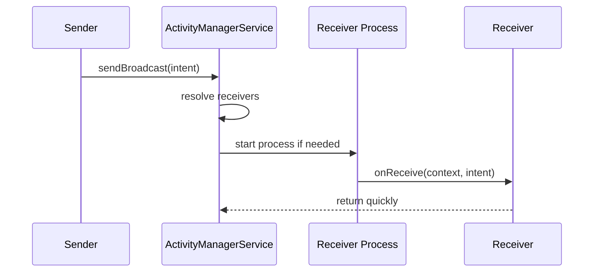

# Broadcast Receivers

## Overview

A broadcast is Android's event delivery mechanism. The system or an app sends an `Intent`; interested receivers get a callback. Broadcasts power boot events, package changes, locale changes, alarm callbacks, notification actions, SMS-related events, device state changes, and app-to-app integration.

A `BroadcastReceiver` is not a background worker. It is a short-lived component that the OS may instantiate solely to handle one event. Its job is to validate the event, do tiny work, and hand durable or long-running work to the right owner.

---

## Why It Matters

1. **Receivers are process entry points.** A broadcast can start your process even when no activity is visible.
2. **`onReceive()` has strict time limits.** Long work in a receiver causes ANRs.
3. **Implicit broadcast limits changed Android architecture.** Since Android 8, many manifest-declared implicit broadcasts are restricted to protect battery.
4. **Receivers can be exported.** If exported, other apps can send them intents.
5. **Broadcasts are delivery signals, not state.** Always reconcile real state after receiving one.

Staff-level receiver code is small, permission-aware, idempotent, and tied to WorkManager or a foreground service when work must continue.

---

## Receiver Types

### Manifest-Declared Receiver

Declared in `AndroidManifest.xml`:

```xml
<receiver
    android:name=".BootReceiver"
    android:exported="false">
    <intent-filter>
        <action android:name="android.intent.action.BOOT_COMPLETED" />
    </intent-filter>
</receiver>
```

Use for OS events that must reach you even when your app process is not alive, where allowed by platform restrictions.

### Context-Registered Receiver

Registered while a component is alive:

```kotlin
val receiver = object : BroadcastReceiver() {
    override fun onReceive(context: Context, intent: Intent) {
        // React while registered.
    }
}

context.registerReceiver(receiver, IntentFilter(Intent.ACTION_BATTERY_LOW))
```

Use for events relevant only while a screen/service/process is alive. Always unregister at the matching lifecycle boundary.

---

## Internal Mechanics



The broadcast is delivered through Binder. If your process is dead and the receiver is eligible, Android starts your process, creates the receiver, calls `onReceive()`, and may kill the process again after work completes.

---

## Time Limits and `goAsync()`

`onReceive()` runs on the main thread by default. It must return quickly. For tiny async handoff:

```kotlin
class SyncHintReceiver : BroadcastReceiver() {
    override fun onReceive(context: Context, intent: Intent) {
        if (intent.action != ACTION_SYNC_HINT) return

        WorkManager.getInstance(context).enqueueUniqueWork(
            "sync-hint",
            ExistingWorkPolicy.KEEP,
            OneTimeWorkRequestBuilder<SyncWorker>().build()
        )
    }
}
```

`goAsync()` extends the receiver lifetime briefly, but it is not a license for long work:

```kotlin
override fun onReceive(context: Context, intent: Intent) {
    val pending = goAsync()
    CoroutineScope(Dispatchers.IO).launch {
        try {
            recordSmallMetric(intent)
        } finally {
            pending.finish()
        }
    }
}
```

Use `goAsync()` sparingly for small bounded work. For durable work, use WorkManager. For immediate user-visible ongoing work, use a foreground service when allowed.

---

## Ordered, Normal, and Sticky Broadcasts

### Normal Broadcast

Delivered to receivers without meaningful ordering guarantees. Prefer this for most app-level events.

### Ordered Broadcast

Delivered one receiver at a time according to priority. Each receiver may set a result for the next. This creates coupling and latency. Use only when the platform/API requires it.

### Sticky Broadcast

Old pattern where the last broadcast value stayed available to future receivers. Sticky broadcasts are generally deprecated or system-only. Model state explicitly instead.

---

## Security

### Exported Receiver

If a receiver is exported, other apps can send it intents. Validate action, data, extras, and caller trust.

```xml
<receiver
    android:name=".PartnerReceiver"
    android:exported="true"
    android:permission="com.example.permission.PARTNER_EVENT" />
```

### Sending Protected Broadcasts

When sending app-private broadcasts, prefer explicit package/component targeting or require a signature permission. Do not rely on "nobody knows the action string."

```kotlin
val intent = Intent(ACTION_INTERNAL_REFRESH).setPackage(packageName)
sendBroadcast(intent)
```

### Receiver Injection

Bad:

```kotlin
override fun onReceive(context: Context, intent: Intent) {
    val userId = intent.getStringExtra("user_id")!!
    deleteUser(userId) // External app can forge this if receiver is exported.
}
```

Better:

- Keep receiver unexported.
- Require permissions for cross-app events.
- Treat extras as hints.
- Re-check authorization server-side or in trusted storage.

---

## Production Patterns

### Boot Completed

Use boot events to reschedule durable work, not to run heavy work immediately:

```kotlin
class BootReceiver : BroadcastReceiver() {
    override fun onReceive(context: Context, intent: Intent) {
        if (intent.action != Intent.ACTION_BOOT_COMPLETED) return
        SyncScheduler.schedulePeriodicSync(context)
    }
}
```

### Notification Action

Notification actions often use `PendingIntent.getBroadcast()`. Keep the receiver tiny:

```kotlin
class MarkReadReceiver : BroadcastReceiver() {
    override fun onReceive(context: Context, intent: Intent) {
        val messageId = intent.getStringExtra("message_id") ?: return
        MarkReadWorker.enqueue(context, messageId)
    }
}
```

### Connectivity Changes

Do not build sync solely around connectivity broadcasts. Treat connectivity as a hint; WorkManager constraints and foreground resumption should reconcile state.

---

## Failure Modes

| Failure | Cause | Fix |
|---|---|---|
| Background ANR | Heavy work in `onReceive()` | Enqueue WorkManager; return quickly |
| Receiver never fires | Restricted implicit broadcast | Use context registration, WorkManager, or specific API |
| Security issue | Exported receiver trusts extras | Permission + validation + auth |
| Duplicate work | Multiple broadcasts for same state | Unique work, idempotency |
| Memory leak | Context receiver not unregistered | Register/unregister with lifecycle |
| Lost state | Treat broadcast as guaranteed data | Reconcile from source of truth |

---

## Staff Engineer Thinking

1. **Receivers should be boring.** Validate, enqueue, return.
2. **Broadcasts are hints.** Always reconcile actual state from a durable source.
3. **Every exported receiver needs a threat model.** Who can send? What can they cause?
4. **Avoid process-wide CoroutineScope handoffs.** If the process dies, the work dies. Use WorkManager for durability.
5. **Know platform restrictions.** Background execution limits are an architectural constraint, not an implementation nuisance.

---

## Probing Questions

1. What is the difference between manifest-declared and context-registered receivers?
2. Why is `onReceive()` dangerous for disk or network work?
3. When would you use `goAsync()`?
4. Why did Android restrict many implicit broadcasts?
5. How do you protect an exported receiver?
6. Why are broadcasts hints rather than durable state?
7. How should a boot receiver reschedule sync?
8. What causes a background ANR from a receiver?

## Answer Key

1. **What is the difference between manifest-declared and context-registered receivers?**
   Manifest-declared receivers are registered in the `AndroidManifest.xml` and can wake up your app process to handle events even if the app is not running. Context-registered receivers are registered at runtime using a `Context` and only receive events while the component that registered them is alive.
2. **Why is `onReceive()` dangerous for disk or network work?**
   `onReceive()` runs on the main thread by default and is subject to strict time limits. Performing long-running disk or network operations can block the main thread and lead to Application Not Responding (ANR) errors.
3. **When would you use `goAsync()`?**
   Use `goAsync()` for small, bounded asynchronous work to extend the receiver's lifetime briefly (e.g., lightweight database updates or metric logging). For longer or more complex operations, use WorkManager.
4. **Why did Android restrict many implicit broadcasts?**
   Implicit broadcasts wake up every app registered to receive them, causing a "thundering herd" effect that drains the device battery and degrades performance. Restricting them forces apps to use more battery-efficient mechanisms like JobScheduler or WorkManager.
5. **How do you protect an exported receiver?**
   Protect it by requiring specific permissions (like signature permissions), validating the action, data, and extras, and never trusting the incoming intent payload for destructive actions without independent verification.
6. **Why are broadcasts hints rather than durable state?**
   Broadcasts are transient events that might be missed, duplicated, or dropped. They should act as triggers to reconcile or fetch the actual state from a single source of truth (like a database or server).
7. **How should a boot receiver reschedule sync?**
   A boot receiver should immediately enqueue a work request via WorkManager or schedule a job using JobScheduler, rather than performing the heavy sync work itself within `onReceive()`.
8. **What causes a background ANR from a receiver?**
   A background ANR occurs when `onReceive()` takes too long (typically >10 seconds in the background) to execute, usually due to blocking I/O or heavy computation on the main thread without offloading or calling `goAsync()`.

## Further Reading

- [`workmanager.md`](../concurrency/workmanager.md)
- [`services.md`](../concurrency/services.md)
- [`anrs.md`](../performance/anrs.md)
- [`intent-resolution-and-manifest.md`](intent-resolution-and-manifest.md)
- [Android Developers: Broadcasts overview](https://developer.android.com/develop/background-work/background-tasks/broadcasts)
