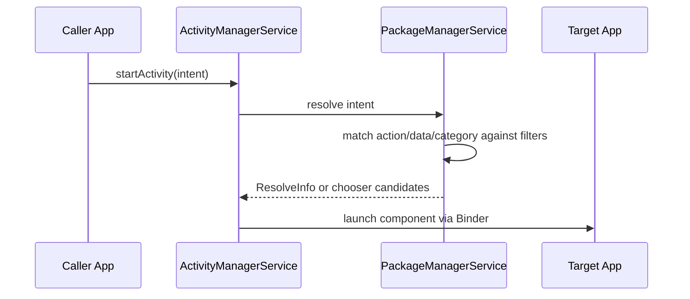

# Intent Resolution and the Manifest

## Overview

The Android manifest is not just metadata. It is the contract your APK publishes to the operating system: which components exist, which ones other apps can call, which permissions protect them, which deep links they accept, which hardware/features they require, and which other packages they need to see.

An `Intent` is a message asking Android to do something: open a screen, start a service, deliver a broadcast, choose a photo, send an email, route a deep link, or invoke another app. Intent resolution is the OS algorithm that maps that message to a concrete component.

Staff-level mastery means treating every intent boundary as IPC and every manifest declaration as part of your app's attack surface.

---

## Why It Matters

1. **The manifest defines process entry points.** Activities, services, receivers, and providers can be instantiated by the OS before your normal app flow exists.
2. **Implicit intents cross trust boundaries.** Data in an incoming `Intent` can come from another app. Treat it as untrusted input.
3. **Exported components are public APIs.** If `android:exported="true"`, other apps can try to call that component.
4. **Deep links are routing plus security.** A verified App Link still needs argument validation and auth gating.
5. **Package visibility affects discovery.** On modern Android, you cannot freely query every installed package unless you declare what you need.

The cost of getting this wrong: hijacked deep links, activity spoofing, crashes from malformed extras, leaked private files, broken share flows, and app-store policy risk.

---

## First Principles

### Explicit Intent

An explicit intent names the target component:

```kotlin
val intent = Intent(context, CheckoutActivity::class.java)
intent.putExtra("order_id", orderId)
context.startActivity(intent)
```

Use explicit intents for in-app navigation and known internal components. They are deterministic and avoid resolver ambiguity.

### Implicit Intent

An implicit intent describes an action and data:

```kotlin
val intent = Intent(Intent.ACTION_VIEW).apply {
    data = Uri.parse("https://example.com/orders/42")
}
context.startActivity(intent)
```

Android resolves it by comparing the intent against installed apps' manifest-declared intent filters.

### Intent Filter

```xml
<activity
    android:name=".LinkRouterActivity"
    android:exported="true">

    <intent-filter android:autoVerify="true">
        <action android:name="android.intent.action.VIEW" />
        <category android:name="android.intent.category.DEFAULT" />
        <category android:name="android.intent.category.BROWSABLE" />
        <data
            android:scheme="https"
            android:host="example.com" />
    </intent-filter>
</activity>
```

Intent filters match on:

- **Action**: what the caller wants done.
- **Data**: URI scheme, host, path, MIME type.
- **Category**: additional constraints such as `BROWSABLE` or `DEFAULT`.

An activity must include `CATEGORY_DEFAULT` in its filter to receive most implicit `startActivity()` calls. Browser-launched links require `CATEGORY_BROWSABLE`.

---

## Resolution Mechanics



For explicit intents, resolution is direct. For implicit intents, PackageManager compares the intent to every visible matching filter and produces candidates. If multiple apps match, Android may show a chooser unless one app is verified/default for the domain or action.

---

## Manifest as Security Boundary

### `android:exported`

`android:exported` controls whether other apps can launch or bind to a component. For components with intent filters, modern Android requires you to declare this explicitly.

```xml
<activity
    android:name=".InternalDebugActivity"
    android:exported="false" />
```

Rule of thumb:

- Launcher activity: exported true.
- App Links / share targets: exported true, with validation.
- Internal screens/services/receivers: exported false.
- Providers: exported false unless intentionally cross-app.

### Permissions on Components

```xml
<receiver
    android:name=".SecureReceiver"
    android:exported="true"
    android:permission="com.example.permission.INTERNAL_EVENTS" />
```

This requires callers to hold the named permission. For high-trust cross-app APIs, use signature permissions so only apps signed with the same certificate can call you.

### Custom Permissions

Custom permissions are API design. Once another app depends on them, changing protection level or semantics is a compatibility event.

---

## Package Visibility

Since Android 11, package visibility is filtered. Your app cannot freely inspect all installed apps. If you need to query for other apps, declare the specific packages or intents under `<queries>`:

```xml
<queries>
    <intent>
        <action android:name="android.intent.action.SEND" />
        <data android:mimeType="image/*" />
    </intent>
</queries>
```

Staff rule: declare the narrowest visibility required. Broad package visibility can trigger Play policy review and leaks more about the user's device than most apps need.

---

## PendingIntent

A `PendingIntent` is a token you give another process so it can execute your app's intent later with your app's identity.

```kotlin
val pendingIntent = PendingIntent.getActivity(
    context,
    requestCode,
    intent,
    PendingIntent.FLAG_IMMUTABLE or PendingIntent.FLAG_UPDATE_CURRENT
)
```

Use `FLAG_IMMUTABLE` unless the receiver must fill in fields. Mutable pending intents are a security footgun because another process can modify parts of the intent before delivery.

---

## Production Patterns

### Link Router Activity

Use a tiny exported activity to validate and route all incoming links:

```kotlin
class LinkRouterActivity : Activity() {
    override fun onCreate(savedInstanceState: Bundle?) {
        super.onCreate(savedInstanceState)

        val uri = intent?.data
        val route = LinkParser.parse(uri)

        if (route == null) {
            finish()
            return
        }

        startActivity(MainActivity.intentForRoute(this, route))
        finish()
    }
}
```

The router should:

- Validate scheme/host/path.
- Reject unknown query parameters if security-sensitive.
- Require auth before opening private content.
- Pass IDs, not large objects.
- Construct the correct back stack.

### Share Target

For `ACTION_SEND`, validate MIME type and content URI grants. Never assume a shared file is small, local, or trustworthy.

```kotlin
val uri = intent.getParcelableExtra<Uri>(Intent.EXTRA_STREAM)
requireNotNull(uri)
contentResolver.openInputStream(uri).use { input ->
    // Stream; do not read arbitrary files fully into memory.
}
```

---

## Failure Modes

| Failure | Cause | Fix |
|---|---|---|
| Malicious deep link opens private screen | Router trusts URI | Validate + auth gate |
| `ActivityNotFoundException` | No app resolves implicit intent | Check `resolveActivity` or use chooser |
| Resolver shows wrong app | Over-broad intent filter | Narrow action/data/category |
| Internal screen launched by another app | `exported=true` accidentally | Set exported false |
| PendingIntent hijack | Mutable pending intent | Use immutable flags |
| `TransactionTooLargeException` | Large extras through Binder | Pass IDs/URIs, not payloads |
| Package query returns empty | Missing `<queries>` | Declare narrow package visibility |

---

## Staff Engineer Thinking

1. **Review manifest diffs like API diffs.** A new exported component is a new public entry point.
2. **Validate every external intent.** Intent extras are untrusted IPC payloads.
3. **Keep routing centralized.** Link parsing scattered across screens becomes impossible to secure.
4. **Prefer verified App Links for domains.** Custom schemes are easy for other apps to claim.
5. **Minimize package visibility.** Querying installed apps is privacy-sensitive.

---

## Probing Questions

1. What is the difference between explicit and implicit intents?
2. How does Android match an implicit intent to an activity?
3. Why does `CATEGORY_BROWSABLE` matter for web links?
4. What does `android:exported` protect?
5. Why are incoming intent extras a security boundary?
6. What is package visibility filtering?
7. Why should most pending intents be immutable?
8. Why should navigation arguments pass IDs instead of full objects?

## Answer Key

1. **What is the difference between explicit and implicit intents?**
   Explicit intents specify the exact component class to launch and are used for internal app navigation. Implicit intents specify an action and data, allowing the OS to find and launch any app that has declared an intent filter capable of handling that request.
2. **How does Android match an implicit intent to an activity?**
   The `PackageManagerService` compares the implicit intent's action, data (URI scheme, host, path, MIME type), and category against the intent filters declared in the manifests of all installed and visible apps.
3. **Why does `CATEGORY_BROWSABLE` matter for web links?**
   It signals to the OS that the activity is safe to be launched directly from a web browser. Without this category, links clicked inside a browser will not resolve to your app, even if the scheme and host match.
4. **What does `android:exported` protect?**
   It controls whether other applications can launch or bind to the component. If set to false, the component is strictly private and can only be accessed by the app itself or components with the same user ID.
5. **Why are incoming intent extras a security boundary?**
   Because implicit intents and exported components can be triggered by any app on the device. Malicious apps can spoof actions or send malformed/harmful data in the extras, so they must be validated like any untrusted IPC input.
6. **What is package visibility filtering?**
   It is a privacy feature introduced in Android 11 that prevents apps from querying the full list of installed applications. Apps must explicitly declare which other packages or intent signatures they need to interact with using the `<queries>` manifest tag.
7. **Why should most pending intents be immutable?**
   Immutable pending intents prevent the receiving application (which executes the intent on your behalf) from modifying the intent's action, data, or extras, preventing intent hijacking and unauthorized access.
8. **Why should navigation arguments pass IDs instead of full objects?**
   Intents use the Binder for IPC, which has a strict ~1MB transaction limit per process. Passing large objects (like Bitmaps or huge lists) via intent extras will cause a `TransactionTooLargeException` and crash the app.

## Further Reading

- [`the-binder.md`](the-binder.md)
- [`../architecture/navigation.md`](../architecture/navigation.md)
- [`../architecture/process-death-and-state-restoration.md`](../architecture/process-death-and-state-restoration.md)
- [`../../mobile-system-design/deep-links-and-universal-links.md`](../../mobile-system-design/deep-links-and-universal-links.md)
- [Android Developers: Intents and intent filters](https://developer.android.com/guide/components/intents-filters)
- [Android Developers: App manifest overview](https://developer.android.com/guide/topics/manifest/manifest-intro)
- [Android Developers: Package visibility](https://developer.android.com/training/package-visibility)
