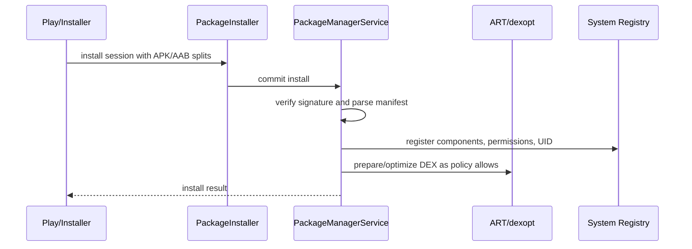

# Package Manager, Installation, and Class Loading

## Overview

Installing an Android app is not "copy APK to disk." Android parses the package, validates signatures, assigns or reuses a Linux UID, registers components, stores permissions, extracts or maps native libraries, prepares resources, optimizes DEX when policy allows, and exposes the app to the rest of the system through `PackageManagerService`.

Class loading is the runtime half of that contract. Your Kotlin code becomes DEX; the app process uses Android class loaders to find classes across the base APK, split APKs, dynamic feature modules, and dependencies.

Staff-level understanding matters when debugging startup crashes, dynamic feature failures, reflection/R8 issues, plugin architectures, multidex, package visibility, and rollout/install behavior.

---

## Why It Matters

1. **The manifest becomes OS registry data.** Activities, providers, services, receivers, permissions, and intent filters are parsed at install time.
2. **Signatures define upgrade identity.** If signing lineage breaks, the update is not the same app.
3. **UID defines sandbox identity.** App data, permissions, and Linux isolation are UID-based.
4. **Class loading is lazy.** Many missing-class errors appear only when a route or feature is first touched.
5. **Splits and dynamic features change assumptions.** Code/resources may not be installed until requested.

---

## Install Pipeline



For Play-distributed apps, users receive generated split APKs from the AAB, not the raw AAB itself. Splits can vary by ABI, density, language, and dynamic feature delivery configuration.

---

## What PackageManager Stores

Package metadata includes:

- Package name and version.
- Signing certificate/signing lineage.
- Requested permissions and granted permissions.
- Activities, services, receivers, providers.
- Intent filters and exported flags.
- Supported features and SDK levels.
- Split APKs and install locations.
- App UID and data directories.

Every `resolveActivity`, `queryIntentActivities`, package visibility check, permission grant, and component launch depends on this registry.

---

## Signatures and Updates

Android treats an update as the same app only if signing identity is valid. Signing affects:

- Whether update install is allowed.
- Whether app data is retained.
- Whether signature permissions are granted.
- Whether shared trust between apps is valid.

Staff rule: signing keys are production infrastructure. Rotation, Play App Signing, upload keys, and disaster recovery need an owner and a runbook.

---

## UID and Sandbox

Each installed app gets a Linux UID. The kernel uses it to isolate files and processes.

```text
/data/data/com.example.app/  -> owned by app UID
```

Permissions attach to the package/UID. Processes for the same app package run with that UID, even if the app uses multiple processes.

---

## Class Loading

In a normal app process:

- Framework classes come from boot class path.
- App/library classes are loaded from DEX in the base APK and splits.
- Native libraries are loaded by ABI-specific paths.

Android commonly uses `PathClassLoader` for installed app code. `DexClassLoader` can load external DEX paths, but plugin-style loading is advanced, security-sensitive, and usually the wrong answer for product apps.

Class lookup is lazy:

```text
User opens feature route
  -> code references FeatureScreen
  -> class loader searches DEX paths
  -> class found or ClassNotFoundException / NoClassDefFoundError
```

This is why release-only crashes can hide until a specific screen opens.

---

## R8, Reflection, and Missing Classes

R8 removes and renames code it believes is unused. Reflection hides usage:

```kotlin
val clazz = Class.forName("com.example.PaymentHandler")
```

If no static reference exists and no keep rule protects it, release builds may crash.

Fixes:

- Prefer direct references or generated registries.
- Add precise keep rules.
- Test minified release-like builds.
- Avoid stringly typed class names for critical paths.

---

## Multidex and Splits

Modern ART handles multiple DEX files, but startup still cares about what must be loaded early. Keep cold-start-critical code in the base install path and avoid pushing startup dependencies into optional dynamic features.

Dynamic feature modules add constraints:

- Code may not exist until installed.
- Resources may resolve differently across splits.
- Navigation must handle "module not installed."
- Deep links into dynamic features need install/fallback behavior.

---

## Package Visibility

PackageManager queries are filtered on modern Android. This affects:

- "Is app X installed?"
- "Which apps can handle this intent?"
- Partner app integrations.
- Share/open-with flows.

Declare narrow `<queries>` entries and handle empty results.

---

## Native Libraries

Native `.so` files are ABI-specific. Common failure modes:

- Missing ABI split for device architecture.
- Loading native code before split install.
- R8/packaging rules removing required JNI entry points.
- Large native libraries bloating app size.

Native library size and ABI coverage should be part of release review.

---

## Failure Modes

| Failure | Cause | Fix |
|---|---|---|
| `ClassNotFoundException` in release | R8 removed reflection target | Keep rule or generated registry |
| Dynamic feature route crashes | Module not installed | Install flow + fallback route |
| Update rejected | Signing mismatch | Signing lineage/runbook |
| Partner app not detected | Missing package visibility query | Add narrow `<queries>` |
| Startup regression | Too much code in base startup path | Lazy load, baseline profile, remove provider init |
| Native crash on some devices | ABI packaging gap | Verify splits and ABI coverage |
| Permission lost across reinstall | New signing identity/package state | Treat signing/package identity as infrastructure |

---

## Staff Engineer Thinking

1. **Treat install as a distributed deployment.** Store, installer, OS registry, ART, and app process all participate.
2. **Test release-like artifacts.** Debug APKs hide minification, splits, signing, and classloading behavior.
3. **Own dynamic-feature fallbacks.** Optional code must never be assumed present.
4. **Keep reflection rare.** String-based class loading breaks shrinkers and observability.
5. **Review signing and package visibility deliberately.** These are security and compatibility contracts.

---

## Probing Questions

1. What does PackageManager parse from the manifest at install time?
2. Why does signing identity matter for updates?
3. What is the relationship between package, UID, and sandbox?
4. Why can a missing class crash only in release builds?
5. How do dynamic feature modules change class/resource assumptions?
6. Why do modern PackageManager queries return less than "all installed apps"?
7. What is the difference between `PathClassLoader` and plugin-style DEX loading?
8. Why should release candidates be tested as minified AAB/split artifacts?

## Further Reading

- [`art-and-dalvik.md`](art-and-dalvik.md)
- [`intent-resolution-and-manifest.md`](intent-resolution-and-manifest.md)
- [`../performance/app-size-and-r8.md`](../performance/app-size-and-r8.md)
- [`../../release-engineering/app-bundles.md`](../../release-engineering/app-bundles.md)
- [`../../release-engineering/code-signing.md`](../../release-engineering/code-signing.md)
- [Android Developers: App manifest overview](https://developer.android.com/guide/topics/manifest/manifest-intro)
- [Android Developers: App bundles](https://developer.android.com/guide/app-bundle)
