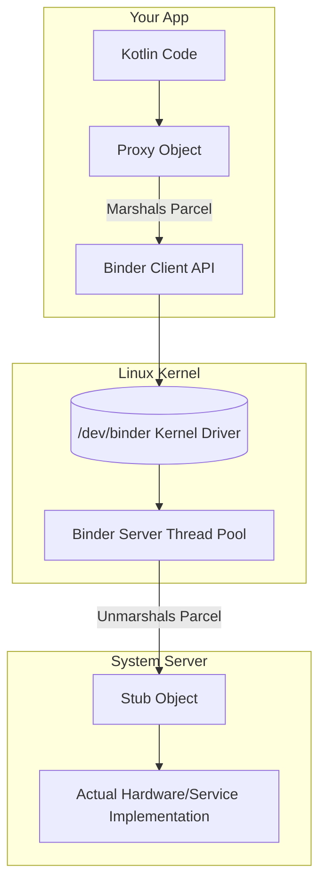

# The Binder (Inter-Process Communication)

## Overview

The Android operating system resembles a distributed system on one device. App components run in Linux processes—one default process unless configured otherwise—while system services run in other processes.

One process cannot directly dereference another process's private object addresses. Cross-process data requires IPC or an explicitly shared mapping with synchronization and access control.

To solve this, Android relies on **The Binder**: a custom Linux kernel driver (`/dev/binder`) that provides fast Inter-Process Communication (IPC) and Remote Procedure Calls (RPC). Nearly every framework interaction — starting an Activity, reading a sensor, showing a notification — crosses the Binder. Without it, the OS cannot function.

## Why It Matters

`getSystemService(Context.WIFI_SERVICE)` returns a `WifiManager` framework facade. For operations backed by a remote service, that facade delegates through an internal Binder interface: a synchronous call marshals a transaction code and arguments, enters the driver, is dispatched to a Binder thread in the service process, and unmarshals the reply. If invoked on the main thread, that thread waits for completion or failure.

A synchronous Binder call can delay its caller; an ANR occurs only when that wait blocks an ANR-sensitive thread or component long enough to cross the applicable timeout. An oversized request or reply can fail with `TransactionTooLargeException`, and an unhandled exception may crash the app. Understanding both mechanisms is required to diagnose the failure accurately.

## Historical Context

- **IPC design:** Binder provides structured transactions, object-reference semantics, caller identity, and lifecycle/death notification suited to Android services. Pipes, sockets, and explicitly shared memory remain available for different contracts.
- **OpenBinder lineage:** Android's Binder design descends from OpenBinder work associated with Be/PalmSource and was implemented for Android's kernel/userspace architecture.
- **Single payload copy:** For ordinary transaction data, Binder copies from the sender into kernel-managed pages mapped into the receiver, avoiding a second payload copy from a kernel socket buffer into receiver userspace. Marshalling, scheduling, driver work, and service execution still contribute to latency.

## First Principles

1.  **Memory Isolation:** Process A (Your App) and Process B (The Camera Service) are walled off from each other by the Linux OS.
2.  **The Proxy:** An empty "shell" object in Process A that pretends to be the real object.
3.  **The Stub:** The actual implementation of the object living in Process B.
4.  **AIDL (Android Interface Definition Language):** A language used to generate the Kotlin/Java boilerplate required to pack and unpack data between the Proxy and the Stub.
5.  **Marshalling/Unmarshalling:** The act of converting a Kotlin object into a flat byte array (Marshalling via `Parcelable`) so it can be pushed through the Linux kernel, and converting it back into a Kotlin object on the other side (Unmarshalling).

## Mental Model

Think of the Binder as a **Maximum Security Prison Telephone**.
- You (Process A) are visiting a prisoner (Process B). You are separated by bulletproof glass (Linux Memory Isolation). You cannot hand them a physical letter (Object Reference).
- To ask the prisoner a question, you speak into a Telephone (The Proxy Object).
- The Telephone wire (The Binder Kernel Driver) turns your voice into electrical signals (Marshalling).
- The signal travels through the wall, into the prisoner's Telephone (The Stub Object), and is converted back into a voice (Unmarshalling).
- The prisoner answers, and the process reverses. 
- The glass is never breached.

## Internal Mechanics

### 1. `Parcelable` (The Transport Format)

Java serialization uses a general object-stream/runtime contract. Android's `Parcelable` integrates with the `Parcel` format and uses generated or manual field marshaling; performance and size depend on the model and should be measured when material.

```kotlin
@Parcelize // Kotlin compiler plugin generates the massive byte-packing boilerplate
data class User(val id: Int, val name: String) : Parcelable
```

### 2. The Transaction Limits

Android documents a per-process Binder transaction buffer that is currently about 1 MB and shared across in-progress requests and replies. Parcel metadata and concurrent transactions reduce the headroom for any one payload. Current AOSP allocation and asynchronous-capacity details are implementation facts, not a public payload budget; keep individual parcels well below the observed limit.

```kotlin
val intent = Intent(this, TargetActivity::class.java)
intent.putExtra("massive_image", bitmap) // DISASTER
startActivity(intent)
```

`startActivity` uses Binder to talk to ActivityManagerService. A multi-megabyte bitmap can exceed the shared transaction capacity once parcel overhead and concurrent work are included. The transaction may fail and surface `TransactionTooLargeException`; the app crashes only if that exception is unhandled. Pass an ID, URI/file descriptor, or other small reference instead of the bitmap bytes.

### 3. Synchronous vs Asynchronous IPC

By default, Binder calls are **Synchronous**. 
When your app calls `activityManager.getRunningAppProcesses()`, your app's thread goes to `sleep`. It will not wake up until the System Server finishes the work and returns the `Parcel`.

If the target service is slow or deadlocked, the calling thread waits. That can freeze visible work and cause an ANR only when an ANR-sensitive thread/component remains blocked past its timeout, which is why long or uncertain IPC should use an appropriate asynchronous contract.

## Architecture



## Production Example

**Bound Services and AIDL**

If you build a complex SDK (like a custom Android Auto music player), you might run your music playback engine in a dedicated background process (`:music_process`) to protect it from the UI process crashing.

One typed option for allowing the UI process to pause playback is an AIDL interface:
```aidl
// IMusicService.aidl
interface IMusicService {
    void pauseMusic();
    boolean isPlaying();
}
```

The Android build system generates a `Stub` and a `Proxy`.
1. The Background Process extends the `Stub` and implements `pauseMusic()`.
2. The UI Process calls `bindService()`. The OS returns the `Proxy` object.
3. The UI Process calls `proxy.pauseMusic()`. The Binder routes the call across the process boundary.

*(Staff Note: AIDL interfaces are **append-only**. Each method is assigned a transaction code from its declaration order, so reordering methods, inserting one in the middle, or changing an existing signature breaks every already-compiled client — the caller invokes transaction N expecting the old method and reaches a different one. The only safe evolutions are adding new methods at the end (or with explicitly assigned serials) and — **for structured/stable AIDL parcelables only** — adding new fields with defaults, because their generated read code tolerates missing trailing fields. An ordinary `Parcelable`/`@Parcelize` class gets no such protection: both sides must read the exact same sequential byte layout, so adding a field to a plain parcelable shared across an app/SDK boundary breaks old readers unless you version the parcel format yourself. This is why long-lived AIDL surfaces feel frozen in time.)*

## Tradeoffs

**Single-Process vs Multi-Process Apps**

- **Single Process (Default):**
    - *Pros:* You can share singletons (like a Dagger/Hilt component or an in-memory `HashMap`) across the entire app. Fast. Simple.
    - *Cons:* If one screen runs out of memory, the entire app dies.
- **Multi-Process (Using `android:process=":background"` in Manifest):**
    - *Pros:* A separate process has its own heap/runtime and failure boundary, so some failures need not terminate the UI process.
    - *Costs:* It increases aggregate memory/runtime footprint, remains subject to device and per-process limits, and may be killed independently; it does not grant a doubled app-memory entitlement.
    - *Cons:* Each process has separate heaps, DI graphs, and lifecycle state. `SharedPreferences` does not provide a supported coherent multi-process state model. Cross-process communication needs an explicit IPC boundary such as Binder/AIDL, a provider, or another deliberately secured protocol.

*Staff decision:* Prefer one process until isolation, resilience, platform integration, or a separately managed component justifies the IPC and lifecycle cost. Browsers, sandboxed workloads, and some media or service designs are examples, not the only valid cases.

## Failure Modes

- **The `TransactionTooLargeException` Crash:**
  Large requests or replies compete for the process's shared Binder transaction capacity. The framework cannot reliably tell callers whether request or reply pressure caused the heuristic `TransactionTooLargeException`; an unhandled exception may crash the app.
  *(Fix: Keep parcels small. Pass stable IDs, URIs/file descriptors, or chunked data, then load the large object through an owned repository or stream.)*
- **The Binder Thread Pool Exhaustion:**
  A receiving process configures a maximum Binder thread-pool size in userspace; AOSP defaults and system-process overrides are implementation details rather than an API guarantee. When all available Binder threads are busy, additional synchronous transactions wait. That wait causes an ANR only if it blocks an ANR-sensitive thread or component long enough to cross the relevant timeout. Inspect the current AOSP `ProcessState` implementation for platform internals, but design services around short transactions, bounded concurrency, and offloading work rather than coding against a presumed fixed count.
  *(Fix: Keep Binder entry points bounded. Offload long work to an owned executor/coroutine scope and expose completion through an asynchronous callback, one-way event, or durable job rather than pretending a synchronous result is immediate.)*

## Staff Engineer Thinking

When reviewing code that crosses process boundaries, a Staff engineer focuses on the physical transport cost.

1.  **Intent Size Auditing:** I review large `Intent`/`Bundle` extras and measure their marshalled size. Request capacity is charged to the receiving process and reply capacity to the caller; concurrent transactions and metadata share the same per-process headroom, so “below 1 MB” is not a safe design target.
2.  **`oneway` AIDL Calls:** Use `oneway` when the contract is genuinely fire-and-forget and its ordering, failure, and backpressure semantics are acceptable. It returns after local marshalling and driver enqueue rather than waiting for server execution; queues remain bounded, delivery is not guaranteed, and local enqueue can still take time or fail.
3.  **Process-death resiliency:** When a remote Binder process dies, existing proxies to its objects become invalid. Long-lived direct Binder clients can use `IBinder.DeathRecipient`; framework managers may expose their own recovery behavior. Reacquire state or bindings according to the API contract rather than assuming every proxy reconnects itself.

## Common Misconceptions

- **"I don't use IPC because my app is only a single process."** Even a single-process app invokes platform IPC for operations such as activity/service lifecycle coordination, permission or package queries, and notification publication. Input delivery uses an `InputChannel` after setup, so not every framework event is itself a Binder transaction.
- **"Parcelable is just a faster Serializable."** They are different contracts. Java serialization uses a general object-stream/runtime format, while `Parcelable` integrates with Android's `Parcel` representation and generated/manual field marshaling. Performance and size vary by model.

## Probing Questions

1.  Explain why two distinct Android applications cannot simply share a Kotlin object reference in memory to communicate.
2.  What is the fundamental architectural difference between a Binder `Proxy` object and a Binder `Stub` object?
3.  Why did Google engineer the Binder kernel driver to use a "Single-Copy" mechanism instead of standard Linux Sockets for Android IPC?
4.  If a developer attempts to pass a multi-megabyte bitmap through an `Intent`, how can the Binder transaction fail, and when does that failure crash the app?
5.  What is the primary advantage of annotating a Kotlin data class with `@Parcelize` instead of implementing `java.io.Serializable`?
6.  Describe the architecture consequences of splitting an application into two processes (for example, `:ui` and `:background`) for DI singletons and communication.
7.  When can a synchronous Binder wait contribute to an ANR, and why is a slow target alone insufficient to declare one?
8.  What does AIDL `oneway` remove from the caller's wait, and which marshalling, enqueue, capacity, and delivery risks remain?
9.  Explain Binder thread-pool exhaustion. How can it delay multiple synchronous clients, and when can those waits contribute to ANRs?
10. If the Android System Server process crashes and reboots while your app is running, what happens to the Binder `Proxy` objects your app is currently holding?

## Answer Key

1. **Explain why two distinct Android applications cannot simply share a Kotlin object reference in memory to communicate.**
   Each process has its own virtual address space, so a Kotlin object reference from one process is meaningless in another and cannot directly address the other process's private objects. Explicit shared memory is possible only through a deliberately mapped region plus synchronization, access control, and an agreed data layout; it does not make ordinary object references portable.
2. **What is the fundamental architectural difference between a Binder `Proxy` object and a Binder `Stub` object?**
   The `Proxy` is a hollow shell in the client process that marshals method calls into data parcels. The `Stub` lives in the server process, unmarshals the parcel, and executes the actual implementation.
3. **Why did Google engineer the Binder kernel driver to use a "Single-Copy" mechanism instead of standard Linux Sockets for Android IPC?**
   Binder copies transaction data from the sender into kernel-managed pages mapped into the receiver, avoiding a second payload copy from a kernel socket buffer into receiver userspace. That reduces copy overhead for Android's frequent structured IPC; end-to-end latency still includes marshalling, scheduling, driver work, and service execution.
4. **If a developer attempts to pass a multi-megabyte bitmap through an `Intent`, how can the Binder transaction fail, and when does that failure crash the app?**
   Requests and replies share the process's currently-about-1-MB transaction capacity, with parcel overhead and concurrent traffic reducing available headroom. The framework may surface `TransactionTooLargeException`; the process crashes only if the exception is unhandled or a surrounding component cannot recover.
5. **What is the primary advantage of annotating a Kotlin data class with `@Parcelize` instead of implementing `java.io.Serializable`?**
   `@Parcelize` generates the repetitive `Parcelable` marshaling implementation at compile time and integrates with Android's parcel contract. Java serialization has a different object-stream format and runtime machinery. Performance and size vary by model, so prefer `Parcelable` for Android IPC compatibility and measure hot or large transfers.
6. **Describe the architecture consequences of splitting an application into two processes (for example, `:ui` and `:background`) for DI singletons and communication.**
   Each process builds its own DI graph, so a Dagger/Hilt `Singleton` is process-local rather than shared. Cross-process state requires an explicit IPC boundary; AIDL/Binder, a provider, or another secured protocol may fit, depending on contract and ownership.
7. **When can a synchronous Binder wait contribute to an ANR, and why is a slow target alone insufficient to declare one?**
   The call blocks only its calling thread until the transaction completes or fails. It contributes to an ANR when that wait blocks an ANR-sensitive thread or component past the applicable timeout; a background caller can wait without automatically making the app ANR.
8. **What does AIDL `oneway` remove from the caller's wait, and which marshalling, enqueue, capacity, and delivery risks remain?**
   `oneway` removes the wait for server method completion and a reply. The caller still performs local marshalling and driver enqueue, asynchronous capacity is bounded, floods can create backpressure, and delivery/server execution is not a durable guarantee.
9. **Explain Binder thread-pool exhaustion. How can it delay multiple synchronous clients, and when can those waits contribute to ANRs?**
   Each process has a configured, bounded Binder thread pool. If a service performs long blocking work on all available Binder threads, subsequent synchronous transactions wait until capacity returns. The configured limit can vary by process and platform; an ANR occurs only when the wait blocks an ANR-sensitive component long enough.
10. **If the Android System Server process crashes and reboots while your app is running, what happens to the Binder `Proxy` objects your app is currently holding?**
    Proxies to objects hosted by the dead process are no longer usable; calls can surface `DeadObjectException` or an API-specific failure. Direct long-lived Binder clients may use `DeathRecipient`, while framework APIs may provide their own reacquisition path. Recovery follows the service contract and may require rebuilding local state.

## Further Reading

- [`anrs.md`](../performance/anrs.md) — How synchronous Binder waits can contribute to ANRs when they block an ANR-sensitive thread or component past its timeout.
- [`process-death-and-state-restoration.md`](../architecture/process-death-and-state-restoration.md) — How the `SavedStateHandle` pushes its bundles through the Binder to survive OS process death.
- [Android Open Source Project: AIDL and Binder IPC](https://source.android.com/docs/core/architecture/aidl)
- [AOSP `ProcessState.cpp`](https://android.googlesource.com/platform/frameworks/native/+/master/libs/binder/ProcessState.cpp) — Current userspace Binder pool configuration.
- [Android Developers: Diagnose ANRs](https://developer.android.com/topic/performance/vitals/anr) — ANR triggers and diagnosis.
