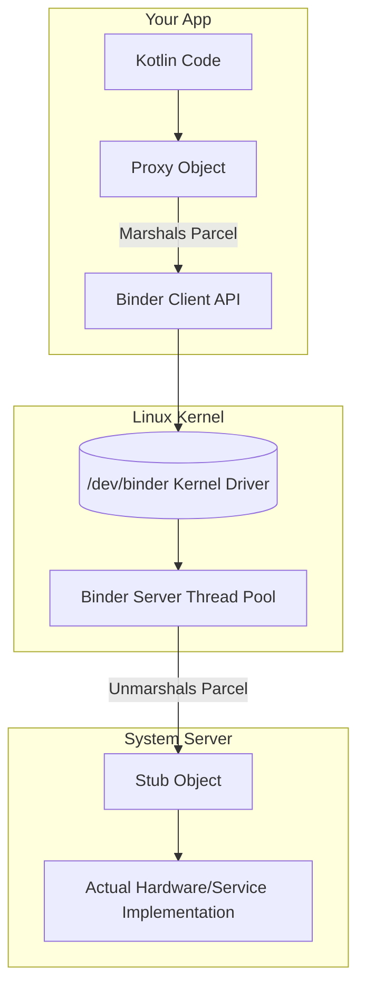

# The Binder (Inter-Process Communication)

## Overview

The Android Operating System is fundamentally a distributed system running on a single device. Every single application runs in its own isolated Linux process. The System Server (which controls Wi-Fi, Bluetooth, Audio, and Window Management) runs in its own isolated Linux process. 

Because Linux enforces strict memory isolation for security, Process A cannot simply call a method on an object in Process B. They cannot share RAM.

To solve this, Android relies on **The Binder**: a custom Linux kernel driver (`/dev/binder`) that provides fast Inter-Process Communication (IPC) and Remote Procedure Calls (RPC). Nearly every framework interaction — starting an Activity, reading a sensor, showing a notification — crosses the Binder. Without it, the OS cannot function.

## Why It Matters

It's natural to assume that `getSystemService(Context.WIFI_SERVICE)` simply hands you a Kotlin object. What it actually returns is a **Proxy Object**. When you call `wifiManager.isWifiEnabled()`, you are not executing code in your app's process. The Binder is halting your Main Thread, packing the method name and arguments into a binary `Parcel`, crossing the Linux Kernel boundary, waking up the System Server process, unpacking the data, executing the real hardware check, packing the boolean result into a new `Parcel`, crossing the kernel boundary *again*, and waking up your Main Thread to hand you the result.

If the System Server is busy, your app ANRs. If you pack a 2MB image into an `Intent` (which uses the Binder), your app crashes with a `TransactionTooLargeException`. Understanding the Binder is required to debug severe architectural failures.

## Historical Context

- **Standard Linux IPC (Pipes, Sockets, Shared Memory):** Google engineers evaluated standard Linux IPC mechanisms when building Android in 2007. They rejected them all. Sockets were too slow and required multiple memory copies. Shared Memory was fast, but extremely dangerous and difficult to synchronize.
- **OpenBinder:** Android acquired the OpenBinder project (originally developed at BeOS and PalmSource). They rewrote it specifically for Android as a kernel-level driver. 
- **The Core Innovation:** The Binder driver uses a technique called **Single-Copy**. When Process A sends data to Process B, the Binder driver maps a piece of Process B's memory directly into the Linux Kernel space. The data is only copied *once* (from Process A to the Kernel). This made Android IPC fast enough for 60fps UI rendering.

## First Principles

1.  **Memory Isolation:** Process A (Your App) and Process B (The Camera Service) are walled off from each other by the Linux OS.
2.  **The Proxy:** An empty "shell" object in Process A that pretends to be the real object.
3.  **The Stub:** The actual implementation of the object living in Process B.
4.  **AIDL (Android Interface Definition Language):** A language used to generate the Kotlin/Java boilerplate required to pack and unpack data between the Proxy and the Stub.
5.  **Marshalling/Unmarshalling:** The act of converting a Kotlin object into a flat byte array (Marshalling via `Parcelable`) so it can be pushed through the Linux kernel, and converting it back into a Kotlin object on the other side (Unmarshalling).

## Mental Model

Think of the Binder as a **Maximum Security Prison Telephone**.
- You (Process A) are visiting a prisoner (Process B). You are separated by bulletproof glass (Linux Memory Isolation). You cannot hand them a physical letter (Object Reference).
- To ask the prisoner a question, you speak into a Telephone (The Proxy Object).
- The Telephone wire (The Binder Kernel Driver) turns your voice into electrical signals (Marshalling).
- The signal travels through the wall, into the prisoner's Telephone (The Stub Object), and is converted back into a voice (Unmarshalling).
- The prisoner answers, and the process reverses. 
- The glass is never breached.

## Internal Mechanics

### 1. `Parcelable` (The Transport Format)

Unlike Java `Serializable` (which uses slow, expensive reflection), Android uses `Parcelable`. It requires you to explicitly write the exact byte-order for packing and unpacking your object.

```kotlin
@Parcelize // Kotlin compiler plugin generates the massive byte-packing boilerplate
data class User(val id: Int, val name: String) : Parcelable
```

### 2. The Transaction Limits

The Binder kernel driver allocates a fixed, shared memory buffer for IPC transactions. Crucially, this buffer is limited to **just under 1 Megabyte per process** (`BINDER_VM_SIZE` = 1 MB minus two pages in AOSP's `ProcessState.cpp`). This single pool is shared by *all* in-flight transactions happening simultaneously for that specific app process — and asynchronous (`oneway`) transactions are restricted to half of it.

```kotlin
val intent = Intent(this, TargetActivity::class.java)
intent.putExtra("massive_image", bitmap) // DISASTER
startActivity(intent)
```

`startActivity` uses the Binder to talk to the ActivityManagerService. If you put a 2MB bitmap into the Intent, the Binder driver rejects it. It throws a `TransactionTooLargeException`, and your app crashes instantly. You cannot push an elephant through a telephone wire.

### 3. Synchronous vs Asynchronous IPC

By default, Binder calls are **Synchronous**. 
When your app calls `activityManager.getRunningAppProcesses()`, your app's thread goes to `sleep`. It will not wake up until the System Server finishes the work and returns the `Parcel`.

If the System Server is currently locked up by a rogue app, *your* app will freeze. This is why strict ANR guidelines exist, and why modern Android APIs rely on Asynchronous callbacks or Kotlin Flows rather than direct synchronous Binder calls.

## Architecture



## Production Example

**Bound Services and AIDL**

If you build a complex SDK (like a custom Android Auto music player), you might run your music playback engine in a dedicated background process (`:music_process`) to protect it from the UI process crashing.

To allow the UI to pause the music, you must write an AIDL file:
```aidl
// IMusicService.aidl
interface IMusicService {
    void pauseMusic();
    boolean isPlaying();
}
```

The Android build system generates a `Stub` and a `Proxy`.
1. The Background Process extends the `Stub` and implements `pauseMusic()`.
2. The UI Process calls `bindService()`. The OS returns the `Proxy` object.
3. The UI Process calls `proxy.pauseMusic()`. The Binder routes the call across the process boundary.

*(Staff Note: AIDL interfaces are **append-only**. Each method is assigned a transaction code from its declaration order, so reordering methods, inserting one in the middle, or changing an existing signature breaks every already-compiled client — the caller invokes transaction N expecting the old method and reaches a different one. The only safe evolutions are adding new methods at the end (or with explicitly assigned serials) and — **for structured/stable AIDL parcelables only** — adding new fields with defaults, because their generated read code tolerates missing trailing fields. An ordinary `Parcelable`/`@Parcelize` class gets no such protection: both sides must read the exact same sequential byte layout, so adding a field to a plain parcelable shared across an app/SDK boundary breaks old readers unless you version the parcel format yourself. This is why long-lived AIDL surfaces feel frozen in time.)*

## Tradeoffs

**Single-Process vs Multi-Process Apps**

- **Single Process (Default):**
    - *Pros:* You can share singletons (like a Dagger/Hilt component or an in-memory `HashMap`) across the entire app. Fast. Simple.
    - *Cons:* If one screen runs out of memory, the entire app dies.
- **Multi-Process (Using `android:process=":background"` in Manifest):**
    - *Pros:* Ultimate isolation. If the background process crashes, the UI process stays alive. The OS allocates a brand new heap limit for the new process (doubling your total allowed RAM).
    - *Cons:* Complete architectural nightmare. `SharedPreferences` are easily corrupted. Dagger Singletons are no longer singletons (you have two distinct instances in two isolated memory spaces). You must use AIDL/Binder for the two halves of your app to talk to each other.

*Staff Decision:* A Staff Engineer almost never uses multi-process architectures unless building a web browser (like Chrome, where each tab is an isolated process for security) or a massive background media engine.

## Failure Modes

- **The `TransactionTooLargeException` Crash:**
  Passing massive Lists, Bitmaps, or deep Object Graphs between Activities or Fragments using `Intent.putExtra` or `Bundle`. The OS attempts to push it through the 1MB Binder buffer and kills your app.
  *(Fix: Only pass primitive IDs (`userId: String`) through Intents or Navigation arguments. The receiving Activity uses the ID to query a local SQLite database or Repository singleton).*
- **The Binder Thread Pool Exhaustion:**
  The receiving process has a fixed pool of Binder threads (`DEFAULT_MAX_BINDER_THREADS` = 15 in AOSP, plus the main binder thread; system-critical processes raise their own limit). If more clients hit a busy service at the exact same moment with complex requests, the pool is exhausted. The next caller is blocked and ANRs.
  *(Fix: You cannot control the OS, but you can control your own AIDL Bound Services. Never perform long-running disk I/O on a Binder thread. Hand the request to a background Coroutine and return immediately).*

## Staff Engineer Thinking

When reviewing code that crosses process boundaries, a Staff engineer focuses on the physical transport cost.

1.  **Intent Size Auditing:** I actively search the codebase for `intent.putExtra(KEY, object)`. If `object` is anything more complex than a basic String or Int, I flag it. Developers frequently attach massive `ArrayList<Data>` to intents for convenience, unaware that every byte competes for the same shared per-process Binder buffer.
2.  **`oneway` AIDL Calls:** If we are forced to build an AIDL interface, and the Client does not need a return value (e.g., `fun reportAnalyticsEvent()`), I mandate the use of the `oneway` keyword in the AIDL file. This tells the Binder driver to fire the Parcel into the kernel and return instantly. While this prevents the caller thread from blocking, it does *not* completely eliminate ANR risk—async Binder queues can still back up, and server-side Binder thread pools can be exhausted if flooded.
3.  **Process Death Resiliency:** Because the Binder manages the connections between processes, if the System Server crashes (a "soft reboot" of the phone), all `Proxy` objects in your app become dead ("Binder Died"). I ensure our critical services implement `IBinder.DeathRecipient` to gracefully reconnect when the OS recovers.

## Common Misconceptions

- **"I don't use IPC because my app is only a single process."** Absolutely false. Every time you touch the screen, the Android OS hardware layer uses the Binder to send the touch coordinates to your app. Every time you start an Activity, load a Font, or show a Notification, you are triggering IPC via the Binder.
- **"Parcelable is just a faster Serializable."** While true in outcome, they are mechanically different. Serializable uses reflection to figure out what data exists at runtime. Parcelable is a hardcoded, manual byte-array packing instruction set.

## Probing Questions

1.  Explain why two distinct Android applications cannot simply share a Kotlin object reference in memory to communicate.
2.  What is the fundamental architectural difference between a Binder `Proxy` object and a Binder `Stub` object?
3.  Why did Google engineer the Binder kernel driver to use a "Single-Copy" mechanism instead of standard Linux Sockets for Android IPC?
4.  If a developer attempts to pass a 3MB `Bitmap` image to a new Activity via `Intent.putExtra()`, explain the exact mechanical failure that crashes the app.
5.  What is the primary advantage of annotating a Kotlin data class with `@Parcelize` instead of implementing `java.io.Serializable`?
6.  Describe the severe architectural consequences of splitting an application into two processes (e.g., `:ui` and `:background`) regarding Dependency Injection singletons.
7.  Why is a synchronous Binder call inherently dangerous, and how does it directly contribute to Application Not Responding (ANR) crashes?
8.  In an AIDL file, what is the purpose of the `oneway` keyword, and how does it protect the Client process?
9.  Explain the concept of "Binder Thread Pool Exhaustion" and how a poorly designed background service can freeze multiple client applications simultaneously.
10. If the Android System Server process crashes and reboots while your app is running, what happens to the Binder `Proxy` objects your app is currently holding?

## Further Reading

- [`anrs.md`](../performance/anrs.md) — How synchronous Binder calls to busy system services block the Main Thread and cause ANRs.
- [`process-death-and-state-restoration.md`](../architecture/process-death-and-state-restoration.md) — How the `SavedStateHandle` pushes its bundles through the Binder to survive OS process death.
- [Android Open Source Project: AIDL and Binder IPC](https://source.android.com/docs/core/architecture/aidl)
