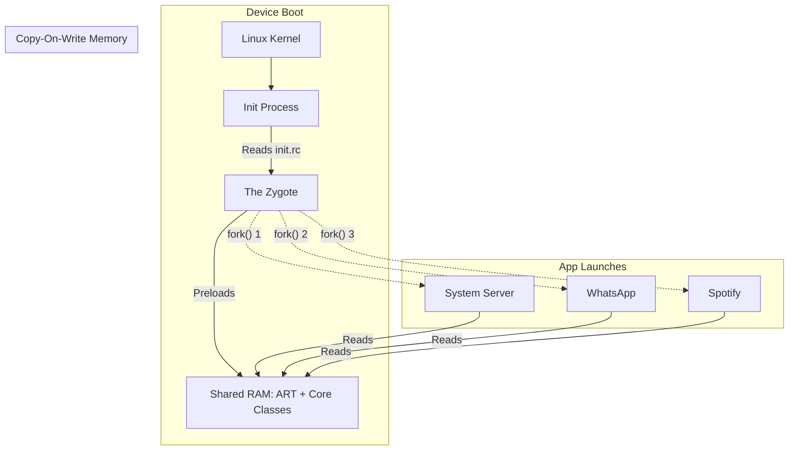

# The Zygote

## Overview

In biology, a Zygote is a eukaryotic cell formed by a fertilization event between two gametes; it is the single cell from which all other cells in an organism divide and grow.

In the Android Operating System, **The Zygote** is a special daemon process launched during the physical boot of the device. It initializes the core Android Runtime (ART), preloads all the core Java/Kotlin framework classes, and then just sits there waiting. When the user taps your App Icon, the OS does not launch your app from scratch. Instead, it asks the Zygote to "fork" itself.

A Staff Engineer understands that because of the Zygote, every single Android application is actually a clone of a master process. This architectural decision is the single greatest performance optimization in the Android OS, drastically reducing app startup times and memory consumption.

## Why It Matters

If Android launched apps like a standard desktop Operating System, tapping your app icon would require the OS to:
1. Allocate a new block of RAM.
2. Spin up a new Linux process.
3. Boot up the Android Runtime (ART) JVM.
4. Read 5,000 core Android framework classes (`View`, `Activity`, `String`) from the hard drive into RAM.
5. Finally, execute your `MainActivity`.

This process would take 3-4 seconds, even on a flagship device. Furthermore, if you had 10 apps open, the OS would have 10 identical copies of the `String` class and the `Activity` class taking up hundreds of megabytes of RAM.

By utilizing the Zygote, Android achieves instant startup and massive RAM deduplication.

## Historical Context

- **Linux `fork()`:** In standard Linux, the `fork()` command creates a new process by perfectly duplicating the calling process. The child process is an exact genetic clone of the parent, sharing the exact same memory until one of them tries to modify it.
- **Dalvik (Pre-Android 5):** The original Android Zygote preloaded classes into the Dalvik Virtual Machine. It was incredibly effective, but the list of preloaded classes was hardcoded and static.
- **Modern ART:** The modern Zygote is vastly more intelligent. It utilizes Ahead-Of-Time (AOT) compiled `.odex` files and even maintains a secondary `WebViewZygote` specifically for cloning Chrome rendering engines to prevent untrusted web code from compromising the main Zygote.

## First Principles

1.  **Daemon:** A background process that runs continuously, waiting for requests.
2.  **`fork()`:** A Linux system call that creates a new process by cloning the existing one.
3.  **Copy-On-Write (COW):** The magical memory optimization. When the Zygote forks, the child process (your app) does *not* get its own copy of the preloaded classes in RAM. It simply points to the Zygote's RAM. Only if your app attempts to *modify* that shared memory does the OS physically copy it.
4.  **Preloading:** Loading thousands of common framework classes and resources (like the default Android button themes) into RAM once during device boot, so apps don't have to load them from disk.

## Mental Model

Think of the Zygote as a **Master Sourdough Starter**.
- The baker (Android OS) spends 24 hours perfectly mixing flour, water, and yeast to create a massive, active Master Starter (The Zygote).
- When a customer orders a loaf of bread (The User taps your App Icon), the baker doesn't start from scratch. 
- The baker simply tears off a chunk of the Master Starter (a `fork()`), adds a little bit of custom flavor (Your specific App's APK code), and bakes it.
- Because the heavy lifting (fermentation) was already done in the Master Starter, the bread is ready instantly. 

## Internal Mechanics

### 1. The Boot Sequence

1. The user presses the physical power button on the phone.
2. The Linux Kernel boots up.
3. The Kernel runs `init`, the mother of all processes.
4. `init` reads the `init.rc` configuration file and launches the **Zygote** daemon.
5. The Zygote spins up the Android Runtime (ART).
6. The Zygote reads a text file (`/system/etc/preloaded-classes`) containing ~4000 framework classes and loads them into memory.
7. The Zygote opens a Unix domain socket (`/dev/socket/zygote`) and waits.
8. `init` then launches the `SystemServer` (which is actually the very first fork of the Zygote).

### 2. The App Launch

When the user taps your app icon on the Launcher screen:
1. The Launcher sends an Intent to the `ActivityManagerService` (living in the SystemServer).
2. The `ActivityManagerService` sends a message to the Zygote socket: *"Fork a new process for com.example.myapp"*.
3. The Zygote calls `fork()`.
4. The new child process abandons the Zygote socket, loads your app's specific APK bytecode, and calls `ActivityThread.main()`. Your app is now running.

## Architecture

*Notice how all forks point to the same physical RAM for the core framework classes.*

## Production Example

**The `WebViewZygote`**

If your app uses a `WebView` to display a webpage, you are rendering HTML and Javascript downloaded from the internet. If that Javascript contains a malicious exploit that breaks out of the Sandbox, it could compromise the memory of your app.

To mitigate this, modern Android isolates the `WebView`.
When you instantiate a `WebView`, the OS does not render it in your app's process. It contacts the `WebViewZygote` (a specialized, heavily restricted clone of the main Zygote) and asks it to fork a dedicated, sandboxed rendering process. Your app then communicates with this sandboxed renderer via IPC (The Binder).

If the Javascript exploit breaks out, it only compromises the sandboxed renderer, protecting your app's memory (and user tokens) from being stolen.

## Tradeoffs

**Class Preloading vs Boot Time**

- **Tradeoff:** Google engineers have to decide exactly which classes go into the `preloaded-classes` list. 
- **Too Few Classes:** The phone boots instantly. But when the user taps an app, the app has to load the missing framework classes from the hard drive. App startup is slow and janky.
- **Too Many Classes:** App startup is lightning fast because everything is already in RAM. But the phone takes 2 minutes to physically turn on, and the Zygote consumes 500MB of RAM permanently, leaving very little RAM for background apps.
- **The Solution:** Google constantly analyzes telemetry from millions of devices to optimize this list, ensuring only the most universally used classes (like `TextView`, `Intent`, `ArrayList`) are preloaded.

## Failure Modes

- **Static Variable Contamination (The Theory):**
  If App A and App B are both clones of the Zygote, and they both point to the same preloaded classes in RAM, what happens if App A modifies a `public static int` inside a framework class? Does App B see the change?
  *(Answer: No. Thanks to Copy-On-Write (COW), the exact millisecond App A attempts to modify the shared memory, the Linux kernel intercepts the action, makes a physical copy of that specific memory page just for App A, and allows the modification. App B continues pointing to the original, pristine Zygote memory).*
- **Custom Zygote Modifications:**
  In the early days of Android rooting (CyanogenMod, Xposed Framework), hackers would inject custom code directly into the Zygote process during boot. Because every single app is a fork of the Zygote, injecting code into the Zygote meant your custom code was instantly injected into *every single app on the phone*. This was incredibly powerful for custom themes, but catastrophic for security.
  *(Fix: Modern Android uses Verified Boot and SE-Linux policies that strictly prohibit modification of the Zygote process).*

## Staff Engineer Thinking

When thinking about the Zygote, a Staff engineer focuses on the architectural implications of Application Initialization.

1.  **`Application.onCreate()`:** Because the Zygote handles the heavy lifting of JVM boot and framework loading, the absolute biggest bottleneck in app startup is typically the code *you* write in `Application.onCreate()`. The Zygote forks in milliseconds. If your app takes 3 seconds to launch, it is almost certainly due to application-level initialization rather than OS overhead.
2.  **Multidex Overhead:** On legacy Android versions (Dalvik), if your app exceeded 65,536 methods, you had to enable Multidex. The Dalvik Zygote was not designed for this. Loading secondary DEX files required extracting massive ZIP files on the Main Thread during the fork process, causing multi-second black screens. While ART natively supports Multidex, I still ensure our build pipelines optimize DEX layout for the Zygote.
3.  **Process Restarts:** I design apps with the assumption that the OS will ruthlessly kill my app's process when in the background. Because the Zygote makes forking a new process so cheap, the OS uses Process Death as its primary memory management tool. We must rely on `SavedStateHandle` to restore state, because the Zygote will happily fork us a brand new, empty process when the user returns.

## Common Misconceptions

- **"Android apps run in Java Virtual Machines (JVMs)."** Strictly speaking, no. They run in the Android Runtime (ART), which executes Dalvik Bytecode (`.dex`), not Java Bytecode (`.class`). More importantly, standard JVMs do not fork from a master Zygote; they boot from scratch.
- **"If I clear my RAM, my phone will be faster."** This is a terrible myth perpetuated by "Task Killer" apps. Clearing RAM destroys the cached background processes that were already cleanly forked from the Zygote. When you reopen those apps, the Zygote has to fork them all over again, burning CPU cycles and draining the battery. Empty RAM is wasted RAM in Android.

## Probing Questions

1.  Explain the biological metaphor of the Zygote and how it perfectly describes Android's process creation model.
2.  What is the Linux `fork()` command, and why is it vastly faster than booting a process from scratch?
3.  Describe the concept of Copy-On-Write (COW) memory and how it allows 20 running Android applications to share the exact same core framework classes in RAM without interfering with each other.
4.  Why does the Android OS maintain a separate `WebViewZygote` instead of rendering web pages directly in the main app process?
5.  If a user modifies a static variable inside a preloaded Android framework class, why doesn't that change instantly propagate to every other app on the phone?
6.  What is the `preloaded-classes` list, and what is the architectural tradeoff Google faces when deciding how many classes to put on this list?
7.  Explain how the existence of the Zygote makes "Task Killer" applications actively detrimental to Android battery life.
8.  How did frameworks like Xposed exploit the Zygote architecture to alter the behavior of every application on a rooted device?
9.  If the Zygote guarantees near-instant process creation, what is the most common cause of a 3-5 second "Cold Start" delay when a user taps an app icon?
10. Describe the sequence of events involving the `ActivityManagerService` when a user taps an icon on their home screen Launcher.

## Answer Key

1. **Explain the biological metaphor of the Zygote and how it perfectly describes Android's process creation model.**
   Just as a biological zygote is the single master cell that divides to create all other cells in an organism, the Android Zygote is a master daemon process that clones itself to instantly spawn every single application process on the device.
2. **What is the Linux `fork()` command, and why is it vastly faster than booting a process from scratch?**
   `fork()` creates a new process by perfectly duplicating the parent's memory map instead of allocating new RAM, initializing the JVM, and loading framework classes from disk. This bypasses the heavy lifting of process initialization.
3. **Describe the concept of Copy-On-Write (COW) memory and how it allows 20 running Android applications to share the exact same core framework classes in RAM without interfering with each other.**
   When Zygote forks, the child process points to the Zygote's existing RAM. The OS only allocates new physical memory if the child attempts to modify (write to) that shared memory, allowing all apps to safely read the same framework classes without duplicating them.
4. **Why does the Android OS maintain a separate `WebViewZygote` instead of rendering web pages directly in the main app process?**
   To sandbox potentially malicious web code (like exploited JavaScript). By forking the renderer from an isolated `WebViewZygote`, a compromised renderer cannot access the main app's memory, tokens, or permissions.
5. **If a user modifies a static variable inside a preloaded Android framework class, why doesn't that change instantly propagate to every other app on the phone?**
   Because of Copy-On-Write. The moment App A attempts to modify the shared static variable, the kernel intercepts the write, creates a private copy of that memory page solely for App A, and leaves the original shared Zygote memory untouched.
6. **What is the `preloaded-classes` list, and what is the architectural tradeoff Google faces when deciding how many classes to put on this list?**
   It's a list of framework classes loaded into Zygote's RAM at boot. Preloading too many classes consumes permanent RAM and slows down device boot, but preloading too few classes forces apps to load them from disk, causing slow, janky app startups.
7. **Explain how the existence of the Zygote makes "Task Killer" applications actively detrimental to Android battery life.**
   Killing background apps clears them from RAM. When the user reopens them, Zygote has to fork them again, and the app must re-run its startup logic, burning significantly more CPU cycles and battery than simply resuming a paused process.
8. **How did frameworks like Xposed exploit the Zygote architecture to alter the behavior of every application on a rooted device?**
   By injecting custom code directly into the Zygote process during device boot. Because every app is a clone of Zygote, injecting hooks into the master process meant those hooks were instantly inherited by every app launched thereafter.
9. **If the Zygote guarantees near-instant process creation, what is the most common cause of a 3-5 second "Cold Start" delay when a user taps an app icon?**
   Application-level initialization. The delay is almost entirely caused by heavy work, synchronous disk/network I/O, or complex dependency injection graph construction happening synchronously inside the developer's `Application.onCreate()` or `MainActivity.onCreate()`.
10. **Describe the sequence of events involving the `ActivityManagerService` when a user taps an icon on their home screen Launcher.**
    The Launcher sends an Intent to the `ActivityManagerService` (AMS). AMS determines the target app is not running and sends a socket request to Zygote to fork a new process. Zygote forks, the new child process loads the app's APK, and then executes `ActivityThread.main()`.

## Further Reading

- [`art-and-dalvik.md`](art-and-dalvik.md) — The runtime engine that the Zygote initializes and clones.
- [`process-death-and-state-restoration.md`](../architecture/process-death-and-state-restoration.md) — Why the Zygote's speed makes process death an acceptable OS-level memory strategy.
- [`baseline-profiles.md`](../performance/baseline-profiles.md) — How AOT compilation bypasses the need for the Zygote to JIT compile your specific app code.
