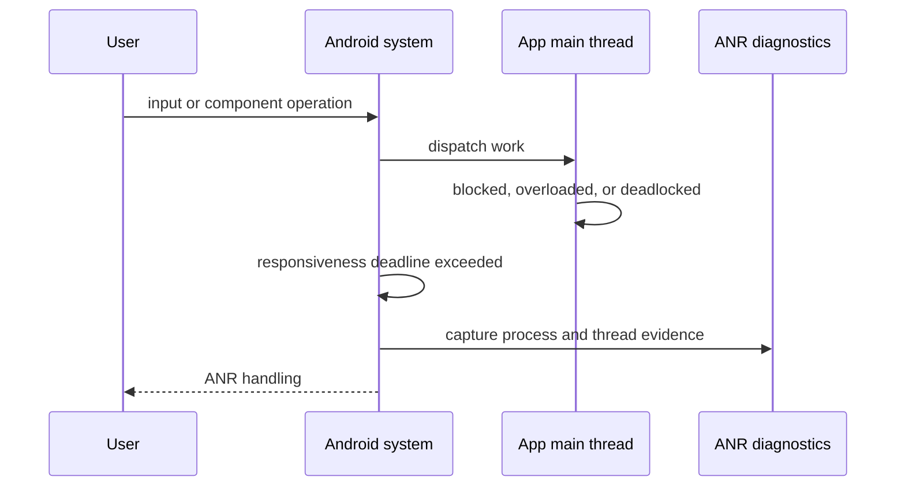

# Application Not Responding (ANR)

## Overview

An Application Not Responding (ANR) error is the single worst user experience in Android. It is a catastrophic failure where the Operating System detects that your application's Main Thread has been completely blocked for an extended period.

When this happens, the OS literally halts your app, grays out the screen, and presents the user with a brutal dialog box: *"App isn't responding. Close app or Wait?"* 

A Staff Engineer understands that ANRs are not just "slow code." They are fundamental architectural failures involving Synchronous I/O, Deadlocks, or abusive BroadcastReceivers. Google Play Console heavily penalizes apps with high ANR rates, aggressively down-ranking them in search results.

## Why It Matters

If an app crashes with a `NullPointerException`, the app dies instantly. The user can reopen it. 
If an app ANRs, the app freezes. The user taps the screen 5 times, nothing happens, they get angry, the OS shows the dialog, they force-kill the app, and they leave a 1-star review.

ANRs are often invisible to the developer during testing because developers test on $1000 flagship phones. In production, users run your app on $150 budget devices in battery-saving mode, where flash storage is incredibly slow. A file write that takes 2ms on a Pixel 8 might take 6000ms on a budget device, triggering a massive ANR.

## Historical Context

In the early days of Android, ANRs were the leading cause of user abandonment. The OS rules were simple but unforgiving:
- **Input Dispatching Timeout:** 5 seconds. If the user touches the screen and the Main Thread cannot process the event within 5 seconds, ANR.
- **BroadcastReceiver Timeout:** 10 seconds. If a BroadcastReceiver's `onReceive()` takes longer than 10 seconds on the Main Thread, ANR.
- **Service Timeout:** 20 seconds. If a Service takes longer than 20 seconds to execute `onCreate` or `onStartCommand` on the Main Thread, ANR.

Over the years, Google shifted architecture away from these traps. They deprecated `SharedPreferences` (a massive source of I/O ANRs) in favor of `DataStore`. They pushed developers away from `Services` to `WorkManager`. Yet, ANRs still plague the Play Store today.

## First Principles

1.  **The Main Thread Rule:** The Main Thread (UI Thread) must *only* be used for UI updates and responding to user input.
2.  **I/O is Evil:** Network calls, Database queries, and File Reads/Writes are fundamentally unpredictable. They must never touch the Main Thread.
3.  **The ANR Traces File:** When an ANR occurs, the OS dumps the entire thread state of the app into a file (`/data/anr/traces.txt`). This file is the forensic evidence required to solve the crime.

## Mental Model

Think of the Main Thread as the **Cashier at a busy Supermarket**.
- The Cashier's only job is to scan items and take money (Process UI Events).
- If the Cashier decides to personally run to the warehouse in the back to fetch a new box of cereal (Disk I/O), the line stops.
- Customers (Touch Events) start piling up. They tap their watches.
- After 5 seconds of the line not moving, the Store Manager (Android OS) steps in, fires the Cashier, and shuts down the register (The ANR Dialog).

The Cashier should have radioed a warehouse worker (Background Thread) to get the cereal.

## Internal Mechanics

### How the OS Detects an ANR



An ANR is observed by the system when a monitored operation exceeds its context-specific responsiveness deadline; the main-thread trace explains the block, while surrounding evidence identifies why it occurred.

The OS runs an internal watchdog system called the `InputDispatcher`.
1.  The user taps the screen. The hardware sends an interrupt to the OS kernel.
2.  The OS Kernel routes the event to the `InputDispatcher`.
3.  The `InputDispatcher` queues the event in your app's Main Thread `MessageQueue`.
4.  The `InputDispatcher` starts a 5-second timer.
5.  If your Main Thread `Looper` processes the event and replies before the timer hits 0, the timer is cancelled.
6.  If the Main Thread is stuck in a `while(true)` loop or blocked on a `Mutex`, the timer hits 5 seconds. The OS fires the ANR.

### Forensic Traces

If you look at an ANR trace on Google Play Console, you will see something like this:

```text
"main" prio=5 tid=1 Blocked
  | group="main" sCount=1 dsCount=0 flags=1 obj=0x74b38d48 self=0x7ab8c14c00
  | sysTid=10245 nice=-10 cgrp=default sched=0/0 handle=0x7ab9f1b548
  | state=S schedstat=( 12048406 2056094 13 ) utm=1 stm=0 core=2 HZ=100
  | stack=0x7fc95da000-0x7fc95dc000 stackSize=8192MB
  at com.example.app.Database.saveDataSynchronously(Database.java:45)
  - waiting to lock <0x01a8c4f6> (a java.lang.Object) held by thread 12
  at com.example.app.MainActivity.onSaveClick(MainActivity.java:102)
```

This trace tells you the exact story:
1. Thread State is `Blocked`.
2. The Main thread called `onSaveClick`, which called `saveDataSynchronously`.
3. It is waiting to acquire a lock (`0x01a8c4f6`).
4. That lock is currently held by Thread 12. 
*(To fix this, you must look down the trace file, find Thread 12, and figure out why it hasn't released the lock).*

## Production Example

**The Hidden `SharedPreferences.apply()` ANR**

This is the most common ANR in the history of Android, and the exact reason `DataStore` was invented.

```kotlin
// In the ViewModel or Activity
fun saveDraft() {
    // apply() is asynchronous, right? WRONG.
    sharedPreferences.edit().putString("draft", largeText).apply() 
}
```

**The Trap:**
`apply()` commits to memory instantly, then schedules an asynchronous disk write on a background thread.
However, if the user hits the Home Button, the OS calls `Activity.onStop()`.
Inside the Android OS source code, the `ActivityThread` explicitly calls a method named `QueuedWork.waitToFinish()`.
This method **blocks the Main Thread** until *all* pending `apply()` disk writes are finished.
If the flash storage is slow, `onStop` takes 6 seconds. BOOM. ANR.

*(Fix: Migrate to `DataStore`, or use `commit()` on a strictly defined `Dispatchers.IO` coroutine).*

## Tradeoffs

**Third-Party SDKs vs Stability**

A massive source of ANRs comes from code you didn't write. Ad Networks, Analytics trackers, and crash reporters often execute synchronous initialization logic on the Main Thread during `Application.onCreate()`.

- **Tradeoff:** Do you initialize the Ads SDK on the Main Thread to ensure ads are ready immediately (revenue), or do you initialize it on a background thread (stability)?
- **The Staff Decision:** You must mandate background initialization for all 3rd party SDKs unless they explicitly require the Main Thread. If they require the Main Thread and cause ANRs, you rip them out of the app. The revenue lost from Play Store down-ranking due to ANRs always exceeds the revenue gained from that specific ad network.

## Failure Modes

- **The Coroutine Main Dispatcher Trap:**
  ```kotlin
  viewModelScope.launch(Dispatchers.Main) {
      // This runs on the Main Thread!
      val bitmap = BitmapFactory.decodeFile(largeFile) // Disk I/O!
      imageView.setImageBitmap(bitmap)
  }
  ```
  *(Fix: Coroutines do not magically make code safe. You must explicitly shift context to `Dispatchers.IO` before performing the decode).*
- **Deadlock with Synchronized:**
  Thread A (Main) holds Lock 1 and waits for Lock 2.
  Thread B (Background) holds Lock 2 and waits for Lock 1.
  Both threads freeze forever. If Thread A is the Main Thread, it's an instant ANR.
  *(Fix: Avoid nested locks. Always acquire locks in the exact same mathematical order across all threads).*
- **Main Thread Initialization (`Application.onCreate`):**
  If you do 3 seconds of heavy setup in your `Application` class, the app will take 3 seconds to show the first frame. If the user starts tapping the blank screen out of frustration, the 5-second timer starts.

## Staff Engineer Thinking

When attacking an ANR spike in production, a Staff engineer does not guess.

1.  **Google Play Console / Crashlytics:** I look at the aggregated ANR traces. Are they concentrated on specific Android versions (e.g., Android 8)? Are they concentrated on low-RAM devices?
2.  **Thread State Analysis:** I read the trace. Is the Main Thread `Runnable` (doing a massive mathematical loop)? Is it `Sleeping` (`Thread.sleep()`)? Or is it `Blocked` (waiting on a lock)? The state dictates the fix.
3.  **Strict Mode:** I enforce `StrictMode` during debug builds. `StrictMode` instantly crashes the app with a bright red error if *any* developer attempts to perform Network or Disk I/O on the Main Thread. This catches 90% of ANR causes before they ever merge into the `main` branch.

### Release-gating ANRs

ANRs deserve different handling from crashes because many ANR signals arrive late through Play Vitals. Use both fast in-house telemetry and slower Play data.

| Signal | Decision |
|---|---|
| User-perceived ANR spike in current rollout | Halt rollout immediately |
| Background ANR increase only | Hold rollout if trend persists; investigate receiver/service work |
| ANRs isolated to low-RAM devices | Gate feature by device tier or reduce startup/background work |
| Main thread blocked in third-party SDK init | Disable/defer SDK; escalate vendor removal if repeated |
| Trace points to app lock contention | Treat as architectural bug; add regression test or StrictMode policy |

Do not page every ANR threshold crossing. Page when the app is currently unusable for a meaningful cohort and the on-call engineer can mitigate by halting rollout, flipping a flag, or disabling a backend-driven entry point.

## Common Misconceptions

- **"If my app is in the background, it can't ANR."** False. If your app is in the background, and a `BroadcastReceiver` fires, and you block the thread for 10 seconds, the OS will silently record a "Background ANR." While the user won't see the dialog, Google Play Console *will* penalize your app's vitals score just as heavily.
- **"I can just increase the 5-second timeout limit."** Impossible. The 5-second Input Dispatching timeout is hardcoded into the Android OS kernel (ActivityManager). You cannot bypass it or change it.

## Probing Questions

1.  What is the fundamental difference in user experience and OS handling between a standard Crash (Exception) and an Application Not Responding (ANR) error?
2.  Explain the role of the Android OS `InputDispatcher` and the 5-second timer in triggering an ANR.
3.  Why does `SharedPreferences.apply()`, which claims to be asynchronous, frequently cause ANRs during Activity lifecycle transitions?
4.  If an ANR trace shows the Main Thread in a `Blocked` state waiting on a lock, what are your next steps to debug the issue?
5.  How does Android's `StrictMode` API help teams prevent ANRs before they reach production?
6.  Describe a scenario where a `BroadcastReceiver` running in an application with no visible UI can still trigger an ANR.
7.  Why is initializing complex Third-Party SDKs inside `Application.onCreate()` a massive risk for generating ANRs?
8.  Explain how a classic "Deadlock" between the Main Thread and an IO Thread will trigger an ANR.
9.  If you decode a massive 4K JPEG image from the local disk inside a `viewModelScope.launch { }` block without changing the dispatcher, what happens to the Main Thread?
10. Describe the business impact (Google Play Vitals) of having a high ANR rate, even if those ANRs occur silently in the background.

## Further Reading

- [`jank.md`](jank.md) — The precursor to an ANR. A blocked thread for 16ms causes Jank; blocked for 5000ms causes an ANR.
- [`threads-and-looper.md`](../concurrency/threads-and-looper.md) — The underlying MessageQueue that the `InputDispatcher` monitors.
- [`datastore.md`](../data-and-di/datastore.md) — The Google-mandated architectural fix for `SharedPreferences` ANRs.
