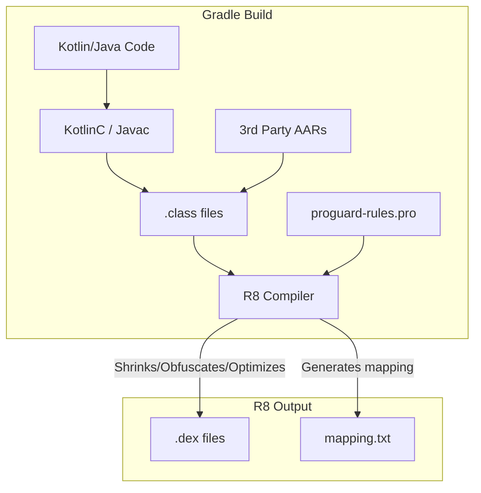

# App Size and R8 (ProGuard)

## Overview

A Staff Engineer understands that Application Size is directly correlated to User Acquisition Cost (UAC). Google's internal data shows that for every 6MB increase in APK size, install conversion rates drop by 1%. If your marketing team spends $100,000 driving users to your Play Store page, a bloated 150MB APK will literally cost the company thousands of dollars in lost installs.

To fight bloat, Android relies on **R8** (the modern replacement for ProGuard). R8 is a compiler that performs three critical steps during the release build: **Shrinking, Obfuscation, and Optimization**.

## Why It Matters

When you add the `Retrofit` or `Guava` library to your `build.gradle` file, you are adding thousands of classes and methods to your app. If you only use one specific `Retrofit` annotation, the other 999 classes are dead weight.

If you ship an APK without R8, you are shipping all of that dead weight to the user. Furthermore, your codebase is easily decompiled by attackers who can read your exact class and variable names. R8 strips the dead weight and renames the surviving classes to meaningless letters (`a.b.c`), saving space and adding a layer of security through obscurity.

## Historical Context

- **ProGuard:** The original Java bytecode shrinker. It was notoriously difficult to configure. If you misconfigured your `proguard-rules.pro` file, the app would compile perfectly but instantly crash on startup with a `ClassNotFoundException`.
- **D8 / R8 (2019+):** Google completely rewrote the shrinker to be deeply integrated into the Android Gradle Plugin. R8 converts Java Bytecode (`.class`) directly into Android Dalvik Bytecode (`.dex`), whereas ProGuard required an intermediate step. R8 is significantly faster and produces smaller APKs. R8 uses the exact same `proguard-rules.pro` syntax for backwards compatibility.

## First Principles

R8 performs three distinct operations:

1.  **Shrinking (Tree Shaking):** R8 starts at your Android Manifest (Activities, Services, etc.) and traces every single method call. If a method or class is never reached during this trace, R8 completely deletes it from the final APK.
2.  **Obfuscation:** For all the surviving classes and methods, R8 renames them. `UserRepository.kt` becomes `a.kt`. `fetchUsers()` becomes `b()`. This drastically reduces the size of the DEX string pool.
3.  **Optimization:** R8 rewrites your actual code. If you have an `if (false)` block, R8 deletes it. If you have a getter method `getName()` that just returns a variable, R8 might delete the method and inline the direct variable access everywhere it is used.

## Mental Model

Think of your codebase as a **Massive Jigsaw Puzzle Kit**.
- You bought a 5,000 piece kit, but your specific picture only requires 500 pieces.
- **Shrinking:** R8 throws the remaining 4,500 pieces in the trash.
- **Obfuscation:** R8 sands off the original manufacturer logos from the back of the 500 pieces so competitors can't easily figure out where you bought them.
- **Optimization:** R8 notices that two puzzle pieces are always locked together, so it superglues them into a single, faster-to-handle piece (Inlining).

## Internal Mechanics

### The `@Keep` Annotation and `proguard-rules.pro`

R8's static analysis is powerful, but it is blind to **Reflection**. 
If you use `Gson` to parse JSON from the network, `Gson` uses reflection to look up the names of your data class variables at runtime.

```kotlin
// JSON: { "first_name": "John" }
data class User(val first_name: String)
```
If R8 obfuscates this, `User` becomes `a`, and `first_name` becomes `b`. When the JSON arrives, Gson looks for `first_name`, can't find it, and returns `null`.

**The Fix:** You must explicitly tell R8 to leave this class alone.
```kotlin
@Keep // Tells R8: "Do not shrink or obfuscate anything in this class!"
data class User(val first_name: String)
```

Alternatively, you write rules in your `proguard-rules.pro` file:
```proguard
# Keep all classes in the models package
-keep class com.example.app.models.** { *; }
```

### Resource Shrinking

Code is only half the battle. Images and XML layouts are huge. If you enable `shrinkResources true` in your `build.gradle`, the Android Gradle Plugin will scan your code. If it finds a `.png` file in your `res/drawable` folder that is never referenced by an XML file or Kotlin code, it replaces that image with a tiny 1x1 pixel dummy file, saving megabytes of space.

## Architecture



## Production Example

**The `mapping.txt` File and Crashlytics**

Because R8 renames all your classes to `a.b.c`, if your app crashes in production, your Crashlytics dashboard will show a completely useless stack trace:
```text
NullPointerException: 
  at a.b.c(Unknown Source)
  at d.e.f(Unknown Source)
```

To solve this, R8 generates a `mapping.txt` file during the build. This file acts as a dictionary (e.g., `com.example.UserRepository -> a`). 
You **must** upload this `mapping.txt` file to Google Play Console and Firebase Crashlytics. They will use it to "de-obfuscate" the crash reports back into readable Kotlin class names. 
*(Staff Note: The Firebase Crashlytics Gradle Plugin automates this upload).*

## Tradeoffs

**Aggressive Optimization vs Build Times**

- **Tradeoff:** R8 optimization can be turned up to maximum using `android.enableR8.fullMode=true` in your `gradle.properties`. Full mode enables extremely aggressive inlining and class merging. 
- **The Catch:** Full mode will break poorly written 3rd party SDKs that rely on reflection without providing their own Consumer ProGuard rules. It also drastically increases the release build time on your CI server.
- **The Staff Decision:** A Staff Engineer enables `fullMode` and spends the 3 days required to hunt down and write the custom `-keep` rules for every broken SDK. The 10% reduction in APK size and 5% boost to execution speed is permanently worth the one-time integration pain.

## Failure Modes

- **Testing only on Debug:**
  `minifyEnabled` is strictly disabled on `Debug` builds because R8 takes minutes to run. If a developer uses reflection (like `Gson`) but forgets the `@Keep` annotation, the app works perfectly on their emulator. The moment it builds for Release, R8 destroys the class, and the app crashes on the first network call.
  *(Fix: Require all QA testing to be done on a `Release` variant, or a `Staging` variant with `minifyEnabled true`).*
- **The `shrinkResources` Dynamic Trap:**
  If you write code that loads an image dynamically by name using reflection:
  `resources.getIdentifier("icon_$name", "drawable", packageName)`
  The Resource Shrinker cannot "see" this dynamic string. It assumes `icon_cat.png` is never used and deletes it.
  *(Fix: You must create a `res/raw/keep.xml` file and explicitly use `tools:keep="@drawable/icon_*"` to protect dynamic resources).*

## Staff Engineer Thinking

When reviewing App Size, a Staff engineer looks holistically at the App Bundle:

1.  **Android App Bundles (AAB):** We never ship `.apk` files to the Play Store anymore. We ship `.aab`. An AAB contains all resources for all device densities (xxhdpi, hdpi) and languages. Google Play looks at the specific user's phone (e.g., a Spanish user with an xxhdpi screen) and generates a custom, tiny APK just for them. I verify that we are heavily utilizing AABs and not bypassing them.
2.  **Vector Drawables:** I actively reject PRs that contain large `.png` or `.jpg` illustrations if they can be recreated as `.xml` VectorDrawables. Vectors scale infinitely with zero pixelation and take kilobytes instead of megabytes.
3.  **ProGuard Rule Scoping:** I ensure that library modules (like a custom UI library built by another team) ship their own `-consumer-proguard-rules.pro` files inside their `.aar`. The main app module should not be responsible for writing keep rules for a library's internal reflection needs.

### App size governance

App size is a platform budget, not a cleanup chore after marketing complains. Give each major owner a budget and make CI report attribution.

| Budget | Owner | Gate |
|---|---|---|
| Base install size | App platform | Fail release candidate if any target device exceeds budget |
| DEX growth | Feature/module owner | Warn on > 100 KB, require approval on > 500 KB |
| Native library growth | SDK/platform owner | Require ABI justification and per-ABI size report |
| Resources/assets | Design system or feature owner | Require optimized format and density review |
| Dynamic feature size | Feature owner | Require install-time/on-demand decision record |

The useful report is not "the app grew by 2 MB." It is "checkout added 1.2 MB DEX through payment-sdk, design-system added 600 KB drawables, maps added 4 MB arm64 native code." Staff engineers need owner attribution so size work does not become a vague platform tax.

Run size checks on release-like, minified AABs. Debug APK size is noise.

## Common Misconceptions

- **"R8 prevents reverse engineering."** False. R8 obfuscation renames variables, making it *annoying* to read decompiled code. It does not encrypt the code. A determined attacker can easily follow the flow of `a.b.c()`. True security requires the [Android Keystore](../networking-and-security/security-and-keystore.md).
- **"I don't need R8 because modern phones have 256GB of storage."** The size on disk isn't the primary issue. The primary issue is the download size over a cellular network (UAC), and the RAM required to load a massive DEX file into memory upon initialization.

## Probing Questions

1.  What are the three distinct steps R8 performs to reduce the size of your Android application?
2.  Explain why a developer must use the `@Keep` annotation on Kotlin Data Classes that are parsed from JSON using libraries like Gson.
3.  If an application crashes in production with a stack trace consisting of `a.b.c(Unknown Source)`, what critical file did the deployment team fail to upload to Crashlytics?
4.  Describe how R8 "Shrinking" (Tree Shaking) differs from R8 "Optimization".
5.  What is the `shrinkResources` flag, and how can dynamically loading drawables by their String name cause it to break your app?
6.  Explain the architectural difference between shipping a legacy `.apk` and a modern Android App Bundle (`.aab`) to the Google Play Store.
7.  Why is it extremely dangerous to rely solely on `Debug` builds when verifying the functionality of a new feature?
8.  How does replacing multiple `.png` files for different screen densities with a single XML `VectorDrawable` impact the final application size?
9.  If you enable `android.enableR8.fullMode=true`, what specific types of 3rd party libraries are most likely to crash on startup?
10. Describe the business impact (User Acquisition Cost) of failing to implement R8 in a consumer-facing application.

## Further Reading

- [`jank.md`](jank.md) — How smaller, optimized code paths from R8 prevent UI stuttering.
- [`baseline-profiles.md`](baseline-profiles.md) — The AOT compilation step that occurs *after* R8 generates the final DEX file.
- [Android Developers: Shrink, obfuscate, and optimize your app](https://developer.android.com/studio/build/shrink-code)
