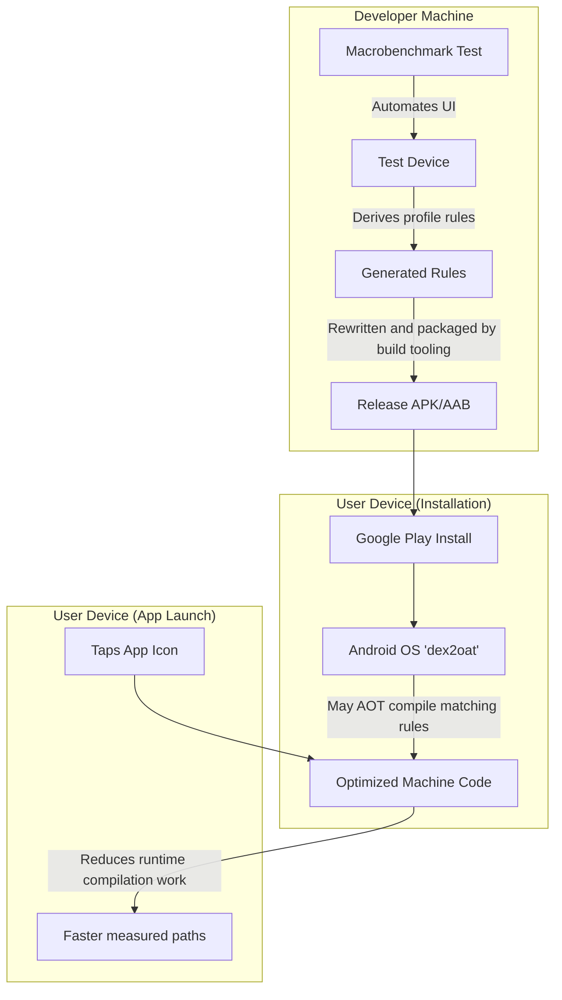

# Baseline Profiles

## Overview

A `Baseline Profile` is a Google-recommended performance optimization technique. It is a set of rules bundled with your app that identifies classes and methods used during startup and critical user journeys so Android Runtime (ART) can prioritize them for optimization.

A Staff Engineer treats Baseline Profiles as one tool for reducing cold-start latency and initial scroll jank, especially in Jetpack Compose apps. When a profile is delivered, installed, and compiled, ART can optimize important paths before or early in app usage; the improvement must be measured on representative devices and is not guaranteed for every install.

## Why It Matters

When a user downloads your app from the Play Store, the app is distributed as Dalvik Executable (DEX) bytecode. It is not raw machine code. 

When the user taps the app icon, ART may execute already compiled code and interpret or JIT-compile other methods. Runtime compilation consumes CPU and can contribute to startup or interaction latency.

Jetpack Compose applications can execute substantial library and application code during startup and early rendering. If important paths are not already optimized, interpretation or JIT work can contribute to slower startup and dropped frames alongside I/O, class loading, layout, and application work.

Baseline Profiles reduce first-run interpretation and JIT work for included code paths when the profile is installed and compiled successfully; they do not eliminate all runtime compilation or startup cost.

## Historical Context

- **Android 4.4 (Dalvik):** Dalvik used interpretation plus trace JIT for hot paths. Installation and startup costs varied by app, device, and executed code.
- **Android 5.0 (ART / install-time AOT):** ART replaced Dalvik and used install-time ahead-of-time compilation broadly. Compared with later profile-guided compilation, this traded more installation time and compiled-code storage for less runtime compilation. The cost varied by app and device; “five minutes,” “the entire APK,” “instant startup,” and “3× storage” are not platform guarantees.
- **Android 7.0 (Profile-Guided Optimization):** Android adopted a hybrid of interpretation, JIT, profiles, and selective AOT. Runtime profiles identify important methods and classes, and later optimization can compile matching paths when scheduler and device conditions permit.
- **Modern era (Baseline Profiles):** A developer-supplied profile can identify important startup and interaction paths before cloud or local profiles accumulate. The installer or later profile-install/compilation flow uses those rules subject to Android version and delivery conditions; applications should verify compilation state and benchmark rather than assume every listed method is compiled immediately at package installation.

## First Principles

1.  **JIT (Just-In-Time):** Translating selected bytecode while the app is running, which shifts some compilation CPU into runtime.
2.  **AOT (Ahead-Of-Time):** Translating selected bytecode before execution, which shifts compilation work earlier and uses compiled-code storage.
3.  **The Profile:** A list of critical classes and methods (e.g., `Lcom/example/MainActivity;->onCreate()V`).
4.  **Cloud and Baseline Profiles:** Cloud Profiles are derived from representative production usage, while developer-supplied Baseline Profiles can provide useful rules before that data accumulates. Either path remains subject to delivery, installation, compilation, and device conditions.

### Startup Profiles vs Baseline Profiles

While **Baseline Profiles** supply rules that ART can use to prioritize code optimization, **Startup Profiles** guide R8/D8 in arranging startup-related classes within the app's DEX files. Profile-guided layout keeps frequently loaded startup code close together and can influence multidex partitioning, reducing page faults and disk I/O without guaranteeing that every startup class is placed in the primary `classes.dex`.

## Mental Model

Think of your app's codebase as a **Massive IKEA Furniture Manual (written in Swedish)**.
- **JIT compilation:** The user translates selected passages while building. Translation on an interactive path consumes runtime CPU and may add latency; the measured effect depends on device and workload.
- **Heavier install-time AOT (early ART):** The delivery driver prepares a substantial translated edition according to the current delivery policy. That can make later reading easier, but adds variable delivery time and may translate pages the user never opens.
- **Baseline Profiles:** You identify the first chapters the user is likely to need. If the delivery path accepts and prepares those chapters, the user can spend less time translating them while reading; the profile is a priority list, not a pre-translated book or an instant-reading guarantee.

## Internal Mechanics

### How to Generate a Baseline Profile

Prefer `BaselineProfileRule` with the Baseline Profile Gradle plugin to generate representative, variant-aware rules. Manual authoring or importing rules is possible, but generated journeys are easier to reproduce and validate.

1.  Create a separate `benchmark` module in your project.
2.  Write a JUnit test that uses `BaselineProfileRule`.
3.  The test uses `UiAutomator` to launch your app, click a few buttons, and scroll your main feed.
4.  While the test runs, the tooling derives profile rules from the exercised paths.
5.  The plugin generates profile rules into its configured variant-aware output.
6.  The consumer plugin merges, rewrites, and packages matching rules for the release artifact; avoid a manual copy step when the current plugin workflow owns placement.

```kotlin
@RunWith(AndroidJUnit4::class)
class BaselineProfileGenerator {
    @get:Rule
    val baselineProfileRule = BaselineProfileRule()

    @Test
    fun generate() = baselineProfileRule.collect(
        packageName = "com.example.myapp",
        profileBlock = {
            // 1. Exercise representative startup paths.
            startActivityAndWait()
            
            // 2. Exercise the critical scrolling journey.
            val list = device.findObject(By.res("main_list"))
            list.setGestureMargin(device.displayWidth / 5)
            list.fling(Direction.DOWN)
        }
    )
}
```

During a release build, Android build tooling rewrites matching human-readable rules and packages a binary profile asset in the APK/AAB according to the configured plugin workflow.

### How the OS Uses It

When a supported installer delivers the app and profile:
1. The installer or profile-install flow makes the profile rules available to ART.
2. ART validates the rules against the installed DEX code.
3. Subject to Android version, compiler filter, and device state, `dex2oat` may compile selected matching methods immediately or during later optimization.
4. On launch, compiled paths can avoid some interpretation and JIT work; unmatched, deferred, or uncompiled paths continue through ART's other execution modes.

## Architecture



## Production Example

**Jetpack Compose and Baseline Profiles**

Compose ships as application/library code rather than as part of the platform framework, so its critical paths are candidates for the same ART optimization as other DEX code.

Without useful installed profiles, Compose startup and early interactions may perform more interpretation or JIT work, which can contribute to dropped frames on affected devices.

Compose libraries ship profile rules for library code, but those rules do not describe every application-specific `@Composable` path. If application-specific paths are material, generate a profile for important journeys and use Macrobenchmark to measure its incremental value on relevant devices and scenarios.

## Tradeoffs

**Maintenance Burden vs Speed**

- **Tradeoff:** Profile rules are specific to code signatures. Renamed or removed methods no longer match, while new critical paths are absent until the profile is regenerated.
- **The Staff Decision:** Automate profile generation and validation at a cadence appropriate to the app. Review generated changes and benchmark release-equivalent artifacts rather than automatically committing unverified output.

## Failure Modes

- **Testing on Debug Builds:**
  Debug-only instrumentation and missing release optimizations make Debug results unrepresentative of production.
  *(Fix: Use a release-equivalent, profileable benchmark build and document any remaining differences from the shipped artifact.)*
- **Over-Profiling:**
  Developers sometimes think: "If AOT compilation is fast, I'll just write a script that clicks every button in my app and profiles the entire codebase!" 
  An oversized profile can increase compilation work and compiled-code storage without improving frequently used journeys. The magnitude varies by device, compiler filter, and how many rules match.
  *(Fix: Prioritize measured startup and high-value interactions, then validate profile size and performance rather than imposing a universal screen count.)*

## Staff Engineer Thinking

When optimizing Android performance, a Staff engineer looks for the highest ROI (Return on Investment).

1.  **Compare opportunities:** Measure startup traces before choosing between algorithm, I/O, initialization, and compilation optimizations. A Baseline Profile can offer high leverage when runtime compilation is material, but setup time and gains vary.
2.  **Verify the profile:** Use Macrobenchmark and compilation modes to compare representative builds with and without the profile across enough iterations and devices to understand variance. A weak result may indicate poor rule coverage, failed installation/compilation, or another dominant bottleneck.
3.  **Observe delivery:** Track Baseline and Cloud Profile coverage separately. Baseline rules can help earlier than production-derived profiles, but neither establishes a fixed “Day 1 versus Day 30” schedule.

## Common Misconceptions

- **"Baseline Profiles replace R8 / ProGuard."** False. R8 optimizes and shrinks application code, while Baseline Profiles prioritize selected paths for ART optimization. They are complementary tools with different purposes; use and validate each according to the product's build and performance requirements.
- **"If I update my app, the old Baseline Profile still works."** Not fully. Profile rules match code signatures, so a changed or removed signature no longer receives guidance from its stale rule. The new code may still be interpreted, JIT-compiled, or optimized through other matching Baseline, Cloud, or runtime profiles.

## Probing Questions

1.  What is the fundamental difference between Just-In-Time (JIT) compilation and Ahead-Of-Time (AOT) compilation in the Android Runtime (ART)?
2.  When can missing installed profile rules increase cold-start or early-rendering risk in a Jetpack Compose application?
3.  How did Google's approach to AOT compilation change between Android 5.0 (Lollipop) and modern Android versions regarding app installation times?
4.  Describe the automated process of generating a Baseline Profile. What library and tools do you use?
5.  What tradeoffs should be evaluated before profiling a very broad set of screens and journeys?
6.  If you rename a critical startup class in your application, what happens to the effectiveness of your existing Baseline Profile?
7.  Explain Cloud Profiles and how they differ from Baseline Profiles packaged with the app release artifact.
8.  Why should performance benchmarks and Baseline Profile generation use a profileable, release-equivalent build rather than a typical Debug build?
9.  What is `dex2oat`, and how can delivered Baseline Profile rules influence compilation during installation or later optimization?
10. If a junior engineer wants to spend a week optimizing the sorting logic of a local database to improve app startup speed, how would you coach them regarding Return on Investment (ROI) and Baseline Profiles?

## Answer Key

1. **What is the fundamental difference between Just-In-Time (JIT) compilation and Ahead-Of-Time (AOT) compilation in the Android Runtime (ART)?**
   JIT compiles selected bytecode while the app runs, shifting some compilation CPU into runtime. AOT compiles selected bytecode before execution, shifting work earlier and consuming compiled-code storage. Performance depends on the compiled paths and workload; neither mode ensures instant execution.
2. **When can missing installed profile rules increase cold-start or early-rendering risk in a Jetpack Compose application?**
   Compose applications can execute substantial library and application code during startup and early rendering. When important paths are not already optimized, interpretation or JIT work can add to I/O, class loading, and UI work, increasing latency or dropped-frame risk on affected devices.
3. **How did Google's approach to AOT compilation change between Android 5.0 (Lollipop) and modern Android versions regarding app installation times?**
   Early ART relied much more heavily on install-time AOT compilation, increasing install time and compiled-code storage. Modern ART combines interpretation, JIT compilation, profiles, and selective AOT compilation so frequently used paths can be optimized without compiling everything eagerly. Exact costs depend on app, device, OS, and profile state.
4. **Describe the automated process of generating a Baseline Profile. What library and tools do you use?**
   Use `BaselineProfileRule` to exercise representative journeys and the Baseline Profile Gradle plugin to generate variant-aware rules. Build tooling rewrites matching rules and packages a binary profile asset in the APK/AAB; validate installation/compilation and benchmark the consumer artifact.
5. **What tradeoffs should be evaluated before profiling a very broad set of screens and journeys?**
   An oversized profile can increase compilation work and compiled-code storage for low-value paths. The actual cost depends on rule matching, compiler filters, device state, and when compilation occurs.
6. **If you rename a critical startup class in your application, what happens to the effectiveness of your existing Baseline Profile?**
   Profile rules rely on method signatures. A rule for the old class no longer matches the renamed code, so that rule provides no optimization guidance; the new method may still be interpreted, JIT-compiled, or optimized from another matching profile.
7. **Explain Cloud Profiles and how they differ from Baseline Profiles packaged with the app release artifact.**
   Cloud Profiles are derived from representative production usage. Baseline Profiles are generated by developers and shipped with the app, so useful rules can be available earlier, but performance still depends on successful delivery, installation, compilation, and the device workload.
8. **Why should performance benchmarks and Baseline Profile generation use a profileable, release-equivalent build rather than a typical Debug build?**
   Debuggable builds and their optimization settings differ from shipped artifacts, so their timing and generated rules may not represent production. Use a profileable, release-equivalent benchmark build and document any remaining differences.
9. **What is `dex2oat`, and how can delivered Baseline Profile rules influence compilation during installation or later optimization?**
   `dex2oat` is an ART compiler that can translate DEX bytecode into compiled artifacts. A delivered Baseline Profile supplies rules that may guide compilation during installation or later optimization; the Android release, compiler filter, installer, and device state determine when and how much matching code is compiled.
10. **If a junior engineer wants to spend a week optimizing the sorting logic of a local database to improve app startup speed, how would you coach them regarding Return on Investment (ROI) and Baseline Profiles?**
    First measure a startup trace. If runtime compilation on important paths is material, a focused Baseline Profile may offer better ROI than an unrelated micro-optimization; if database sorting dominates, optimize that instead. Benchmark the chosen change on representative devices before claiming a gain.

## Further Reading

- [`jank.md`](jank.md) — How installed profiles can reduce runtime-compilation-related startup or early-rendering jank without eliminating other causes.
- [`app-size-and-r8.md`](app-size-and-r8.md) — Build-time optimization that complements runtime profile-guided optimization.
- [Android Developers: Baseline Profiles](https://developer.android.com/topic/performance/baselineprofiles/overview)
