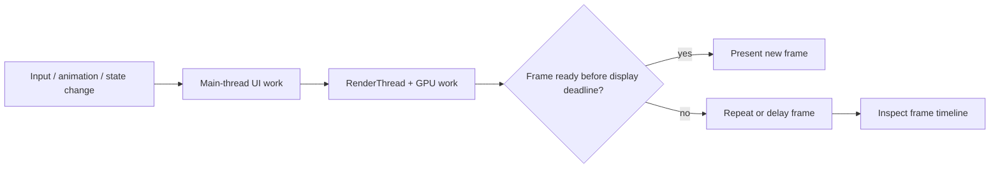

# Jank (Dropped Frames)

## Overview

"Jank" is the colloquial term for dropped frames during UI rendering. It manifests as stuttering animations, delayed scroll responses, and an overall feeling that the app is "cheap" or "laggy."

To a user, Jank is frustrating. To a Staff Engineer, Jank is a mathematical failure to meet the 16.6-millisecond deadline. 

Android devices attempt to draw the screen 60 times per second (60Hz), or increasingly, 120 times per second (120Hz). This means the Main Thread has exactly **16.6ms** (or **8.3ms** on 120Hz screens) to execute all layout, measurement, and drawing calculations for the current frame. If the Main Thread takes 17ms, the OS misses the display refresh window, the previous frame stays on the screen, and the user perceives a stutter.

## Why It Matters

Jank directly impacts user retention and revenue. E-commerce companies have repeatedly proven that a stuttering checkout scroll reduces conversion rates.

Furthermore, Jank is cumulative. If your `RecyclerView` item takes 14ms to bind, it "works" technically. But if the OS happens to trigger a Garbage Collection event that takes 3ms during that specific frame, you hit 17ms and drop a frame. A Staff Engineer architects the UI to bind in 2ms, leaving a massive buffer for OS interruptions.

## Historical Context

- **Pre-Android 4.1:** Android was notoriously laggy compared to iOS. UI rendering was not synchronized with the hardware display refresh rate.
- **Android 4.1 (Jelly Bean):** Google introduced "Project Butter" and **VSYNC** (Vertical Synchronization). VSYNC is a hardware heartbeat. The display hardware pings the Android OS every 16.6ms: *"I am ready for the next frame."*
- **Android 5.0 (Lollipop):** Introduced the `RenderThread`. Previously, the Main Thread had to do both UI logic (clicks) and talk to the GPU (OpenGL). The `RenderThread` offloaded the actual GPU communication, allowing the Main Thread to start working on Frame 2 while the `RenderThread` sent Frame 1 to the GPU.
- **Modern Jetpack Compose:** Completely altered how Jank is measured. In XML, Jank was caused by deep layout hierarchies (`RelativeLayout` inside `LinearLayout`). In Compose, Jank is caused by excessive "Recomposition" (running Kotlin functions too many times).

## First Principles



Jank is a missed presentation deadline, not merely a slow function. Diagnose the exact frame across main-thread, rendering, GPU, and system scheduling evidence.

To eliminate Jank, you must understand the Android Rendering Pipeline:

1.  **Input/Animation:** The OS processes touch events or animation ticks.
2.  **Measure:** The OS calculates *how big* every UI element needs to be.
3.  **Layout:** The OS calculates *where* every UI element goes on the X/Y axis.
4.  **Draw:** The UI elements generate drawing commands (DisplayLists).
5.  **Sync/Render:** The Main Thread passes the DisplayLists to the `RenderThread`, which converts them into GPU commands (OpenGL/Vulkan) and swaps the buffer to the screen.

All of this must happen in `< 16.6ms`.

## Mental Model

Think of rendering the screen as an **Assembly Line Factory**.
- A truck arrives exactly every 16 minutes to pick up a box of parts (VSYNC).
- If the workers take 15 minutes to pack the box, they load it on the truck, take a 1-minute break, and start the next box. The factory runs smoothly.
- If the workers take 17 minutes to pack the box, the truck has already left empty. The workers must wait for the *next* truck 16 minutes later. The recipient misses a delivery (Dropped Frame).

## Internal Mechanics (Jetpack Compose)

In legacy XML, Jank was solved by flattening the view hierarchy using `ConstraintLayout`. 
In Compose, Jank is solved by understanding **State Reads**.

Compose operates in three phases:
1.  **Composition:** What UI to show (Runs your `@Composable` functions).
2.  **Layout:** Where to put it.
3.  **Draw:** How to render it to the canvas.

If a piece of state changes (e.g., `scrollOffset`), Compose tries to figure out which of the three phases it needs to re-run.

### The Jank Trap (Reading State too High)

```kotlin
// BAD: State is read in the Composition phase
@Composable
fun BadScrollEffect(scrollState: ScrollState) {
    // We read scrollState.value directly. 
    // Every time the user scrolls 1 pixel, this entire function Recomposes!
    val offset = scrollState.value 
    
    Box(modifier = Modifier.offset(y = offset.dp)) {
        HeavyImage()
    }
}
```

If the user scrolls at 60fps, Compose will re-run the `HeavyImage` function 60 times a second. The CPU spikes, you breach the 16.6ms limit, and the scroll janks.

### The Staff Fix (Deferring State Reads)

```kotlin
// GOOD: State is read in the Layout/Draw phase
@Composable
fun GoodScrollEffect(scrollState: ScrollState) {
    // We pass a LAMBDA to the modifier. 
    // We DO NOT read scrollState.value in the Composition phase.
    Box(
        modifier = Modifier.offset { 
            // This lambda only runs during the Layout phase!
            // Composition is completely skipped during scrolling.
            IntOffset(x = 0, y = scrollState.value) 
        }
    ) {
        HeavyImage()
    }
}
```

## Production Example

**The "Unstable" Data Class**

A massive source of Jank in Compose is when a parent recomposes, and Compose attempts to skip recomposing the children to save time. Compose checks: *"Did the inputs to this child change?"*

```kotlin
// 1. You fetch this from the network
data class User(val name: String, val tags: List<String>)

// 2. You pass it to a UI component
@Composable
fun UserProfile(user: User) { ... }
```

If the parent recomposes, Compose looks at `user.tags`. `List` is an interface. Compose cannot guarantee that the `List` hasn't been mutated by another thread (it might be an `ArrayList` under the hood). Because Compose cannot prove the `List` is immutable, it marks the `User` class as **Unstable**.

When a class is Unstable, Compose *always* recomposes the `UserProfile` function, even if the data didn't change at all. If `UserProfile` is complex, you drop frames.

**The Fix:**
You must use immutable collections (like `kotlinx.collections.immutable.ImmutableList`) or annotate the class with `@Stable` or `@Immutable` to promise the compiler it won't change.

## Tradeoffs

**LazyColumn vs Column (XML RecyclerView vs ScrollView)**

- **`Column` (with `verticalScroll`):** Instantiates and measures *every single child* immediately.
    - *Pros:* Instant scrolling once rendered. Great for 10-20 items.
    - *Cons:* If you pass 1000 items into a `Column`, the Main Thread will freeze for 2 seconds trying to render items the user can't even see.
- **`LazyColumn`:** Only instantiates the items currently visible on the screen.
    - *Pros:* Infinite items without crashing.
    - *Cons:* It has to compose new items *just in time* as the user scrolls. If the item takes 10ms to compose, scrolling will jank.

*Staff Note:* In a `LazyColumn`, always provide a `key` to the `items()` block. If you don't, and you delete item #2, Compose might recompose items #3 through #1000 because it lost track of their identity.

## Failure Modes

- **Overdraw:**
  Drawing a pixel is expensive. If you draw a white background on the Activity, a gray background on the Fragment, a white background on the Card, and a white background on the Image... the GPU paints the exact same pixel 4 times per frame. This is "Overdraw."
  *(Fix: Enable "Debug GPU Overdraw" in Developer Options. Your screen should be blue/green. If it is deep red, you are dropping frames due to painting useless pixels).*
- **Garbage Collection (GC) Thrashing:**
  If you allocate a new `String` or `Rect` object inside the `onDraw` method of a custom view, or inside a tight `@Composable` loop, you will create 10,000 objects per second. The JVM will panic and trigger a "Stop-The-World" Garbage Collection to clean up RAM. The Main Thread is physically halted for 5-10ms. You instantly drop a frame.
  *(Fix: Never allocate objects inside draw loops or tight scroll listeners. Pre-allocate and reuse them).*
- **Testing in Debug Mode:**
  Compose Debug builds perform drastically more validation checks than Release builds. A scroll that janks terribly in Debug might be buttery smooth in Release.
  *(Fix: Never profile Jank on a Debug build. You must compile an APK with `buildTypes { release { debuggable true } }` or use the official `Macrobenchmark` library).*

## Staff Engineer Thinking

When reviewing code for Jank, a Staff engineer uses metrics, not feelings.

1.  **Macrobenchmark:** I enforce CI pipelines that run `Macrobenchmark` tests on physical devices in the cloud (Firebase Test Lab). These tests literally measure the 99th percentile frame times (`P99 FrameDuration`) of a scroll operation. If a PR increases the P99 time from 12ms to 18ms, the PR is automatically rejected.
2.  **Systrace / Perfetto:** When Jank is reported in production, I do not guess. I use `Perfetto` to capture a trace. Perfetto provides a visual timeline of the 16.6ms window. I can see exactly which function (Measure, Layout, or a random GC event) breached the deadline.
3.  **The "Release" Rule:** I frequently remind developers that R8 (ProGuard) strips dead code and inline functions. R8 optimization is required to hit 60fps in complex Compose apps.

### Jank as an SLI

Jank should be owned per critical screen, not averaged across the whole app.

| Screen class | Suggested gate | Action |
|---|---|---|
| Checkout/payment | p95 frame duration and frozen frames cannot regress | Halt rollout or disable the new UI path |
| Feed/search results | Scroll jank budget per device tier | Hold rollout; reduce composition/bind cost |
| Media/camera/map | Surface-specific frame metrics | Feature-owner triage; use device allowlist if needed |
| Settings/static screens | Very low tolerance | Fix in normal PR flow; should rarely need incident response |

CI macrobenchmarks catch deterministic regressions. Production telemetry catches device/OEM-specific regressions. A Staff engineer needs both: CI protects the main path, and production protects the long tail.

## Common Misconceptions

- **"My phone has a 120Hz screen, so Jank is less noticeable."** The opposite is true. On a 120Hz screen, the deadline is 8.3ms. If you miss it, the frame drops. Because the user is accustomed to extreme smoothness, a single stutter on a 120Hz display is jarringly obvious compared to a 60Hz display.
- **"Coroutines fix Jank because they run in the background."** Coroutines fix *ANRs* (5-second freezes). If you launch a Coroutine on `Dispatchers.Main` to do a heavy mathematical calculation, it will still block the Main Thread and cause Jank.

## Probing Questions

1.  What is the mathematical significance of the 16.6ms deadline in Android UI rendering?
2.  Explain the concept of VSYNC and how it prevents "screen tearing" and regulates frame rendering.
3.  In Jetpack Compose, what are the three distinct phases of rendering, and why is it important to know which phase you are triggering?
4.  Why does reading a `ScrollState` value directly inside a `@Composable` function body cause severe Jank? How do you fix it?
5.  What does it mean for a Compose data class to be marked as "Unstable," and how does a standard Kotlin `List` trigger this?
6.  Explain "Garbage Collection Thrashing" and why instantiating objects inside an `onDraw` method guarantees dropped frames.
7.  What is "Overdraw," and how can you use Developer Options on your physical device to detect it?
8.  Why is it fundamentally incorrect to profile UI performance (Jank) using a "Debug" APK build?
9.  How does the `key` parameter in a Compose `LazyColumn` prevent unnecessary recompositions when items are added or removed?
10. Describe the difference between the impact of a 200ms Main Thread blockage (Jank) versus a 5000ms Main Thread blockage (ANR).

## Answer Key

1. **What is the mathematical significance of the 16.6ms deadline in Android UI rendering?**
   Android devices traditionally refresh at 60Hz. 1000 milliseconds / 60 frames = 16.6 milliseconds per frame. The OS must complete all Measure, Layout, and Draw calculations within this window, or it drops the frame.
2. **Explain the concept of VSYNC and how it prevents "screen tearing" and regulates frame rendering.**
   VSYNC (Vertical Synchronization) is a hardware signal sent periodically by the display. It tells the OS to swap the rendered buffer to the screen and triggers the start of the next 16.6ms frame calculation, ensuring UI updates stay perfectly in rhythm with the hardware.
3. **In Jetpack Compose, what are the three distinct phases of rendering, and why is it important to know which phase you are triggering?**
   Composition (what to show), Layout (where to put it), and Draw (how to render it). Knowing which phase you trigger allows you to skip expensive phases (like Composition) for frequent updates (like scrolling) by reading state in the Layout or Draw phase.
4. **Why does reading a `ScrollState` value directly inside a `@Composable` function body cause severe Jank? How do you fix it?**
   Reading it directly causes the entire Composable function to re-run (Recomposition) every time the scroll changes by 1 pixel. Fix it by deferring the read to the Layout phase by passing a lambda to a Modifier (e.g., `Modifier.offset { ... }`).
5. **What does it mean for a Compose data class to be marked as "Unstable," and how does a standard Kotlin `List` trigger this?**
   An Unstable class cannot be proven immutable by the Compose compiler. Because `List` is an interface, it could be a mutable `ArrayList` under the hood. Compose plays it safe and forces recomposition every time, causing Jank.
6. **Explain "Garbage Collection Thrashing" and why instantiating objects inside an `onDraw` method guarantees dropped frames.**
   Creating objects in a tight loop (like `onDraw` called 60 times a second) rapidly fills memory, forcing the Garbage Collector to constantly run. "Stop-the-world" GC pauses the Main Thread, blowing past the 16.6ms deadline.
7. **What is "Overdraw," and how can you use Developer Options on your physical device to detect it?**
   Overdraw happens when the GPU paints the same pixel multiple times per frame (e.g., stacked backgrounds). Enable "Debug GPU Overdraw" in Developer Options; areas painted dark red indicate heavy, wasteful rendering.
8. **Why is it fundamentally incorrect to profile UI performance (Jank) using a "Debug" APK build?**
   Debug builds disable R8 (ProGuard) optimizations, skip dead code stripping, and contain heavy internal validation checks (especially in Compose), causing artificial Jank that will not exist in production.
9. **How does the `key` parameter in a Compose `LazyColumn` prevent unnecessary recompositions when items are added or removed?**
   By default, Compose uses positional indexing. If an item is added at the top, every item shifts and recomposes. The `key` parameter provides a stable unique identity, allowing Compose to intelligently move items without recomposing them.
10. **Describe the difference between the impact of a 200ms Main Thread blockage (Jank) versus a 5000ms Main Thread blockage (ANR).**
    A 200ms blockage causes severe Jank (dropping roughly 12 frames), resulting in a visual stutter. A 5000ms blockage triggers an ANR (Application Not Responding), prompting the OS to freeze the app and show a force-close dialog.

## Further Reading

- [`anrs.md`](anrs.md) — What happens when Jank gets so bad it triggers an OS-level crash.
- [`baseline-profiles.md`](baseline-profiles.md) — How to pre-compile Compose code to eliminate startup Jank.
- [Android Developers: Inspect CPU Activity with Systrace](https://developer.android.com/topic/performance/tracing)
