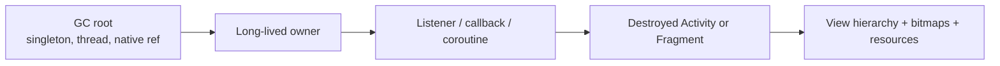

# Memory Management and Leaks

## Overview

In the Java/Kotlin ecosystem, memory management is handled by the Garbage Collector (GC). You do not manually `malloc()` or `free()` memory like you do in C/C++. 

However, a Staff Android Engineer knows that the GC is not magic. It relies on **Reachability**. If an object in memory is no longer needed, but is still "reachable" via a chain of references leading back to a GC Root (like the Main Thread or a Static variable), the Garbage Collector is strictly forbidden from destroying it.

An unintended reachable object is a leak. Retained objects can increase managed, native and graphics pressure; the runtime can throw OutOfMemoryError on allocation failure, while the system may separately kill a process under memory pressure.

## Why It Matters

Android devices differ in managed heap limits, native/graphics allocations and system memory pressure. A managed heap maximum is not a hard cap on all process RAM; inspect the relevant allocation category and device budget.

The retained cost depends on the actual graph. For illustration, six distinct retained 40MB graphs would add roughly 240MB, but neither a 256MB managed budget nor a fixed leak-to-crash count applies to every device or bitmap allocation.

An app with memory leaks is a ticking time bomb.

## Historical Context

- **Dalvik (Pre-Android 5.0):** The original Android runtime. Its Garbage Collector was famously slow and "Stop-The-World" (it froze the entire app to clean up memory), leading to massive [Jank](jank.md) during fast allocations.
- **ART:** Concurrent GC performs substantial work concurrently but still has pause phases. It can reclaim unreachable objects; strongly reachable objects retained by an unintended owner remain live.
- **LeakCanary (2015):** Square released an open-source library that revolutionized Android memory debugging. It automatically detects leaked Activities/Fragments and dumps the heap, drawing a trace of exactly what is preventing the GC from deleting the object.

## First Principles

1.  **The Heap:** The pool of RAM where all your objects live.
2. **GC roots:** Runtime roots include thread stacks, static references and JNI roots. An active coroutine is not intrinsically a separate root; a live owner may retain its continuation and captures.
3.  **Reachability:** If the GC can draw a continuous line from a GC Root to an Object, the Object is reachable and cannot be deleted.
4.  **The Memory Leak:** An object that is conceptually useless to the user, but is still technically reachable from a GC Root.

## Mental Model

Think of memory management as a **Rock Climber (The Object) and a Rope (The Reference)**.
- The top of the cliff is the GC Root (The Main Thread).
- The rock climber wants to go home (be Garbage Collected).
- As long as the climber is tied to the rope, the Safety Crew (Garbage Collector) refuses to let them fall/leave.
- A **Memory Leak** is when the climber finishes their climb, takes off their harness, but someone tied the rope around their ankle. They are permanently stuck to the cliff face until the rope is cut.

## Internal Mechanics

### How an Activity Leaks



A leak is a live reference path from a GC root to an object whose lifecycle has ended. Fix the owner or registration boundary that retains the path rather than trying to force garbage collection.

An `Activity` is massive. It holds a reference to the `Context`, which holds the `Window`, which holds the View hierarchy.

```kotlin
// THE DISASTER: Leaking an Activity via a Background Thread
class ProfileActivity : AppCompatActivity() {

    override fun onCreate(savedInstanceState: Bundle?) {
        super.onCreate(savedInstanceState)
        
        // We start a background thread that runs for 10 minutes
        thread {
            Thread.sleep(10 * 60 * 1000) // Simulating a massive download
            
            // This inner lambda holds an IMPLICIT reference to 'this' (ProfileActivity)
            // so it can call updateUi().
            runOnUiThread { updateUi() }
        }
    }
}
```

1. The user opens `ProfileActivity`. The Thread starts.
2. The user presses the Back button. The `ProfileActivity` is destroyed. The user wants their RAM back.
3. The GC runs. It looks at `ProfileActivity`. It wants to delete it.
4. The GC sees the Background Thread is still running (it is a GC Root).
5. The Thread holds a reference to the Lambda.
6. The Lambda holds an implicit reference to `ProfileActivity`.
7. The GC says: *"ProfileActivity is reachable. I cannot delete it."*
8. The Activity, and its 40MB of Bitmaps, are permanently trapped in RAM for the next 10 minutes.

### The Staff Fix (Cancellation)

The solution is [Structured Concurrency](../architecture/structured-concurrency.md). You must cut the rope when the Activity dies.

```kotlin
class ProfileActivity : AppCompatActivity() {
    override fun onCreate(savedInstanceState: Bundle?) {
        super.onCreate(savedInstanceState)
        // lifecycleScope is automatically CANCELLED when the Activity dies.
        // It cuts the rope!
        lifecycleScope.launch {
            delay(10 * 60 * 1000) 
            updateUi() 
        }
    }
}
```

## Production Example

**The Static / Companion Object Leak**

A very common pattern in legacy codebases is keeping global caches using `static` variables (or `companion object` in Kotlin). 

```kotlin
// BAD
class UserCache {
    companion object {
        private val listeners = mutableListOf<Listener>()
        
        fun register(listener: Listener) {
            listeners.add(listener)
        }
    }
}

class DashboardFragment : Fragment(), Listener {
    override fun onViewCreated(view: View, savedInstanceState: Bundle?) {
        super.onViewCreated(view, savedInstanceState)
        UserCache.register(this) // The Fragment hands a rope to the Static Root
    }
    // We FORGOT to unregister in onDestroyView!
}
```

A process-lived listener list retains registered fragments until removed or the owner ends. Register/unregister at the matching lifecycle boundary; the retained graph and device pressure determine whether and when allocation fails.

Fix this example by pairing registration in `onViewCreated` with unregistration in `onDestroyView`. [Dependency injection](../data-and-di/dependency-injection.md) makes ownership explicit but a process-scoped injected listener list can retain the same fragment. A weak reference changes retention and delivery semantics; it does not replace a deliberate subscription lifetime.

## Tradeoffs

**Strong vs Weak References**

If you absolutely must hold a reference to an object, but you do not want to prevent it from being Garbage Collected, you can use a `WeakReference`.

```kotlin
class Cache {
    // If the GC needs RAM, it is allowed to delete the Context 
    // even if this Cache still holds a WeakReference to it!
    private var contextRef: WeakReference<Context>? = null
}
```

- **Tradeoff:** Weak References are often a "band-aid" for terrible architectural design. A Staff Engineer relies on tight, predictable lifecycles (`viewModelScope`, Jetpack components) rather than littering `WeakReference` throughout the codebase. If you need a `Context` outliving its scope, you should likely be injecting the Application Context via Hilt.

## Failure Modes

- **The Inner Class Trap:**
  An inner instance retains its outer instance. A long-lived owner that stores it beyond the intended lifecycle can retain that outer object; inspect the actual reference path.
  *(Fix: Avoid `inner class` unless absolutely necessary).*
- **The Context Cast:**
  Passing an `Activity` context into a repository constructor because the repository needs to access SharedPreferences or a database. The repository outlives the Activity, leaking the Activity.
  *(Fix: When a Singleton or Repository requires a `Context`, always pass `context.applicationContext`).*
- **Unregistered BroadcastReceivers:**
  A context-registered receiver must be unregistered at its intended boundary. AOSP LoadedApk.removeContextRegistrations reports leaked registrations and unregisters them during context cleanup, so do not claim permanent retention by a system-service Java reference after every Activity finish. Registration beyond the intended lifecycle can still retain app-side context until cleanup.

## Staff Engineer Thinking

When attacking an `OutOfMemoryError` spike in production, a Staff engineer focuses on the Heap:

1. **Leak diagnosis:** Use LeakCanary in debug to identify retained objects and their reference paths; coverage depends on exercised journeys and watched objects, not a fixed detection percentage.
2.  **Heap Dumps (.hprof):** When an OOM occurs in production, Crashlytics doesn't tell you *what* leaked, it just tells you that you ran out of memory. I pull an `.hprof` heap dump from a testing device and load it into Android Studio's Memory Profiler (or Eclipse MAT) to analyze the "Dominator Tree." This tells me exactly which object is holding 40% of the RAM.
3. **Bitmap budgets:** Pixel allocation and cache ownership can create substantial pressure. Since API 26 bitmap pixel data is in the native heap; managed heap limits are not total-process limits. Downsample and measure rather than promise immediate OOM for a given image.

## Common Misconceptions

- **"Kotlin doesn't have memory leaks because it has a Garbage Collector."** The GC only deletes *unreachable* objects. A memory leak in Java/Kotlin is a logic error where you keep a reference to an object you no longer need. The GC works perfectly; your code is at fault.
- **"System.gc() fixes memory leaks."** Calling `System.gc()` is a suggestion to the JVM. It does not force it. More importantly, if an object is reachable (a leak), `System.gc()` will *never* delete it. It only deletes unreachable objects.

## Probing Questions

1.  Explain the concept of "Reachability" and how it determines whether the Android Garbage Collector can destroy an object.
2.  Why is an `Activity` the most dangerous object to leak in the Android ecosystem? What does it hold in memory?
3.  Describe how an active, running background Thread acts as a GC Root and causes memory leaks.
4.  If a Singleton class requires access to `SharedPreferences`, why is it a critical error to pass it an `Activity` context? What should you pass instead?
5.  Explain the architectural flaw of using a Kotlin `companion object` to hold a list of callback listeners registered by Fragments.
6.  How does the `lifecycleScope` in Kotlin Coroutines natively solve the problem of leaking background tasks when an Activity is destroyed?
7.  What is a `WeakReference`, and how does its behavior differ from a standard (Strong) reference during a Garbage Collection cycle?
8.  Why does an `inner class` in Kotlin pose a significantly higher risk of causing a memory leak than a standard nested class?
9.  Describe the tool `LeakCanary`. How does it help teams prevent `OutOfMemoryError` crashes before releasing to production?
10. If an app crashes with an `OutOfMemoryError`, but `LeakCanary` reports zero leaked Activities, what other common memory structure is likely responsible for the crash? (Hint: Think about images).

## Answer Key

1. **Explain the concept of "Reachability" and how it determines whether the Android Garbage Collector can destroy an object.**
   An object is Reachable if there is a chain of references connecting it to a GC Root (like a running thread or a static variable). The GC is strictly forbidden from destroying reachable objects.
2. **Why is an `Activity` the most dangerous object to leak in the Android ecosystem? What does it hold in memory?**
   An Activity holds a reference to the Context, which holds the Window, which holds the entire View hierarchy, including massive, memory-heavy Bitmaps and resources. Leaking it instantly wastes a massive chunk of RAM.
3. **Describe how an active, running background Thread acts as a GC Root and causes memory leaks.**
   An active thread cannot be garbage collected. If the thread runs a task (like a lambda or Runnable) that holds an implicit reference to an Activity, the GC sees the Activity as reachable from the Thread, trapping it in memory.
4. **If a Singleton class requires access to `SharedPreferences`, why is it a critical error to pass it an `Activity` context? What should you pass instead?**
   A Singleton lives for the entire application lifecycle. If it holds an Activity context, that Activity can never be garbage collected. You should pass `context.applicationContext` instead.
5. **Explain the architectural flaw of using a Kotlin `companion object` to hold a list of callback listeners registered by Fragments.**
   A `companion object` acts as a static GC root. If Fragments add themselves to the list but fail to unregister in `onDestroyView`, the static list holds hard references to dead Fragments, leaking them permanently.
6. **How does the `lifecycleScope` in Kotlin Coroutines natively solve the problem of leaking background tasks when an Activity is destroyed?**
   lifecycleScope cancellation is cooperative. It stops cancellable work and runs cleanup; non-cooperative work and other owners can retain references. Release listeners/resources at their actual ownership boundary rather than assuming cancellation instantly reclaims every object.
7. **What is a `WeakReference`, and how does its behavior differ from a standard (Strong) reference during a Garbage Collection cycle?**
   A standard reference prevents garbage collection. A `WeakReference` does not. If an object is only reachable via WeakReferences, the GC will aggressively destroy the object and clear the reference to reclaim RAM.
8. **Why does an `inner class` in Kotlin pose a significantly higher risk of causing a memory leak than a standard nested class?**
   An inner instance retains its outer instance. If a longer-lived owner retains that inner instance beyond the outer lifecycle, it can cause a leak; merely passing it without retention does not.
9. **Describe the tool `LeakCanary`. How does it help teams prevent `OutOfMemoryError` crashes before releasing to production?**
   LeakCanary automatically watches for destroyed Activities and Fragments. If they persist in memory, it forces a heap dump, analyzes the Dominator Tree, and displays a notification with the exact reference chain causing the leak.
10. **If an app crashes with an `OutOfMemoryError`, but `LeakCanary` reports zero leaked Activities, what other common memory structure is likely responsible for the crash? (Hint: Think about images).**
     Large decoded images can create substantial native/process pressure (bitmap pixels are native-heap allocations since API 26). Actual failure depends on format, allocation, caches and device limits; distinguish this from a retained-object leak.

## Further Reading

- [`jank.md`](jank.md) — How Garbage Collection events (caused by bad memory management) pause the Main Thread and drop frames.
- [`process-death-and-state-restoration.md`](../architecture/process-death-and-state-restoration.md) — How the OS brutally kills apps that consume too much RAM.
- [Android Developers: Memory Management](https://developer.android.com/topic/performance/memory)

### Official verification references

- [Primary documentation or owning implementation](https://developer.android.com/reference/android/app/Activity)
- [Primary documentation or owning implementation](https://developer.android.com/reference/androidx/fragment/app/Fragment)
- [Primary documentation or owning implementation](https://developer.android.com/topic/performance/graphics/manage-memory)
- [Primary documentation or owning implementation](https://developer.android.com/topic/performance/memory-overview)
- [Primary documentation or owning implementation](https://kotlinlang.org/docs/cancellation-and-timeouts.html)
- [Primary documentation or owning implementation](https://raw.githubusercontent.com/aosp-mirror/platform_frameworks_base/master/core/java/android/app/LoadedApk.java)
- [Hilt component lifetimes](https://developer.android.com/training/dependency-injection/hilt-android)
