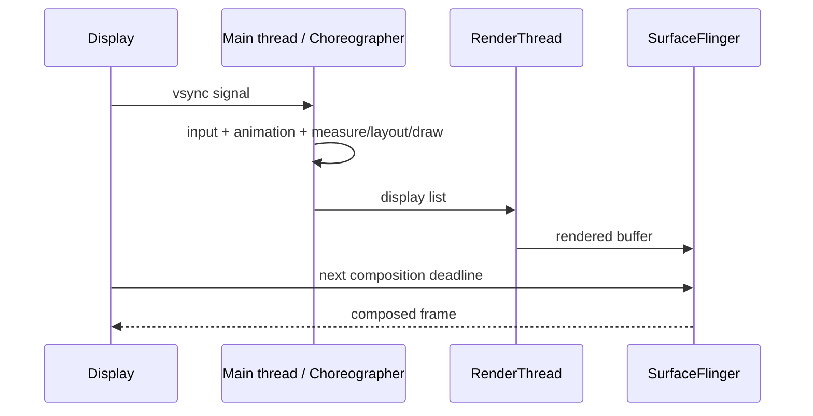

# Rendering — RenderThread, Skia, and the 16ms Budget

> Every Android frame is a deadline. At 60Hz, 16.67ms; at 90Hz, 11.1ms; at 120Hz, 8.3ms. Miss it and the user sees a stutter. The pipeline from `setText` to pixels involves the UI thread, the RenderThread, Skia, the GPU, the SurfaceFlinger, and finally the display. Staff-level mastery is being able to trace a jank report through every stage, knowing which work runs on which thread, and the differences between View and Compose rendering paths.

---

## The Rendering Pipeline (One Frame)

```mermaid
graph LR
  Vsync["Vsync<br/>display tick"] --> Input["Input<br/>handle touch"]
  Input --> Animate["Animations<br/>tick choreographer"]
  Animate --> Measure["Measure / Layout<br/>UI thread"]
  Measure --> Draw["Record draw commands<br/>UI thread"]
  Draw --> Sync["Sync display list<br/>to RenderThread"]
  Sync --> RT["RenderThread<br/>translate to GPU"]
  RT --> GPU["GPU executes<br/>OpenGL / Vulkan"]
  GPU --> SF["SurfaceFlinger<br/>composites layers"]
  SF --> Display[Display]
```



Six teams take part:

1. **UI thread (Choreographer)** — handles input, runs animations, measures/lays out the view tree, records drawing commands.
2. **RenderThread** — receives the draw commands (display list), translates them into Skia/HWUI calls.
3. **Skia** — Android's 2D graphics engine. Encodes draw operations into GPU commands.
4. **GPU** — executes the actual rasterization in parallel with the next frame's CPU work.
5. **SurfaceFlinger** — system service that takes finished buffers from every visible app/window and composites them into a single frame.
6. **Display** — receives the composed frame at vsync.

A "frame" budget must fit **input + animate + measure + layout + draw + render**. If any single phase blows past 16ms, the frame is dropped.

---

## The Three Phases the App Owns

### 1. Measure + Layout (UI thread)

For Views: recursive `onMeasure()` then `onLayout()` traversal of the entire view hierarchy whenever you mark it dirty (`requestLayout()`). Cost is roughly linear with hierarchy depth.

For Compose: a single layout pass per recomposition. Compose's layout is generally cheaper because:
- The compose tree is flatter than the View tree (fewer wrapper Views).
- Modifier-based layout lets Compose skip work for unchanged sub-trees.
- No `LinearLayout` weight passes (Compose's `weight` is computed differently).

When this phase is slow:
- View: nested `LinearLayout` with weights — multiple measure passes per frame.
- Compose: an `IntrinsicMeasureScope` lookup that recurses too deep.
- Either: `RecyclerView` / `LazyColumn` with expensive `onCreateViewHolder` / item Composable.

### 2. Draw (UI thread, recording phase)

The UI thread doesn't paint pixels — it records a **display list** of drawing commands (path/text/image/clip).

Display lists are recorded once per frame for each view or Composable, then handed to the RenderThread. Subsequent recompositions of unchanged sub-trees reuse cached display lists.

When this phase is slow:
- Custom `View.onDraw` allocating `Paint` / `Path` / `Rect` per call.
- Compose `Modifier.drawBehind` with non-stable parameters.
- Loading a `Bitmap` from disk inside `onDraw`.

### 3. RenderThread (async)

Created automatically by the framework. Translates the display list into GPU commands via Skia or HWUI (the legacy hardware-accelerated path). Runs in parallel with the next UI thread frame.

You can't directly schedule work on the RenderThread. But you can starve it:
- Massive draw command lists (10,000+ items in a frame).
- Hardware-unfriendly paths (paths with thousands of curve segments).
- Frequent `RenderEffect` / `BlurEffect` allocations.

---

## Skia — Android's 2D Engine

Skia is Google's open-source 2D graphics library, also used by Chrome, Flutter, and others. On Android, it's the backend for both View `Canvas` and Compose's `DrawScope`.

Key operations Skia performs:

| Operation | Cost on GPU |
|---|---|
| `drawRect` | Cheap (single quad) |
| `drawRoundRect` | Moderate (corner shaders) |
| `drawPath` (simple) | Cheap |
| `drawPath` (complex curves) | Expensive (many vertices) |
| `drawText` | Moderate (text atlas lookup; cached) |
| `drawBitmap` (sampled) | Cheap (single textured quad) |
| `drawBitmap` (filtered) | Moderate |
| `drawBitmap` (with `ColorFilter`) | Expensive (per-pixel shader) |
| `drawShadow` (View elevation) | Expensive (shadow render pass) |
| `BlurEffect` (RenderEffect) | Very expensive (multi-pass blur) |

These costs are GPU-side. Heavy ops won't necessarily block your UI thread — but they will block the RenderThread, which blocks the next frame.

---

## Compose vs Views — Different Pipelines

| Stage | View system | Compose |
|---|---|---|
| Hierarchy | XML inflated to View tree | `@Composable` tree built dynamically |
| Re-measure trigger | `requestLayout()` | Recomposition + `Layout` invalidation |
| Re-draw trigger | `invalidate()` | Composition re-runs |
| Skip work | Memoization via `invalidate(Rect)` | Stable params + skippable functions |
| Display list cache | Per View | Per Composable group |
| Final paint backend | Skia via HWUI | Skia (direct) |

Compose's runtime + slot table do more bookkeeping but enable finer-grained skipping. Net: a well-written Compose screen typically runs measure+layout+draw in less than half the time of an equivalent View hierarchy.

Compose's leverage: **stable parameters skip composition → skip layout → skip draw**. View's leverage: **selective `invalidate(Rect)` to dirty only a small region**.

Both can be fast. Both can be janky if abused.

---

## Vsync and Choreographer

`Choreographer` is the framework class that synchronizes UI work with the display refresh rate.



Main-thread UI work, RenderThread execution, and system composition must collectively meet the display deadline; missing any stage can present an older frame even when the others are fast.

A frame's CPU work targets *finishing before vsync N+1* so it ships on vsync N+2. If the UI thread takes 20ms, the RenderThread is delayed, and vsync N+1 ships the *previous* frame again — visible stutter.

Higher refresh rates (90/120Hz) cut the budget. A `RecyclerView` row Composable that's fast at 60Hz can drop frames at 120Hz.

---

## Measuring Rendering — Tools

### 1. Android Studio CPU Profiler

`View > Tool Windows > Profiler > CPU`. Record a trace, look for `Choreographer#doFrame` calls. Frames over 16ms are flagged.

What to look for:
- `doFrame` durations exceeding 16ms.
- `traversal` phase (measure/layout) > 8ms — usually means deep View hierarchy or expensive Compose layout.
- `draw` phase > 8ms — usually means complex `onDraw` or `drawBehind`.

### 2. GPU Profiler ("Profile GPU Rendering")

Developer Options → "Profile GPU Rendering" → "On screen as bars."

Each frame becomes a vertical bar split by phase (blue = misc/input, green = animation, dark blue = measure/layout, red = draw, orange = sync, light green = swap buffers). Red horizontal line = 16ms target. Bars over the line = dropped frames.

Read the color distribution to identify which phase dominates.

### 3. `dumpsys gfxinfo`

```bash
adb shell dumpsys gfxinfo com.example.app framestats
```

Outputs the last N frames with per-stage timing. Useful for CI and reproducible measurements.

### 4. Compose `LayoutTraceable` / Compose Compiler Metrics

For Compose, the compiler metrics file (`<module>-composables.txt`) tells you which Composables are non-skippable. See [`../compose/stability.md`](../compose/stability.md).

### 5. Perfetto / systrace

Most powerful tool. Capture a trace; the timeline shows UI thread, RenderThread, and GPU work overlapping.

```bash
adb shell perfetto -o /data/misc/perfetto-traces/trace.pftrace -t 10s -c - <<EOF
buffers { size_kb: 32768 }
data_sources { config { name: "linux.ftrace" ftrace_config { ftrace_events: "sched_switch" } } }
data_sources { config { name: "android.gpu.memory" } }
EOF
```

Or use `adb shell systrace` (deprecated but still works) for simpler captures.

---

## Common Rendering Bottlenecks

### 1. Bitmap loading on UI thread

```kotlin
// BAD — decodes and uploads to texture on UI thread
imageView.setImageBitmap(BitmapFactory.decodeResource(resources, R.drawable.banner))
```

Decoding a 1080x1920 bitmap on the UI thread = ~30ms = dropped frames.

Fix: use Coil/Glide which decode on a background dispatcher.

### 2. View hierarchy depth

Each nested `LinearLayout` adds measure passes. A 10-deep hierarchy can take 12ms just to measure.

Fix: flatten to `ConstraintLayout` (which can replace 5+ nested layouts with one). Or migrate to Compose.

### 3. Custom view allocation in `onDraw`

```kotlin
override fun onDraw(canvas: Canvas) {
    val paint = Paint().apply { color = Color.RED }   // ❌ new Paint every frame
    canvas.drawRect(0f, 0f, width.toFloat(), height.toFloat(), paint)
}
```

Allocations per frame trigger GC, GC pauses, dropped frames.

Fix: hoist allocations into `init` or fields.

```kotlin
private val paint = Paint().apply { color = Color.RED }
override fun onDraw(canvas: Canvas) {
    canvas.drawRect(0f, 0f, width.toFloat(), height.toFloat(), paint)
}
```

### 4. Compose recomposition cascade

Unstable parameter on a root Composable → entire screen re-runs every change.

Fix: see [`../compose/stability.md`](../compose/stability.md).

### 5. Bitmap memory pressure

A full-screen image at `ARGB_8888` is ~8 MB. Loading three of them = 24 MB + decoding overhead = GC pressure.

Fix: use `Bitmap.Config.HARDWARE` (Android 8+), Coil/Glide downsampling, image sizing matched to display.

### 6. Overdraw

When transparent layers stack, the GPU draws the same pixel multiple times. Default = 1x; bad screen = 4–6x overdraw.

Developer Options → "Debug GPU Overdraw" → shows colored overlay. Blue = OK, green = 2x, red = 3x+.

Fixes:
- Remove transparent backgrounds on full-screen containers.
- Use `clipToOutline = true` for rounded corner backgrounds (skips below-corner drawing).
- Remove `android:windowBackground` if your root view fully paints.

### 7. Hardware shadows

`View.elevation > 0` triggers an extra render pass for the shadow shape.

Fix: limit shadows to small UI elements; for full-screen "elevated" looks, use a static drawable.

### 8. Heavy `drawBehind` / `Modifier.drawWithCache` in Compose

```kotlin
Modifier.drawBehind {
    drawPath(complexPath, Brush.radialGradient(...))  // ❌ allocates every frame
}
```

Fix: use `Modifier.drawWithCache { onDrawBehind { ... } }` to cache the `Path` and `Brush` between recompositions.

---

## RecyclerView / LazyColumn — Where Rendering Matters Most

Lists are the most common screen pattern, and the most common jank source.

### RecyclerView

- `onCreateViewHolder` runs once per item type — cheap.
- `onBindViewHolder` runs every time a row scrolls into view — must be fast.
- Use `setHasFixedSize(true)` when items don't change in size — skips measure pass.
- `DiffUtil` minimizes rebinding when the list changes.
- `RecycledViewPool` shares ViewHolders across sibling RecyclerViews.

### LazyColumn

```kotlin
LazyColumn {
    items(items, key = { it.id }, contentType = { it.type }) { item ->
        // The composable for each row
    }
}
```

- **`key`** — stable identity. Without it, scroll re-binds every visible row whenever the list changes.
- **`contentType`** — type-discriminator for item recycling. Without it, Compose treats every row as a different type and can't reuse Composables.

Both `key` and `contentType` are the single biggest perf wins for `LazyColumn`. Always provide them when the list has structure.

### Common list-perf checks

| Check | View | Compose |
|---|---|---|
| Stable item IDs | `DiffUtil.ItemCallback` `areItemsTheSame` returns equal | `key = { it.id }` |
| Content type bucketing | `getItemViewType` | `contentType = { it.type }` |
| Pre-allocated holders | `setItemViewCacheSize`, `RecycledViewPool` | Compose handles internally |
| Bind work cost | Profile `onBindViewHolder` | Profile row Composable |
| Image loading | Coil/Glide with placeholder | Same — also cancel via `key` |

---

## SurfaceFlinger and Layers

Each visible window (status bar, navigation bar, app, soft keyboard) is a separate `Surface` (a buffer). SurfaceFlinger composes them every frame into a final image.

Performance implications:
- Each `Surface` = one allocation. Too many surfaces (e.g., heavy `SurfaceView` use) = SurfaceFlinger CPU spike.
- `TextureView` paints to a regular layer (cheaper than `SurfaceView` but trickier to animate).
- `SurfaceView`s with `setZOrderOnTop(true)` can sometimes bypass SurfaceFlinger compositing, but break transparency.

Most apps don't need to think about layers explicitly. If you're rendering video or AR content, you do.

---

## Vulkan vs OpenGL ES

Android historically used OpenGL ES; modern devices increasingly use Vulkan as the Skia backend (`ro.hwui.use_vulkan = true`).

Vulkan: lower CPU overhead, better multi-threading. Skia's Vulkan backend is now default on most Android 12+ devices.

You don't choose this — the framework does. But know:
- Vulkan reduces per-frame CPU cost by ~5–15%.
- Some custom rendering code (custom OpenGL via `GLSurfaceView`) won't get the Vulkan benefit.
- Bug reports involving "GPU corruption" sometimes stem from Vulkan/OpenGL switching.

---

## Real Android Patterns

### Pattern 1: Custom view that allocates correctly

```kotlin
class WaveformView(context: Context) : View(context) {
    private val paint = Paint().apply {
        color = Color.BLUE
        style = Paint.Style.STROKE
        strokeWidth = 2f
        isAntiAlias = true
    }
    private val path = Path()
    private val rect = RectF()

    override fun onDraw(canvas: Canvas) {
        path.reset()                    // reset existing Path (cheap)
        rect.set(0f, 0f, width.toFloat(), height.toFloat())
        // ... compute path ...
        canvas.drawPath(path, paint)
    }
}
```

Zero allocations in `onDraw`. Path/Paint/RectF preallocated.

### Pattern 2: Compose `drawWithCache`

```kotlin
@Composable
fun GradientBox(modifier: Modifier = Modifier) {
    Box(
        modifier = modifier.drawWithCache {
            val brush = Brush.linearGradient(
                colors = listOf(Color.Red, Color.Blue),
            )
            onDrawBehind {
                drawRect(brush)
            }
        }
    )
}
```

`Brush` allocated once per size change. `drawRect` called per frame, but the brush is cached.

### Pattern 3: Image loading with size constraints

```kotlin
AsyncImage(
    model = ImageRequest.Builder(LocalContext.current)
        .data(imageUrl)
        .size(Size.ORIGINAL)        // or specific size to downsample
        .crossfade(true)
        .build(),
    contentDescription = null,
)
```

Coil downsamples to the displayed size. A 4K image displayed at 200×200 dp loads ~200×200 pixels into memory, not 4K.

### Pattern 4: LazyColumn with keys + contentType

```kotlin
sealed interface FeedItem {
    data class Post(val id: String, val text: String) : FeedItem
    data class Ad(val id: String, val campaignId: String) : FeedItem
}

LazyColumn {
    items(feed,
        key = { it.id() },
        contentType = { it::class.simpleName },
    ) { item ->
        when (item) {
            is FeedItem.Post -> PostRow(item)
            is FeedItem.Ad -> AdRow(item)
        }
    }
}
```

Keys = stable scrolling. ContentType = Post and Ad Composables are recycled separately.

### Pattern 5: Pre-allocate Paint in Compose `drawBehind`

```kotlin
@Composable
fun Underline(color: Color, modifier: Modifier = Modifier) {
    val brush = remember(color) { SolidColor(color) }   // hoist allocation
    Box(modifier = modifier.drawBehind {
        drawLine(
            brush = brush,
            start = Offset(0f, size.height),
            end = Offset(size.width, size.height),
            strokeWidth = 2f,
        )
    })
}
```

`remember(color) { SolidColor(color) }` allocates once per color change, not per recomposition.

---

## Failure Modes

| Symptom | Cause | Fix |
|---|---|---|
| Scrolling stutters at 60fps | List items have non-trivial measure/draw | Profile bind; simplify; cache; use `contentType` |
| Stutter at 90/120Hz but not 60Hz | UI thread takes 12–15ms; OK at 60, late at 90 | Optimize layout, draw; defer non-critical work |
| Initial frame after navigation drops | First Composable build does heavy work | Pre-warm; use `Modifier.layout` to defer |
| Bitmap-heavy screen GC-spikes | Decoding on UI thread or loading too-large bitmaps | Coil/Glide with sized requests |
| Translucent overlay causes 3x overdraw | Layered backgrounds | Combine; remove `windowBackground`; use `clipToOutline` |
| Blur effect tanks framerate | `RenderEffect.createBlurEffect` is GPU-expensive | Use only on small areas; static blur via baked bitmap |
| Heavy custom `View.onDraw` allocates per frame | `new Paint()` in `onDraw` | Hoist allocations |
| Compose recomposes whole screen on small change | Stability issue | See [`../compose/stability.md`](../compose/stability.md) |
| `RecyclerView` rebuilds all visible rows on data change | No `DiffUtil` or wrong equals | Implement `DiffUtil.ItemCallback` carefully |
| `LazyColumn` re-binds visible items on insert at top | No `key = { ... }` | Provide stable keys |
| Drop frames around image-heavy screens | Bitmap memory pressure | Downsample; `Config.HARDWARE`; LRU cache |
| Shadow rendering dropping frames | Multiple `elevation` views | Limit elevated views; pre-bake shadows as 9-patch |
| Compose `drawBehind` slow | New brush/path per recomposition | `drawWithCache` |
| SurfaceFlinger reports many transparent regions | Layered windows | Reduce surface count |
| Vulkan backend crashes on older devices | Driver bugs | Add a fallback path; profile per-device |
| ANR triggered during scrolling | Bind work blocks UI thread | Defer expensive work to `viewModelScope`; cache in repo |

---

## Common Pitfalls

- **Reading `width` / `height` in `onDraw` instead of caching.** Cheap individually; expensive across thousands of calls per second. Hoist.
- **`Bitmap.createScaledBitmap` per frame.** Allocates new bitmaps. Use a pool or precompute.
- **`Choreographer.postFrameCallback` for animation.** Often abused — use `ValueAnimator` or Compose `animate*AsState` instead; both honor vsync.
- **`View.setLayerType(LAYER_TYPE_HARDWARE, null)` everywhere.** Forces a separate render pass; useful only for animation-time stability.
- **Putting heavy logic in `onSizeChanged`.** Fires during layout; cascades to RenderThread.
- **`RecyclerView.notifyDataSetChanged()` instead of DiffUtil.** Full re-bind of all visible items.
- **Compose `derivedStateOf` not wrapped in `remember`.** Recomputed every recomposition.
- **`AnimatedContent` for instant transitions.** Allocates new sub-trees; use `Crossfade` for simpler cases or a state-driven `if/else`.
- **Heavy work in `LaunchedEffect(Unit) {}`.** Runs in coroutine but the *start* of the effect is on the main dispatcher by default; long-running work needs `Dispatchers.IO`.
- **Multiple `RecyclerView`s on one screen without `setRecycledViewPool` shared.** Each maintains its own holder pool; double the memory.

---

## Probing Questions

1. Walk through the rendering pipeline for one frame. Which work is on the UI thread, which is on the RenderThread, which is on the GPU?
2. What does `Choreographer` do? When does `doFrame` fire?
3. Display list — what is it, and when is it cached vs re-recorded?
4. Compose vs View — for a typical screen, which is faster, and *why* (not just "Compose is faster")?
5. `setHasFixedSize(true)` on RecyclerView — what does it skip and when is it safe to enable?
6. `key = { it.id }` on `LazyColumn` — what specifically does it prevent?
7. Overdraw at 4x — what's the GPU cost, and how do you investigate?
8. Bitmap full-screen ARGB_8888 = ~8 MB. How do you load it without blocking the UI thread?
9. `Modifier.drawWithCache` vs `Modifier.drawBehind` — when each? What does the former save?
10. Vsync timing: UI work took 20ms. What frame does the user see, and when?
11. SurfaceFlinger — what work does it do, and how does it interact with your app's main RenderThread output?
12. Profile a janky list scroll with Perfetto. What's the first thing you look at?

---

## Further Reading

- [`jank.md`](jank.md) — jank diagnosis canonical.
- [`baseline-profiles.md`](baseline-profiles.md) — AOT-compile hot paths.
- [`memory-management-and-leaks.md`](memory-management-and-leaks.md) — Bitmap memory pressure.
- [`startup.md`](startup.md) — first-frame rendering.
- [`anrs.md`](anrs.md) — when UI thread blocks too long.
- [`../compose/compose-runtime.md`](../compose/compose-runtime.md) — Compose pipeline internals.
- [`../compose/stability.md`](../compose/stability.md) — recomposition skipping.
- [`../compose/modifiers-and-layout.md`](../compose/modifiers-and-layout.md) — modifier layout phase.
- [`../../kotlin/runtime-and-jvm/memory-model.md`](../../kotlin/runtime-and-jvm/memory-model.md) — heap allocations in hot paths.
- [Android Developers — Slow rendering](https://developer.android.com/topic/performance/vitals/render) — official.
- [Android Developers — Better performance through threading](https://developer.android.com/topic/performance/threads) — official.
- [Romain Guy — Android graphics & UI](https://www.curious-creature.com/) — engineer's blog.
- [Skia documentation](https://skia.org/) — 2D engine reference.
- [Perfetto](https://perfetto.dev/) — system tracing.
- [Profile GPU rendering](https://developer.android.com/topic/performance/rendering/profile-gpu) — official guide.
