# App Startup — Cold, Warm, Hot and the First Frame

> First impressions are measured in milliseconds. Cold start under 500ms feels instant; over 1.5s feels broken. Every app's launch involves the Zygote fork, `Application.onCreate`, Activity lifecycle, layout inflation, the first frame draw, and the first network call. Staff-level mastery is breaking this chain into measurable phases, knowing which work belongs where, and using Baseline Profiles + Macrobenchmark to lock in your wins.

---

## Three Startup Types

| Type | When | What Android does | Target time |
|---|---|---|---|
| **Cold** | App process not running | Fork Zygote → load classes → `Application.onCreate` → `Activity.onCreate` → first frame | < 500ms |
| **Warm** | Process running but Activity destroyed | `Activity.onCreate` → first frame | < 200ms |
| **Hot** | Activity still alive in background | `Activity.onStart/Resume` → frame | < 50ms |

Cold start is what users notice. It's also where staff-level engineering matters most — warm/hot are mostly framework-driven.

A "cold" start happens after:
- App process killed (OOM, swiped from recents, Doze).
- First launch after install / update.
- Reboot.

Google Play Console reports cold-start time at the 90th percentile. Anything above ~1500ms shows up as a "slow start" Vitals alert.

---

## The Cold-Start Pipeline

```mermaid
graph LR
  Tap[User taps icon] --> Zygote["Zygote fork<br/>kernel"]
  Zygote --> ClassLoad["Load app classes<br/>DEX"]
  ClassLoad --> App["Application.onCreate<br/>UI thread"]
  App --> ActStart["Activity.onCreate<br/>UI thread"]
  ActStart --> Inflate[Layout inflate / Compose setup]
  Inflate --> Measure[Measure / Layout / Draw]
  Measure --> FirstFrame["First frame<br/>visible to user"]
  FirstFrame --> NetworkFetch[First network calls / DB queries]
```



| Stage | Typical cost (cold) | Owned by |
|---|---|---|
| Zygote fork + class load | 100–300ms | Framework + ART |
| `Application.onCreate` | 0–800ms | Your code |
| `Activity.onCreate` | 50–300ms | Your code |
| Inflate / setContent | 30–200ms | Your code (XML or `setContent`) |
| First frame measure+layout+draw | 16–80ms | Your code + framework |
| Total cold start | 300–1500+ ms | — |

The **two stages staff engineers control** are `Application.onCreate` and `Activity.onCreate` (plus the first composition / inflate). Everything else is framework-bound.

---

## `Application.onCreate` — The Silent Killer

Every line in `Application.onCreate` runs synchronously on the UI thread *before any UI shows*. A 200ms SDK init = 200ms of black screen.

### Audit template

```kotlin
@HiltAndroidApp
class MyApp : Application() {
    override fun onCreate() {
        super.onCreate()
        // measure every line:
        val firebase = trace("firebase") { Firebase.initialize(this) }
        val mixpanel = trace("mixpanel") { Mixpanel.init(this) }
        val crashlytics = trace("crashlytics") { Crashlytics.start() }
        val workManager = trace("workmanager") { WorkManager.initialize(this, …) }
        // ...
    }

    private inline fun <T> trace(name: String, block: () -> T): T {
        val start = SystemClock.elapsedRealtime()
        val result = block()
        Log.d("Startup", "$name=${SystemClock.elapsedRealtime() - start}ms")
        return result
    }
}
```

Run this on a real device (not emulator), kill the app, relaunch. The longest line is the first thing to fix.

### Three classes of work in `onCreate`

| Class | Example | Verdict |
|---|---|---|
| **Critical** | DI graph init, Crashlytics (must capture early crashes) | Keep |
| **Deferrable** | Analytics SDK, A/B test client, image cache warmup | Move to App Startup library or background |
| **Wasted** | Database init you don't need yet, Retrofit instance creation | Lazy |

The rule: **if you can't prove a piece of work is needed for the first frame to be correct, defer it**.

---

## App Startup Library — Initialization Orchestration

`androidx.startup` lets you declare initializers in manifest, declare their dependencies, and lazy-init them on demand.

```kotlin
class LoggingInitializer : Initializer<Logger> {
    override fun create(context: Context): Logger {
        return Logger.init(context)
    }
    override fun dependencies() = emptyList<Class<out Initializer<*>>>()
}

class AnalyticsInitializer : Initializer<Analytics> {
    override fun create(context: Context): Analytics {
        return Analytics.init(context)
    }
    override fun dependencies() = listOf(LoggingInitializer::class.java)
}
```

```xml
<!-- AndroidManifest.xml -->
<provider
    android:name="androidx.startup.InitializationProvider"
    android:authorities="${applicationId}.androidx-startup"
    android:exported="false"
    tools:node="merge">
    <meta-data
        android:name="com.example.LoggingInitializer"
        android:value="androidx.startup" />
    <meta-data
        android:name="com.example.AnalyticsInitializer"
        android:value="androidx.startup" />
</provider>
```

Benefits over raw `Application.onCreate`:
- **Lazy by default.** Initializers run on first access, not at startup.
- **Dependency-ordered.** Analytics waits for Logger automatically.
- **Removable.** If a feature's initializer isn't needed, mark it `tools:node="remove"` per build variant.

App Startup is the single biggest startup win for most apps — typically 100–400ms shaved off cold start by moving SDK inits behind the library.

### Force eager init for specific initializers

If something must initialize at app start (e.g., Crashlytics):

```xml
<meta-data
    android:name="com.example.CrashlyticsInitializer"
    android:value="androidx.startup" />
```

Without `tools:node="remove"`, the initializer runs in `Application.onCreate` via the manifest-declared `ContentProvider`.

For deferred ones, expose them via `AppInitializer.getInstance(context).initializeComponent(MyInitializer::class.java)` when needed.

---

## Activity.onCreate Optimization

Two big wins:

### 1. Move work off the critical path

```kotlin
override fun onCreate(savedInstanceState: Bundle?) {
    super.onCreate(savedInstanceState)
    setContent { App() }
    
    // Anything else: defer
    lifecycleScope.launch {
        analytics.track("screen_main_opened")   // not blocking
        warmup.runIdle()                         // background after frame
    }
}
```

The rule: only the `setContent` (or `setContentView`) is on the critical path. Anything else can wait one frame.

### 2. Avoid synchronous I/O

```kotlin
// BAD — blocks until disk read completes
override fun onCreate(savedInstanceState: Bundle?) {
    super.onCreate(savedInstanceState)
    val theme = sharedPreferences.getString("theme", "light")
    AppCompatDelegate.setDefaultNightMode(theme.toNightMode())
    setContent { App() }
}

// GOOD — read from DataStore (async) via cached default
override fun onCreate(savedInstanceState: Bundle?) {
    super.onCreate(savedInstanceState)
    AppCompatDelegate.setDefaultNightMode(MODE_NIGHT_FOLLOW_SYSTEM)   // safe default
    setContent { 
        val theme by themeViewModel.theme.collectAsStateWithLifecycle()
        // when DataStore loads, theme updates
        AppTheme(theme) { App() }
    }
}
```

Trade a "first frame uses default theme then flips" for "first frame in 200ms instead of 500ms." Usually worth it; sometimes not (e.g., if the flicker is jarring).

---

## Baseline Profiles — AOT Compilation for Hot Paths

ART runs code in three modes:

| Mode | When | Speed |
|---|---|---|
| Interpreter | First time a method runs | Slowest |
| JIT-compiled | After many invocations | Fast |
| AOT-compiled | Pre-compiled to native code | Fastest |

By default, code starts interpreted, gets JIT-compiled hot paths over time. First launches see no AOT compilation — so cold start runs through the interpreter, the slowest path.

**Baseline Profiles** ship pre-recorded "this method is hot during startup" hints. ART AOT-compiles those methods at install time. Result: 20–40% faster startup on first launch.

### Generate a Baseline Profile

```kotlin
// androidTest module
@RunWith(AndroidJUnit4::class)
class StartupBaselineProfile {
    @get:Rule val baselineProfileRule = BaselineProfileRule()

    @Test
    fun generate() = baselineProfileRule.collect(packageName = "com.example.app") {
        pressHome()
        startActivityAndWait()
        device.findObject(By.res("com.example.app", "feed_loaded")).click()
    }
}
```

```bash
./gradlew :app:generateBaselineProfile
```

The generated `baseline-prof.txt` ships in `app/src/main/baselineProfile/` and gets bundled into the APK as `baseline.prof`. ART consumes it on install.

### Verify the win

```kotlin
@RunWith(AndroidJUnit4::class)
class StartupMacrobenchmark {
    @get:Rule val benchmarkRule = MacrobenchmarkRule()

    @Test
    fun startupCold() = benchmarkRule.measureRepeated(
        packageName = "com.example.app",
        metrics = listOf(StartupTimingMetric()),
        iterations = 10,
        startupMode = StartupMode.COLD,
        compilationMode = CompilationMode.Partial(BaselineProfileMode.Require),
    ) {
        pressHome()
        startActivityAndWait()
    }
}
```

Macrobenchmark with `CompilationMode.Partial(Require)` runs the test with the baseline profile applied. Compare against `CompilationMode.None` (no AOT) to see the delta.

Typical results: 200–400ms saved on cold start. Free perf — just ship a baseline profile.

---

## Macrobenchmark — Measuring Startup Properly

```kotlin
@LargeTest
@RunWith(AndroidJUnit4::class)
class StartupBenchmark {
    @get:Rule val benchmark = MacrobenchmarkRule()

    @Test
    fun cold() = benchmark.measureRepeated(
        packageName = "com.example.app",
        metrics = listOf(StartupTimingMetric()),
        iterations = 5,
        startupMode = StartupMode.COLD,
    ) {
        startActivityAndWait()
    }
}
```

Output:
```
StartupTimingMetric:
  timeToInitialDisplayMs   min 282.4   median 312.7   max 354.1
  timeToFullDisplayMs      min 412.8   median 451.1   max 519.6
```

Two metrics:
- **`timeToInitialDisplayMs` (TTID)** — first frame is drawn (loading spinner OK).
- **`timeToFullDisplayMs` (TTFD)** — content is fully rendered.

Mark TTFD via `Activity.reportFullyDrawn()`:

```kotlin
class MainActivity : ComponentActivity() {
    override fun onCreate(savedInstanceState: Bundle?) {
        super.onCreate(savedInstanceState)
        setContent {
            val state by vm.uiState.collectAsStateWithLifecycle()
            when (state) {
                Loading -> { /* spinner */ }
                is Loaded -> {
                    Content(state)
                    LaunchedEffect(Unit) { reportFullyDrawn() }
                }
            }
        }
    }
}
```

`reportFullyDrawn()` tells the framework when the screen is *meaningfully* rendered. Macrobenchmark + Play Vitals + your dashboard all pick this up.

---

## Splash Screen API (Android 12+)

```kotlin
class MainActivity : ComponentActivity() {
    override fun onCreate(savedInstanceState: Bundle?) {
        val splash = installSplashScreen()
        super.onCreate(savedInstanceState)
        
        // Keep splash while ViewModel loads
        splash.setKeepOnScreenCondition {
            viewModel.uiState.value is Loading
        }
        
        setContent { App() }
    }
}
```

The system splash gives users immediate feedback while you set up. The `setKeepOnScreenCondition` lets you keep it until your initial state loads — turning "blank screen for 800ms" into "branded splash for 800ms."

Use for the *perceptual* startup experience. It doesn't make cold start faster; it makes it feel faster.

---

## Diagnosing Slow Startup

### 1. `adb shell am start -W -n <package>/<activity>`

```bash
adb shell am start -W -n com.example.app/.MainActivity
ThisTime: 412
TotalTime: 412
WaitTime: 419
```

`TotalTime` ≈ time from `am start` to the first frame. Quick smoke test.

### 2. Perfetto / systrace

For deeper analysis. Capture a trace covering the launch:

```bash
adb shell perfetto -o /data/local/tmp/trace.pftrace -c - <<EOF
buffers { size_kb: 32768 }
data_sources { config { name: "linux.ftrace" } }
EOF
```

Look for the "ActivityStart" event on the main thread; measure from there to "Choreographer#doFrame" reaching the first frame mark.

### 3. Macrobenchmark + StartupTimingMetric

Reproducible measurements in CI.

### 4. Play Vitals dashboard

Production data. P90 cold-start time across all users. Alerts on "% slow start" > 5%.

### Release gates and alerting

Startup regressions usually should not page the on-call engineer, but they should stop rollout progression.

| Signal | Decision |
|---|---|
| Cold start p95 regresses > 10% versus previous version | Hold rollout; inspect startup trace and recent SDK/init changes |
| Cold start p99 regresses > 20% on low-tier devices | Hold rollout; add device-tier mitigation |
| Slow-start percentage crosses Play bad-behavior threshold | Halt rollout until root cause is understood |
| First install / first launch regresses only | Check baseline profile packaging and install-time compilation |
| Repeat launch regresses only | Check lazy init, cache warmup, and retained process assumptions |

Always slice startup by app version, device tier, API level, and first-install vs repeat launch. Aggregated startup charts hide the exact cohort a Staff engineer needs to protect.

---

## Patterns That Help

### Pattern 1: Lazy DI init for non-critical singletons

```kotlin
@Module
@InstallIn(SingletonComponent::class)
object NetworkModule {
    @Provides @Singleton
    fun provideOkHttp(): OkHttpClient {
        // Not constructed until first @Inject access
        return OkHttpClient.Builder().build()
    }
}
```

Hilt's `@Provides` are lazy by default — the instance isn't built until requested. But if your `Application.onCreate` does `analytics.track("app_opened")`, Hilt builds the `Analytics` graph eagerly. Defer.

### Pattern 2: Cached default values

```kotlin
class ThemeRepository(private val prefs: DataStore<Preferences>) {
    suspend fun observe(): Flow<Theme> = prefs.data
        .map { it[KEY] ?: Theme.SYSTEM }
        .distinctUntilChanged()
}

// Compose:
val theme by themeRepo.observe().collectAsStateWithLifecycle(Theme.SYSTEM)
```

Render with `Theme.SYSTEM` immediately; rebind once the real value loads. Avoids blocking startup on disk reads.

### Pattern 3: Splash-as-loader

```kotlin
class MainActivity : ComponentActivity() {
    override fun onCreate(savedInstanceState: Bundle?) {
        val splash = installSplashScreen()
        super.onCreate(savedInstanceState)
        splash.setKeepOnScreenCondition { vm.isLoading.value }
        setContent { App() }
    }
}
```

Splash hides while async setup runs. User sees branded screen, not white.

### Pattern 4: Deferred Activity work

```kotlin
override fun onCreate(savedInstanceState: Bundle?) {
    super.onCreate(savedInstanceState)
    setContent { App() }
    
    // Run after first frame:
    Choreographer.getInstance().postFrameCallback {
        analytics.track("screen_main_opened")
        prefetchManager.warmUp()
    }
}
```

`postFrameCallback` defers to after the first frame draws. Background work doesn't block the user-visible launch.

### Pattern 5: Library/SDK initialization via App Startup

(see App Startup section above)

---

## Failure Modes

| Symptom | Cause | Fix |
|---|---|---|
| Cold start 2.5s on entry-level devices | Heavy `Application.onCreate` | Trace each SDK init; defer non-critical to App Startup |
| Cold start regression after adding analytics | New SDK eagerly initializes | Move behind App Startup; mark deferrable |
| First frame is white for 800ms | No splash; synchronous load | Splash Screen API + Loading UiState |
| `TotalTime` reported by `am start` > 1500ms | Combination of slow `Application` + `Activity` init | Macrobenchmark to split phases |
| Compose first composition takes 300ms | Heavy `LaunchedEffect(Unit) { ... }` work | Defer via `Dispatchers.IO` + Spinner |
| TTFD never reported | Forgot `reportFullyDrawn()` | Call it once content is meaningful |
| Baseline profile not applied | APK didn't bundle `baseline.prof` | Verify `androidx.profileinstaller:profileinstaller` dep + `assembleRelease` includes it |
| Profile installer reports "not installed" | Direct ADB install (skips Play Store install hook) | Use `adb install --apex` for testing |
| Vitals shows slow start despite local fast launches | Production has different device mix | Test on entry-level Pixel/older devices |
| Macrobenchmark gives wildly varying numbers | Device thermal throttling | Use a separate testing device; run with screen on |
| `installSplashScreen()` doesn't take effect | Style misconfigured | Use the `Theme.SplashScreen` parent theme; set `windowSplashScreenBackground` |
| Splash holds too long | `setKeepOnScreenCondition` always true | Add a max timeout fallback |
| Process death + relaunch is slow | Relevant data not in `SavedStateHandle` | Cache final state via DataStore or Room |
| Compose initial recomposition cascades | Unstable parameter at root | See [`../compose/stability.md`](../compose/stability.md) |
| App Startup library `Initializer` fails silently | Manifest wiring wrong | Check logcat for `androidx.startup` errors |

---

## Common Pitfalls

- **`Application.onCreate` as a dumping ground.** Every SDK ships an "add this line in onCreate" guide. Apps accumulate. By year 3 you have 600ms of SDK init. Audit annually.
- **Loading config from disk synchronously.** SharedPreferences `.getString(key, default)` blocks. So does an unprotected DataStore read.
- **`Dexopt` blamed for slow startup.** Dexopt is a one-time install cost, not startup. If launch is slow on every cold start, it's not Dexopt.
- **Optimizing release builds with debug-build behavior in mind.** Debug builds skip R8/proguard; release startups are usually faster. Measure release builds for real numbers.
- **`Room.databaseBuilder().build()` in `Application.onCreate`.** Database isn't opened until first query — but Hilt's `@Singleton` provides might eagerly build it depending on consumer.
- **Reflection / SPI / annotation-processed initialization.** Each one is hidden cost. Replace with explicit init paths.
- **Workers and BroadcastReceivers triggering work at boot.** Cold-start path includes anything else the system is doing.
- **`AndroidX-startup` library forgotten.** Mature Android apps almost all use it. New projects sometimes skip it; the cost compounds.
- **Macrobenchmark without `CompilationMode.None`.** You measure JIT-warmed code, not the user's first-launch experience.
- **No splash screen with branded loading.** Visual smoothing matters even when underlying cold-start cost is unfixable.

---

## Probing Questions

1. Walk through the cold-start pipeline. What runs on which thread? Where are your two biggest leverage points?
2. Compare cold vs warm vs hot start. Give a code change that affects each.
3. Audit `Application.onCreate` — what's the right way to measure each line's cost?
4. App Startup library — what problem does it solve? Walk through wiring an initializer with dependencies.
5. Baseline Profile — what does it do at install time, and how much does it save? How do you generate one?
6. Macrobenchmark `CompilationMode.Partial(BaselineProfileMode.Require)` — what does this measure?
7. `timeToInitialDisplayMs` (TTID) vs `timeToFullDisplayMs` (TTFD) — what's the difference, and how do you report TTFD?
8. Splash Screen API — what does it actually solve for cold start?
9. Cold start was 800ms; you added one analytics SDK and now it's 1100ms. Walk through finding the culprit.
10. Production P90 cold start is 2.1s but your local device measures 600ms. Why?
11. ART AOT / JIT / interpreter — what fires when?
12. A junior wants to add `firebase.fetch_remote_config()` to `Application.onCreate`. Walk through your code-review pushback.

---

## Further Reading

- [`baseline-profiles.md`](baseline-profiles.md) — Baseline Profiles canonical.
- [`rendering.md`](rendering.md) — the rendering pipeline first frame rides on.
- [`anrs.md`](anrs.md) — when startup work crosses the ANR threshold.
- [`jank.md`](jank.md) — first-frame jank.
- [`app-size-and-r8.md`](app-size-and-r8.md) — APK size also affects install + first-launch time.
- [`../data-and-di/components.md`](../data-and-di/components.md) — `SingletonComponent` init cost.
- [`../data-and-di/room-vs-datastore.md`](../data-and-di/room-vs-datastore.md) — lazy data layer init.
- [`../compose/compose-runtime.md`](../compose/compose-runtime.md) — first composition.
- [`../compose/stability.md`](../compose/stability.md) — initial recomposition cost.
- [`../../kotlin/coroutines-and-flow/coroutines.md`](../../kotlin/coroutines-and-flow/coroutines.md) — deferring work.
- [Android Developers — App startup time](https://developer.android.com/topic/performance/vitals/launch-time) — official.
- [Android Developers — Baseline Profiles](https://developer.android.com/topic/performance/baselineprofiles/overview) — official.
- [Android Developers — App Startup library](https://developer.android.com/topic/libraries/app-startup) — official.
- [Macrobenchmark](https://developer.android.com/topic/performance/benchmarking/macrobenchmark-overview) — official.
- [Romain Guy — Startup performance](https://www.curious-creature.com/) — engineer's blog.
