# App Startup — Cold, Warm, Hot and the First Frame

> First impressions are measured in milliseconds. Cold start under 500ms feels instant; over 1.5s feels broken. Every app's launch involves the Zygote fork, `Application.onCreate`, Activity lifecycle, layout inflation, the first frame draw, and the first network call. Staff-level mastery is breaking this chain into measurable phases, knowing which work belongs where, and using Baseline Profiles + Macrobenchmark to lock in your wins.

---

## Three Startup Types

| Type | When | What Android does | Target time |
|---|---|---|---|
| **Cold** | App process not running | Fork Zygote → load classes → `Application.onCreate` → `Activity.onCreate` → first frame | < 500ms |
| **Warm** | Process running but Activity destroyed | `Activity.onCreate` → first frame | < 200ms |
| **Hot** | Activity still alive in background | `Activity.onStart/Resume` → frame | < 50ms |

Cold start is what users notice. It's also where staff-level engineering matters most — warm/hot are mostly framework-driven.

A "cold" start happens after:
- Cold means the app process is absent. Removing a task or entering Doze does not universally terminate that process.
- First launch after install / update.
- Reboot.

Play Vitals uses separate cold, warm and hot TTID definitions. As checked on 27 October 2026, slow starts are cold >=5 seconds, warm >=2 seconds and hot >=1–1.5 seconds: Play Console Help lists hot >=1 second, while the developer.android.com Vitals startup page lists hot >=1.5 seconds. Use the definition shown in Play Console for the app. The table's smaller targets are illustrative product budgets, not Vitals alert thresholds.

---

## The Cold-Start Pipeline

```mermaid
graph LR
  Tap[User taps icon] --> Zygote["Zygote fork<br/>kernel"]
  Zygote --> ClassLoad["Load app classes<br/>DEX"]
  ClassLoad --> App["Application.onCreate<br/>UI thread"]
  App --> ActStart["Activity.onCreate<br/>UI thread"]
  ActStart --> Inflate[Layout inflate / Compose setup]
  Inflate --> Measure[Measure / Layout / Draw]
  Measure --> FirstFrame["First frame<br/>visible to user"]
  FirstFrame --> NetworkFetch[First network calls / DB queries]
```



| Stage | Illustrative cost only — not measurements or platform guarantees | Owned by |
|---|---|---|
| Zygote fork + class load | 100–300ms | Framework + ART |
| `Application.onCreate` | 0–800ms | Your code |
| `Activity.onCreate` | 50–300ms | Your code |
| Inflate / setContent | 30–200ms | Your code (XML or `setContent`) |
| First frame measure+layout+draw | 16–80ms | Your code + framework |
| Total cold start | 300–1500+ ms | — |

The **two stages staff engineers control** are `Application.onCreate` and `Activity.onCreate` (plus the first composition / inflate). Everything else is framework-bound.

---

## `Application.onCreate` — The Silent Killer

Every line in `Application.onCreate` runs synchronously on the UI thread *before any UI shows*. A 200ms SDK init = 200ms of black screen.

### Audit template

```kotlin
@HiltAndroidApp
class MyApp : Application() {
    override fun onCreate() {
        super.onCreate()
        // measure every line:
        val firebase = trace("firebase") { Firebase.initialize(this) }
        val mixpanel = trace("mixpanel") { Mixpanel.init(this) }
        val crashlytics = trace("crashlytics") { Crashlytics.start() }
        val workManager = trace("workmanager") { WorkManager.initialize(this, …) }
        // ...
    }

    private inline fun <T> trace(name: String, block: () -> T): T {
        val start = SystemClock.elapsedRealtime()
        val result = block()
        Log.d("Startup", "$name=${SystemClock.elapsedRealtime() - start}ms")
        return result
    }
}
```

### StrictMode for Startup

Install the debug-only thread policy in `Application.attachBaseContext()`, before Android creates manifest-declared `ContentProvider`s (including AndroidX Startup's provider):

```kotlin
override fun attachBaseContext(base: Context) {
    super.attachBaseContext(base)
    if (BuildConfig.DEBUG) {
        StrictMode.setThreadPolicy(
            StrictMode.ThreadPolicy.Builder()
                .detectDiskReads()
                .detectDiskWrites()
                .penaltyLog()
                .build()
        )
    }
}
```

Installing the policy in `Application.onCreate()` is too late to observe provider initialization. The earlier hook catches hidden main-thread I/O such as `SharedPreferences` or database reads across that startup phase as well as application initialization.

Run this on a real device (not emulator), kill the app, relaunch. The longest line is the first thing to fix.

### Three classes of work in `onCreate`

| Class | Example | Verdict |
|---|---|---|
| **Critical** | DI graph init, Crashlytics (must capture early crashes) | Keep |
| **Deferrable** | Analytics SDK, A/B test client, image cache warmup | Move to App Startup library or background |
| **Wasted** | Database init you don't need yet, Retrofit instance creation | Lazy |

The rule: **if you can't prove a piece of work is needed for the first frame to be correct, defer it**.

---

## App Startup Library — Initialization Orchestration

`androidx.startup` lets you declare initializers in manifest, declare their dependencies, and lazy-init them on demand.

```kotlin
class LoggingInitializer : Initializer<Logger> {
    override fun create(context: Context): Logger {
        return Logger.init(context)
    }
    override fun dependencies() = emptyList<Class<out Initializer<*>>>()
}

class AnalyticsInitializer : Initializer<Analytics> {
    override fun create(context: Context): Analytics {
        return Analytics.init(context)
    }
    override fun dependencies() = listOf(LoggingInitializer::class.java)
}
```

```xml
<!-- AndroidManifest.xml -->
<provider
    android:name="androidx.startup.InitializationProvider"
    android:authorities="${applicationId}.androidx-startup"
    android:exported="false"
    tools:node="merge">
    <meta-data
        android:name="com.example.LoggingInitializer"
        android:value="androidx.startup" />
    <meta-data
        android:name="com.example.AnalyticsInitializer"
        android:value="androidx.startup" />
</provider>
```

Benefits over raw `Application.onCreate`:
- **Automatic discovery is eager.** Manifest metadata opts initializers into provider startup. Disable discovery for the chosen initializer and call initializeComponent later for manual lazy initialization; an eager dependency can still reach it.
- **Dependency-ordered.** Analytics waits for Logger automatically.
- **Removable.** If a feature's initializer isn't needed, mark it `tools:node="remove"` per build variant.

App Startup consolidates providers and expresses initialization dependencies. Moving work off startup requires an explicit discovery/lifetime policy; measure whether that change improves the product's actual launch path.

### Force eager init for specific initializers

If something must initialize at app start (e.g., Crashlytics):

```xml
<meta-data
    android:name="com.example.CrashlyticsInitializer"
    android:value="androidx.startup" />
```

Without removing its discovery metadata, the initializer runs through InitializationProvider before Application.onCreate; consolidating providers alone does not defer it.

For deferred ones, expose them via `AppInitializer.getInstance(context).initializeComponent(MyInitializer::class.java)` when needed.

---

## Activity.onCreate Optimization

Two big wins:

### 1. Move work off the critical path

```kotlin
override fun onCreate(savedInstanceState: Bundle?) {
    super.onCreate(savedInstanceState)
    setContent { App() }
    
    // Dispatch owned blocking I/O explicitly; this does not guarantee after-first-frame timing.
    lifecycleScope.launch {
        withContext(Dispatchers.IO) { analytics.track("screen_main_opened"); warmup.runIdle() }
        // Main.immediate launch itself may enter inline; the explicit IO boundary owns this blocking work.
    }
}
```

Keep required launch work explicit. lifecycleScope.launch alone is neither a background dispatcher nor an after-draw boundary; measure the first frame separately.

### 2. Avoid synchronous I/O

```kotlin
// BAD — blocks until disk read completes
override fun onCreate(savedInstanceState: Bundle?) {
    super.onCreate(savedInstanceState)
    val theme = sharedPreferences.getString("theme", "light")
    AppCompatDelegate.setDefaultNightMode(theme.toNightMode())
    setContent { App() }
}

// GOOD — read from DataStore (async) via cached default
override fun onCreate(savedInstanceState: Bundle?) {
    super.onCreate(savedInstanceState)
    AppCompatDelegate.setDefaultNightMode(MODE_NIGHT_FOLLOW_SYSTEM)   // safe default
    setContent { 
        val theme by themeViewModel.theme.collectAsStateWithLifecycle()
        // when DataStore loads, theme updates
        AppTheme(theme) { App() }
    }
}
```

Trade a "first frame uses default theme then flips" for "first frame in 200ms instead of 500ms." Usually worth it; sometimes not (e.g., if the flicker is jarring).

---

## Baseline Profiles — AOT Compilation for Hot Paths

ART runs code in three modes:

| Mode | When | Speed |
|---|---|---|
| Interpreter | First time a method runs | Slowest |
| JIT-compiled | After many invocations | Fast |
| AOT-compiled | Pre-compiled to native code | Fastest |

Execution can combine interpreted, JIT and AOT code according to installed profiles, compilation state, ART version and the method. First launch is not universally interpreter-only.

Baseline Profiles package rules for important journeys so ART can optimize covered code through supported installation/compilation paths. Verify packaging and installation, then measure the selected journey; no fixed speedup is promised here.

### Generate a Baseline Profile

```kotlin
// androidTest module
@RunWith(AndroidJUnit4::class)
class StartupBaselineProfile {
    @get:Rule val baselineProfileRule = BaselineProfileRule()

    @Test
    fun generate() = baselineProfileRule.collect(packageName = "com.example.app") {
        pressHome()
        startActivityAndWait()
        device.findObject(By.res("com.example.app", "feed_loaded")).click()
    }
}
```

```bash
./gradlew :app:generateBaselineProfile
```

The Baseline Profile Gradle plugin generates and packages rules for the selected variant. Confirm its generated outputs and packaged baseline.prof with the pinned plugin setup; a single hardcoded source path is not universal.

### Verify the win

```kotlin
@RunWith(AndroidJUnit4::class)
class StartupMacrobenchmark {
    @get:Rule val benchmarkRule = MacrobenchmarkRule()

    @Test
    fun startupCold() = benchmarkRule.measureRepeated(
        packageName = "com.example.app",
        metrics = listOf(StartupTimingMetric()),
        iterations = 10,
        startupMode = StartupMode.COLD,
        compilationMode = CompilationMode.Partial(BaselineProfileMode.Require),
    ) {
        pressHome()
        startActivityAndWait()
    }
}
```

Macrobenchmark with `CompilationMode.Partial(Require)` runs the test with the baseline profile applied. Compare against `CompilationMode.None` (no AOT) to see the delta.

Compare reproducible compilation modes and journeys on the target devices. This repository supplies no measured 200–400ms gain.

---

## Macrobenchmark — Measuring Startup Properly

```kotlin
@LargeTest
@RunWith(AndroidJUnit4::class)
class StartupBenchmark {
    @get:Rule val benchmark = MacrobenchmarkRule()

    @Test
    fun cold() = benchmark.measureRepeated(
        packageName = "com.example.app",
        metrics = listOf(StartupTimingMetric()),
        iterations = 5,
        startupMode = StartupMode.COLD,
    ) {
        startActivityAndWait()
    }
}
```

Output:
```
StartupTimingMetric:
  timeToInitialDisplayMs   min 282.4   median 312.7   max 354.1
  timeToFullDisplayMs      min 412.8   median 451.1   max 519.6
```

Two metrics:
- **`timeToInitialDisplayMs` (TTID)** — first frame is drawn (loading spinner OK).
- **`timeToFullDisplayMs` (TTFD)** — content is fully rendered.

Mark TTFD via `Activity.reportFullyDrawn()`:

```kotlin
class MainActivity : ComponentActivity() {
    override fun onCreate(savedInstanceState: Bundle?) {
        super.onCreate(savedInstanceState)
        setContent {
            val state by vm.uiState.collectAsStateWithLifecycle()
            when (state) {
                Loading -> { /* spinner */ }
                is Loaded -> {
                    Content(state)
                    LaunchedEffect(Unit) { reportFullyDrawn() }
                }
            }
        }
    }
}
```

reportFullyDrawn marks the app's meaningful-content milestone for TTFD measurement in supported tools such as Macrobenchmark. Play Vitals startup reporting measures TTID; a custom dashboard needs its own instrumentation.

---

## Splash Screen API (Android 12+)

```kotlin
class MainActivity : ComponentActivity() {
    override fun onCreate(savedInstanceState: Bundle?) {
        val splash = installSplashScreen()
        super.onCreate(savedInstanceState)
        
        // Keep splash while ViewModel loads
        splash.setKeepOnScreenCondition {
            viewModel.uiState.value is Loading
        }
        
        setContent { App() }
    }
}
```

The system splash gives users immediate feedback while you set up. The `setKeepOnScreenCondition` lets you keep it until your initial state loads — turning "blank screen for 800ms" into "branded splash for 800ms."

Use for the *perceptual* startup experience. It doesn't make cold start faster; it makes it feel faster.

---

## Diagnosing Slow Startup

For an app shipping native code, also check [16 KB page-size compatibility](../../release-engineering/16kb-page-sizes.md). Android 15 introduced support for devices configured with 16 KB pages. Audit your own and SDK-provided native libraries, ELF and APK alignment, and test in a 16 KB environment. This compatibility check complements startup traces; it is not a promise of a specific startup-speed improvement. See the [official page-size guide](https://developer.android.com/guide/practices/page-sizes).

### 1. `adb shell am start -W -n <package>/<activity>`

```bash
adb shell am start -W -n com.example.app/.MainActivity
ThisTime: 412
TotalTime: 412
WaitTime: 419
```

`TotalTime` ≈ time from `am start` to the first frame. Quick smoke test.

### 2. Perfetto / systrace

For deeper analysis. Capture a trace covering the launch:

```bash
adb shell perfetto --txt -o /data/local/tmp/trace.pftrace -c - <<EOF
buffers { size_kb: 32768 }
duration_ms: 10000
data_sources { config { name: "linux.ftrace" ftrace_config {
  ftrace_events: "sched/sched_switch"
  atrace_categories: "am"
  atrace_categories: "view"
  atrace_categories: "gfx"
  atrace_apps: "your.application.id"
} } }
EOF
```

Look for the "ActivityStart" event on the main thread; measure from there to "Choreographer#doFrame" reaching the first frame mark.

### 3. Macrobenchmark + StartupTimingMetric

Reproducible measurements in CI.

### 4. Play Vitals dashboard

Use the documented Vitals TTID definitions and inspect the actual device/version cohort. A team may set stricter product budgets and alert policies, but 5% is not a universal platform alert contract.

### Release gates and alerting

Startup regressions usually should not page the on-call engineer, but they should stop rollout progression.

| Signal | Decision |
|---|---|
| Cold start p95 regresses > 10% versus previous version | Hold rollout; inspect startup trace and recent SDK/init changes |
| Cold start p99 regresses > 20% on low-tier devices | Hold rollout; add device-tier mitigation |
| Slow-start percentage crosses Play bad-behavior threshold | Halt rollout until root cause is understood |
| First install / first launch regresses only | Check baseline profile packaging and install-time compilation |
| Repeat launch regresses only | Check lazy init, cache warmup, and retained process assumptions |

Always slice startup by app version, device tier, API level, and first-install vs repeat launch. Aggregated startup charts hide the exact cohort a Staff engineer needs to protect.

---

## Patterns That Help

### Pattern 1: Lazy DI init for non-critical singletons

```kotlin
@Module
@InstallIn(SingletonComponent::class)
object NetworkModule {
    @Provides @Singleton
    fun provideOkHttp(): OkHttpClient {
        // Not constructed until first @Inject access
        return OkHttpClient.Builder().build()
    }
}
```

Hilt's `@Provides` are lazy by default — the instance isn't built until requested. But if your `Application.onCreate` does `analytics.track("app_opened")`, Hilt builds the `Analytics` graph eagerly. Defer.

### Pattern 2: Cached default values

```kotlin
class ThemeRepository(private val prefs: DataStore<Preferences>) {
    fun observe(): Flow<Theme> = prefs.data
        .map { it[KEY]?.let(Theme::valueOf) ?: Theme.SYSTEM } // KEY is a stringPreferencesKey
        .distinctUntilChanged()
}

// Compose:
val theme by themeRepo.observe().collectAsStateWithLifecycle(Theme.SYSTEM)
```

Render with `Theme.SYSTEM` immediately; rebind once the real value loads. Avoids blocking startup on disk reads.

### Pattern 3: Splash-as-loader

```kotlin
class MainActivity : ComponentActivity() {
    override fun onCreate(savedInstanceState: Bundle?) {
        val splash = installSplashScreen()
        super.onCreate(savedInstanceState)
        splash.setKeepOnScreenCondition { vm.isLoading.value }
        setContent { App() }
    }
}
```

Splash hides while async setup runs. User sees branded screen, not white.

### Pattern 4: Deferred Activity work

```kotlin
override fun onCreate(savedInstanceState: Bundle?) {
    super.onCreate(savedInstanceState)
    setContent { App() }
    
    // Owned blocking work dispatched off Main; not an after-draw guarantee.
    lifecycleScope.launch(Dispatchers.IO) {
        analytics.track("screen_main_opened")
        prefetchManager.warmUp()
    }
}
```

postFrameCallback schedules a callback for the next frame on its Looper thread; it does not mean after drawing or on a background worker. The example below uses a lifecycle-owned IO boundary instead and makes no first-frame ordering promise.

### Pattern 5: Library/SDK initialization via App Startup

(see App Startup section above)

---

## Failure Modes

| Symptom | Cause | Fix |
|---|---|---|
| Cold start 2.5s on entry-level devices | Heavy `Application.onCreate` | Trace each SDK init; defer non-critical to App Startup |
| Cold start regression after adding analytics | New SDK eagerly initializes | Move behind App Startup; mark deferrable |
| First frame is white for 800ms | No splash; synchronous load | Splash Screen API + Loading UiState |
| `TotalTime` reported by `am start` > 1500ms | Combination of slow `Application` + `Activity` init | Macrobenchmark to split phases |
| Compose first composition takes 300ms | Heavy `LaunchedEffect(Unit) { ... }` work | Defer via `Dispatchers.IO` + Spinner |
| TTFD never reported | Forgot `reportFullyDrawn()` | Call it once content is meaningful |
| Baseline profile not applied | APK didn't bundle `baseline.prof` | Verify `androidx.profileinstaller:profileinstaller` dep + `assembleRelease` includes it |
| Profile installer reports not installed | Packaging, installer path or compilation state differs | Verify packaged rules and ProfileInstaller/CompilationMode.Partial through the supported version-specific workflow; --apex is not an application APK installation repair |
| Vitals shows slow start despite local fast launches | Production has different device mix | Test on entry-level Pixel/older devices |
| Macrobenchmark gives wildly varying numbers | Device thermal throttling | Use a separate testing device; run with screen on |
| `installSplashScreen()` doesn't take effect | Style misconfigured | Use the `Theme.SplashScreen` parent theme; set `windowSplashScreenBackground` |
| Splash holds too long | `setKeepOnScreenCondition` always true | Add a max timeout fallback |
| Process death + relaunch is slow | Relevant data not in `SavedStateHandle` | Cache final state via DataStore or Room |
| Compose initial recomposition cascades | Unstable parameter at root | See [`../compose/stability.md`](../compose/stability.md) |
| App Startup library `Initializer` fails silently | Manifest wiring wrong | Check logcat for `androidx.startup` errors |

---

## Common Pitfalls

- **`Application.onCreate` as a dumping ground.** Every SDK ships an "add this line in onCreate" guide. Apps accumulate. By year 3 you have 600ms of SDK init. Audit annually.
- **Loading config from disk synchronously.** SharedPreferences `.getString(key, default)` blocks. So does an unprotected DataStore read.
- **Compilation-state assumptions:** Inspect installed profiles and ART compilation state. Compilation can occur through installation and later optimization; do not treat every first launch as interpreter-only or infer the cause from cold-process state alone.
- **Optimizing release builds with debug-build behavior in mind.** Debug builds skip R8/proguard; release startups are usually faster. Measure release builds for real numbers.
- **`Room.databaseBuilder().build()` in `Application.onCreate`.** Database isn't opened until first query — but Hilt's `@Singleton` provides might eagerly build it depending on consumer.
- **Reflection / SPI / annotation-processed initialization.** Each one is hidden cost. Replace with explicit init paths.
- **Workers and BroadcastReceivers triggering work at boot.** Cold-start path includes anything else the system is doing.
- **`AndroidX-startup` library forgotten.** Mature Android apps almost all use it. New projects sometimes skip it; the cost compounds.
- **Compilation modes without a stated question:** None is a useful controlled baseline; Partial with required profiles tests another state. Neither alone reproduces every user's first launch, so document installation, compilation and data state with the comparison.
- **No splash screen with branded loading.** Visual smoothing matters even when underlying cold-start cost is unfixable.

---

## Probing Questions

1. Walk through the cold-start pipeline. What runs on which thread? Where are your two biggest leverage points?
2. Compare cold vs warm vs hot start. Give a code change that affects each.
3. Audit `Application.onCreate` — what's the right way to measure each line's cost?
4. App Startup library — what problem does it solve? Walk through wiring an initializer with dependencies.
5. Baseline Profile — what does it do at install time, and how much does it save? How do you generate one?
6. Macrobenchmark `CompilationMode.Partial(BaselineProfileMode.Require)` — what does this measure?
7. `timeToInitialDisplayMs` (TTID) vs `timeToFullDisplayMs` (TTFD) — what's the difference, and how do you report TTFD?
8. Splash Screen API — what does it actually solve for cold start?
9. Cold start was 800ms; you added one analytics SDK and now it's 1100ms. Walk through finding the culprit.
10. Production P90 cold start is 2.1s but your local device measures 600ms. Why?
11. ART AOT / JIT / interpreter — what fires when?
12. A junior wants to add `firebase.fetch_remote_config()` to `Application.onCreate`. Walk through your code-review pushback.

---

## Answer Key

1. **Walk through the cold-start pipeline. What runs on which thread? Where are your two biggest leverage points?**
   Zygote fork → Class loading → `Application.onCreate` (UI Thread) → `Activity.onCreate` (UI Thread) → Inflate/setContent (UI Thread) → First Frame (UI/Render threads). The two biggest leverage points controlled by devs are `Application.onCreate` and `Activity.onCreate`.
2. **Compare cold vs warm vs hot start. Give a code change that affects each.**
   Cold: Process is dead (affect via `Application.onCreate`). Warm: Process alive, Activity dead (affect via `Activity.onCreate`). Hot: Activity in background (affect via `Activity.onResume`).
3. **Audit `Application.onCreate` — what's the right way to measure each line's cost?**
   Wrap each SDK initialization call in a timer block (`SystemClock.elapsedRealtime()`) and log the duration. Run it on a real physical device, not an emulator, during a true cold start.
4. **App Startup library — what problem does it solve? Walk through wiring an initializer with dependencies.**
   App Startup consolidates provider discovery and dependencies. Manifest-discovered initializers still run eagerly before Application.onCreate; manual lazy initialization requires disabling the chosen discovery metadata.
5. **Baseline Profile — what does it do at install time, and how much does it save? How do you generate one?**
   Baseline Profiles provide rules for critical journeys. Use the Baseline Profile Gradle plugin and BaselineProfileRule, verify packaged/installed rules and compare compilation modes on the target workload; gains are not fixed.
6. **Macrobenchmark `CompilationMode.Partial(BaselineProfileMode.Require)` — what does this measure?**
   It forces the test to run using the compiled Baseline Profile, allowing you to accurately measure the performance gains of your AOT compilation compared to a baseline JIT launch.
7. **`timeToInitialDisplayMs` (TTID) vs `timeToFullDisplayMs` (TTFD) — what's the difference, and how do you report TTFD?**
   TTID is when the OS draws the very first frame (e.g., a loading spinner). TTFD is when meaningful content is fully rendered. You report TTFD by explicitly calling `reportFullyDrawn()` in your UI layer.
8. **Splash Screen API — what does it actually solve for cold start?**
   It doesn't speed up the actual CPU work, but it dramatically improves perceptual performance by showing a branded splash screen instead of a blank white window while the app completes its initial loading.
9. **Cold start was 800ms; you added one analytics SDK and now it's 1100ms. Walk through finding the culprit.**
   Inspect the SDK signature and trace its initialization path. App Startup only defers work when discovery and manual initialization are configured accordingly; required Main work and safe background work need separate ownership.
10. **Production P90 cold start is 2.1s but your local device measures 600ms. Why?**
    Local testing is usually done on high-end flagship devices, while Production P90 includes users on budget devices with slow CPUs and highly constrained flash storage.
11. **ART AOT / JIT / interpreter — what fires when?**
    Interpreter translates bytecode instantly but slowly on first run. JIT compiles frequently used methods while running. AOT pre-compiles code to machine code at install time based on Baseline Profiles.
12. **A junior wants to add `firebase.fetch_remote_config()` to `Application.onCreate`. Walk through your code-review pushback.**
     Inspect the concrete SDK API: an asynchronous Remote Config fetch does not inherently block on network I/O. Determine whether the code awaits it before readiness, blocks a thread, or performs synchronous initialization; keep optional fetches out of the launch dependency.

## Further Reading

- [`baseline-profiles.md`](baseline-profiles.md) — Baseline Profiles canonical.
- [`rendering.md`](rendering.md) — the rendering pipeline first frame rides on.
- [`anrs.md`](anrs.md) — when startup work crosses the ANR threshold.
- [`jank.md`](jank.md) — first-frame jank.
- [`app-size-and-r8.md`](app-size-and-r8.md) — APK size also affects install + first-launch time.
- [`../data-and-di/components.md`](../data-and-di/components.md) — `SingletonComponent` init cost.
- [`../data-and-di/room-vs-datastore.md`](../data-and-di/room-vs-datastore.md) — lazy data layer init.
- [`../compose/compose-runtime.md`](../compose/compose-runtime.md) — first composition.
- [`../compose/stability.md`](../compose/stability.md) — initial recomposition cost.
- [`../../kotlin/coroutines-and-flow/coroutines.md`](../../kotlin/coroutines-and-flow/coroutines.md) — deferring work.
- [Android Developers — App startup time](https://developer.android.com/topic/performance/vitals/launch-time) — official.
- [Android Developers — Baseline Profiles](https://developer.android.com/topic/performance/baselineprofiles/overview) — official.
- [Android Developers — App Startup library](https://developer.android.com/topic/libraries/app-startup) — official.
- [Macrobenchmark](https://developer.android.com/topic/performance/benchmarking/macrobenchmark-overview) — official.
- [Android Developers — App startup time](https://developer.android.com/topic/performance/vitals/launch-time) — official startup guidance.

### Official verification references

- [Primary documentation or owning implementation](https://developer.android.com/kotlin/coroutines/coroutines-best-practices)
- [Primary documentation or owning implementation](https://developer.android.com/reference/android/view/Choreographer#postFrameCallback(android.view.Choreographer.FrameCallback))
- [Primary documentation or owning implementation](https://developer.android.com/reference/androidx/lifecycle/LifecycleKt)
- [Primary documentation or owning implementation](https://developer.android.com/topic/libraries/architecture/datastore)
- [Primary documentation or owning implementation](https://developer.android.com/topic/performance/issues/launch-time)
- [Primary documentation or owning implementation](https://firebase.google.com/docs/remote-config/get-started?platform=android)
- [Primary documentation or owning implementation](https://kotlinlang.org/docs/flow.html)
- [Primary documentation or owning implementation](https://perfetto.dev/docs/reference/perfetto-cli)
- [Primary documentation or owning implementation](https://support.google.com/googleplay/android-developer/answer/9844486?hl=en)
