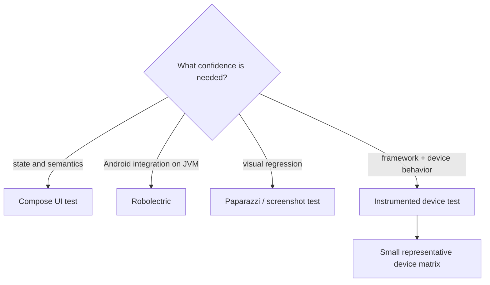

# UI Testing — Compose, Espresso, Robolectric, Paparazzi

> UI tests sit in an uncomfortable middle: too slow to run on every save, too fast to skip. Done well, they catch regressions a unit test can't — interaction bugs, layout breaks, accessibility violations, theme drift. Staff-level mastery means knowing when to reach for Compose UI tests vs Robolectric vs Paparazzi snapshots, structuring tests to avoid the flakiness curse, and using Semantics + test tags effectively across the entire app's component library.

---

## The UI-Test Landscape



Choose the cheapest layer that can observe the failure mode. Device tests are essential for platform integration, but using them for pure state or semantics makes feedback slower without adding confidence.

| Tool | Runs on | Speed | What it tests |
|---|---|---|---|
| **Compose UI Tests** | Device or emulator | ~1s/test | Real Compose with framework |
| **Robolectric** | JVM (faked Android) | ~100ms/test | Compose/Views without an emulator |
| **Paparazzi** | JVM (Layoutlib) | ~50ms/test | Screenshot diff testing |
| **Espresso (Views)** | Device or emulator | ~2s/test | Legacy XML-based UI |
| **UI Automator** | Device | ~3s/test | Cross-app, system UI |

You'll usually use **two or three of these**, not all five. A modern Compose-only codebase typically uses:
- **Paparazzi** for component-level visual regression.
- **Compose UI tests** (on Robolectric) for behavior tests.
- **Compose UI tests on device** for the most critical journeys.

This file is the **practical guide**. Companion file: [`unit-testing.md`](unit-testing.md).

---

## UI Test Governance At Scale

UI tests fail in two ways: they catch real regressions, or they teach engineers to ignore CI. Staff engineers protect the first outcome by aggressively managing the second.

### Flake policy

| Signal | Action |
|---|---|
| Test fails once, passes on retry | Track as flake; do not hide it |
| Same test flakes twice in 7 days | Quarantine from merge gate and create owner ticket |
| Quarantined test not fixed in 14 days | Delete or rewrite it |
| Critical journey flakes | Treat as release risk; fix before next train |
| Whole device pool flakes | Platform owner investigates infrastructure |

Quarantine is not forgiveness. It is a time-boxed safety valve so one bad test does not block the org while the owning team fixes it.

### Stable UI test design

Rules for long-lived UI tests:
- Prefer semantics and stable test tags over text that changes with copy.
- Disable or control animations in test builds.
- Inject fake clocks, fake repositories, and fake network states.
- Avoid sleeps; wait on UI state or idling resources.
- Keep one assertion theme per test: navigation, validation, rendering, or accessibility.
- Run broad visual coverage on JVM screenshots; reserve devices for flows that need the OS.

The test should fail because the product behavior changed, not because a spinner took 400 ms longer on one emulator.

---

## Compose UI Testing Setup

```kotlin
// :feature:cart:impl/build.gradle.kts
dependencies {
    androidTestImplementation(libs.androidx.compose.ui.test.junit4)
    debugImplementation(libs.androidx.compose.ui.test.manifest)
}

android {
    defaultConfig {
        testInstrumentationRunner = "androidx.test.runner.AndroidJUnitRunner"
    }
}
```

A basic Compose UI test:

```kotlin
@RunWith(AndroidJUnit4::class)
class CartScreenTest {

    @get:Rule val composeRule = createComposeRule()

    @Test
    fun displaysEmptyState_whenCartEmpty() {
        composeRule.setContent {
            CartScreen(state = CartUiState.Empty)
        }

        composeRule.onNodeWithText("Your cart is empty").assertIsDisplayed()
        composeRule.onNodeWithTag("addItemButton").assertIsDisplayed()
    }

    @Test
    fun clickingAdd_callsOnAddCallback() {
        var clicked = false
        composeRule.setContent {
            CartScreen(
                state = CartUiState.Empty,
                onAdd = { clicked = true },
            )
        }

        composeRule.onNodeWithTag("addItemButton").performClick()
        assertTrue(clicked)
    }
}
```

Three patterns visible:
1. **`createComposeRule()`** — sets up the Compose host.
2. **`setContent { ... }`** — renders your composable.
3. **`onNodeWithText`/`onNodeWithTag`** — query the semantic tree.

---

## Semantics — The Foundation

Compose UI tests don't traverse the rendered pixel tree. They traverse the **semantics tree** — an abstraction that mirrors what accessibility services and tests see.

```kotlin
@Composable
fun CartItem(name: String, price: Money, onRemove: () -> Unit) {
    Row(
        modifier = Modifier
            .testTag("cart_item")                       // for tests
            .semantics { 
                contentDescription = "$name: $price"     // for accessibility AND tests
            },
    ) {
        Text(name)
        Text(price.toString())
        IconButton(onClick = onRemove) {
            Icon(Icons.Default.Close, contentDescription = "Remove $name")
        }
    }
}
```

`testTag` is for tests only — invisible to users, invisible to accessibility (mostly). `contentDescription` serves both.

The **goal**: tests look like accessibility checks. If a feature is hard to test, it's also hard to use with a screen reader.

### Finder APIs

| API | Use |
|---|---|
| `onNodeWithTag("...")` | By `testTag` |
| `onNodeWithText("...")` | By visible text |
| `onNodeWithContentDescription("...")` | By `contentDescription` |
| `onNode(hasText("...") and hasClickAction())` | Composite matcher |
| `onAllNodesWithTag("...")` | Multiple nodes; use `.onFirst()`, `.onLast()`, `[0]` to disambiguate |
| `onRoot().printToLog("TAG")` | Debug: dump the semantic tree |

The `printToLog` is your best friend when a test fails — see what Compose actually rendered.

### Assertion APIs

```kotlin
composeRule.onNodeWithText("Submit").assertIsDisplayed()
composeRule.onNodeWithText("Submit").assertIsEnabled()
composeRule.onNodeWithText("Submit").assertHasClickAction()
composeRule.onNodeWithText("Spinner").assertDoesNotExist()
composeRule.onNodeWithText("Loading").assertIsDisplayed()
```

`assertIsDisplayed` ≠ `assertExists`. The former requires the node to be on-screen and have non-zero size; the latter just checks the semantic tree contains it.

### Action APIs

```kotlin
composeRule.onNodeWithTag("name_input").performTextInput("Alice")
composeRule.onNodeWithText("Submit").performClick()
composeRule.onNodeWithTag("password").performTextClearance()
composeRule.onNodeWithTag("settings").performScrollTo()
composeRule.onRoot().performTouchInput {
    swipeLeft()
}
```

---

## Robolectric — JVM-Hosted Android

Robolectric runs Android code on the JVM by reimplementing key framework APIs. For Compose UI tests, it means **device-free testing at ~10x speed**.

```kotlin
// build.gradle.kts
android {
    testOptions {
        unitTests {
            isIncludeAndroidResources = true
        }
    }
}

dependencies {
    testImplementation(libs.robolectric)
    testImplementation(libs.androidx.compose.ui.test.junit4)
    testImplementation(libs.androidx.test.ext.junit)
}
```

```kotlin
@RunWith(RobolectricTestRunner::class)
@Config(sdk = [34])
class CartScreenRobolectricTest {

    @get:Rule val composeRule = createComposeRule()

    @Test
    fun displaysCart() {
        composeRule.setContent {
            CartScreen(state = CartUiState.Success(items = listOf(item1)))
        }
        composeRule.onNodeWithText("Item 1").assertIsDisplayed()
    }
}
```

What Robolectric handles:
- `Resources` (string lookups, dimensions, drawables).
- `Context` (Application context).
- Most lifecycle classes.
- Compose runtime (with proper setup).

What it doesn't handle:
- Animation behavior depends on the configured clock and shadows; drive the relevant clock explicitly.
- Graphics fidelity depends on legacy versus native Android graphics mode; Robolectric is not Paparazzi's Layoutlib renderer.
- Ordinary JVM I/O can run, but fakes are usually preferable for deterministic external-system tests.

The trade-off depends on the failure mode: use JVM-hosted tests for suitable framework/state behavior and devices for platform, rendering and hardware behavior they cannot represent.

---

## Paparazzi — Screenshot Testing on JVM

[Paparazzi](https://github.com/cashapp/paparazzi) renders Compose to images on the JVM (using Layoutlib, the same engine the Android Studio Preview uses).

```kotlin
// app/build.gradle.kts
plugins {
    id("app.cash.paparazzi") version "1.3.4"
}
```

```kotlin
class CartItemSnapshotTest {

    @get:Rule val paparazzi = Paparazzi(
        deviceConfig = DeviceConfig.PIXEL_5,
        theme = "android:Theme.Material.Light.NoActionBar",
    )

    @Test
    fun renders_default() {
        paparazzi.snapshot {
            AppTheme {
                CartItem(name = "Laptop", price = Money(1299_99), onRemove = {})
            }
        }
    }

    @Test
    fun renders_longName() {
        paparazzi.snapshot {
            AppTheme {
                CartItem(name = "A very long product name that should truncate gracefully", price = Money(1299_99), onRemove = {})
            }
        }
    }

    @Test
    fun renders_darkMode() {
        paparazzi.snapshot {
            AppTheme(darkTheme = true) {
                CartItem(name = "Laptop", price = Money(1299_99), onRemove = {})
            }
        }
    }
}
```

Workflow:
1. Run recordPaparazziDebug (or the selected variant's record task) to write reference images.
2. Commit goldens to git (under `src/test/snapshots/`).
3. Run verifyPaparazziDebug in CI to compare renders with committed references. Ordinary test tasks generate reports but are not the reference-recording contract.
4. Verification fails when the difference exceeds maxPercentDifference; choose and document the threshold rather than assuming every changed pixel fails.
5. Re-record with `./gradlew :feature:cart:impl:recordPaparazzi` when intentional.

### Why use Paparazzi

- Catches visual regressions humans miss (1px misalignment, color shift, theme leakage).
- Documents every component in every state with images (browse `src/test/snapshots/` like a design system gallery).
- Cheap to run (~50ms per test).
- Catches accidental layout changes early — before they reach QA.

### What Paparazzi isn't

- Not a behavior test — it doesn't click buttons or assert state.
- Not pixel-perfect realistic — Layoutlib differs subtly from real devices for fonts and gradients.
- Not a replacement for Compose UI tests — those test interactions.

Pair both: Paparazzi for visual, Compose UI tests for behavior.

### Variant testing

```kotlin
@Test
fun renders_allCardStyles() {
    listOf(CardStyle.Primary, CardStyle.Secondary, CardStyle.Outlined).forEach { style ->
        paparazzi.snapshot(name = "card_${style.name.lowercase()}") {
            AppTheme { Card(style = style, content = { Text("Sample") }) }
        }
    }
}
```

One test → three snapshot images, named.

---

## Test Tags vs Semantic Properties

Two ways to identify nodes:

```kotlin
// Approach A: testTag
Box(modifier = Modifier.testTag("cart_button")) { /* ... */ }
// Test: onNodeWithTag("cart_button")

// Approach B: Semantics (preferred for accessible components)
Box(modifier = Modifier.semantics { 
    contentDescription = "Cart button"
    role = Role.Button
}) { /* ... */ }
// Test: onNodeWithContentDescription("Cart button")
```

**Rule:** prefer semantic queries when the element is user-facing. Use `testTag` only when the element has no natural accessibility text (e.g., internal scaffolding).

Tests that match production accessibility behavior are more robust to UI refactors.

### `mergeDescendants`

```kotlin
Column(modifier = Modifier.semantics(mergeDescendants = true) {
    contentDescription = "Product card"
}) {
    Text("Laptop")
    Text("$1,299.99")
    Image(painter = painterResource(R.drawable.laptop), contentDescription = null)
}
```

mergeDescendants merges eligible descendant properties using each property's merge policy. Independently merging children such as clickable controls can remain separate. Merged text may remain queryable on the parent; inspect merged and unmerged trees for the actual boundary.

---

## Hilt + Compose Tests

For dependency injection in UI tests:

```kotlin
@HiltAndroidTest
@RunWith(AndroidJUnit4::class)
class CartScreenHiltTest {

    @get:Rule(order = 0) val hiltRule = HiltAndroidRule(this)
    @get:Rule(order = 1) val composeRule = createAndroidComposeRule<HiltTestActivity>()

    @Inject lateinit var fakeRepository: FakeCartRepository

    @Before
    fun setUp() {
        hiltRule.inject()
    }

    @Test
    fun cartUpdates_whenRepositoryEmits() {
        composeRule.setContent {
            CartScreen()
        }

        composeRule.onNodeWithText("Empty").assertIsDisplayed()
        fakeRepository.addItem(item1)
        composeRule.onNodeWithText("Item 1").assertIsDisplayed()
    }
}
```

Use the documented HiltTestApplication runner and an @AndroidEntryPoint HiltTestActivity registered in the debug manifest. Add hilt-android-testing and the Hilt test compiler to the instrumentation source set. Override the production module in the test source set:

```kotlin
@Module
@TestInstallIn(
    components = [SingletonComponent::class],
    replaces = [CartRepositoryModule::class],
)
object FakeCartRepositoryModule {
    @Provides @Singleton
    fun provideFake(): FakeCartRepository = FakeCartRepository()

    @Provides
    fun provideRepo(fake: FakeCartRepository): CartRepository = fake
}
```

---

## ScreenshotTesting

A newer Android-official screenshot testing alternative to Paparazzi:

```kotlin
plugins {
    id("com.android.compose.screenshot") version "0.0.1-alpha15"
}

android {
    experimentalProperties["android.experimental.enableScreenshotTest"] = true
}
```

```kotlin
@PreviewTest
@Preview(showBackground = true)
@Composable
fun CartItemPreview() {
    AppTheme {
        CartItem(name = "Laptop", price = Money(1299_99), onRemove = {})
    }
}
```

Place `@PreviewTest`-annotated previews in the `screenshotTest` source set. The plugin renders them during `./gradlew :feature:cart:impl:validateDebugScreenshotTest` and compares the output with approved references.

Trade-off vs Paparazzi:
- Google-official; first-class IDE support.
- Slower than Paparazzi.
- Still experimental/alpha as of the official June 2026 documentation; APIs and required versions can change.

Paparazzi remains a mature third-party option. Choose based on IDE integration, rendering fidelity, execution cost, KMP constraints, and the Android plugin's experimental status; do not base the decision on a predicted graduation date.

---

## Testing Custom Modifiers

Custom modifiers (`Modifier.fadeIn()`, `Modifier.shimmer()`) often need their own tests:

```kotlin
@Test
fun shimmer_modifierAppliesGradient() {
    composeRule.setContent {
        Box(
            modifier = Modifier
                .size(100.dp)
                .shimmer()
                .testTag("shimmered"),
        )
    }
    composeRule.onNodeWithTag("shimmered").assertIsDisplayed()
    // Pair with Paparazzi for visual verification
}
```

The behavior is mostly visual — Paparazzi captures it more usefully than Compose UI tests.

---

## Test Robustness — Avoiding Flakiness

Flaky UI tests destroy test-suite credibility. Common causes and fixes:

### 1. Animations

```kotlin
@Test
fun inspectIntermediateAnimation() {
    composeRule.mainClock.autoAdvance = false
    try {
        composeRule.setContent { AnimatedCart() }
        composeRule.onNodeWithTag("expand").performClick()
        composeRule.mainClock.advanceTimeBy(100)
        // Assert this deliberately chosen animation frame.
    } finally {
        composeRule.mainClock.autoAdvance = true
    }
}
```

This controls one test, not global animation behavior. For Hilt instrumentation tests, use a custom AndroidJUnitRunner that creates `dagger.hilt.android.testing.HiltTestApplication`, plus a registered `@AndroidEntryPoint` test activity extending `androidx.activity.ComponentActivity`. The ordinary Compose host comes from ui-test-manifest; neither a manifest declaration nor the Hilt application disables animations. Platform instrumentation animation settings are a separate policy.

### 2. Async work

```kotlin
composeRule.waitUntil(timeoutMillis = 3_000) {
    composeRule.onAllNodesWithText("Loaded").fetchSemanticsNodes().isNotEmpty()
}
```

Wait for an assertion to become true, not for a fixed time.

### 3. Coroutine awaits

```kotlin
// In test:
composeRule.waitForIdle() // synchronous test API; waits for Compose and registered idlers
```

### 4. Idling resources

For complex async chains:

```kotlin
class LoadingIdler : androidx.compose.ui.test.IdlingResource {
    private val pending = java.util.concurrent.atomic.AtomicInteger()
    override val isIdleNow: Boolean get() = pending.get() == 0
    fun begin() { pending.incrementAndGet() }
    fun end() { check(pending.decrementAndGet() >= 0) }
}
val idlingResource = LoadingIdler()
// In the owned coroutine, balance on failure and cancellation too:
viewModelScope.launch {
    idlingResource.begin()
    try { repo.load() } finally { idlingResource.end() }
}
// In the test, register before triggering the work:
composeRule.registerIdlingResource(idlingResource)
try {
    // Trigger load and assert the resulting UI.
} finally {
    composeRule.unregisterIdlingResource(idlingResource)
}
```

### Avoiding Flakes — Best Practices

- Never use `Thread.sleep` in tests. Always `waitUntil` or `awaitIdle`.
- Disable animations.
- Use unique test data (avoid global state).
- Reset dependencies in JUnit 4 @Before for these rule-based suites; Jupiter suites use @BeforeEach.
- Don't depend on test execution order.
- Fail loud — better to crash than silently pass.

---

## Accessibility Testing

```kotlin
@Test
fun cart_meetsAccessibilityRequirements() {
    composeRule.setContent {
        AppTheme { CartScreen(state = CartUiState.Success(items)) }
    }

    val node = composeRule.onNodeWithTag("cart_item").fetchSemanticsNode()

    // Tap targets at least 48dp
    val width = with(composeRule.density) { node.boundsInRoot.width.toDp() }
    val height = with(composeRule.density) { node.boundsInRoot.height.toDp() }
    assertTrue(width >= 48.dp && height >= 48.dp)

    // Has contentDescription
    val description = node.config[SemanticsProperties.ContentDescription]
    assertNotNull(description)
    assertTrue(description!!.first().isNotEmpty())
}
```

For systematic accessibility audits:

```kotlin
// androidTestImplementation("androidx.compose.ui:ui-test-junit4-accessibility:<compose-version>")
// import androidx.compose.ui.test.junit4.accessibility.enableAccessibilityChecks
@get:Rule val composeRule = createAndroidComposeRule<ComponentActivity>()

@Before
fun enableChecks() { composeRule.enableAccessibilityChecks() }
```

Checks run on supported test actions and can be requested explicitly. They complement manual assistive-technology testing and do not certify every interaction or WCAG requirement.

---

## Multi-Device Testing — Firebase Test Lab

For instrumentation tests on a matrix of real devices:

```bash
gcloud firebase test android run \
  --type instrumentation \
  --app app-debug.apk \
  --test app-debug-androidTest.apk \
  --device model=Pixel6,version=33 \
  --device model=Pixel6,version=34 \
  --device model=SamsungS21,version=33
```

CI can run Test Lab through gcloud, Firebase tooling or Fladle. Gradle Play Publisher publishes to Google Play and is not a Test Lab matrix runner.

---

## Real Patterns

### Pattern 1: Component-level Paparazzi gallery

```kotlin
@Test
fun renderAllButtonStyles() {
    listOf(
        ButtonStyle.Primary, ButtonStyle.Secondary,
        ButtonStyle.Destructive, ButtonStyle.Ghost,
    ).forEach { style ->
        paparazzi.snapshot(name = "button_${style.name.lowercase()}") {
            AppTheme {
                CompanyButton(style = style, onClick = {}) {
                    Text("Action")
                }
            }
        }
    }
}
```

One test, dozens of snapshots. Visual regression coverage for the entire design system in minutes.

### Pattern 2: Screen-level UI test with Hilt

```kotlin
@HiltAndroidTest
class CheckoutScreenTest {
    @get:Rule(order = 0) val hiltRule = HiltAndroidRule(this)
    @get:Rule(order = 1) val composeRule = createAndroidComposeRule<HiltTestActivity>()

    @Inject lateinit var repository: CheckoutRepository // supplied by the matching test replacement module

    @Before fun setUp() = hiltRule.inject()

    @Test
    fun submitSuccess_navigatesToConfirmation() {
        var navigatedTo: String? = null
        composeRule.setContent {
            CheckoutScreen(onNavigate = { navigatedTo = it })
        }
        composeRule.onNodeWithTag("submit_button").performClick()
        composeRule.waitUntil { navigatedTo == "confirmation/order123" }
        assertEquals("confirmation/order123", navigatedTo)
    }
}
```

### Pattern 3: State-driven Compose test (no Hilt)

```kotlin
@Test
fun loadingState_showsSpinner() {
    composeRule.setContent {
        AppTheme { CartScreen(state = CartUiState.Loading) }
    }
    composeRule.onNodeWithTag("loading_spinner").assertIsDisplayed()
}

@Test
fun errorState_showsRetryButton() {
    composeRule.setContent {
        AppTheme { CartScreen(state = CartUiState.Error("oops")) }
    }
    composeRule.onNodeWithText("Try again").assertIsDisplayed()
}
```

Faster — no DI graph init. Use for screens that accept state as a parameter (recommended pattern anyway).

### Pattern 4: Snapshot tests in multiple themes / locales

```kotlin
@get:Rule val paparazzi = Paparazzi(
    deviceConfig = DeviceConfig.PIXEL_5.copy(locale = "ar-XB"),
    theme = "android:Theme.Material.Light",
)

@Test
fun rtlLayout() {
    paparazzi.snapshot {
        AppTheme { CartItem(name = "Laptop", price = Money(1299_99), onRemove = {}) }
    }
}
```

Catches RTL bugs early. Most apps test LTR, dark mode, and one RTL locale per component.

---

## Failure Modes

| Symptom | Cause | Fix |
|---|---|---|
| Test passes locally, fails on CI | Animations enabled, race condition | Disable animations; use `waitUntil` |
| `onNodeWithText("...")` finds 0 nodes | Text inside a merged-descendant block | Use `useUnmergedTree = true` or query parent |
| Paparazzi reports diff but visually identical | Font hinting / pixel-level differences | Increase tolerance; use Paparazzi's `maxPercentDifference` |
| Compose Test hangs forever | Coroutine collecting in non-test scope | `composeRule.awaitIdle()` not enough — register IdlingResource |
| `HiltAndroidRule` works but `composeRule` doesn't see deps | Rule order wrong | `@get:Rule(order = 0)` for Hilt, `order = 1` for compose |
| `androidx.compose.ui.test.manifest` not in debug | Missing manifest dep | Add `debugImplementation` |
| Robolectric fails: "no Activity in test config" | Default activity not set | Use `createAndroidComposeRule<MyActivity>()` |
| performTextInput does not update a TextField | Controlled state callback is unwired, or external work is not synchronized | Update the value in onValueChange; synchronize only the actual external boundary. Actions already synchronize with Compose |
| Screenshot fails on Linux but works on macOS | Font fallback differences | Pin to a single OS in CI; or commit per-OS goldens (rare) |
| `onAllNodesWithTag` selects too many | Duplicate `testTag` | Make tags unique or use indexed `[i]` |
| `@HiltAndroidTest` not picked up | Forgot Hilt test runner | Add `testInstrumentationRunner` or `HiltTestApplication` |
| Slow test suite (5min) | Mix of unit and instrumentation tests | Split into separate Gradle tasks |
| Flaky `waitUntil` | Polling interval too long or timeout too short | Tune; or use IdlingResource |
| Tests retain snackbar state between cases | Shared owner/state | Reset the rule-owned test and dependencies using JUnit 4 @Before; synchronize the expected UI outcome |
| A child matcher changes after merging | The property moved to a parent or a nested merge boundary remains independent | Inspect both trees and query the actual semantic contract; useUnmergedTree is deliberate inspection, not a universal fix |
| Paparazzi golden out of date | Intentional UI change but not re-recorded | `./gradlew recordPaparazzi` to update |

---

## Common Pitfalls

- **Compose UI tests on every PR.** Slower than unit tests; run fewer in CI per PR, full suite on main.
- **No testTag strategy.** Engineers invent them ad-hoc; no consistent pattern. Add lint rule for naming.
- **Mixing test types in same module.** Keep `src/test/` (unit) and `src/androidTest/` (instrumentation) separate.
- **Testing internal implementation.** A test that checks "view is a `LinearLayout`" breaks on refactor. Test behavior.
- **Snapshot tests of dynamic content.** Date/time changes per run, so do random IDs. Inject `Clock` and seed `Random`.
- **No baseline diff review.** When 50 snapshots change in a PR, you can't eyeball each. Use Paparazzi's HTML diff report; have a designer review.
- **Paparazzi for behavior tests.** Wrong tool — use Compose UI tests.
- **Compose UI tests for visual regression.** Wrong tool — use Paparazzi.
- **No Hilt + Compose pattern.** Each team invents their own. Document in convention plugins.
- **Treating Robolectric as "real Android."** It approximates. Real-device tests still needed for production critical paths.
- **Tests pass with `Thread.sleep(5_000)`.** Slow + flaky. Always use `waitUntil`.

---

## Probing Questions

1. Compose UI test vs Paparazzi vs Robolectric — when each?
2. Semantic queries vs `testTag` — when use each?
3. Walk through structuring a Hilt + Compose UI test with `HiltAndroidRule`.
4. Why are animation-related test failures the most common flakes? How do you fix them globally?
5. `mergeDescendants` — what does it do? How does it interact with test queries?
6. Paparazzi vs Compose Screenshot Testing — what's the trade-off?
7. A new engineer writes a Compose UI test that fails on CI with 50% reliability. Walk through your debugging.
8. Multi-theme / multi-locale snapshot testing — how to set up?
9. Accessibility testing in Compose — what tools, what assertions?
10. Why do you sometimes need `IdlingResource` even with `awaitIdle()`?
11. A junior creates 200 testTags called "button1", "button2", etc. What's the code-review pushback?
12. Component-level Paparazzi vs screen-level Compose UI tests — which catches what?

---

## Answer Key

1. **Compose UI test vs Paparazzi vs Robolectric — when each?**
   Use Compose UI tests for interaction and behavior. Use Paparazzi for visual/pixel-perfect regression testing of components. Use Robolectric for running Compose or Views behavior tests fast on the JVM without an emulator.
2. **Semantic queries vs `testTag` — when use each?**
   Use semantic queries (`contentDescription`, text) for user-facing elements to mirror accessibility. Use `testTag` for internal scaffolding or elements that lack natural accessibility text.
3. **Walk through structuring a Hilt + Compose UI test with `HiltAndroidRule`.**
   Annotate with `@HiltAndroidTest`, add `HiltAndroidRule` (order 0), add `createAndroidComposeRule<HiltTestActivity>` (order 1), and call `hiltRule.inject()` in `@Before` before setting content.
4. **Why are animation-related test failures the most common flakes? How do you fix them globally?**
   Control the Compose test clock for a specific intermediate frame and advance it explicitly. Automatic advancement normally helps actions reach idleness. Instrumentation animation settings affect platform animations, not every Compose animation or external job.
5. **`mergeDescendants` — what does it do? How does it interact with test queries?**
   It merges eligible descendant properties using merge policies; independently merging children can stay separate. Text can be found on the merged parent. Inspect the actual merged tree before using useUnmergedTree for a child-specific assertion.
6. **Paparazzi vs Compose Screenshot Testing — what's the trade-off?**
   Paparazzi is a mature, fast, third-party tool that uses Layoutlib. Compose Screenshot Testing is a newer, Google-official, IDE-integrated plugin but is slower and currently in alpha.
7. **A new engineer writes a Compose UI test that fails on CI with 50% reliability. Walk through your debugging.**
   Disable animations. Check for async work not tied to Compose's idling mechanism. Use `waitUntil` instead of `Thread.sleep`. Check if coroutines are running on an un-tracked scope requiring an `IdlingResource`.
8. **Multi-theme / multi-locale snapshot testing — how to set up?**
   Create multiple `Paparazzi` rule configurations or iterate over different `DeviceConfig` objects (altering locale/theme) in a single test, taking uniquely named snapshots for each variant.
9. **Accessibility testing in Compose — what tools, what assertions?**
   On a supported AndroidComposeTestRule, add ui-test-junit4-accessibility and call enableAccessibilityChecks(). Pair automated checks with semantics and manual TalkBack/Switch Access verification; labels and size assertions alone do not establish complete accessibility.
10. **Why do you sometimes need `IdlingResource` even with `awaitIdle()`?**
    awaitIdle is suspending; waitForIdle is the synchronous test API. They wait for Compose work and registered idling resources, not arbitrary Main/background jobs. Use a matching idler or waitUntil for the external outcome.
11. **A junior creates 200 testTags called "button1", "button2", etc. What's the code-review pushback?**
    Push back because they are brittle, non-descriptive, and don't help accessibility. Require semantic testing where possible, or use descriptive tags representing the domain action (e.g., `submit_order_button`).
12. **Component-level Paparazzi vs screen-level Compose UI tests — which catches what?**
    Component-level Paparazzi catches visual regressions, color shifts, and padding errors. Screen-level Compose UI tests catch broken navigation, missing validation logic, and incorrect state flow on interactions.

## Further Reading

- [`unit-testing.md`](unit-testing.md) — JVM-only tests.
- [`../compose/recomposition-and-state.md`](../compose/recomposition-and-state.md) — what gets tested.
- [`../compose/stability.md`](../compose/stability.md) — recomposition during tests.
- [`../compose/snapshot-system.md`](../compose/snapshot-system.md) — state changes during test.
- [`../data-and-di/hilt-vs-koin-vs-manual-di.md`](../data-and-di/hilt-vs-koin-vs-manual-di.md) — `@TestInstallIn` patterns.
- [`../performance/rendering.md`](../performance/rendering.md) — rendering tests catch.
- [`../build-tooling/multi-module.md`](../build-tooling/multi-module.md) — `:test:fixtures` shared fakes.
- [Compose UI testing official docs](https://developer.android.com/jetpack/compose/testing) — official.
- [Robolectric](http://robolectric.org/) — official.
- [Paparazzi](https://github.com/cashapp/paparazzi) — screenshot tests.
- [Android Compose Screenshot Testing](https://developer.android.com/studio/preview/compose-screenshot-testing) — official alpha.
- [Espresso (for legacy)](https://developer.android.com/training/testing/espresso) — official.
- [Firebase Test Lab](https://firebase.google.com/docs/test-lab) — cross-device matrix.

### Official verification references

- [Primary documentation or owning implementation](https://developer.android.com/develop/ui/compose/accessibility/merging-clearing)
- [Primary documentation or owning implementation](https://developer.android.com/develop/ui/compose/accessibility/testing)
- [Primary documentation or owning implementation](https://developer.android.com/develop/ui/compose/testing/synchronization)
- [Primary documentation or owning implementation](https://developer.android.com/reference/kotlin/androidx/compose/ui/test/IdlingResource)
- [Primary documentation or owning implementation](https://developer.android.com/reference/kotlin/androidx/compose/ui/test/package-summary)
- [Primary documentation or owning implementation](https://developer.android.com/training/dependency-injection/hilt-testing)
- [Primary documentation or owning implementation](https://github.com/Triple-T/gradle-play-publisher)
- [Primary documentation or owning implementation](https://github.com/cashapp/paparazzi#tasks)
- [Primary documentation or owning implementation](https://github.com/robolectric/robolectric)
- [Primary documentation or owning implementation](https://github.com/robolectric/robolectric/blob/master/annotations/src/main/java/org/robolectric/annotation/GraphicsMode.java)
- [Primary documentation or owning implementation](https://robolectric.org/)
