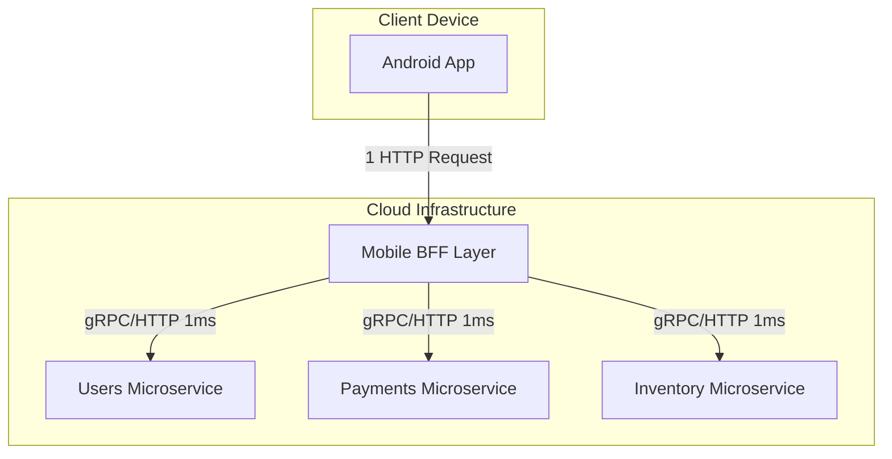

# Backend-For-Frontend (BFF) Pattern

## Overview

A Junior Engineer assumes that the Mobile App must adapt to whatever JSON the Backend API decides to return. If a screen requires data from 5 different microservices, the Junior Engineer writes 5 different `Retrofit` calls, waits for them all to finish, and merges the data on the client.

A Staff Engineer understands that **the mobile device is the worst possible place to orchestrate data**. Mobile CPUs are slow, batteries are limited, and cellular connections suffer from high latency and packet loss.

The **Backend-For-Frontend (BFF)** pattern solves this by introducing a dedicated middleware layer that lives in the cloud. The BFF sits between the Mobile App and the massive generic Backend Microservices. Its sole purpose is to aggregate, filter, and format data *exactly* how the Mobile UI needs it, requiring the mobile app to make only one single HTTP request.

## Why It Matters

Imagine a "User Profile" screen. To render it, the app needs:
1. User Details (Name, Avatar) from the `UsersService`.
2. Order History from the `CommerceService`.
3. Loyalty Points from the `RewardsService`.

If the app calls these 3 services directly from a mobile phone on a 3G network:
- **Latency:** Establishing 3 separate TCP/TLS connections takes 1,500ms before any data is even transferred.
- **Over-fetching:** The `CommerceService` returns the entire SQL row (150 fields) for an Order, but the mobile UI only needs `orderId` and `totalPrice`. You just forced the user to download 50KB of useless JSON, draining their data plan.
- **Battery Drain:** The mobile CPU has to parse three massive JSON payloads, hold them in RAM, and run complex Zip/Merge logic in Kotlin.

With a BFF, the app makes **one** request: `GET /mobile/profile`. The BFF (living in the AWS/GCP datacenter) queries the 3 microservices over ultra-fast 10-Gigabit fiber, strips out the 148 useless fields, merges it into a tiny 2KB JSON payload, and returns it to the phone in 200ms.

## Historical Context

- **The Monolith (Pre-2010):** Apps talked to a single massive server (e.g., `api.mycompany.com`). The Monolith returned everything.
- **The Microservice Explosion (2010-2015):** Companies broke their Monoliths into hundreds of microservices. They forced Mobile Apps to orchestrate the calls. Mobile performance tanked globally.
- **The API Gateway:** A centralized router that forwarded requests, but still returned massive generic payloads designed for Desktop Web Browsers.
- **The BFF (2015 - Present):** Pioneered by Soundcloud and Netflix. Instead of one massive API Gateway for everyone, you build a *Mobile BFF*, a *Web BFF*, and a *SmartTV BFF*. Each client gets an API tailored perfectly to its UI requirements.

## First Principles

1.  **Orchestration:** The act of calling multiple disparate services and combining their results. This belongs on the server, not the client.
2.  **Over-fetching:** Downloading data from an API that the UI does not actually display.
3.  **Under-fetching:** An API not providing enough data, forcing the client to make a second follow-up API call (The N+1 Query problem).
4.  **Network Topology:** The physical distance data travels. A request from a Phone to AWS takes 100ms. A request from an AWS BFF to an AWS Microservice takes 1ms.

## Mental Model

Think of the BFF as a **Personal Shopper at a massive Supermarket**.
- **Without a BFF:** You (The Mobile App) have to walk into the supermarket, go to the Bakery for bread, walk across the store to the Deli for meat, and then go to the Dairy aisle for cheese. It takes you 30 minutes, and you have to carry a massive cart.
- **With a BFF:** You pull your car up to the curb and hand a list to the Personal Shopper (The BFF). The Shopper runs through the store at lightning speed, grabs exactly what you need, removes the cardboard packaging (strips useless JSON), hands you a small bag, and you drive away in 2 minutes.

## Internal Mechanics

### 1. Data Aggregation and Trimming

The primary mechanical function of the BFF is mapping generic backend DTOs (Data Transfer Objects) into UI-specific State models.

```json
// What the raw Microservice returns (Massive, Generic)
{
  "user_id": "991",
  "first_name": "John",
  "last_name": "Doe",
  "account_created": "2015-10-01T12:00:00Z",
  "last_login_ip": "192.168.1.1",
  "marketing_opt_in": true,
  "internal_fraud_score": 0.05
}

// What the BFF returns to the Mobile App (Tiny, Specific)
{
  "formattedName": "John Doe",
  "isVeteranUser": true 
}
```

Notice the BFF performed logic: It concatenated the name, and it calculated `isVeteranUser` based on the `account_created` date. The mobile app contains zero logic; it simply binds `formattedName` to a `TextView`.

### 2. Protocol Translation

Microservices often use high-performance, strictly-typed binary protocols like gRPC (Protocol Buffers) or Thrift to communicate with each other inside the datacenter.

However, standard Android apps generally consume JSON over REST.

The BFF acts as a translator. The Mobile App speaks HTTP/JSON to the BFF. The BFF translates that request, speaks gRPC to the microservices, receives the binary response, and translates it back into JSON for the mobile app.

## Architecture



## Production Example

**Server-Driven UI (SDUI)**

The ultimate evolution of the BFF pattern is **Server-Driven UI**. 
Instead of the BFF returning data (`"price": "$10"`), the BFF returns *UI rendering instructions*.

```json
// BFF Response
{
  "screen": "Profile",
  "components": [
    {
      "type": "HeaderComponent",
      "text": "Welcome John",
      "color": "#FF0000"
    },
    {
      "type": "ButtonComponent",
      "actionUrl": "app://navigate/settings"
    }
  ]
}
```

Because the BFF dictates the UI layout, the Product team can completely redesign the Profile screen, add new buttons, and change colors *without ever releasing a new APK to the Play Store*. The Mobile App is reduced to a "dumb rendering engine" that just draws whatever the BFF tells it to draw.

## Tradeoffs

**Who owns the BFF?**

The most difficult challenge of the BFF pattern is Conway's Law (Organization Structure).
- **Backend Team owns it:** The Backend team writes the BFF. Because they don't understand Android UI lifecycles, they build a generic API. We are back to square one.
- **Mobile Team owns it:** The Mobile developers write the BFF (often using Node.js or Kotlin/Ktor). They can build the perfect API for the UI. However, Android developers are rarely experts in Kubernetes, cloud scaling, or datacenter security. If the BFF crashes, the mobile devs get paged at 3 AM.

*Staff Decision:* The industry consensus is that **Frontend/Mobile teams must own the BFF logic**. It is part of the Client. However, the Platform/DevOps team must provide the infrastructure (e.g., a managed GraphQL server or Apollo Federation) so the mobile devs don't have to manage bare-metal servers.

## Failure Modes

- **The Single Point of Failure:**
  If the Mobile BFF goes down, the entire Android app goes down, even if the underlying 50 microservices are perfectly healthy.
  *(Fix: The BFF must be stateless, heavily horizontally scaled, and placed behind an aggressive load balancer. It should implement strict [Circuit Breakers](../patterns/circuit-breaker.md) so if one downstream microservice dies, the BFF returns a partial success rather than a complete HTTP 500).*
- **The "God" BFF:**
  Over time, developers stuff so much business logic into the BFF that it accidentally transforms back into a monolithic backend.
  *(Fix: The BFF must be strictly a presentation-formatting layer. It should NEVER connect directly to a database, and it should NEVER execute core business logic. If you are calculating taxes inside the BFF, you have failed).*

## Staff Engineer Thinking

When auditing an API layer, a Staff engineer focuses on the physical constraints of the mobile device.

1.  **Payload Size Budgets:** I enforce strict JSON payload limits on our BFF endpoints via CI/CD contract testing. If a new PR causes the `GET /feed` endpoint to exceed 50KB, the build fails. Mobile networks (especially in developing nations) simply cannot handle 500KB JSON blobs.
2.  **GraphQL as a BFF Alternative:** If spinning up a dedicated Node/Kotlin BFF server is too politically difficult in an organization, I advocate for **GraphQL**. A GraphQL server allows the Android client to specify exactly which fields it wants, effectively solving over-fetching without requiring a dedicated Mobile-only server layer. (See [GraphQL](../android/networking-and-security/graphql.md)).
3.  **Versioning:** Because the BFF is intimately tied to the Android UI, I ensure the BFF endpoints are explicitly versioned alongside the app releases (`/v14/profile`). An Android app released 3 years ago might still be installed on a device today; the BFF must continue serving the exact JSON shape that v14 expects, even if v20 is entirely different.

## Common Misconceptions

- **"BFF is just an API Gateway."** False. An API Gateway is a generic router meant to handle rate-limiting, SSL termination, and authentication for *all* clients. A BFF is a bespoke translation layer built explicitly for *one specific client UI*.
- **"BFFs execute business logic."** Dangerously false. If a user transfers money, the BFF does not subtract the balance. The BFF simply routes the `POST` request to the Ledger Microservice, waits for the confirmation, and translates the success response into a format the mobile app expects.

## Probing Questions

1.  Explain the concepts of "Over-fetching" and "Under-fetching" and how the Backend-For-Frontend pattern resolves both simultaneously.
2.  Why is orchestrating multiple API calls significantly faster when done inside a cloud datacenter (BFF) compared to orchestrating them on an Android device?
3.  Describe the difference between an API Gateway and a BFF. Can they exist in the same architecture?
4.  If an Android app requires a BFF to communicate with 5 microservices, what happens if Microservice #4 crashes? How should the BFF handle this?
5.  What is "Server-Driven UI" (SDUI), and how does a BFF enable an engineering team to bypass the Google Play Store update process?
6.  Explain the organizational friction (Conway's Law) regarding who should own, write, and maintain the BFF code (Backend team vs Mobile team).
7.  Why is it an architectural anti-pattern for a BFF to connect directly to a PostgreSQL database?
8.  How does GraphQL serve as an alternative solution to the problems a BFF is trying to solve?
9.  If an Android app is expected to live on a user's phone for 4 years without an update, how must the BFF be managed to prevent breaking the app?
10. Describe how a BFF can act as a protocol translator between a Mobile App speaking JSON/HTTP and internal microservices speaking binary gRPC.

## Further Reading

- [`graphql.md`](../android/networking-and-security/graphql.md) — An alternative query language that solves many of the same over-fetching problems as a BFF.
- [`api-design-for-mobile.md`](api-design-for-mobile.md) — How the endpoints on the BFF should actually be structured.
- [SoundCloud: Building Products with BFFs](https://developers.soundcloud.com/blog/building-products-at-soundcloud-part-4-microservices-in-scala-and-finagle)
