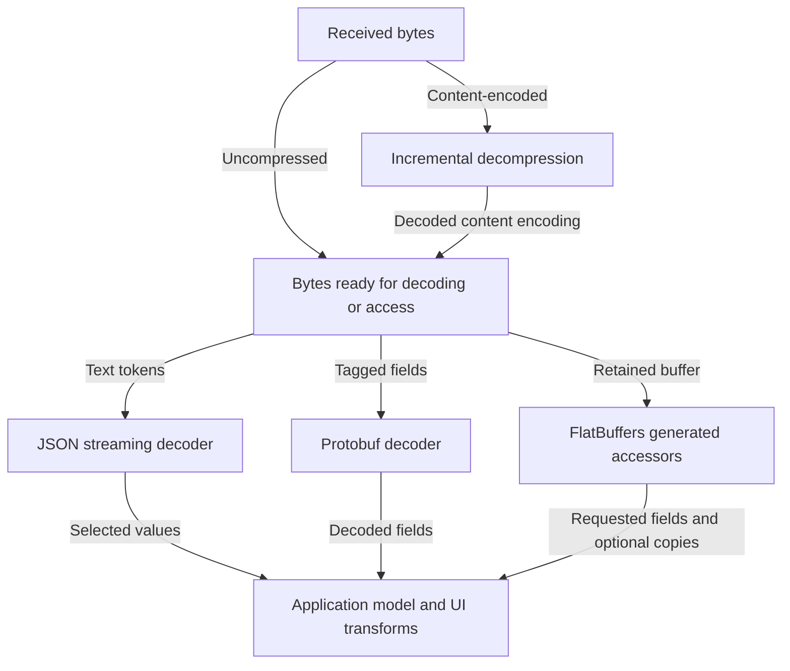

# Data Formats (JSON, Protobuf, FlatBuffers)

## Overview

A large response can spend time in transfer, decompression, decoding, allocation and UI transformation. Choose a format from measured workload costs and compatibility needs. Wire size, decoded heap size and access latency are different measurements; a compact binary message does not imply zero CPU or memory cost.

## Historical Context

JSON became a common interoperable web representation; Protocol Buffers brought schema-generated tagged messages, and FlatBuffers made direct access to a schema-defined buffer a design goal. These are different access models, not a progression where each newer format universally replaces the last. Existing infrastructure and compatibility can justify keeping JSON even when a binary encoding is smaller.

## First Principles

Serialization encodes values; transport delivers bytes; decompression and decoding reconstruct or expose data. A schema describes the wire contract, while a generated model is one language's API for it. Measure compressed transfer size separately from retained heap and access CPU. Streaming, pagination and zero-copy access address different parts of that pipeline.

## Format Comparison

| Format | Access model | Contract and tradeoff |
|---|---|---|
| JSON | Decode text tokens, optionally from a stream, into selected models | Easy to inspect; schema and compatibility still need enforcement |
| Protobuf | Generated code decodes tagged binary fields | Compact typed messages; schema distribution and evolution discipline required |
| FlatBuffers | Generated accessors read fields from a binary buffer | Avoids eagerly constructing a full object graph; buffer lifetime, access patterns and language APIs matter |

There is no fixed 5x or 10x winner. Compare representative data on target devices, with compression, cold/warm adapters, peak memory and the fields actually consumed. A numeric field may be a primitive rather than a separately boxed object; ignored JSON fields need not become model properties.

## JSON: Streaming and Adapters

A JSON decoder does not require the entire decompressed document to become one `String`. Moshi and Gson expose streaming readers; a decompressor can feed the reader incrementally. Calling `body.string()` or building a complete DOM chooses additional buffering. Returning a complete list still allocates the retained model even if token parsing streams; pagination or incremental consumption is a separate design choice.

Generated Moshi adapters and Kotlinx Serialization avoid reflective property discovery. Gson is maintained, but its official README describes maintenance mode and limitations for Kotlin nullability/default arguments and Android shrinking; it is not formally deprecated merely because another library fits better. Custom Gson adapters can avoid reflection. Pick from supported platforms, behavior, maintenance and measurements rather than declaring a universal parser ban.

Move substantial decoding and transformation off the main thread. A tiny decode is not automatically an ANR, and moving work alone does not eliminate CPU contention or allocation pressure. Handle decoder exceptions at a repository boundary; malformed input need not crash the application.

## Protobuf: Evolution Is About the Wire Contract

```protobuf
message User {
  int32 id = 1;
  string name = 2;
}
```

Tags include a field number and wire type; they are not always one byte. Kotlin Protobuf generation adds Kotlin DSLs around generated Java message classes, not ordinary Kotlin data classes. Protobuf can travel over HTTP, a socket, a queue or local storage; it is not a transport protocol.

Never reuse a removed field number. Reserve removed numbers and names, and apply the official compatibility rules for the specific binary or ProtoJSON interface. Some type changes are wire-compatible under documented constraints, while others break semantics or lose information without causing an immediate parse error. Do not interpret successful parsing as compatibility. Renaming a field while retaining its number can preserve binary compatibility but can break JSON mappings, generated source APIs and consumers using names.

## FlatBuffers: Direct Access Has Costs

FlatBuffers has its own schema-defined binary layout; it is not a raw C++ struct dump. A Java/Kotlin client can wrap a `ByteBuffer` and access selected fields without deserializing the entire message graph. File mapping is optional, not a prerequisite of the format.

Reading offsets, validating/traversing data and accessing memory take time. Java string access decodes UTF-8 and allocates a string; wrapper objects, builder buffers and application copies may allocate too. Reusable accessors and byte-buffer views can avoid some allocations. The retained buffer occupies memory/address space, and mapped pages incur residency and page-fault costs. Object APIs deliberately construct an object graph. None of this is zero milliseconds or zero RAM.

Use it when partial/random access and measured allocation savings justify the tooling and API constraints, not only in games or only above an arbitrary payload size. Keep a buffer alive while readers reference it and validate untrusted input according to the chosen runtime's capabilities.

## Architecture



The input may stream, decode into objects, or remain in a buffer. Every path still has access and lifetime costs; none promises a fixed payload ratio or zero work.

Validated against: [HTTP content encoding](https://www.rfc-editor.org/rfc/rfc9110.html#name-content-encoding), [Moshi streaming](https://github.com/square/moshi), [Protobuf wire encoding](https://protobuf.dev/programming-guides/encoding/) and [FlatBuffers Java access](https://flatbuffers.dev/languages/java/).

## Defaults, Nulls and Unknown Values

Distinguish an absent field, explicit null, unknown property and unknown enum value. Behavior is a decoder configuration contract.

- Kotlinx Serialization rejects unknown JSON keys by default; `ignoreUnknownKeys = true` permits additive properties. That does not by itself handle unknown enum values.
- A non-null property with a default normally uses that default when absent; an explicit null normally fails. The opt-in `coerceInputValues` setting can treat certain null/unknown enum inputs as missing. Use it only when that fallback is the intended domain behavior.
- Moshi's `@Json(name = "UNKNOWN")` changes a serialized name; it does **not** catch every unknown enum value. Register `EnumJsonAdapter.create(Status::class.java).withUnknownFallback(Status.UNKNOWN)` from `moshi-adapters`, or use a reviewed custom adapter. This fallback is for unknown strings, not arbitrary wrong JSON types.

Test all four cases with the actual adapter. An unknown payment state may need an explicit unavailable/reconcile state rather than being silently interpreted as success.

## Worked Migration: Defaults Are Part of the Contract

Suppose a Gson model is moving to Kotlinx Serialization. Capture the existing wire fixtures before switching adapters; a successful build does not prove old payloads retain their meaning.

```kotlin
@Serializable
data class FormatUser(val id: Int, val name: String, val isPremium: Boolean = false)

val formatJson = Json { ignoreUnknownKeys = true }
val missingPremium = formatJson.decodeFromString<FormatUser>(
    """{"id":1,"name":"Reader","newField":123}"""
)
check(!missingPremium.isPremium)
// An explicit "isPremium": null is a decoding failure with this configuration.
```

A primitive Boolean cannot become JVM null. Gson constructor/unsafe-instantiation paths can differ in whether initializers run, so test missing and null inputs rather than describing a universal Gson outcome. Kotlinx's default handles absence here; explicit null still fails unless an intentionally chosen coercion policy changes it. Do not turn an unknown entitlement into permission through a convenience fallback.

Test enums separately. In Moshi, naming a constant `UNKNOWN` does not enable a fallback:

```kotlin
enum class FormatStatus { ACTIVE, INACTIVE, UNKNOWN }
val formatMoshi = Moshi.Builder().add(
    FormatStatus::class.java,
    EnumJsonAdapter.create(FormatStatus::class.java).withUnknownFallback(FormatStatus.UNKNOWN)
).build()
check(formatMoshi.adapter(FormatStatus::class.java).fromJson("\"PENDING\"") == FormatStatus.UNKNOWN)
```

This requires `moshi-adapters` in addition to Moshi. An unknown string, explicit null, absent field and wrong JSON type still need separate fixtures. Keep failures typed at the repository boundary so malformed server input produces an intentional product state.

## Tradeoffs and Failure Modes

| Trigger | Risk | Verification |
|---|---|---|
| Very large decoded list | Retained heap and transformation pressure despite streaming | Bound pages and profile peak/retained allocations |
| Decoder swap | Defaults, nulls or unknown values change behavior | Golden wire fixtures through both configurations |
| Reusing a Protobuf tag | Silent semantic change or incompatible payload | Schema compatibility checks for supported binaries |
| FlatBuffer released too early | Accessors reference invalid/reused storage | Own buffer lifetime; test copies and reuse explicitly |
| Reflective model shrunk | Required fields/constructors are altered | Library-specific keep rules and minified artifact tests |

## Staff Engineer Thinking

Start with the screen or pipeline that is measurably slow. Compare the same data, fields, compression and supported device cohorts, then include migration, debugging and old-client costs. A format change that saves bytes while making recovery or schema evolution unsafe is not a performance win for the product. Keep the existing format when paging, adapter choice or off-main transformation resolves the actual bottleneck.

## Shrinking and Compatibility

Reflective models may need narrowly scoped keep rules. Generated adapters and explicit wire names have different requirements; do not prevent all DTO obfuscation by default. Follow the selected library's consumer rules and verify a minified build. Wire compatibility, Kotlin nullability and R8 behavior are separate contracts.

## Probing Questions

1. Why can streaming JSON still consume substantial heap?
2. What does FlatBuffers direct access avoid, and what work remains?
3. Does renaming a Protobuf field preserve every interface?
4. Why does `@Json(name = "UNKNOWN")` not provide an enum fallback?
5. Which measurements should drive a format migration?
6. How do missing, null and unknown JSON fields differ in a generated Kotlin adapter?
7. What must be tested when enabling shrinking for reflective DTOs?
8. Why should deleted Protobuf tags be reserved?
9. How can a format migration preserve old mobile clients?
10. When should a team keep JSON despite a faster binary benchmark?

## Answer Key

1. **Why can streaming JSON still consume substantial heap?**
   Streaming avoids retaining the whole input string or tree, but a returned list and its model values remain allocated. Bound the result with pagination or incremental consumption when needed.
2. **What does FlatBuffers direct access avoid, and what work remains?**
   It avoids eager decoding of the complete object graph. Buffer storage, traversal, UTF-8 string decoding, wrappers and application copies still have costs.
3. **Does renaming a Protobuf field preserve every interface?**
   Retaining its tag can preserve the binary interface, but JSON field names and generated source APIs may change. Test all supported representations.
4. **Why does `@Json(name = "UNKNOWN")` not provide an enum fallback?**
   It maps one literal name. Unknown strings need a configured enum adapter or explicit custom decoding policy.
5. **Which measurements should drive a format migration?**
   Representative compressed bytes, end-to-end latency, decoding/access CPU, peak and retained memory, allocations, compatibility and operational costs on supported devices.

6. **How do missing, null and unknown JSON fields differ in a generated Kotlin adapter?**
   A missing field may use its declared default; explicit null still violates a non-null field unless a specific coercion policy applies. Unknown keys are a separate decoder setting. Test each path with the selected adapter.
7. **What must be tested when enabling shrinking for reflective DTOs?**
   Test a minified artifact with real adapter construction, field names, defaults and enum handling. Apply the library's narrowly scoped rules instead of assuming all models need blanket keep rules.
8. **Why should deleted Protobuf tags be reserved?**
   Reusing a tag can cause an old reader to interpret a new value as the deleted field. Reserve deleted numbers and relevant names and test binary and JSON compatibility independently.
9. **How can a format migration preserve old mobile clients?**
   Keep the supported old contract available, negotiate capabilities/version explicitly, and migrate behind a reversible boundary. Verify caches, stored payloads and rollback before retiring the old representation.
10. **When should a team keep JSON despite a faster binary benchmark?**
    Keep it when representative end-to-end results do not justify migration, compatibility and operational costs, or when paging and adapter improvements address the actual bottleneck.

## Further Reading

- [`transport-protocols.md`](transport-protocols.md) — How Protobufs are usually transmitted over gRPC and HTTP/2.
- [`app-size-and-r8.md`](../android/performance/app-size-and-r8.md) — Shrinker configuration and minified-build verification for the chosen adapters.
- [`jank.md`](../android/performance/jank.md) — Diagnose measured main-thread decoding, allocation and transformation costs.

- [FlatBuffers Java guide](https://flatbuffers.dev/languages/java/) and [UTF-8 runtime implementation](https://github.com/google/flatbuffers/blob/master/java/src/main/java/com/google/flatbuffers/Utf8Safe.java).
- [Protobuf evolution rules](https://protobuf.dev/programming-guides/proto3/) and [Kotlin generated code](https://protobuf.dev/reference/kotlin/kotlin-generated/).
- [Gson supported behavior and limitations](https://github.com/google/gson).
- [Moshi streaming, code generation and R8 guidance](https://github.com/square/moshi).
- [Moshi enum fallback implementation](https://github.com/square/moshi/blob/master/moshi-adapters/src/main/java/com/squareup/moshi/adapters/EnumJsonAdapter.kt).
- [Kotlinx Serialization configuration](https://kotlinlang.org/docs/serialization-json-configuration.html).
