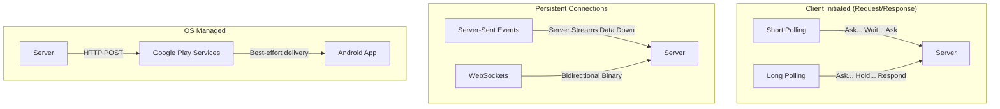

# Real-Time Data (Push vs Poll vs SSE vs WebSockets)

> **Canonical owner:** shared real-time transport mechanics and the four-way selection model live here. The focused [`sse-vs-websockets.md`](sse-vs-websockets.md) chapter applies this model as a decision between the two persistent-stream options; it should not redefine lifecycle, retry, or background-delivery semantics.

## Overview

The naive way to build a chat app is a `while(true)` loop making an HTTP `GET` every few seconds. That creates radio and server work even when nothing changed; the actual energy and capacity impact depends on cadence, lifecycle, cache validators, connection reuse, network, and update frequency.

A Staff Engineer distinguishes ordinary request-response exchanges from long-lived HTTP streams, upgraded connections, and platform push channels. Real-time synchronization still needs an explicit transport, lifecycle, delivery, and reconciliation model.

Choosing between Push Notifications, Polling, Server-Sent Events (SSE), and WebSockets materially affects latency, energy, infrastructure load, reliability, and implementation complexity.

## Why It Matters

Imagine a sports app showing live soccer scores.
- If 1 million active users each **poll** once per second, the fleet attempts about 60 million requests a minute before retries or lifecycle changes. Empty-response rate, cost, and energy depend on actual update frequency and infrastructure.
- If those users hold **WebSockets**, the service must capacity-plan long-lived connections, load balancers, file descriptors, memory, heartbeats, fan-out, and reconnect storms. Long-lived does not mean permanent, and exhaustion is not automatic.
- **FCM** is a best-effort notification/invalidation channel with no bounded live-score latency. Priority, Doze, app/device state, delegation, and server policy can delay or drop delivery.

Every real-time protocol is a tradeoff between Latency, Battery Drain, Server Load, and Connection Reliability.

## The Options (First Principles)

### 1. Polling
The client asks the server on a timer (`setInterval`).
- **Short Polling:** Ask every X seconds. Its suitability depends on cadence, freshness, lifecycle, conditional requests, update rate, and measured device/server cost.
- **Long Polling:** The client asks. The server holds the request open (does not reply) until data is available, then replies. The client immediately asks again.
- *Best For:* Low-frequency or lifecycle-bound freshness, conditional synchronization, simple infrastructure, and a bounded fallback when persistent delivery is unavailable or unnecessary.

### 2. FCM Push Notifications (The OS Native)
The server submits a bounded message to FCM, and Google Play services/platform messaging infrastructure handles device delivery. Depending on message type, priority, app state, Doze, delegation, and device policy, delivery may invoke app code, display a notification, be delayed, or be dropped.
- *Best For:* Best-effort user-visible notifications or invalidation hints that cause the client to reconcile durable state when delivery/background constraints allow.

### 3. Server-Sent Events / SSE (The Unidirectional Pipe)
The client makes an HTTP request and the server replies with `Content-Type: text/event-stream`, keeping the response open while events are available. The stream can end because of lifecycle, timeout, proxy, network, or server policy. SSE itself is server-to-client; client-to-server commands use another request or transport.
- *Best For:* Live feeds where data only flows one way (Live Scores, Stock Tickers, News Feeds).

### 4. WebSockets (The Bidirectional Pipe)
The client and server negotiate a long-lived framed bidirectional connection. Its ownership follows the selected feature/process lifecycle; intermediaries, network changes, and product policy determine how long it remains useful.
- *Best For:* True bi-directional real-time communication (Multiplayer Gaming, Chat Apps, Collaborative Editing).

## Mental Model

Think of Real-Time communication as **Getting news from a Friend**.
- **Polling:** You call your friend every 5 minutes and ask "Any news?". They usually say "No." (Annoying for both).
- **Long Polling:** You call your friend. They don't say hello, they just stay on the line breathing silently for 3 hours until they have news, tell you, and hang up. You immediately call them back.
- **Push Notifications:** Your friend sends you a text message. Your phone buzzes.
- **SSE:** Your friend calls you and plays a radio broadcast. You can listen, but if you speak, they can't hear you.
- **WebSockets:** You and your friend are on a live phone call, talking back and forth simultaneously.

## Architecture

## Internal Mechanics and Tradeoffs

### 1. WebSockets vs SSE
This is the most common debate. If you are building a Stock Trading app (where prices stream down constantly, but the user only occasionally clicks "Buy"), you might assume WebSockets.

**Why SSE is often better than WebSockets for Unidirectional data:**
- SSE uses an HTTP response stream, which can fit existing HTTP infrastructure, but proxy buffering and idle timeouts still require configuration. WebSockets are widely supported by modern gateways; sticky routing is needed only when server-side state requires it.
- Some EventSource implementations provide reconnection and event IDs. Android clients still need an explicit retry/backoff, authentication, replay, and gap policy; WebSocket clients need the same product-level continuity decisions.
- SSE can use an HTTP/2 stream. WebSocket transport and multiplexing support depend on protocol/library choices, so measure connection and intermediary behavior rather than relying on a universal port-count claim.

*(See the focused [SSE vs WebSockets decision](sse-vs-websockets.md) for criteria, defaults, and reversal triggers).*

### Shared continuity contract

Neither SSE nor WebSocket delivery is durable merely because a connection stays open. Define the same product-level continuity contract for both:

- Reconnect with bounded exponential backoff plus jitter; honor server retry hints and reset the attempt window only after a sufficiently stable session.
- Resume from a durable event ID/cursor when the protocol and backend support it; otherwise reconcile authoritative state and deduplicate by event ID.
- Tie the connection to an explicit feature/process owner. When that owner is inactive or continuity is uncertain, close or suspend the stream according to product policy and reconcile on resumption.
- Treat heartbeat cadence as measured infrastructure policy, not a protocol constant.

### 2. The Battery Cost of WebSockets
On Android, cellular data activity can change radio state and add promotion or tail energy. Magnitude depends on radio technology, carrier, signal, device, batching, concurrent traffic, and interval.
A WebSocket does not require a universal heartbeat interval; for example, OkHttp sends no pings unless configured. Choose a heartbeat only when measured server, NAT, carrier, or intermediary idle policy requires it. Heartbeats and other traffic can increase radio wakeups and tail energy, but the cost depends on interval, network, batching, device, and connection lifecycle rather than keeping the radio permanently active.

*Default:* Do not keep a WebSocket alive merely to receive background updates. Tie an interactive socket to a process- or feature-level lifecycle, close it when no foreground experience needs it, and use FCM as a best-effort invalidation or notification trigger. `Activity.onStop()` is not a universal socket boundary: multi-window, picture-in-picture, foreground services, calls, navigation between activities, and process-scoped connection managers require an explicit product lifecycle.

### 3. FCM "Data" vs "Notification" Messages
Firebase Cloud Messaging (FCM) allows two payload types:
- **Notification Payload:** When the app is backgrounded, the FCM SDK normally displays the notification and delivers launcher intent extras when the user taps it; `onMessageReceived` is not called for that notification payload. Foreground messages are delivered to `onMessageReceived`. Data-only and mixed notification-plus-data messages have different background behavior, so “app code never runs” is not a safe general model.
- **Data Payload (FCM) / Background Push (APNs):** Delivery is best-effort; a message is a trigger to reconcile durable server state, not the state itself. On Android, `onMessageReceived` receives a short processing window—Firebase documents several seconds, with slightly more time for high-priority messages—not a stable ten-second guarantee. Do only the work needed to render the notification or persist a handoff. If additional work is necessary, schedule the documented WorkManager path and account for high-priority messages being deprioritized when they do not produce user-visible notifications. On iOS, background delivery is likewise governed by system policy and can be delayed or dropped.

*Contextual default for chat:* Use data messages when the client must control notification rendering or persist a small handoff before rendering, while accounting for delivery priority, background limits, and server policy. On Android 13+, `POST_NOTIFICATIONS` controls whether the app may display non-exempt notifications; denial does not itself prevent an FCM data message from reaching `FirebaseMessagingService`. Treat the push as a hint: reconcile the authoritative message stream, deduplicate by message ID, persist it transactionally, and let database observation update visible UI. A notification payload or mixed payload can be preferable when SDK-managed display is more important than executing client logic, subject to display permission and platform policy.

## Failure Modes

- **The WebSocket Reconnection Storm (Thundering Herd):**
  A shared load-balancer or network failure can disconnect a large client cohort. If clients use the same immediate retry schedule, their reconnection attempts synchronize and can overload recovering capacity.
  *(Fix: Use bounded exponential backoff with jitter, honor server hints, cap concurrent connection establishment, and reset backoff only after a sufficiently stable session.)*
- **Assuming Push Notifications are Guaranteed:**
  Doze, app standby, message priority/deprioritization, OEM policy, process state, expiration, and user settings can delay or suppress delivery; manual allowlisting is not a universal prerequisite or remedy.
  *(Fix: Treat background delivery as discontinuous. Reconcile authoritative state with a durable cursor on gaps, staleness, `onDeletedMessages`, or lifecycle resumption as product freshness requires, using the app's supported sync transport.)*
- **Polling over HTTP/1.1:**
  HTTP/1.1 supports persistent pooled connections, so a poll does not inherently create a new TCP/TLS connection. Frequent requests still consume radio, server, and application work, especially when keep-alive or pooling fails.
  *(Fix: Verify connection reuse and protocol negotiation, then choose polling cadence from freshness, conditional requests, lifecycle, and measured energy/server cost.)*

## Staff Engineer Thinking

When designing a real-time feature, a Staff engineer focuses on the State Machine transitions between Foreground and Background.

1.  **A hybrid approach:**
    - *Interactive lifecycle:* Establish a WebSocket while the owning chat feature or process has a foreground consumer. Measure latency rather than assuming a fixed value.
    - *No foreground consumer:* Close the socket when the selected owner no longer needs it. Use FCM as a best-effort alert or invalidation hint, persist a small handoff when delivered, and do not treat the push as authoritative state.
    - *Resumption or uncertain continuity:* Reconcile from a durable server cursor or event ID, deduplicate locally, and re-establish the socket. Multi-window, picture-in-picture, calls, and foreground services may keep the owner active after one activity stops.
2.  **WebSockets vs gRPC streams:** Choose [gRPC bidirectional streams](transport-protocols.md) when Protobuf contracts, HTTP/2 infrastructure, generated clients, and streaming semantics fit. WebSockets provide transport frames, not an application schema; teams can still define a typed binary or JSON envelope. Compare intermediary support, backpressure, observability, deployment, and client-library constraints.
3.  **Connection-state UX:** Surface stale, reconnecting, or offline state when it changes a user's decision or trust—for example, live bidding. The UI treatment should follow product risk and freshness policy; background or non-interactive streams may need telemetry rather than a global banner.

## Common Misconceptions

- **"WebSockets are always faster than HTTP requests."** False. Establishment cost depends on DNS, connection reuse, TLS version/resumption, proxying, and HTTP version. A one-shot request may reuse an existing connection, while a healthy WebSocket can avoid per-message request overhead. Measure the actual session and message pattern.
- **"FCM Push Notifications are real-time."** False. FCM is best-effort and publishes no general application-level delivery bound; delay or loss depends on message priority, expiry, app/device state, Doze, deprioritization, and network conditions.

## Probing Questions

1.  Explain the architectural flaw of using "Short Polling" (e.g., an HTTP GET every 1 second) for a mobile chat application regarding both device battery and server load.
2.  Describe the "Thundering Herd" problem in the context of WebSocket disconnections, and how implementing "Jitter" prevents it.
3.  Why is Server-Sent Events (SSE) often a superior choice to WebSockets for a Live Sports Score application?
4.  What is the fundamental difference between an FCM "Notification" payload and an FCM "Data" payload regarding background execution on Android?
5.  How should a Staff Engineer choose the lifecycle boundary for an interactive WebSocket, and why is `Activity.onStop()` not universal?
6.  How does the Android OS's "Doze Mode" and aggressive OEM battery optimizations (e.g., Xiaomi/Huawei) impact the reliability of FCM Push Notifications?
7.  Describe the "Hybrid Approach" to real-time mobile data, combining REST, WebSockets, and FCM depending on the app's foreground/background state.
8.  Why is it dangerous to rely entirely on FCM Push Notifications to keep a local SQLite database synchronized with the server? What must happen when the app is brought to the foreground?
9.  Explain the difference in network traversal (Firewalls, Proxies, Load Balancers) between SSE (which uses standard HTTP) and WebSockets (which require a protocol upgrade).
10. If an application requires a persistent bidirectional connection, why might an engineering team choose gRPC Bidirectional Streaming over raw WebSockets?

## Answer Key

1. **Explain the architectural flaw of using "Short Polling" (e.g., an HTTP GET every 1 second) for a mobile chat application regarding both device battery and server load.**
   A fixed high-frequency poll creates requests even when state is unchanged, adding radio wake/tail energy and server work. The actual empty-response rate and battery impact depend on update frequency, cache validators, pooling, lifecycle, network, and device, so measure them and select a bounded fallback cadence.
2. **Describe the "Thundering Herd" problem in the context of WebSocket disconnections, and how implementing "Jitter" prevents it.**
   A shared failure can disconnect many clients. Identical immediate retry schedules synchronize their reconnection load and may overload recovering capacity. Jitter randomizes bounded backoff so attempts spread over time; server hints and connection-rate limits add protection.
3. **Why is Server-Sent Events (SSE) often a superior choice to WebSockets for a Live Sports Score application?**
   Live scores are mostly server-to-client, so SSE's HTTP stream and event-ID/reconnect model can be a good fit. The decision still depends on Android client support, proxy buffering/timeouts, replay requirements, authentication, and whether bidirectional control is needed.
4. **What is the fundamental difference between an FCM "Notification" payload and an FCM "Data" payload regarding background execution on Android?**
   For a backgrounded app, the FCM SDK normally displays a notification payload without invoking `onMessageReceived`; foreground and mixed-payload behavior differs. A data message may be delivered to `FirebaseMessagingService` for a short processing window, but delivery is best-effort: normal priority may be delayed by Doze, and high priority can be deprioritized when it is misused. Persist a small handoff and reconcile durable server state rather than treating delivery as immediate or guaranteed.
5. **How should a Staff Engineer choose the lifecycle boundary for an interactive WebSocket, and why is `Activity.onStop()` not universal?**
   Own the socket at the narrowest feature or process scope that matches the product experience, and close it when no foreground consumer needs it. `Activity.onStop()` is suitable only when that activity exclusively owns the connection; multi-window, picture-in-picture, navigation, calls, or a foreground service may require a longer-lived owner. The explicit boundary prevents unnecessary pings without tearing down a connection another visible experience still uses.
6. **How does the Android OS's "Doze Mode" and aggressive OEM battery optimizations (e.g., Xiaomi/Huawei) impact the reliability of FCM Push Notifications?**
   Doze and device/app policy can defer normal-priority delivery and restrict follow-up work; misuse can also cause high-priority deprioritization. Delivery may be delayed or lost, and manual allowlisting is neither universally required nor a guarantee, so clients reconcile durable state independently.
7. **Describe the "Hybrid Approach" to real-time mobile data, combining REST, WebSockets, and FCM depending on the app's foreground/background state.**
   Use WebSockets or SSE while the selected foreground feature/process lifecycle needs interactive updates. When no foreground consumer remains, close the connection and use FCM as a best-effort alert or invalidation hint. On resume—or whenever continuity is uncertain—reconcile durable state with the server, deduplicate events, and re-establish the stream.
8. **Why is it dangerous to rely entirely on FCM Push Notifications to keep a local SQLite database synchronized with the server? What must happen when the app is brought to the foreground?**
   FCM can delay, collapse, expire, or drop messages, so it cannot be the database's authoritative event log. On gaps, staleness, deleted-message signals, or resume as required by the freshness policy, reconcile from a durable server cursor using the product's supported sync transport and deduplicate results.
9. **Explain the difference in network traversal (Firewalls, Proxies, Load Balancers) between SSE (which uses standard HTTP) and WebSockets (which require a protocol upgrade).**
   SSE stays within an HTTP response stream and often fits existing HTTP infrastructure, but proxy buffering, idle timeouts, authentication, and client support still require validation. WebSockets use an HTTP upgrade (or extended CONNECT with HTTP/2) and require end-to-end support; modern infrastructure may support them, but timeout and upgrade policy can still differ.
10. **If an application requires a persistent bidirectional connection, why might an engineering team choose gRPC Bidirectional Streaming over raw WebSockets?**
    gRPC supplies generated Protobuf contracts and defined RPC streaming semantics. WebSockets supply frames, so the team owns its envelope, schema evolution, backpressure, and error model. Protobuf is often compact but not guaranteed smaller for every payload; choose based on measured size plus infrastructure, interoperability, and lifecycle needs.

## Further Reading

- [`transport-protocols.md`](transport-protocols.md) — How HTTP/2 multiplexing impacts SSE and Polling.
- [`process-death-and-state-restoration.md`](../android/architecture/process-death-and-state-restoration.md) — Why process death invalidates in-process connection state and requires durable resumption.
- [`sse-vs-websockets.md`](sse-vs-websockets.md) — The specific Architecture Decision Record detailing why SSE was chosen over WebSockets for one-way streams.
- [Firebase: Receive messages on Android](https://firebase.google.com/docs/cloud-messaging/android/receive) — Callback behavior and processing window.
- [Firebase: Message priority](https://firebase.google.com/docs/cloud-messaging/android/message-priority) — High-priority handling, deprioritization, and follow-on work.
