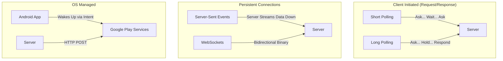

# Real-Time Data (Push vs Poll vs SSE vs WebSockets)

## Overview

A Junior Engineer building a Chat app uses a `while(true)` loop to make an HTTP `GET` request every 3 seconds to see if there are new messages. The phone's battery dies in an hour, and the backend server crashes from the DDOS attack.

A Staff Engineer understands that HTTP was fundamentally designed as a Request-Response protocol. The Client must ask. The Server cannot speak unless spoken to. To achieve "Real-Time" synchronization (Chat, Live Scores, Ride-Hailing GPS), we must break or bend this rule. 

Choosing between Push Notifications, Polling, Server-Sent Events (SSE), and WebSockets is one of the most critical architectural decisions in mobile development. Choosing wrong will destroy either your server bill or the user's battery life.

## Why It Matters

Imagine a sports app showing live soccer scores.
- If you **Poll** every 1 second, 1 million active users generate 60 million HTTP requests a minute. Your AWS bill will be astronomical, and 99% of those requests will return "No changes."
- If you use **WebSockets**, you open 1 million permanent TCP connections on your server. Your load balancers run out of ports and crash.
- If you use **FCM Push**, the latency might be up to 30 seconds, defeating the purpose of "live" scores.

Every real-time protocol is a tradeoff between Latency, Battery Drain, Server Load, and Connection Reliability.

## The Options (First Principles)

### 1. Polling (The Brute Force)
The client asks the server on a timer (`setInterval`).
- **Short Polling:** Ask every X seconds. (Terrible for mobile).
- **Long Polling:** The client asks. The server holds the request open (does not reply) until data is available, then replies. The client immediately asks again.
- *Best For:* Legacy systems that absolutely cannot support persistent connections.

### 2. FCM Push Notifications (The OS Native)
The server sends a tiny payload (4KB) to Google's servers. Google uses a single, globally maintained TCP connection on the Android device to wake up the app.
- *Best For:* Waking the app up when it is in the background, or delivering low-frequency, high-value events (e.g., "Your Uber has arrived").

### 3. Server-Sent Events / SSE (The Unidirectional Pipe)
The client makes a standard HTTP request. The server replies with `Content-Type: text/event-stream`. The server keeps the HTTP connection open forever and just streams text data down to the client. The client *cannot* send data back on this connection.
- *Best For:* Live feeds where data only flows one way (Live Scores, Stock Tickers, News Feeds).

### 4. WebSockets (The Bidirectional Pipe)
The client and server perform an HTTP "Upgrade" handshake. The HTTP protocol is stripped away, leaving a raw, permanent, bidirectional TCP socket. Both sides can send binary or text frames at any time.
- *Best For:* True bi-directional real-time communication (Multiplayer Gaming, Chat Apps, Collaborative Editing).

## Mental Model

Think of Real-Time communication as **Getting news from a Friend**.
- **Polling:** You call your friend every 5 minutes and ask "Any news?". They usually say "No." (Annoying for both).
- **Long Polling:** You call your friend. They don't say hello, they just stay on the line breathing silently for 3 hours until they have news, tell you, and hang up. You immediately call them back.
- **Push Notifications:** Your friend sends you a text message. Your phone buzzes.
- **SSE:** Your friend calls you and plays a radio broadcast. You can listen, but if you speak, they can't hear you.
- **WebSockets:** You and your friend are on a live phone call, talking back and forth simultaneously.

## Architecture

## Internal Mechanics and Tradeoffs

### 1. WebSockets vs SSE
This is the most common debate. If you are building a Stock Trading app (where prices stream down constantly, but the user only occasionally clicks "Buy"), you might assume WebSockets.

**Why SSE is often better than WebSockets for Unidirectional data:**
- SSE uses standard HTTP. It passes through corporate firewalls, API Gateways, and Load Balancers perfectly. WebSockets require special load-balancer configurations (sticky sessions) because it breaks HTTP.
- SSE natively supports automatic reconnection (`EventSource`). If a WebSocket drops, you must write complex Exponential Backoff logic in Kotlin to reconnect it.
- SSE supports HTTP multiplexing (HTTP/2). WebSockets do not (they consume a dedicated physical TCP port).

*(See [ADR-003 SSE vs WebSockets](../backend-for-mobile/sse-vs-websockets.md) for a deeper architectural analysis).*

### 2. The Battery Cost of WebSockets
On Android, the cellular radio has power states (Active, Idle, Sleep). Waking the radio from Sleep to Active consumes massive battery power.
If you hold a WebSocket open, you must send a "Ping" packet every ~30 seconds so the server knows the client is still alive, and so the cellular ISP doesn't drop the idle connection. 

This Ping forces the cellular radio to stay in the "Active" state permanently. A background WebSocket will drain an Android battery in a few hours.

*Staff Rule:* NEVER keep a WebSocket alive when the app is in the background. Close it in `onStop()`. Rely on FCM Push Notifications to wake the app up if an urgent message arrives while backgrounded.

### 3. FCM "Data" vs "Notification" Messages
Firebase Cloud Messaging (FCM) allows two payload types:
- **Notification Payload:** The Android OS intercepts the message and automatically draws a system notification in the tray. Your app code *never runs* unless the user taps the notification.
- **Data Payload (FCM) / Background Push (APNs):** The OS wakes up your app in the background. On Android (FCM High Priority), you get up to 10 seconds of CPU time to process the JSON, sync your local Room database, and optionally draw your own notification. **However, on iOS**, APNs background pushes (even high priority) are strictly governed by the OS's battery and usage heuristics. If the user rarely opens your app, or the battery is low, iOS will silently throttle or drop your background pushes. You cannot guarantee waking the app on iOS.

*Staff Rule:* For chat apps, always use **Data Payloads** (with the understanding that iOS delivery is best-effort). When the message arrives, write it to the local SQLite database. Then, emit a Kotlin `Flow`. If the UI is open, the chat screen updates instantly. If the UI is closed, draw a notification.

## Failure Modes

- **The WebSocket Reconnection Storm (Thundering Herd):**
  You have 500,000 users connected via WebSockets. Your Load Balancer crashes and reboots. All 500,000 WebSockets drop instantly.
  The Android clients detect the drop and immediately try to reconnect. 500,000 TCP handshakes hit your Load Balancer at the exact same millisecond, instantly crashing it again.
  *(Fix: Mobile clients must implement "Jitter" — a randomized delay — in their reconnection logic. Client A waits 1 second, Client B waits 4 seconds).*
- **Assuming Push Notifications are Guaranteed:**
  Chinese OEMs (Xiaomi, Huawei, Oppo) ruthlessly modify the Android OS to save battery. They will completely kill your app, and they will ignore FCM Push Notifications unless the user manually whitelists your app in the device settings.
  *(Fix: You cannot rely on Push Notifications as a 100% reliable data transport. When the user opens the app, you MUST perform a REST API sync to fetch any messages that the OS dropped).*
- **Polling over HTTP/1.1:**
  If you are forced to poll, and you are using HTTP/1.1, every 3-second poll opens a new TCP connection, performing the 3-way handshake and TLS negotiation. This destroys the battery.
  *(Fix: Ensure `OkHttp` connection pooling is active and HTTP/2 is enabled on the server, so the polls reuse a single TCP socket).*

## Staff Engineer Thinking

When designing a real-time feature, a Staff engineer focuses on the State Machine transitions between Foreground and Background.

1.  **The Hybrid Approach (The Gold Standard):** 
    - *Foreground:* When the user opens the Chat screen, I establish a WebSocket. Latency is 10ms.
    - *Background:* When the user puts the app in the background, I close the WebSocket instantly. I rely entirely on FCM Data Pushes. If a push arrives, I write to the DB.
    - *Resumption:* When the app comes back to the foreground, I fire a `GET /sync?last_timestamp=X` REST call to catch up on any dropped pushes, and I re-establish the WebSocket.
2.  **WebSockets vs gRPC Streams:** If the team wants bidirectional streaming, I strongly push for [gRPC Bidirectional Streams](transport-protocols.md) over raw WebSockets. gRPC provides a strict schema (Protobuf), whereas WebSockets just send raw unstructured bytes/strings, leading to parsing crashes.
3.  **Connection State UI:** If we use SSE or WebSockets, the user *must* know if it drops. I mandate a "Connecting..." / "Offline" banner in the UI. If a user is staring at a live auction bidding screen, and the WebSocket drops silently, they will lose money and sue the company.

## Common Misconceptions

- **"WebSockets are always faster than HTTP REST."** False. Establishing a WebSocket takes 3 round-trips (TCP, TLS, HTTP Upgrade). A standard HTTP/2 REST call takes 2. If you only need to send one piece of data, REST is faster. WebSockets only win on latency *after* the connection is established.
- **"FCM Push Notifications are real-time."** False. FCM is a best-effort delivery system. During peak times (e.g., New Year's Eve), Google's FCM servers might delay a message by 5-10 minutes. 

## Probing Questions

1.  Explain the architectural flaw of using "Short Polling" (e.g., an HTTP GET every 1 second) for a mobile chat application regarding both device battery and server load.
2.  Describe the "Thundering Herd" problem in the context of WebSocket disconnections, and how implementing "Jitter" prevents it.
3.  Why is Server-Sent Events (SSE) often a superior choice to WebSockets for a Live Sports Score application?
4.  What is the fundamental difference between an FCM "Notification" payload and an FCM "Data" payload regarding background execution on Android?
5.  Explain why a Staff Engineer insists on closing active WebSockets when the Android `Activity` reaches the `onStop()` lifecycle state.
6.  How does the Android OS's "Doze Mode" and aggressive OEM battery optimizations (e.g., Xiaomi/Huawei) impact the reliability of FCM Push Notifications?
7.  Describe the "Hybrid Approach" to real-time mobile data, combining REST, WebSockets, and FCM depending on the app's foreground/background state.
8.  Why is it dangerous to rely entirely on FCM Push Notifications to keep a local SQLite database synchronized with the server? What must happen when the app is brought to the foreground?
9.  Explain the difference in network traversal (Firewalls, Proxies, Load Balancers) between SSE (which uses standard HTTP) and WebSockets (which require a protocol upgrade).
10. If an application requires a persistent bidirectional connection, why might an engineering team choose gRPC Bidirectional Streaming over raw WebSockets?

## Further Reading

- [`transport-protocols.md`](transport-protocols.md) — How HTTP/2 multiplexing impacts SSE and Polling.
- [`process-death-and-state-restoration.md`](../android/architecture/process-death-and-state-restoration.md) — How the Android OS aggressively kills background apps, destroying WebSockets.
- [`sse-vs-websockets.md`](sse-vs-websockets.md) — The specific Architecture Decision Record detailing why SSE was chosen over WebSockets for one-way streams.
