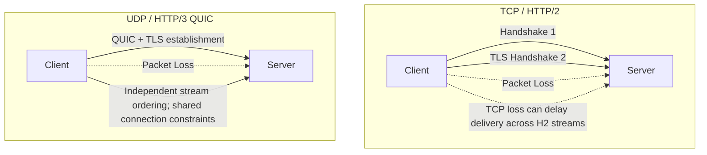

# Transport Protocols (HTTP/2, HTTP/3, gRPC)

## Overview

It's easy to call an API through `Retrofit` and treat everything below it as magic — as if the data teleports from the server to the phone.

A Staff Engineer understands that `Retrofit` is just a high-level facade over `OkHttp`, which is a facade over a raw Linux Socket, which transmits physical radio waves to a cell tower. The protocol that governs *how* those bytes are packed, ordered, and acknowledged across that radio link dictates whether the app feels fast or broken.

Understanding HTTP/1.1, HTTP/2, and HTTP/3 (QUIC) helps explain behavior under packet loss, latency variation, proxies, and Wi-Fi/cellular path changes. No version is universally best; negotiation, fallback, workload, and measured network cohorts determine the outcome.

## Why It Matters

Imagine an app loading a JSON feed plus five images.
- HTTP/1.1 can reuse persistent connections but cannot multiplex responses on one connection; a client may open several connections for parallelism.
- HTTP/2 can multiplex eligible streams on fewer connections when TLS/ALPN, origin, route, proxy, and server support align. Measure handshake and transfer savings on the product's target networks rather than assuming a fixed connection count or latency.
- Under HTTP/3, a Wi-Fi-to-cellular transition can use QUIC connection migration instead of necessarily creating a new connection. Migration depends on path validation, endpoint policy, available connection IDs, and the network; resumable delivery remains necessary.

## Historical Context

- **HTTP/1.1 (1997):** Persistent connections are the default, but one connection cannot multiplex response messages; clients often use multiple pooled connections for parallelism.
- **SPDY (2012):** Created by Google to fix HTTP/1.1 latency. It introduced multiplexing (sending multiple files over one connection). It became the foundation for HTTP/2.
- **HTTP/2 (2015):** Binary framing, multiplexing, and header compression can reduce connection and header overhead when negotiation, reuse, server behavior, and network conditions align.
- **HTTP/3 / QUIC (2022):** QUIC provides reliable encrypted streams over UDP and removes TCP's transport-level cross-stream ordering dependency. Streams still share connection congestion control and flow-control constraints.

## First Principles

1.  **TCP (Transmission Control Protocol):** Presents applications with a reliable, ordered byte stream or a connection failure. Loss of earlier bytes can delay delivery of later bytes even if later packets arrived.
2.  **UDP (User Datagram Protocol):** Sends independent datagrams without built-in reliability or ordering. Applications such as QUIC can add acknowledgement, retransmission, congestion control, encryption, and stream semantics above it.
3.  **Head-of-Line (HoL) Blocking:** TCP delivers one ordered byte stream, so loss can delay delivery of later bytes carrying multiple HTTP/2 streams. QUIC gives streams independent delivery ordering, while retaining shared connection constraints.
4.  **Multiplexing:** Packing multiple different streams of data (JSON, Image A, Image B) into a single physical connection simultaneously.
5.  **gRPC (gRPC Remote Procedure Calls):** An RPC framework that commonly uses HTTP/2 with schema-defined binary Protocol Buffer messages. Wire size depends on schema, values, framing, and optional message compression.

## Mental Model

Think of Transport Protocols as a **Highway System**.
- **HTTP/1.1:** Persistent roads can be reused, but one road does not multiplex multiple response messages; clients may open several roads for parallelism.
- **HTTP/2:** Multiple logical lanes share one ordered TCP road. Packet loss can delay delivery across lanes carried after the missing bytes.
- **HTTP/3 (QUIC):** Logical lanes have independent stream ordering, so missing data for one stream need not block already-received data on another. All lanes still share congestion and connection-level flow-control constraints.

## Internal Mechanics

### 1. HTTP/2 and Multiplexing

OkHttp can negotiate HTTP/2 when the route, TLS/ALPN, proxy, origin, and server support it, and it reuses eligible pooled connections. It may open another connection for route or policy changes, saturation, failure, or network migration.

```kotlin
// These calls may share an eligible HTTP/2 connection and multiplex streams.
api.getUser()
api.getPosts()
api.getFriends()
```
The server interleaves frames from multiple response streams on one connection, and the HTTP client maps them back to their streams. Reuse `OkHttpClient` instances when their configuration is compatible so calls share connection and thread pools. “Exactly one client for the entire app” is not an invariant: separate clients can be justified for distinct trust stores, proxies, authenticators, network bindings, or lifecycle boundaries, and related clients can share a `ConnectionPool` explicitly.

### 2. HTTP/3 (QUIC) and Connection Migration

On a mobile phone, when you walk out your front door, your phone switches from your Home Router (IP: `192.168.1.5`) to the Cellular Tower (IP: `10.45.2.1`).
TCP identifies a connection by endpoint addresses and ports. A path or address change generally prevents an existing TCP connection from continuing unless an extension or platform mechanism preserves it; failure detection may take time rather than being instantaneous. Applications still need timeouts, retries, and resumable downloads.

QUIC runs over UDP and uses **Connection IDs** so a connection is not bound only to one network path. An endpoint can validate a new path and migrate the connection when peer policy, connection-ID availability, address validation, NAT, carrier, and implementation behavior permit it. Migration can still introduce delay or fail; it does not guarantee that a download continues invisibly.

Network transitions can also change the path's Maximum Transmission Unit (MTU). Both TCP and QUIC implementations may use Path MTU Discovery, but probing behavior and black-hole recovery depend on the implementation and path. HTTP/3 connection migration therefore avoids tying a connection to one IP address; it does not by itself guarantee uninterrupted delivery across every carrier or MTU change. Downloads still need resumable transfers, timeouts, and retry handling.

### 3. gRPC and Protocol Buffers (Protobuf)

JSON represents numbers as text, while Protocol Buffers encode typed fields in a binary wire format. For example, the positive integer `12345` takes five ASCII bytes in JSON before structural overhead and two varint bytes in Protobuf before its field tag; total message size depends on schema, values, compression, and framing.

gRPC is a framework built on top of HTTP/2 that transmits Protobufs. It is heavily used for internal microservice communication, but increasingly adopted for Mobile-to-Server communication to save battery and bandwidth.

## Architecture



## Production Example

**Evaluating a gRPC migration**

A real-time multiplayer Android game currently uses JSON polling. Before choosing a replacement, the team records device model, OS, network profile, session duration, payload distribution, sample size, negotiated protocol, CPU/allocation traces, latency percentiles, and an energy proxy or power measurement.

One candidate is **gRPC bidirectional streaming**:

1. The Android client and the Backend share a `.proto` file (the contract).
2. Protobuf and gRPC plugins generate Kotlin message types and RPC stubs; the runtime and channel implementation perform transport work.
3. The Android app opens a single HTTP/2 connection.
4. The client streams binary joystick movements up.
5. The server streams binary player positions down on the exact same connection simultaneously.

The team then repeats the same benchmark against the candidate and reports observed wire bytes, CPU/allocation cost, latency, reconnect behavior, and energy with variance. Protobuf still requires decoding and object construction; no payload, parsing, or battery improvement is assumed without those results.

## Tradeoffs

**gRPC vs REST/JSON**

- **REST/JSON:**
    - *Pros:* Human-readable payloads and mature HTTP, proxy, CDN, and browser tooling; generated models can still provide typed client boundaries.
    - *Cons:* Text encoding and parsing may cost more for some schemas, and application contracts need explicit validation and evolution policy.
- **gRPC/Protobuf:**
    - *Pros:* Generated schema-defined contracts, often compact binary encoding, and first-class unary and streaming RPC semantics.
    - *Cons:* Wire or semantic compatibility can still break separately built clients; binary inspection needs descriptors/decoders, and teams own `.proto` evolution plus a compatible gRPC/Protobuf toolchain.

*Staff Decision:* Choose REST, gRPC, SSE, or WebSockets from payload shape, interaction direction, compatibility, caching, tooling, infrastructure, and measured latency/energy needs. Highly interactive products do not make any one transport mandatory.

## gRPC and Protobuf for Mobile

gRPC can provide schema-defined contracts, and Protobuf may reduce wire size or parsing cost for suitable payloads. The benefit depends on schema, values, parser, device, and workload, while the operational contract and toolchain are heavier than a typical REST/JSON integration.

| Concern | REST/JSON | gRPC/Protobuf |
|---|---|---|
| Debugging | Human-readable with proxy tools | Needs protobuf descriptors/decoders |
| Schema evolution | Loose but easy to break accidentally | Strong field-number rules |
| Streaming | SSE/WebSocket or polling | First-class unary, server, client, bidi streams |
| Browser/CDN compatibility | Excellent | More limited |
| Mobile generated code | Retrofit/Ktor simple | gRPC/Wire/protobuf toolchain |
| Partial rollout | Endpoint/version based | Proto compatibility and method rollout |

### Protobuf evolution rules

- Never reuse field numbers.
- Reserve removed field numbers and names.
- Add fields as optional/nullable-compatible.
- Do not change field type for an existing number.
- Keep enum unknown handling.
- Treat default values carefully; absence and default can be hard to distinguish.
- Version behavior, not only schema.

```proto
message CheckoutRequest {
  string idempotency_key = 1;
  string cart_id = 2;
  reserved 3;
  reserved "legacy_coupon_code";
}
```

### Streaming reconnect semantics

Any mobile stream must define:

- Resume token or last-seen sequence.
- Heartbeat interval.
- Backoff with jitter.
- Maximum background lifetime.
- Authentication refresh behavior.
- Duplicate event handling.
- Out-of-order event handling.
- Full resync trigger.

```json
{
  "lastSequence": 8812,
  "resumeToken": "thread-123:8812"
}
```

Without resume semantics, a stream is only a live socket, not a reliable mobile sync protocol.

### Mobile streaming defaults

| Stream type | Foreground | Background |
|---|---|---|
| Chat active thread | WebSocket/gRPC stream acceptable | Push + delta sync |
| Ride tracking | WebSocket/gRPC while trip visible/active | Foreground service only if user-visible |
| Market ticks | Stream while screen visible | Push/alerts/watchlist sync |
| Presence | Best-effort stream | Usually off |
| Analytics | Batch upload | WorkManager constraints |

## Transport Decision Checklist

- Does the feature need request/response, server streaming, client streaming, or bidirectional streaming?
- Is payload size or parse CPU a real measured problem?
- Do old app versions need to understand new schema?
- Can the team debug binary payloads in production?
- Does the stream have resume tokens and dedup IDs?
- What happens on Wi-Fi to cellular migration?
- Is there a fallback when HTTP/3/UDP is blocked?
- Are connections closed when the product session ends?
- Are retries idempotent?
- Are transport metrics segmented by network type and app state?

## Failure Modes

- **The `OkHttpClient` Instance Leak:**
  A developer builds a new `OkHttpClient` for each call instead of reusing or deriving clients with compatible policies.
  *(Failure: Independent clients own separate pools and dispatchers and usually reduce reuse, increasing sockets, threads, handshakes, latency, and radio work. A new TCP connection is likely in this pattern but not a universal per-call guarantee.)*
- **Assuming HTTP/3 is Ubiquitous:**
  A developer assumes HTTP/3 is active because they turned it on in their AWS API Gateway.
  *(Failure: Some enterprise, carrier, proxy, or captive-portal paths block or impair UDP/QUIC. Use a networking stack with bounded standards-aware fallback to a supported TCP-based HTTP version, and observe negotiated protocol and fallback latency.)*

## Staff Engineer Thinking

When auditing the network layer, a Staff engineer focuses on the physical transport layer.

1.  **Protocol observation:** Segment negotiated protocol by route, proxy, carrier, and network type. Investigate unexpected HTTP/1.1, but verify ALPN, origin, proxy, client, server, and fallback constraints before labeling the gateway misconfigured.
2.  **Connection pooling and origins:** Different origins often require separate connections, though eligible HTTP/2 coalescing can share one when DNS route/IP, certificate, proxy, and client policy align. Consolidate domains only after measuring reuse and considering CDN, security, failure-domain, and ownership tradeoffs.
3.  **QUIC Evaluation:** I evaluate HTTP/3 through a supported Android client and measure it by network cohort. Connection migration can reduce failures during some Wi-Fi-to-cellular transitions, but the benefit is workload-, path-, carrier-, and implementation-dependent. A percentage belongs here only when it comes from the product's controlled experiment with confidence bounds and a defined error metric.

## Common Misconceptions

- **"JSON is always fast enough."** Parsing and object construction can consume CPU and allocate memory, but cost depends on payload, schema, parser, generated adapters, compression, and device. Protobuf can reduce wire size and parsing work for suitable contracts; benchmark representative messages before migrating.
- **"HTTP/2 solves all network problems."** Multiplexing removes HTTP/1.1's per-connection response serialization, but HTTP/2 streams share TCP's ordered byte stream, so packet loss can delay delivery across streams. QUIC was designed in part to provide independent stream ordering, while congestion and connection-level flow control remain shared.

## Probing Questions

1.  Explain the transport services TCP provides compared with UDP, and why QUIC implements reliable encrypted streams over a UDP substrate.
2.  What is "Multiplexing" in HTTP/2, and how does it specifically improve battery life and latency on a mobile device?
3.  Describe "Head-of-Line Blocking." Why does HTTP/2 suffer from it, and how does HTTP/3 (QUIC) resolve it?
4.  Why is unnecessary `OkHttpClient` proliferation expensive, and when are separate clients justified?
5.  Under what conditions can QUIC connection IDs let a transfer continue after a Wi-Fi/cellular path change, and what retry/resume fallback is required when migration fails?
6.  Why does an HTTP/3 deployment normally retain a TCP-based HTTP/2 or HTTP/1.1 fallback, and which layer should own it?
7.  Which payload, parser, schema, and device factors determine JSON-versus-Protobuf parsing cost, and how would you measure whether migration is justified?
8.  How do multiple API origins affect HTTP/2 connection reuse, and when can eligible connection coalescing share a connection across hostnames?
9.  What extra schema/tooling does debugging Protobuf traffic require compared with reading JSON payloads?
10. If an Android application is suffering from massive Garbage Collection pauses during network requests, why might a Staff Engineer suggest migrating from JSON to Protobuf?

## Answer Key

1. **Explain the transport services TCP provides compared with UDP, and why QUIC implements reliable encrypted streams over a UDP substrate.**
   TCP exposes one reliable ordered byte stream or a connection failure; UDP supplies unordered, unreliable datagrams. QUIC builds reliability, congestion control, encryption, and multiple independently ordered streams in user space over UDP, so loss in one stream need not delay delivery of already-received data in another. Shared congestion and flow-control constraints still apply.
2. **What is "Multiplexing" in HTTP/2, and how does it specifically improve battery life and latency on a mobile device?**
   Multiplexing interleaves multiple request/response streams over an eligible connection. Reuse can avoid some extra TCP/TLS handshakes and sockets; latency and energy savings depend on connection state, workload, packet loss, server limits, and radio behavior and therefore require measurement.
3. **Describe "Head-of-Line Blocking." Why does HTTP/2 suffer from it, and how does HTTP/3 (QUIC) resolve it?**
   TCP exposes one ordered byte stream, so missing bytes can delay delivery of later HTTP/2 frames across streams. QUIC gives streams independent delivery ordering, so loss of one stream's data need not block already-received data on another, though streams still share congestion and connection-level flow control.
4. **Why is unnecessary `OkHttpClient` proliferation expensive, and when are separate clients justified?**
   Independently configured clients normally own separate pools and dispatchers, reducing connection reuse and adding sockets, threads, handshakes, latency, and radio work. Reuse a client or derive one with `newBuilder()` when policies are compatible. Separate clients are justified when security, proxy, authentication, network-binding, or lifecycle isolation is intentional; pools may also be shared explicitly.
5. **Under what conditions can QUIC connection IDs let a transfer continue after a Wi-Fi/cellular path change, and what retry/resume fallback is required when migration fails?**
   QUIC Connection IDs let endpoints associate packets with an existing connection across address changes. The endpoint validates the new path and may migrate without a new cryptographic handshake, but peer policy, NATs, unavailable connection IDs, path validation, or implementation choices can prevent or delay migration. Downloads therefore still need resumability and retry.
6. **Why does an HTTP/3 deployment normally retain a TCP-based HTTP/2 or HTTP/1.1 fallback, and which layer should own it?**
   Some paths block or impair UDP, and HTTP/3 negotiation or connection establishment can fail. A production HTTP stack therefore normally races or falls back to a supported TCP-based HTTP version according to its protocol policy and cached reachability information. Prefer the networking library's standards-aware fallback rather than implementing ad hoc application retries that duplicate non-idempotent requests.
7. **Which payload, parser, schema, and device factors determine JSON-versus-Protobuf parsing cost, and how would you measure whether migration is justified?**
   JSON parsing decodes text and constructs the application's object model; Protobuf decodes schema-defined binary tags and often uses fewer bytes. Either format allocates the resulting objects, and CPU/GC differences depend on payload, parser, adapters, schema, and device, so benchmark the target workload.
8. **How do multiple API origins affect HTTP/2 connection reuse, and when can eligible connection coalescing share a connection across hostnames?**
   Different origins often use separate connections, but a client may coalesce eligible hostnames when DNS route/IP, certificate coverage, proxy, and client policy permit it. Measure actual reuse before consolidating domains, because security, CDN, and failure isolation may justify separation.
9. **What extra schema/tooling does debugging Protobuf traffic require compared with reading JSON payloads?**
   Protobuf wire data uses numeric tags rather than human-readable field names. With the matching descriptors and a capable decoder, proxy or capture tools can reconstruct fields; without them, inspection is limited to opaque bytes and transport metadata.
10. **If an Android application is suffering from massive Garbage Collection pauses during network requests, why might a Staff Engineer suggest migrating from JSON to Protobuf?**
    If profiling attributes allocation pressure or long parsing work to large JSON payloads, a schema-based binary format may reduce wire size and some parsing allocations. It does not eliminate object allocation or GC, and contract migration cost may outweigh the gain; compare representative payloads and generated parsers first.

## Further Reading

- [`jank.md`](../android/performance/jank.md) — How large-payload parsing and allocation pressure can contribute to GC work and dropped frames.
- [`retrofit-and-okhttp.md`](../android/networking-and-security/retrofit-and-okhttp.md) — The Android library responsible for managing the HTTP/2 connection pool.
- [`push-vs-poll-vs-sse-vs-websockets.md`](push-vs-poll-vs-sse-vs-websockets.md) — Alternative protocols for real-time bidirectional communication.
- [OkHttp `OkHttpClient`](https://square.github.io/okhttp/5.x/okhttp/okhttp3/-ok-http-client/index.html) — Client reuse and shared resources.
- [RFC 9000 §9: Connection Migration](https://www.rfc-editor.org/rfc/rfc9000.html#section-9) — QUIC migration requirements and limitations.
