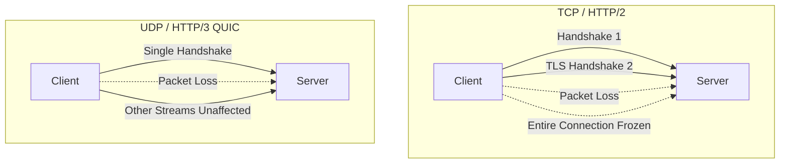

# Transport Protocols (HTTP/2, HTTP/3, gRPC)

## Overview

It's easy to call an API through `Retrofit` and treat everything below it as magic — as if the data teleports from the server to the phone.

A Staff Engineer understands that `Retrofit` is just a high-level facade over `OkHttp`, which is a facade over a raw Linux Socket, which transmits physical radio waves to a cell tower. The protocol that governs *how* those bytes are packed, ordered, and acknowledged across that radio link dictates whether the app feels fast or broken.

Understanding the evolution from HTTP/1.1 to HTTP/2 to HTTP/3 (QUIC) is critical. Mobile networks suffer from packet loss, latency spikes, and IP address changes (switching from Wi-Fi to Cellular). Standard desktop protocols fail miserably under these conditions.

## Why It Matters

Imagine an app loading a user's feed. The app needs to download 1 JSON file and 5 Images.
- Under HTTP/1.1, the phone must open 6 separate TCP connections. Opening a TCP/TLS connection on a 3G network takes 500ms. Just the *handshakes* take 3 seconds before any images download.
- Under HTTP/2, the phone opens 1 single TCP connection and multiplexes all 6 files simultaneously. It saves 2.5 seconds of handshake latency.
- Under HTTP/3, if the user walks out of their house (losing Wi-Fi and switching to 5G), the connection doesn't even drop. The download continues seamlessly because HTTP/3 does not bind to the physical IP address.

## Historical Context

- **HTTP/1.1 (1997):** Text-based. Line-by-line processing. One request per connection. To download 5 images, browsers opened 5 physical TCP sockets, clogging the network.
- **SPDY (2012):** Created by Google to fix HTTP/1.1 latency. It introduced multiplexing (sending multiple files over one connection). It became the foundation for HTTP/2.
- **HTTP/2 (2015):** Binary framing. Multiplexing. Header compression. Drastically improved mobile performance by reusing a single TCP connection.
- **HTTP/3 / QUIC (2022):** TCP is fundamentally broken for mobile because of "Head-of-Line Blocking" (if one packet is lost, the entire connection freezes). Google invented QUIC, throwing away TCP entirely and building a reliable protocol on top of UDP.

## First Principles

1.  **TCP (Transmission Control Protocol):** The standard internet protocol. Guarantees delivery and order. If packet #3 is dropped, TCP halts packet #4, #5, and #6 until #3 is re-transmitted.
2.  **UDP (User Datagram Protocol):** Fire-and-forget. Fast. No guarantees. If packet #3 drops, UDP doesn't care, it keeps sending #4.
3.  **Head-of-Line (HoL) Blocking:** The fundamental flaw of TCP. One lost packet stops the entire traffic jam.
4.  **Multiplexing:** Packing multiple different streams of data (JSON, Image A, Image B) into a single physical connection simultaneously.
5.  **gRPC (gRPC Remote Procedure Calls):** A Google framework that uses HTTP/2 under the hood to send highly compressed binary Protocol Buffers instead of massive text JSON.

## Mental Model

Think of Transport Protocols as a **Highway System**.
- **HTTP/1.1:** A single-lane dirt road. You send a truck (Request). You must wait for the truck to return (Response) before sending the next truck.
- **HTTP/2:** A massive 6-lane highway. You can send 6 trucks simultaneously. *However*, if there is an accident in lane 1 (a dropped packet), the Police halt the *entire highway* (TCP Head-of-Line blocking) until the accident is cleared.
- **HTTP/3 (QUIC):** A massive 6-lane highway where every lane has physical concrete barriers between them. If there is an accident in lane 1, the other 5 lanes keep driving at 100mph.

## Internal Mechanics

### 1. HTTP/2 and Multiplexing

In Android, `OkHttp` supports HTTP/2 by default. 
If your backend server also supports HTTP/2, `OkHttp` will automatically establish a single TCP connection and reuse it for every subsequent request to that domain.

```kotlin
// App needs 3 things. OkHttp will send all 3 requests over a single TCP socket instantly.
api.getUser()
api.getPosts()
api.getFriends()
```
The server sends the responses back intertwined (a piece of User, a piece of Posts, a piece of Friends). The `OkHttp` core reassembles the binary frames. This is why you must use exactly one `OkHttpClient` singleton across your entire app to maintain the connection pool.

### 2. HTTP/3 (QUIC) and Connection Migration

On a mobile phone, when you walk out your front door, your phone switches from your Home Router (IP: `192.168.1.5`) to the Cellular Tower (IP: `10.45.2.1`).
Under TCP (HTTP/1.1 and HTTP/2), a connection is mathematically defined by the IP address. When the IP changes, the TCP connection is instantly severed. All active downloads fail.

HTTP/3 uses UDP. It identifies the connection using a unique **Connection ID** embedded in the packet, *not* the IP address. When your phone switches to 5G, it keeps sending UDP packets with the same ID. The server receives them and seamlessly continues the download. The user never notices a drop.

### 3. gRPC and Protocol Buffers (Protobuf)

JSON is terribly inefficient. To send the number `12345`, JSON requires 5 bytes of ASCII text (`'1' '2' '3' '4' '5'`). 
Protocol Buffers (Protobuf) serialize data into raw binary. The number `12345` is sent as a single 16-bit integer (2 bytes).

gRPC is a framework built on top of HTTP/2 that transmits Protobufs. It is heavily used for internal microservice communication, but increasingly adopted for Mobile-to-Server communication to save battery and bandwidth.

## Architecture



## Production Example

**Migrating to gRPC**

A company has a real-time multiplayer Android game. They currently use JSON over HTTP/1.1 polling. The battery drains in 45 minutes, and the lag is unbearable.

A Staff Engineer replaces it with **gRPC Bidirectional Streaming**.

1. The Android client and the Backend share a `.proto` file (the contract).
2. The gRPC compiler generates raw Kotlin networking code.
3. The Android app opens a single HTTP/2 connection.
4. The client streams binary joystick movements up.
5. The server streams binary player positions down on the exact same connection simultaneously.

The payload size drops by 90% (no JSON strings). Parsing time drops to zero (it's already binary). Battery life triples.

## Tradeoffs

**gRPC vs REST/JSON**

- **REST/JSON:**
    - *Pros:* Universally understood. Easy to debug (you can read JSON in Logcat). Supported by every tool on earth.
    - *Cons:* Extremely verbose. Requires heavy CPU parsing on the phone. Weakly typed.
- **gRPC/Protobuf:**
    - *Pros:* Phenomenally fast. Tiny payloads. Strictly typed (if you change a field type, the build breaks, not the app at runtime). Native support for bidirectional streaming.
    - *Cons:* Binary data is impossible to read in Charles Proxy or Logcat without special decoders. Requires managing and sharing `.proto` files across mobile and backend repositories. `OkHttp` does not natively support gRPC (requires Google's specialized gRPC-Java library or Square's Wire library).

*Staff Decision:* For 90% of standard CRUD apps, REST/JSON over HTTP/2 is perfectly fine. For highly interactive apps (Maps, Ride-Hailing real-time tracking, Financial Trading), the migration to gRPC or WebSockets is mandatory.

## gRPC and Protobuf for Mobile

gRPC is attractive on mobile because Protobuf payloads are small, typed, and cheap to parse compared with large JSON. But the operational contract is heavier than REST.

| Concern | REST/JSON | gRPC/Protobuf |
|---|---|---|
| Debugging | Human-readable with proxy tools | Needs protobuf descriptors/decoders |
| Schema evolution | Loose but easy to break accidentally | Strong field-number rules |
| Streaming | SSE/WebSocket or polling | First-class unary, server, client, bidi streams |
| Browser/CDN compatibility | Excellent | More limited |
| Mobile generated code | Retrofit/Ktor simple | gRPC/Wire/protobuf toolchain |
| Partial rollout | Endpoint/version based | Proto compatibility and method rollout |

### Protobuf evolution rules

- Never reuse field numbers.
- Reserve removed field numbers and names.
- Add fields as optional/nullable-compatible.
- Do not change field type for an existing number.
- Keep enum unknown handling.
- Treat default values carefully; absence and default can be hard to distinguish.
- Version behavior, not only schema.

```proto
message CheckoutRequest {
  string idempotency_key = 1;
  string cart_id = 2;
  reserved 3;
  reserved "legacy_coupon_code";
}
```

### Streaming reconnect semantics

Any mobile stream must define:

- Resume token or last-seen sequence.
- Heartbeat interval.
- Backoff with jitter.
- Maximum background lifetime.
- Authentication refresh behavior.
- Duplicate event handling.
- Out-of-order event handling.
- Full resync trigger.

```json
{
  "lastSequence": 8812,
  "resumeToken": "thread-123:8812"
}
```

Without resume semantics, a stream is only a live socket, not a reliable mobile sync protocol.

### Mobile streaming defaults

| Stream type | Foreground | Background |
|---|---|---|
| Chat active thread | WebSocket/gRPC stream acceptable | Push + delta sync |
| Ride tracking | WebSocket/gRPC while trip visible/active | Foreground service only if user-visible |
| Market ticks | Stream while screen visible | Push/alerts/watchlist sync |
| Presence | Best-effort stream | Usually off |
| Analytics | Batch upload | WorkManager constraints |

## Transport Decision Checklist

- Does the feature need request/response, server streaming, client streaming, or bidirectional streaming?
- Is payload size or parse CPU a real measured problem?
- Do old app versions need to understand new schema?
- Can the team debug binary payloads in production?
- Does the stream have resume tokens and dedup IDs?
- What happens on Wi-Fi to cellular migration?
- Is there a fallback when HTTP/3/UDP is blocked?
- Are connections closed when the product session ends?
- Are retries idempotent?
- Are transport metrics segmented by network type and app state?

## Failure Modes

- **The `OkHttpClient` Instance Leak:**
  A developer instantiates a new `OkHttpClient().build()` every time they make a network call (instead of injecting a Singleton via Dagger/Hilt).
  *(Failure: Every call creates a brand new TCP connection. The app gains absolutely zero benefit from HTTP/2 multiplexing. The server is DDOS'd by TCP handshakes, and the phone battery dies).*
- **Assuming HTTP/3 is Ubiquitous:**
  A developer assumes HTTP/3 is active because they turned it on in their AWS API Gateway.
  *(Failure: Many corporate firewalls and emerging market ISPs actively block all UDP traffic except DNS. If the Android client tries to use QUIC/UDP, the firewall drops it. The client must implement a fast fallback to HTTP/2 over TCP, or the app will appear permanently offline).*

## Staff Engineer Thinking

When auditing the network layer, a Staff engineer focuses on the physical transport layer.

1.  **Enforcing HTTP/2:** I use Android Studio's Network Profiler to inspect the protocol of our API calls. If I see `http/1.1`, I immediately open a ticket with the Backend/DevOps team. Our API Gateway is misconfigured. HTTP/2 has been standard since 2015; there is zero excuse to force a mobile client to use HTTP/1.1.
2.  **Connection Pooling:** I review the `OkHttp` ConnectionPool configuration. If the backend API uses 5 different subdomains (`auth.api.com`, `feed.api.com`, `image.api.com`), `OkHttp` cannot multiplex them over one connection. I mandate that all critical APIs route through a single domain (`api.com/auth`, `api.com/feed`) to force HTTP/2 connection sharing.
3.  **QUIC Evaluation:** I actively track the adoption of HTTP/3 via Cronet (Google's network stack extracted from Chrome, usable in Android). For users in India or Brazil with highly unstable 3G networks, QUIC's ability to survive connection migration (Wi-Fi to Cellular) without dropping packets reduces API error rates by up to 30%.

## Common Misconceptions

- **"JSON is fast enough because computers are fast."** Computers are fast. Mobile CPUs downclocked to save battery are not. Parsing a 2MB JSON string requires the Android OS to allocate thousands of tiny strings in RAM, triggering the Garbage Collector, causing the UI to drop frames. Protocol Buffers bypass string allocation entirely.
- **"HTTP/2 solves all network problems."** HTTP/2 solves *latency* via multiplexing, but it actually makes *packet loss* worse. Because all traffic is on one TCP connection, if one packet drops, the entire multiplexed stream freezes (TCP Head-of-Line blocking). On terrible 3G networks with high packet loss, HTTP/2 can sometimes perform worse than HTTP/1.1. This is exactly why HTTP/3 was invented.

## Probing Questions

1.  Explain the fundamental difference between TCP and UDP, and why Google abandoned TCP when inventing the QUIC (HTTP/3) protocol.
2.  What is "Multiplexing" in HTTP/2, and how does it specifically improve battery life and latency on a mobile device?
3.  Describe "Head-of-Line Blocking." Why does HTTP/2 suffer from it, and how does HTTP/3 (QUIC) resolve it?
4.  Why is it an architectural catastrophe to instantiate multiple `OkHttpClient` objects in an Android application?
5.  Explain the concept of "Connection Migration" in HTTP/3. How does it allow an active download to survive when a user walks out of Wi-Fi range and switches to Cellular?
6.  Why must an Android application always implement a fallback mechanism to TCP (HTTP/2) when attempting to use QUIC (HTTP/3) over UDP?
7.  Describe the severe performance penalty of parsing large JSON payloads on a mobile device compared to parsing binary Protocol Buffers (gRPC).
8.  If an API uses 5 different subdomains (e.g., `a.api.com`, `b.api.com`), why does this completely defeat the purpose of HTTP/2 multiplexing?
9.  Why are gRPC and Protocol Buffers notoriously difficult to debug using standard proxy tools like Charles Proxy or Wireshark?
10. If an Android application is suffering from massive Garbage Collection pauses during network requests, why might a Staff Engineer suggest migrating from JSON to Protobuf?

## Answer Key

1. **Explain the fundamental difference between TCP and UDP, and why Google abandoned TCP when inventing the QUIC (HTTP/3) protocol.**
   TCP guarantees packet delivery and order by halting the connection if a packet is lost. UDP is fire-and-forget. Google abandoned TCP because its strict ordering causes Head-of-Line Blocking on mobile networks with high packet loss, inventing QUIC on top of UDP to maintain reliability without freezing unrelated streams.
2. **What is "Multiplexing" in HTTP/2, and how does it specifically improve battery life and latency on a mobile device?**
   Multiplexing allows sending multiple requests and responses simultaneously over a single TCP connection. This reduces latency by eliminating repeated TCP/TLS handshakes and saves battery by keeping the cellular radio active for a shorter, consolidated duration.
3. **Describe "Head-of-Line Blocking." Why does HTTP/2 suffer from it, and how does HTTP/3 (QUIC) resolve it?**
   Head-of-Line Blocking happens when a lost packet freezes the entire connection until it's retransmitted. HTTP/2 suffers because it multiplexes all traffic over one TCP connection. HTTP/3 resolves it by using UDP, ensuring a lost packet in one stream doesn't halt the others.
4. **Why is it an architectural catastrophe to instantiate multiple `OkHttpClient` objects in an Android application?**
   Each instance manages its own connection pool. Using multiple instances prevents connection reuse, forcing the app to perform expensive TCP/TLS handshakes for every request, negating HTTP/2 multiplexing and causing battery drain and latency.
5. **Explain the concept of "Connection Migration" in HTTP/3. How does it allow an active download to survive when a user walks out of Wi-Fi range and switches to Cellular?**
   In HTTP/3, connections are identified by a unique Connection ID rather than the physical IP address. When switching from Wi-Fi to Cellular (changing IPs), the client continues using the same Connection ID, allowing the server to seamlessly resume the download.
6. **Why must an Android application always implement a fallback mechanism to TCP (HTTP/2) when attempting to use QUIC (HTTP/3) over UDP?**
   Many corporate firewalls and emerging market ISPs block UDP traffic entirely to prevent DDoS attacks. Without a fast fallback to TCP-based HTTP/2, the QUIC requests will time out and the app will appear completely offline.
7. **Describe the severe performance penalty of parsing large JSON payloads on a mobile device compared to parsing binary Protocol Buffers (gRPC).**
   Parsing JSON requires reading characters and allocating thousands of intermediate objects (strings) in memory, which spikes CPU usage and triggers GC pauses. Protobuf is read as binary tags, eliminating string allocation and parsing overhead.
8. **If an API uses 5 different subdomains (e.g., `a.api.com`, `b.api.com`), why does this completely defeat the purpose of HTTP/2 multiplexing?**
   HTTP/2 multiplexing only works when requests share the same physical server connection (IP and certificate). Using different subdomains forces the client to open separate TCP/TLS connections for each domain, completely bypassing the single-connection benefit of HTTP/2.
9. **Why are gRPC and Protocol Buffers notoriously difficult to debug using standard proxy tools like Charles Proxy or Wireshark?**
   Protobufs serialize data into a dense binary format without human-readable keys or structure. Without the specific `.proto` schema file to decode the binary tags back into their corresponding field names, proxy tools just show unreadable gibberish.
10. **If an Android application is suffering from massive Garbage Collection pauses during network requests, why might a Staff Engineer suggest migrating from JSON to Protobuf?**
    Large JSON payloads force the app to allocate massive amounts of strings in the heap, causing memory pressure and frequent Garbage Collection pauses (jank). Protobuf avoids intermediate object allocation, heavily reducing memory churn and eliminating the GC pauses.

## Further Reading

- [`jank.md`](../android/performance/jank.md) — How parsing massive JSON strings from HTTP/1.1 payloads triggers the GC and causes dropped frames.
- [`retrofit-and-okhttp.md`](../android/networking-and-security/retrofit-and-okhttp.md) — The Android library responsible for managing the HTTP/2 connection pool.
- [`push-vs-poll-vs-sse-vs-websockets.md`](push-vs-poll-vs-sse-vs-websockets.md) — Alternative protocols for real-time bidirectional communication.
