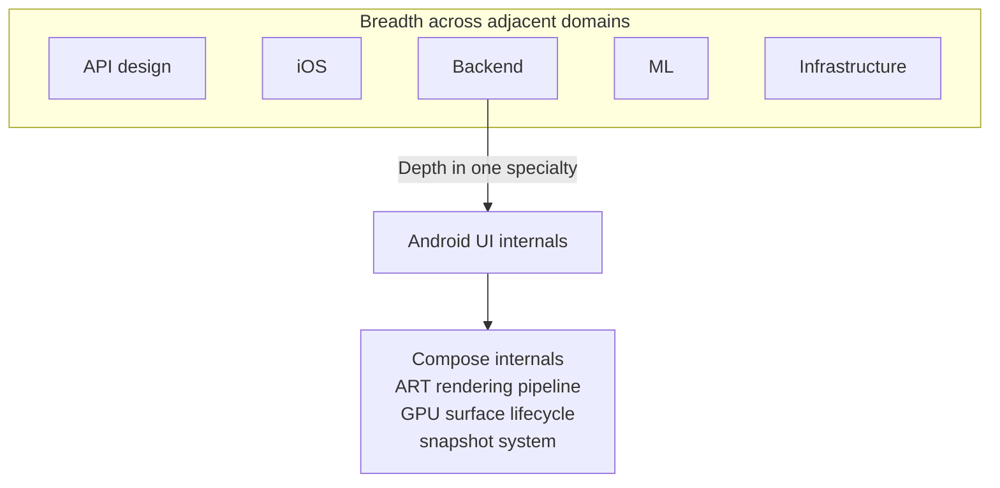

# Career: The Senior-to-Staff Progression (The Paradigm Shift)

> Junior → Mid → Senior is *linear* technical progression: more depth, more ownership, more autonomy. Senior → Staff is **not linear**. It is a paradigm shift. A Staff Engineer is not a "Super Senior" who codes faster. It's a different job.

---

## What Stops Being The Job

The Senior-to-Staff transition is mostly a process of *letting go* of behaviors that made you a great Senior:

| What worked as Senior | What it becomes as Staff |
|---|---|
| Owning a feature end-to-end and shipping it | Designing the system that lets *other teams* ship features end-to-end |
| Being the best coder on the team | Being the engineer with the highest leverage *via* others |
| Closing the most JIRA tickets | Closing few tickets; landing fewer-but-larger architectural moves |
| Being the technical authority on your codebase | Being the engineer the org consults on cross-team architectural decisions |
| Mentoring 1 junior 1:1 | Mentoring engineers who mentor other engineers |
| Writing detailed PR comments | Writing RFCs, ADRs, design docs, and runbooks |
| Being available in the team Slack | Being intentional with your time across many Slack channels |
| Heroics during incidents | Building the systems and runbooks so heroics aren't needed |

If you do all the new things *plus* all the old things, you burn out within a year. The paradigm shift requires actively *stopping* certain Senior behaviors so you have room for the Staff ones.

---

## What Starts Being The Job

### Scope: From team to organization

- **Senior:** scope is your squad. If the Login team hits its OKRs, the Senior on that team succeeded.
- **Staff:** scope is the platform. If Login succeeds but the network module is dropping 5% of requests globally and tanking the company's retention, the Staff engineer intervenes — regardless of which squad owns the network module.

The scope test: when you describe your work, do you use "we" to mean *your team*, or do you use "we" to mean *the mobile org / the company*? Junior says "we" (team). Senior says "we" (team). Staff alternates depending on the context.

### Ambiguity: From JIRA to strategy

- **Senior:** receives a well-defined ticket. Executes flawlessly.
- **Staff:** receives an emotion or a number. "Conversion is dropping in Brazil." There is no ticket. You define the problem, propose the solution, *create* the tickets, sequence the work, convince Product to prioritize it over their roadmap features.

See [`scope-and-ambiguity.md`](scope-and-ambiguity.md).

### Communication: From code to prose

- **Senior:** PR comments and architecture diagrams in chat. Reviews other PRs. Pair-programs.
- **Staff:** RFCs, ADRs, design docs, runbooks, post-mortems, hiring rubrics, all-hands talks, engineering-blog posts. Code is still part of the job, but prose is now half of it.

See [`writing-rfcs.md`](writing-rfcs.md).

### Glue work: The invisible labor

Tanya Reilly's term for the work that falls between organizational seams. Examples:

- Noticing that iOS and Android log analytics events with slightly different schemas, corrupting the data warehouse. Calling a meeting; writing an RFC; aligning both platforms.
- Realizing the on-call rotation hasn't been documented, so newcomers can't ramp. Writing the runbook; running a workshop.
- Spotting that two adjacent teams are independently solving the same problem. Connecting them; finding the leverage.

Glue work is invisible by definition. No one asks for it; no one assigns it; it doesn't fit a sprint. But if the right person stops doing it, the org rots. Staff engineers do this *and* document it (so it becomes packet evidence).

### Hiring, mentorship, and culture

- **Recruiting:** define and run Staff Mobile interview loops. Calibrate the bar. Sponsor 1-2 candidates per quarter through to offer.
- **Mentorship:** sponsor engineers through stretch projects. Help them write *their* RFCs. Coach them through their promotion process. Mentor *other mentors*.
- **Culture:** what the team tolerates becomes the culture. If you tolerate PRs with no tests, that's the culture. The Staff role includes holding the line and automating the standards via CI gates.

---

## The T-Shaped Engineer

The shorthand: deep in one specialty, broad across many adjacent ones.

**Depth.** Be the org's authority on at least one thing. Common Staff Mobile specializations: Compose/Jetpack internals, build systems, performance/perf-profiling, security, multi-module architecture, the Kotlin compiler, a key vendor SDK (Stripe, Firebase, ExoPlayer).

**Breadth.** Have working knowledge of every adjacent domain. You don't need to write the BFF, but you need to debate API contract design with the backend Staff. You don't need to design iOS, but you need to argue cross-platform standards.

The Staff job is not "more depth than a Senior." A Senior can be specialized; a Staff must be both.

---

## The Multi-Year Time Horizon

- **Senior** plans 1-2 sprints out. "What ships this quarter?"
- **Staff** plans 1-3 years out. "What will our platform need when we hire from 20 engineers to 80? Are our current architectural choices still right at 5× scale?"

This is uncomfortable. The further-out the horizon, the higher the uncertainty. Staff engineers learn to make load-bearing architectural decisions on imperfect information, document the reasoning (ADRs), and revise as the world changes.

Practical horizons by document type:

| Document | Horizon |
|---|---|
| PR | This week |
| Sprint planning | This sprint |
| OKR | This quarter / half |
| Roadmap | This year |
| Architecture RFC | 1-3 years |
| Platform strategy | 3-5 years |

A Staff engineer is comfortable contributing meaningfully at every row of this table. A Senior is comfortable through the OKR row.

---

## How To Operate At Staff Before You Have The Title

This is the entire game. Promotions are *trailing indicators*: you must operate at the next level for 6-18 months *before* the title is granted.

### The first 90 days

- Find one cross-team initiative no one is leading. Volunteer.
- Find one engineering practice that's broken (CI gating, code review standards, on-call docs). Fix it via RFC + CI automation.
- Find one Senior peer outside your team. Build a working relationship; help them with their hardest problem.
- Start the brag doc. Tag everything as Senior / Staff-aspiring / Cross-org.

### The next 6 months

- Land the cross-team initiative. Document the impact in business metrics.
- Mentor 1-2 engineers in their stretch projects.
- Publish 1-2 internal-blog posts on the work.
- Surface 2-3 systemic problems via RFCs.

### Months 7-12

- Take on a *second* cross-team initiative; the first should now be running with someone else as lead.
- Sponsor a junior or mid-level engineer through their next-rung promotion.
- Get peer feedback. Are senior peers consulting you on their decisions? That's the signal.
- Submit the packet at the right cycle (don't rush).

### Throughout

- Maintain the brag doc religiously.
- Quarterly checkpoints with your EM.
- Read [Will Larson](https://staffeng.com/) and [Tanya Reilly's book](https://www.oreilly.com/library/view/the-staff-engineers/9781098118723/).
- Watch other Staff engineers in adjacent orgs. What are they actually doing day-to-day?

---

## Anti-Patterns That Stall Staff Promotions

- **The Hero Trap.** Working 80-hour weeks to fix every production bug yourself. Management sees a single point of failure hoarding knowledge, not a Staff scaling the team.
- **The Architecture Astronaut.** Stops coding entirely; spends all day drawing UML diagrams; the architecture inevitably fails because the author is disconnected from the compiler's reality. Staff must stay hands-on with hard, risky engineering work (30-40% of the week).
- **Waiting for permission.** "Can I lead this RFC?" — no, you write the RFC and tag the right reviewers. Asking signals you're not ready; doing signals you are.
- **Confusing visibility with impact.** Speaking at conferences ≠ reducing crash rate by 1pp for 100M users. The first sometimes follows the second; never the reverse.
- **Slipping into people management.** Doing your EM's job because your team needs an EM. Noble; destroys your Staff bandwidth. Lobby for a competent EM hire; do not become one by default.
- **All-or-nothing on cross-team work.** Spreading across 5 initiatives and finishing none. Pick 1-2 large bets per quarter and let smaller asks go.
- **Avoiding politics.** Staff requires navigating org boundaries, conflicting priorities, and stakeholder management. Refusing to engage in "politics" means refusing to be Staff.
- **Optimizing for the title.** Some people just want the rung. The committee can smell it. Optimize for the impact; the title follows.
- **Job-hopping for a title bump.** Often resets you to the new company's bar. The promotion you earn locally is more durable than the title you negotiate elsewhere.
- **Refusing glue work.** "That's not engineering." It is — it's the most leveraged engineering you can do. Engineers who refuse glue work cap out at Senior.

---

## What Changes Day-To-Day

A Senior engineer's calendar:
- 60% deep coding work
- 20% PR reviews + design discussions for their team
- 10% 1:1s
- 10% meetings

A Staff engineer's calendar:
- 30-40% deep coding work (on intentionally chosen high-leverage projects)
- 20% writing (RFCs, ADRs, post-mortems, documentation)
- 20% cross-team meetings + decisions
- 10-15% mentorship + sponsorship
- 5-10% hiring + recruiting
- 5% organizational citizenship (all-hands, blog posts, interviews)

The deep-coding fraction *shrinks*, but its *leverage* multiplies. A Staff engineer's 10 hours of coding might land 10× the durable impact of a Senior's 30 hours.

---

## Probing Questions

1. Why is Senior → Staff a paradigm shift, not a linear progression?
2. What three Senior behaviors do you have to *stop* doing to make room for Staff behaviors?
3. Give a concrete example of glue work that wouldn't show up in `git log` but is unmistakably Staff-level.
4. How do you know if you're operating as Staff before you have the title? What are the lagging signals?
5. What's the difference between "Senior on a team" and "Staff working with that team"?
6. How do you balance staying hands-on with code while taking on more cross-team work?
7. What's the right horizon for an architectural decision? When is it too far out to be useful?
8. Why can't you be promoted to Staff just by being a really good Senior?

---

## Further Reading

- [`scope-and-ambiguity.md`](scope-and-ambiguity.md) — the ambiguity dimension of the paradigm shift.
- [`technical-leadership.md`](technical-leadership.md) — the leadership-without-management dimension.
- [`writing-rfcs.md`](writing-rfcs.md) — the prose-as-code dimension.
- [`performance-reviews-and-promotion.md`](performance-reviews-and-promotion.md) — how the operating-at-Staff turns into the title.
- [Tanya Reilly — "The Staff Engineer's Path"](https://www.oreilly.com/library/view/the-staff-engineers/9781098118723/) — canonical book; read it.
- [Will Larson — "Staff Engineer: Leadership Beyond the Management Track"](https://staffeng.com/) — practitioner stories from Staff+ engineers.
- [Charity Majors — "The Engineer/Manager Pendulum"](https://charity.wtf/2017/05/11/the-engineer-manager-pendulum/) — why you shouldn't slip into management by default.
