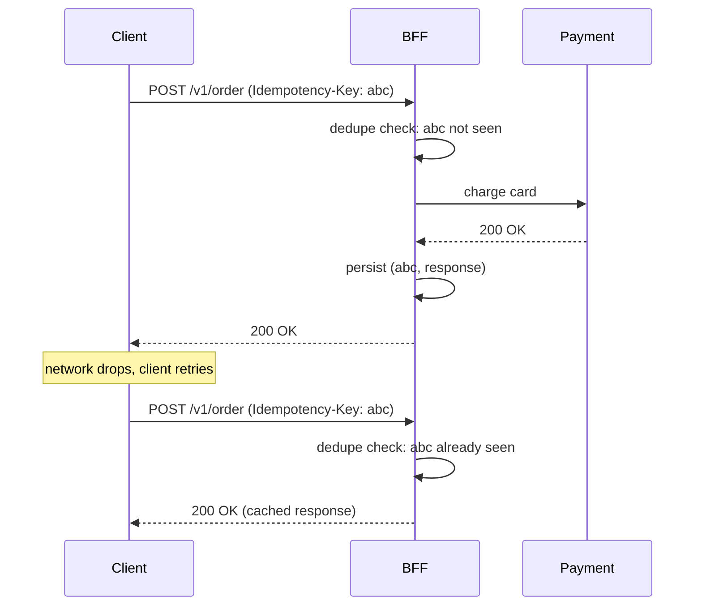

# Career: Writing Technical Documents (RFCs, ADRs, 1-Pagers)

> The defining transition from Senior to Staff Engineer is shifting from communicating with *code* to communicating with *prose*. If you can't make a structured argument in writing, your architectural ideas never get built — others will build theirs instead.

---

## Why It Matters

Code is read sequentially by compilers. Prose is read asynchronously by humans with varying contexts (Product, EM, CTO, junior engineers, the engineer who joins in 18 months). Staff-scope problems take weeks of human alignment before any code makes sense. The RFC is the tool that compresses that alignment.

The RFC also forces *you* to think. The act of writing "why" forces you to confront edge cases your code-thinking glossed over. A Staff engineer who writes RFCs catches their own bad ideas before the team does. The reviewer who comments "what about retry semantics?" saves you a week of debugging in three months.

## Principal-Level Governance

At Principal scope, RFCs are not just documents. They are the operating system for architectural change.

| Artifact | Purpose | Required when |
|---|---|---|
| 1-pager | Decide whether to explore | Work may consume multiple weeks or teams |
| RFC | Align before build | Cross-team architecture, platform direction, migration |
| ADR | Preserve why | Decision is Type 1 or likely to be re-litigated |
| Migration plan | Make change survivable | Existing users/systems must move gradually |
| Deprecation plan | Remove old paths cleanly | APIs, modules, SDKs, or patterns are being retired |

The Principal question is: "Will a new team in 18 months understand why this happened, how to extend it, and when to revisit it?" If not, the decision is not governed yet.

---

## The Three Document Types

### RFC (Request for Comments) / Design Doc

The blueprint, written **before** code. Usually 4-15 pages.

- **Audience:** EM (approves the time), Tech Leads (agree on architecture), peers (will review your code), junior engineers (will inherit it).
- **Goal:** Surface hidden problems via peer review before committing engineering weeks to the wrong thing.
- **Status states:** DRAFT → IN REVIEW → APPROVED → IMPLEMENTED → DEPRECATED.

### ADR (Architecture Decision Record)

The history book, written **after** a decision. Short (1-3 pages).

- **Audience:** The engineer who joins in 18 months and asks "why did we build it this way?"
- **Goal:** Capture decision context so it can't be relitigated without new information.
- **Lives in:** Co-located with the topic it decides — e.g., a decision about the data layer lives in `android/data-and-di/`, a decision about transport in `backend-for-mobile/`. Filename pattern is `<choice-a>-vs-<choice-b>.md`. Never deleted; only superseded by a newer file that links back to it.

See [`../android/architecture/mvvm-vs-mvi.md`](../android/architecture/mvvm-vs-mvi.md), [`../backend-for-mobile/sse-vs-websockets.md`](../backend-for-mobile/sse-vs-websockets.md), and [`../android/data-and-di/hilt-vs-koin-vs-manual-di.md`](../android/data-and-di/hilt-vs-koin-vs-manual-di.md) for examples. Template: [`../templates/decision.md`](../templates/decision.md).

### 1-Pager / Tech Spec

The compressed pitch, used to secure buy-in before investing time in a full RFC.

- **Audience:** Director / VP of Engineering.
- **Goal:** "Should we even explore this?" Quick yes/no on direction.
- **Format:** Bullet points, one HLD sketch, T-shirt-sized estimate.

---

## RFC Template

```markdown
# RFC <N>: <Short title>

**Author:** <name>
**Status:** Draft | In Review | Approved | Implemented | Superseded by RFC-<X>
**Reviewers:** <required + optional sign-offs>
**Created:** <date>
**Updated:** <date>

## TL;DR

One paragraph. What you propose, why, and what changes for the reader.

## Context

The current state of the world. Why this is a problem worth solving NOW (not 6 months ago, not 6 months from now). Include data:

- Telemetry: "Crashlytics shows 4,200 ANRs/day on the cart screen, all SharedPreferences-related."
- Constraints: "Q3 OKRs include reducing ANR rate to <0.3%."
- Org context: "Three teams have independently raised this in retros."

If you can't make the case for *now*, the right answer is to defer.

## Proposed Solution

The architecture. Be concrete:

- Components, modules, classes.
- API contracts (request/response shapes, error codes).
- Database schema changes.
- A Mermaid diagram of the data flow.
- Pseudo-code for the non-obvious parts.

## Alternatives Considered

For each, state: the option, its pros, its cons, and *why you rejected it*. Three is the minimum; five is healthy.

> **Critical:** if you don't argue against your own proposal, reviewers assume you didn't think deeply. The "why not X" section is where your design is stress-tested.

## Migration / Rollout Plan

- How does the existing system continue to work during migration?
- Dual-write window? Feature flag? Staged rollout? See [`release-engineering/staged-rollouts.md`](../release-engineering/staged-rollouts.md).
- Backward compatibility for clients on old versions.
- Rollback plan if it goes wrong.

## Success Metrics

How will we know this worked? Concrete numbers:

- "ANR rate on cart screen drops from 4,200/day to <100/day within 30 days of rollout."
- "Cold-start TTID p95 stays within current budget (no regression)."

## Risks & Open Questions

- Risks: each with mitigation.
- Open questions explicitly marked. Reviewers help close them.

## Timeline

- T-shirt estimate (S/M/L/XL) and rough weeks.
- Major milestones and their dependencies.

## Appendix

- Links to related RFCs, ADRs, dashboards, prior art.
- Detailed schemas / specs that would distract from the main flow.
```

---

## Writing Discipline

### 1. Write in the open

Drop the draft into the team's RFC folder while it's still messy. Tag specific reviewers in comments while you draft:

> `@alice — does this idempotency-key shape match what the BFF team did for payments?`

Reviewers who feel ownership early will champion the work; reviewers who see a "finished" doc dropped on them will reject it on principle.

### 2. Write for the skimmer first

Most readers will:
1. Read the title.
2. Read the TL;DR.
3. Skim the section headers.
4. Read maybe one or two sections in depth.

Optimize for the skimmer. Section headers should answer questions, not name topics. "Why we chose Room over DataStore" beats "Storage Selection."

### 3. Replace adjectives with numbers

| Weak | Strong |
|---|---|
| "ANRs are bad" | "ANRs are 0.8% of sessions; Play's threshold is 0.47%; we're at risk of demotion in Search." |
| "This will be much faster" | "Cold start p95 drops from 1.8s to estimated 1.2s based on a prototype." |
| "Many teams need this" | "Three teams (chat, feed, profile) have independently filed tickets for this." |

### 4. Translate for the audience

Same proposal, written three ways:

> **For engineers:** "We'll migrate from `SharedPreferences` to `Proto DataStore`. The Proto schema lives in `:core:config`. Code-gen happens at build time via the Protobuf Gradle plugin. Migration uses `SharedPreferencesMigration`."

> **For Product:** "We'll move our user-settings storage from a legacy library to its modern replacement. No user-visible change; eliminates a class of crashes that currently affects 0.3% of sessions."

> **For VP:** "Eliminates ANRs that put us on Play's bad-behavior list. 3 engineer-weeks. Q3 OKR for stability."

### 5. Diagrams over paragraphs

A Mermaid sequence diagram of the failure case will save you 200 words and three rounds of "what about when…?"



---

## ADR Template (Michael Nygard style)

```markdown
# ADR <N>: <Decision title>

## Status

Accepted | Superseded by ADR-<X> | Deprecated

## Context

What problem prompted this decision. Constraints. Forces in play. Background a future engineer needs.

## Decision

The decision itself, in active voice: "We will use Room for relational data and Proto DataStore for key-value config."

## Consequences

What becomes easier, what becomes harder, what is now non-trivial. Include the bad with the good — future readers need to know what trade-offs you accepted.
```

ADRs are short by design. If yours is over 3 pages, it's an RFC, not an ADR.

---

## 1-Pager Template

```markdown
# 1-Pager: <Proposal>

**Author:** <name>
**Date:** <date>
**Decision Needed By:** <date>

## What
One sentence: "I want to migrate our build system from Groovy DSL to Kotlin DSL."

## Why
- Current pain point #1: "Groovy build files take 25s to evaluate; Kotlin DSL caches better."
- Current pain point #2: "Type-safe access reduces a class of CI breakage."

## Cost
T-shirt: M (estimated 4 engineer-weeks). One engineer; can be done in parallel with normal feature work.

## Alternatives
- Stay on Groovy: zero cost, persistent friction.
- Convention plugins only (partial migration): less benefit, less cost.

## Ask
Approval to spend ~4 engineer-weeks across Q3. Will write a full RFC if approved.
```

The 1-pager exists so a VP can say "yes, explore" or "no, deferred" in 5 minutes without you spending 3 weeks on a full RFC for a "no."

---

## How Reviews Run

Healthy review processes look like:

1. **Author posts draft** in the RFC folder + Slack channel. Status: DRAFT.
2. **24-72h async comment period.** Reviewers comment inline. Author replies and revises.
3. **Live review meeting** (45-60 min) for the unresolved threads only. Don't relitigate resolved comments.
4. **Author updates** based on meeting outcomes. Status: IN REVIEW → APPROVED with required sign-offs.
5. **Implementation begins.** Author updates RFC as scope evolves; status moves to IMPLEMENTED on merge.
6. **Post-mortem reference.** If something goes wrong in prod, the RFC is the document the post-mortem references.

If the live meeting becomes a place to re-raise resolved comments, the meeting is broken — enforce "comment async, decide in person."

---

## Common Anti-Patterns

- **The Novelist.** 25-page RFC with dense paragraphs and no diagrams. Engineers skim, miss critical bits, approve blindly. Use bullets, bold, diagrams, short sentences.
- **Designing in secret.** Three weeks alone in a doc, then dropped on the team as "final." Rejected on principle. Write in the open.
- **Single-solution RFC.** No alternatives section, or one with cartoonish alternatives ("we could write our own from scratch"). Reviewers assume you haven't thought hard enough.
- **Hand-wavy success metrics.** "This will improve performance." How much? Measured how? Compared to what?
- **The "after lunch" rollout plan.** "We'll just flip the flag" — no dual-write, no staged rollout, no rollback. Tells reviewers you don't know how production works.
- **Implementation buried in narrative.** Reviewers should be able to find the Compose code snippet, the API contract, the SQL migration without reading prose.
- **Justifying with "this is industry standard."** Industry standards are starting points, not finishing arguments. Why is the standard right for *us*?
- **No clock.** "Decision needed by" is left blank; the doc lingers for 6 weeks; the moment passes.
- **Re-opening closed decisions.** A new engineer joins, hates the choice, writes an RFC to revisit. Unless they have *new information*, the ADR closes the discussion.

---

## Real Examples From The Playbook

This repo follows the patterns above. See:

- `backend-for-mobile/sse-vs-websockets.md` and `distributed-systems/lww-vs-crdt.md` — full-depth ADRs.
- `mobile-system-design/feature-flags-and-remote-config.md` — RFC-shaped design discussion.
- `release-engineering/release-strategy.md` — rollout plans (the kind a real RFC includes).

---

## Probing Questions

1. When would you write a 1-pager instead of a full RFC? When would the reverse be true?
2. What makes an ADR's "Consequences" section different from an RFC's "Risks" section?
3. Why is the "Alternatives Considered" section often the most-skipped and most-load-bearing?
4. How do you write the same proposal differently for the EM, the Product Manager, and the VP?
5. What's the failure mode of writing the RFC alone for 3 weeks before sharing?
6. When is it correct to *not* write an RFC?
7. How do you balance "write in the open" with "don't waste reviewers' time on half-formed thoughts"?
8. What's the smallest unit of telemetry data that makes an RFC's "why now" argument credible?

---

## Answer Key

1. **When would you write a 1-pager instead of a full RFC? When would the reverse be true?**
   Write a 1-pager to secure high-level buy-in on direction before investing weeks of time into a full design. Write a full RFC when you need to align on cross-team architecture, APIs, or migration plans prior to building.
2. **What makes an ADR's "Consequences" section different from an RFC's "Risks" section?**
   An RFC's "Risks" anticipates future problems to mitigate them before execution, while an ADR's "Consequences" records the accepted trade-offs of a decision already made so future engineers understand what became harder or easier.
3. **Why is the "Alternatives Considered" section often the most-skipped and most-load-bearing?**
   It's skipped because authors are biased toward their proposed solution, but it is load-bearing because it stress-tests the design. Arguing against your own proposal proves to reviewers that you evaluated trade-offs thoroughly rather than picking the first idea.
4. **How do you write the same proposal differently for the EM, the Product Manager, and the VP?**
   For the EM, focus on architecture and technical details. For Product, focus on user impact and bug reduction. For the VP, translate it into high-level business value, engineering hours saved, and OKR alignment.
5. **What's the failure mode of writing the RFC alone for 3 weeks before sharing?**
   Reviewers feel no ownership over the design, treat it as a finished document dropped on them, and are likely to reject it on principle. "Designing in secret" misses the early feedback that aligns the team.
6. **When is it correct to *not* write an RFC?**
   When the work is a straightforward execution of an established pattern, localized to a single team, doesn't impact cross-functional architecture, and carries low blast radius.
7. **How do you balance "write in the open" with "don't waste reviewers' time on half-formed thoughts"?**
   Share the draft early with explicit tags for specific reviewers asking targeted questions (e.g., "@alice - does this idempotency key shape match?"), rather than asking everyone to review the whole unstructured document.
8. **What's the smallest unit of telemetry data that makes an RFC's "why now" argument credible?**
   A specific, quantitative metric showing current negative impact (e.g., "Crashlytics shows 4,200 ANRs/day affecting 0.3% of sessions"), proving it is an urgent problem rather than a theoretical refactor.

---

## Further Reading

- [Michael Nygard — Documenting Architecture Decisions](https://cognitect.com/blog/2011/11/15/documenting-architecture-decisions) — the canonical ADR template.
- [Industrial Logic — How to write a Design Doc](https://www.industriallogic.com/blog/) — practical RFC guidance.
- [Google's eng-practices](https://google.github.io/eng-practices/) — review discipline.
- [`distributed-systems/lww-vs-crdt.md`](../distributed-systems/lww-vs-crdt.md) — full-depth ADR in this repo.
- [`scope-and-ambiguity.md`](scope-and-ambiguity.md) — when RFCs are how you take scope.
