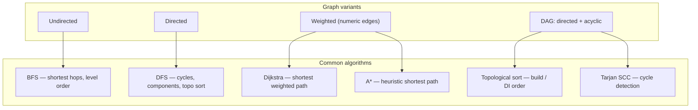

# Graphs

## Overview

A **graph** is a collection of **vertices** (nodes) connected by **edges** (links). Unlike trees (which are acyclic and rooted), graphs can have cycles, multiple connected components, and arbitrary structure. Edges can be **directed** (one-way: A → B) or **undirected** (two-way: A ↔ B), and they can be **weighted** (carrying a numeric cost, like distance or time) or unweighted.

Graphs model relationships of all kinds: road networks, social connections, build dependencies, module imports, package version constraints, navigation flows in an app, geographic adjacencies, citation networks, knowledge graphs, neural network topologies, payment routing, and almost every system where "things connect to other things." The algorithms on them — shortest path, topological sort, connectivity, cycle detection, minimum spanning tree, maximum flow — are foundational and appear constantly in production systems.

For mobile engineers, the **Directed Acyclic Graph (DAG)** is the most important graph variant in daily work. Gradle's build dependencies form a DAG; Dagger/Hilt's dependency injection wires components into a DAG; Jetpack Navigation graphs are directed graphs of screens; the Compose composer's recomposition tree is a DAG. Understanding why DAGs make build systems possible, why circular dependencies are catastrophic, and how shortest-path algorithms power ride-hailing routing is part of operating at Staff level.

---

## Why It Exists

Three observations made graphs inevitable:

1. **Real-world relationships are not strictly hierarchical.** A tree forces "exactly one parent per node, no cycles." Real life violates this constantly: a person has multiple friends; a city is connected to many other cities; a software module depends on many other modules. Trees can't model these without inventing fake hierarchies.
2. **Algorithms on graphs solve problems that look nothing like graphs at first.** Shortest path solves driving directions, but also network routing, currency arbitrage, dependency resolution order, and minimum-effort task scheduling. Topological sort decides build order, but also course prerequisites and recipe instructions. Recognizing "this problem is a graph problem" unlocks a vast library of algorithms.
3. **DAGs are an architectural primitive.** Most software-engineering tasks that depend on ordering — what to build first, what to load first, what to evaluate first — are DAG problems. Without graph theory, every team would invent ad-hoc dependency resolution; with it, we have proven algorithms (Tarjan, Kahn) and proven languages of expression (Gradle, Bazel, Make).

The mobile-specific motivation: build performance and dependency injection both scale linearly (or worse) with graph complexity. A misconfigured Gradle build with a wide diamond dependency runs in O(n²) compile units. A Dagger graph with deeply nested dependencies takes seconds to wire on app startup. Understanding the underlying graph helps you diagnose and fix the slowness instead of just suffering it.

The cost of getting graphs wrong: cycles in build systems (Gradle refuses to compile), cycles in DI (Dagger fails with a long error), cycles in recursive component composition (Compose blows the stack). Graphs are powerful, but their failure modes are loud and unforgiving.

---

## Historical Context

1. **Leonhard Euler, *Seven Bridges of Königsberg* (1736).** The first paper in graph theory. Euler proved that you couldn't walk across all seven bridges exactly once, by abstracting the city into vertices (land masses) and edges (bridges). Founded the field.
2. **Kirchhoff's circuit laws (1845).** Applied graph theory to electrical networks, introducing spanning trees.
3. **Dijkstra's algorithm (1959).** Edsger Dijkstra published the shortest-path algorithm; it remains the canonical reference for the problem. Found by Dijkstra in 20 minutes at a café in Amsterdam.
4. **A* algorithm (Hart, Nilsson, Raphael, 1968).** Heuristic-guided graph search. Powers nearly every game pathfinder and map-routing app.
5. **Tarjan's strongly connected components (1972).** Linear-time algorithm for finding cycles; foundational for dependency resolution.
6. **Topological sort (Kahn, 1962).** Algorithm to order DAG vertices respecting dependencies.
7. **Make (Stuart Feldman, 1976).** First widely-used build tool to use DAGs for dependency-driven compilation.
8. **Ford-Fulkerson max-flow (1956–62).** Algorithm for maximum flow in capacity networks. Foundation of bipartite matching and modern network routing.
9. **PageRank (Larry Page, Sergey Brin, 1996).** Treating the web as a graph and ranking by link structure; founded Google.
10. **Modern build systems (Gradle 2007, Bazel 2015, Buck 2013).** All built on explicit DAG modeling for parallel, incremental, distributed builds.

The arc: from a single puzzle (1736) to abstract math (19th century) to practical algorithms (1950s-60s) to large-scale systems (modern build, search, social media). Graph theory may be the single piece of CS most baked into every layer of modern software.

---

## First Principles

### 1. Vertex and edge basics

```
    A ---- B
    |    / |
    |   /  |
    C --+  D
```

Four vertices: A, B, C, D. Five edges: A-B, A-C, B-C, B-D, and so on. An edge can be **undirected** (no arrow), **directed** (A → B but not B → A), and **weighted** (each edge has a number, often a cost or distance).

### 2. Representation: adjacency list vs adjacency matrix

```kotlin
// Adjacency list — sparse graphs
class Graph<T> {
    val edges = mutableMapOf<T, MutableList<T>>()
    fun addEdge(from: T, to: T) {
        edges.getOrPut(from) { mutableListOf() }.add(to)
    }
}

// Adjacency matrix — dense graphs or small node count
class MatrixGraph(val n: Int) {
    val matrix = Array(n) { BooleanArray(n) }
    fun addEdge(from: Int, to: Int) { matrix[from][to] = true }
}
```

Adjacency list: O(V + E) space. Best for sparse graphs (most graphs in practice). Adjacency matrix: O(V²) space. Best for dense graphs or when you need O(1) edge-existence queries.

### 3. DAG: Directed Acyclic Graph

A DAG is a directed graph with no cycles. Crucially, DAGs admit **topological sort** — an ordering of vertices such that every edge goes from earlier to later. Build systems require this: to compile module X, you must have already compiled everything X depends on.

```
    A → B
    |   |
    ↓   ↓
    C → D
```

Topological sort: A, B, C, D (or A, C, B, D — either is valid).

### 4. Cycle detection

A cycle is a path that returns to its start. In a build graph, cycles are catastrophic (you can't decide what to compile first). In a road network, cycles are normal. Detection: a depth-first search that marks vertices as "currently visiting" finds a cycle if it tries to visit an already-visiting vertex.

### 5. Connectivity

A graph is **connected** if there's a path between every pair of vertices. **Strongly connected** (for directed graphs) means every vertex can reach every other in both directions. Disconnected components matter: a social-graph algorithm that doesn't know about components processes irrelevant subgraphs.

### 6. Weighted edges and shortest path

Edges with numeric weights model cost. Driving time, transmission latency, dollar cost, calorie burn. Algorithms compute **shortest paths** — the minimum total cost path from A to B. Different algorithms apply: Dijkstra (non-negative weights), Bellman-Ford (negative weights allowed), A* (heuristic-guided), Floyd-Warshall (all-pairs).

---

## Mental Model

Think of a graph as a **subway map**. Stations are vertices; rail lines are edges. The map can be directed (one-way tunnels), weighted (travel time per segment), and disconnected (different transit systems with no shared station).

Tree vs graph: a tree is what you'd have if every station were reachable from one central terminal with exactly one line, no branches forming loops. A real subway has multiple terminals, loops, transfer points — a graph.

DAG vs general graph: a DAG is a one-way subway with no loops — you can only go from "earlier" stations to "later" ones. Build dependencies look like this: compile core modules before app modules; never compile in a loop.

Algorithms become navigation strategies. BFS: "expand outward in all directions, level by level, until you reach the destination" — useful for shortest-hop. DFS: "go as deep as you can on one path, backtrack, try another" — useful for exhaustive exploration. Dijkstra: "explore paths in order of total cost, pick the cheapest" — useful for shortest-distance.

For DI graphs, picture a factory floor: each station (component) consumes parts from upstream stations. The DAG tells you the assembly order. A cycle would mean: "this station can't make its part until it has its own part" — impossible.

---

## Internal Mechanics

### Graph representation choices

```kotlin
// Adjacency list with named vertices
class Graph<T>(val directed: Boolean = true) {
    private val adjacency = mutableMapOf<T, MutableSet<T>>()

    fun addVertex(v: T) { adjacency.getOrPut(v) { mutableSetOf() } }

    fun addEdge(from: T, to: T) {
        addVertex(from)
        addVertex(to)
        adjacency[from]!!.add(to)
        if (!directed) adjacency[to]!!.add(from)
    }

    fun neighbors(v: T): Set<T> = adjacency[v].orEmpty()
    fun vertices(): Set<T> = adjacency.keys
}
```

### Breadth-first search (BFS)

```kotlin
fun <T> bfs(graph: Graph<T>, start: T): List<T> {
    val visited = mutableSetOf(start)
    val queue: ArrayDeque<T> = ArrayDeque<T>().apply { add(start) }
    val order = mutableListOf<T>()

    while (queue.isNotEmpty()) {
        val node = queue.removeFirst()
        order.add(node)
        for (n in graph.neighbors(node)) {
            if (n !in visited) {
                visited.add(n)
                queue.add(n)
            }
        }
    }
    return order
}
```

BFS visits all vertices at distance d before any at distance d+1. Used for shortest-path in unweighted graphs, for finding nearest reachable thing, and for level-order traversal.

### Depth-first search (DFS)

```kotlin
fun <T> dfs(graph: Graph<T>, start: T): List<T> {
    val visited = mutableSetOf<T>()
    val order = mutableListOf<T>()
    fun visit(node: T) {
        if (node in visited) return
        visited.add(node)
        order.add(node)
        for (n in graph.neighbors(node)) visit(n)
    }
    visit(start)
    return order
}
```

DFS goes as deep as possible before backtracking. Used for cycle detection, topological sort, connected-component identification, and many tree-like recursions.

### Topological sort (Kahn's algorithm)

```kotlin
fun <T> topologicalSort(graph: Graph<T>): List<T>? {
    val inDegree = mutableMapOf<T, Int>()
    for (v in graph.vertices()) inDegree[v] = 0
    for (v in graph.vertices()) for (n in graph.neighbors(v)) inDegree[n] = (inDegree[n] ?: 0) + 1

    val queue: ArrayDeque<T> = ArrayDeque(inDegree.filter { it.value == 0 }.keys)
    val result = mutableListOf<T>()

    while (queue.isNotEmpty()) {
        val v = queue.removeFirst()
        result.add(v)
        for (n in graph.neighbors(v)) {
            inDegree[n] = inDegree[n]!! - 1
            if (inDegree[n] == 0) queue.add(n)
        }
    }
    return if (result.size == graph.vertices().size) result else null  // null = cycle exists
}
```

The algorithm: repeatedly take any node with in-degree zero (nothing depends on it left), output it, decrement its neighbors' in-degrees. If a cycle exists, no node ever reaches in-degree zero and the sort fails — exactly what we want for cycle detection.

### Dijkstra's shortest path

```kotlin
import java.util.PriorityQueue

fun <T> dijkstra(
    graph: Map<T, List<Pair<T, Int>>>,    // adjacency: node -> [(neighbor, weight)]
    start: T
): Map<T, Int> {
    val dist = mutableMapOf<T, Int>().withDefault { Int.MAX_VALUE }
    dist[start] = 0
    val pq = PriorityQueue<Pair<T, Int>>(compareBy { it.second })
    pq.add(start to 0)

    while (pq.isNotEmpty()) {
        val (node, d) = pq.poll()
        if (d > dist.getValue(node)) continue
        for ((neighbor, w) in graph[node].orEmpty()) {
            val alt = d + w
            if (alt < dist.getValue(neighbor)) {
                dist[neighbor] = alt
                pq.add(neighbor to alt)
            }
        }
    }
    return dist
}
```

The algorithm: explore vertices in order of cumulative distance from the source. Once a vertex is dequeued, you've found its shortest distance. O((V + E) log V) with a binary heap. Requires non-negative weights.

### A* (A-star) for guided search

A* extends Dijkstra with a **heuristic** function `h(v)` estimating distance from `v` to the goal. Instead of exploring by cumulative cost alone, A* explores by `cost so far + h(v)`. If the heuristic never overestimates, A* finds the optimal path while exploring far fewer vertices.

For map routing, `h(v)` is the straight-line distance from `v` to the destination. This guides search toward the goal, dramatically reducing work compared to Dijkstra.

### Strongly connected components (Tarjan / Kosaraju)

Tarjan's algorithm finds all strongly connected components (groups of vertices mutually reachable) in linear time using a single DFS. Used for cycle detection in build graphs, module-cycle detection in Gradle, and SCC analysis in IDE code-quality tools.

---

## Architecture



---

## Production Example

### Gradle build dependency DAG

```kotlin
// :app depends on :feature:checkout and :feature:profile
// :feature:checkout depends on :core:network, :core:database
// :feature:profile depends on :core:network
```

When you run `./gradlew :app:assembleDebug`, Gradle builds the dependency DAG and runs a topological sort. The result: build `:core:network` and `:core:database` first (in parallel — no dependency between them), then `:feature:checkout` and `:feature:profile`, then `:app`. Total time is bounded by the longest path through the DAG.

If you accidentally make `:feature:checkout` depend on `:app`, the DAG becomes cyclic. Gradle's build planner refuses to compile and prints the cycle: "Circular dependency between :app, :feature:checkout."

### Dagger/Hilt's compile-time graph

When you annotate constructors with `@Inject`, Dagger reads them and builds a DI DAG:

```kotlin
@Inject constructor(repo: UserRepository, analytics: Analytics)  // UserViewModel
@Inject constructor(api: UserApi, cache: UserCache)              // UserRepository
// ...
```

Dagger topological-sorts the graph at compile time and generates code that wires things in the right order. A missing `@Provides` or `@Binds` (no factory for a needed type) is a compile error. A cycle (X depends on Y, Y depends on X) is also a compile error. The error messages reference the actual edges in your graph.

### Map routing with A*

A map app shows the route from your current location to a coffee shop. The road network is a graph:
- Vertices: road intersections
- Directed edges: legal moves between intersections (respecting one-ways)
- Weights: estimated time at current traffic

A* with straight-line distance as heuristic runs in milliseconds on devices with downloaded map regions, vs Dijkstra which would explore hundreds of intersections in every direction.

### Social graph friendship recommendations

A social network represents users as vertices and friendships as undirected edges. "People you may know" runs a BFS from your vertex, ranking 2-hop neighbors (friends of friends) by number of paths to them. The fewer hops and the more mutual friends, the higher the rank.

For LinkedIn's scale, this is implemented with optimized graph databases (Neo4j, ArangoDB) or specialized in-memory engines (Facebook's TAO).

---

## Android Example

### Jetpack Navigation graph

```kotlin
@Serializable data class Home
@Serializable data class Profile(val userId: Long)
@Serializable data class Settings

NavHost(navController, startDestination = Home) {
    composable<Home> { HomeScreen(navController) }
    composable<Profile> { ProfileScreen(it.toRoute<Profile>().userId) }
    composable<Settings> { SettingsScreen() }
}
```

The navigation graph is a directed graph: Home → Profile, Home → Settings, Profile → Settings. The back stack is a sequence of vertices through which the user passed. `popUpTo` and `popBackStack` manipulate this stack with graph-aware semantics.

### Hilt component DAG

```kotlin
@HiltViewModel
class CheckoutViewModel @Inject constructor(
    private val paymentApi: PaymentApi,
    private val analytics: Analytics
) : ViewModel()

@Module
@InstallIn(SingletonComponent::class)
object NetworkModule {
    @Provides @Singleton
    fun providePaymentApi(retrofit: Retrofit): PaymentApi = retrofit.create()
}
```

Hilt's compile-time processor builds the DAG: `CheckoutViewModel` depends on `PaymentApi` (from `NetworkModule`) and `Analytics`. The processor topo-sorts and generates the wiring code. If you delete `PaymentApi`'s provider, the compile fails with "MissingBinding," referencing the broken edge.

### Compose recomposition tree

Each `@Composable` function corresponds to a node in a runtime tree (technically a graph, since slot keys can be reused across positions). The Compose recomposer tracks which composables read which state, and on state change, invalidates the smallest set of nodes that read the changed state. This is a graph-walk operation on the slot table.

---

## Tradeoffs

**Advantages**

- **Models any pairwise relationship.** Flat lists and trees cover special cases; graphs cover the rest.
- **Rich algorithmic library.** Shortest path, sorting, matching, flow, coloring — all solved problems.
- **Parallel execution is natural.** Topo-sorted DAGs reveal parallel-execution opportunities (independent build modules).
- **Detects structural problems.** Cycle detection catches "this build can't possibly work."

**Disadvantages**

- **Algorithms can be slow.** Shortest-path on a 100M-vertex graph isn't free. Some graph problems (TSP, graph coloring) are NP-hard.
- **Memory grows with edges.** A complete graph on n vertices has n² edges.
- **Representation choice matters a lot.** The wrong representation can make algorithms 100x slower.
- **Distributed graph processing is hard.** Single-machine algorithms don't trivially scale.

**When not to use**

- For data with clear hierarchy and one root — use a tree.
- For data accessed by primary key only — use a hash map.
- For static fixed data with known fast paths — denormalize ahead of time.

---

## Failure Modes

**Build cycle.** A → B → A makes Gradle refuse to compile. Mitigation: review module dependencies regularly; lint rules can forbid feature modules from depending on core modules' specific subpackages.

**DI cycle.** Dagger's compile-time error tells you the cycle. Mitigation: use `Lazy<X>` or `Provider<X>` to defer one edge in the cycle until runtime; or refactor to break the cycle structurally.

**Pathfinding stack overflow.** Recursive DFS on a graph with 100K+ vertices blows the stack. Mitigation: convert to iterative with an explicit stack.

**Dijkstra with negative weights.** Dijkstra assumes non-negative; negative weights cause it to produce wrong answers. Mitigation: use Bellman-Ford for negative edges (slower but correct); or transform weights to non-negative first.

**Disconnected components masking bugs.** Running a global algorithm on a graph that's actually multiple components processes each, possibly hiding that a vertex isn't reachable from where you think it should be. Mitigation: find connected components first; ensure your processing handles them correctly.

**Graph-based DDOS.** A user-supplied "graph" (e.g., a deeply nested JSON cycle) can cause a recursive parser to stack-overflow. Mitigation: depth and edge-count limits.

**Compose recomposition cascade.** State at a high level invalidates a wide subtree. Mitigation: hoist state to the closest reader; pass stable lambdas; use immutable parameters.

**Path explosion in A* with bad heuristic.** A heuristic that overestimates distance can make A* skip the optimal path. Mitigation: ensure the heuristic is admissible (never overestimates) and consistent (triangle inequality holds).

---

## Performance Considerations

- **Adjacency list vs matrix.** For sparse graphs (most), list. For dense graphs or fast edge-existence queries on small graphs, matrix.
- **Algorithm complexity matters at scale.** BFS/DFS are O(V + E). Dijkstra with a binary heap is O((V + E) log V). Floyd-Warshall (all-pairs shortest path) is O(V³) — only for V < ~500.
- **Iterative is faster than recursive.** Recursion has function-call overhead and stack-overflow risk.
- **Visited-set lookup.** Using `HashSet<Vertex>` for visited tracking is O(1) per check. With an array-indexed graph, a `BooleanArray` is even faster.
- **JIT loves tight loops.** Algorithms expressed as flat loops (BFS with a queue) are faster than tree-of-callbacks (BFS with handler interfaces) after warmup.
- **Spatial indexes accelerate geographic queries.** For map routing, an R-tree pre-filters candidate roads, then graph algorithms operate on the small set.

---

## Reliability Considerations

- **Test cycle detection.** A build system without cycle detection is a footgun. Verify the failure case actually fails loudly.
- **Idempotent traversal.** Repeated runs of the same graph algorithm on the same input must produce the same output. Otherwise downstream comparisons (Merkle trees, sync) break.
- **Determinism in unordered structures.** A HashMap-backed adjacency list has unordered iteration. If you need reproducibility, use `LinkedHashMap` or sort during traversal.
- **Watch for graph mutations during traversal.** Modifying the graph mid-BFS produces ill-defined results. Use snapshots or copy-on-write structures.

---

## Security Considerations

- **Graph traversal of attacker-controlled structure.** Parsing a graph from untrusted input must enforce depth limits and node counts. Many JSON parsing libraries enable this by default.
- **Social-graph privacy.** Friend-of-friend queries can leak private connections. The 2014 Facebook Cambridge Analytica scandal exemplified the failure: an app harvesting friends-of-friends data revealed information about people who hadn't consented.
- **Side-channel via graph traversal time.** Algorithm timing can leak structural information about private graphs. For sensitive contexts, use constant-time traversals.
- **DDOS via complete subgraphs.** A user submitting a "friends list" that's a complete graph causes O(n²) work on the server. Rate-limit graph operations.

---

## Observability

- **Module-build-time DAG.** Gradle exposes build graphs via `--scan`; use them to identify bottleneck modules.
- **Dagger error messages.** When a binding fails, Dagger prints the request chain — the path through the DI graph that led to the broken edge. Read it forward and backward to find where to fix.
- **A* / Dijkstra metrics.** Track average nodes-explored-per-query in routing. Sudden increases indicate heuristic degradation or graph changes.
- **Recomposition counters.** Compose tooling (`androidx.compose.runtime.tooling`) reports counts per node; widespread recompositions on a single state change indicate hoisting too high.

---

## Staff Engineer Thinking

**Recognize when a problem is a graph problem.** "Order of operations," "things that depend on other things," "shortest connection," "is this reachable" — all graph problems. Reach for graph algorithms before re-inventing.

**Use the build DAG as a design tool.** Gradle's `--scan` reveals your module graph. Wide, parallel-friendly DAGs build fast; tall, chain-shaped DAGs build slow. Refactor to widen.

**Watch DI graphs for accidental complexity.** A class with 18 `@Inject`-ed dependencies is a sign of a god class. The DI graph reveals the worst offenders.

**Use Lazy<X> sparingly to break cycles.** Cycle-breaking via Lazy is sometimes necessary but is usually a sign that the structure is wrong. Prefer to refactor.

**Don't run Dijkstra on the main thread.** Offload pathfinding to a background dispatcher; cache results when the same start/end appears repeatedly.

**Use spatial indexes alongside graphs for geo work.** R-trees pre-filter candidate roads/places, then graph algorithms operate on the smaller subgraph.

**Visualize the graph.** Many graph problems become obvious when drawn. Tools: Graphviz, Mermaid, even hand-sketched. A 5-minute drawing is often the fastest debugging.

**Consider graph databases for graph-heavy domains.** Neo4j, ArangoDB, Amazon Neptune are designed for graph traversals. SQL on heavily relational data with deep joins is often beaten 100x by a graph database for the same query.

---

## Common Misconceptions

**"Graphs are too academic for app development."** Every Android app uses several graphs: build dependencies, DI, navigation, Compose recomposition. Pretending otherwise is choosing ignorance.

**"DAGs are just trees."** No. Trees have exactly one root and one parent per node. DAGs can have multiple roots and multiple parents.

**"BFS and DFS are interchangeable."** They differ in what they find first: BFS finds the shortest (in hops) path; DFS may find a longer path first. For "is there any path?" both work; for "shortest path," BFS.

**"Dijkstra works on any weighted graph."** Only non-negative weights. Use Bellman-Ford for negatives.

**"All graphs fit in memory."** Real-world graphs (social, web) don't. Streaming algorithms and distributed graph processing exist for this reason.

**"Topological sort is unique."** It usually isn't — many valid orderings exist for the same DAG. Build systems pick one based on heuristics.

**"Cycles in directed graphs always mean bad design."** Sometimes cycles are correct (interaction loops, mutual recursion). DAG-only is a constraint of build systems, not a universal good.

---

## Probing Questions

1. Walk through what happens when you accidentally make `:feature:checkout` depend on `:app` in Gradle. What's the exact error and why?
2. Explain why Dagger requires the DI graph to be a DAG. What error does it produce for a cycle, and what's the workaround using `Lazy` or `Provider`?
3. Why is BFS the right choice for finding the shortest unweighted path, while Dijkstra is for weighted? Walk through a counterexample where DFS would fail.
4. A* uses a heuristic to guide search. Define "admissible" and "consistent" heuristics, and explain why violating either can produce wrong answers.
5. A Gradle build with 200 modules takes 12 minutes. The DAG is wide but has one critical path of 8 sequentially-dependent modules. How do you reduce build time?
6. Explain how topological sort finds cycles. What does it produce when the input has a cycle?
7. Convert a recursive DFS implementation to iterative. Why is iterative typically safer for large graphs?
8. A map app needs to find the fastest route from A to B accounting for current traffic. Sketch the algorithm and what data structures it uses.
9. Why is adjacency-list representation usually better than adjacency-matrix for social graphs?
10. Strongly connected components — what are they, and where would Tarjan's algorithm be useful in a modular Android codebase?

## Answer Key

1. **Walk through what happens when you accidentally make `:feature:checkout` depend on `:app` in Gradle. What's the exact error and why?**
   `:app` already depends on `:feature:checkout`. Adding the reverse dependency creates a cycle. Gradle errors with "Circular dependency between the following tasks/projects" because topological sort cannot resolve an order to compile them.
2. **Explain why Dagger requires the DI graph to be a DAG. What error does it produce for a cycle, and what's the workaround using `Lazy` or `Provider`?**
   Dagger needs a sequence to instantiate objects. If A needs B and B needs A, neither can be created first. It throws a "[Dagger/DependencyCycle]" error. Workaround: Inject `Lazy<B>` or `Provider<B>` into A, deferring the resolution of B until after A is instantiated.
3. **Why is BFS the right choice for finding the shortest unweighted path, while Dijkstra is for weighted? Walk through a counterexample where DFS would fail.**
   BFS explores radially by hop count, guaranteeing the first time it hits the target is the shortest path (unweighted). Dijkstra sorts by cumulative edge weight. DFS might dive deep into a very long winding path and reach the target in 100 hops even if there was a 1-hop direct edge available.
4. **A* uses a heuristic to guide search. Define "admissible" and "consistent" heuristics, and explain why violating either can produce wrong answers.**
   Admissible: never overestimates the true cost to the goal. Consistent: estimated cost from node to goal is $\le$ cost to neighbor + estimated cost from neighbor to goal. If violated, A* might prematurely terminate with a suboptimal path because it wrongfully assumes other paths are worse.
5. **A Gradle build with 200 modules takes 12 minutes. The DAG is wide but has one critical path of 8 sequentially-dependent modules. How do you reduce build time?**
   The critical path dictates the minimum possible build time regardless of parallelism. You must break up the sequential chain by inverting dependencies (using interfaces), splitting modules, or using dependency injection to flatten the graph structure.
6. **Explain how topological sort finds cycles. What does it produce when the input has a cycle?**
   Topological sort iteratively removes nodes with an in-degree of 0. If a cycle exists, all nodes in the cycle have an in-degree $\ge$ 1, so the algorithm stops prematurely. It detects a cycle if the sorted output size is less than the total graph size.
7. **Convert a recursive DFS implementation to iterative. Why is iterative typically safer for large graphs?**
   Iterative uses a `Stack` or `ArrayDeque`. Push the start node, then in a `while` loop, pop a node, mark visited, and push its unvisited neighbors. It's safer because heap memory (used for objects) is vastly larger than the limited JVM call stack space used by recursion.
8. **A map app needs to find the fastest route from A to B accounting for current traffic. Sketch the algorithm and what data structures it uses.**
   It uses A* or Dijkstra's algorithm. Vertices are intersections, directed edges are road segments, and weights are live travel times (traffic). It uses an adjacency list and a min-priority queue (binary heap) to efficiently select the next cheapest path to explore.
9. **Why is adjacency-list representation usually better than adjacency-matrix for social graphs?**
   Social graphs are extremely sparse; most people know a tiny fraction of all users. An adjacency list uses $O(V + E)$ memory, whereas a matrix uses $O(V^2)$ which would require prohibitive amounts of memory for millions of users.
10. **Strongly connected components — what are they, and where would Tarjan's algorithm be useful in a modular Android codebase?**
    Strongly connected components are subgraphs where every node can reach every other node (meaning a cycle exists among them). Tarjan's algorithm can identify these structural cycles in code dependencies (e.g. classes referencing each other), helping break circular module dependencies.

---

## Further Reading

In this repository:

- [`trees.md`](trees.md) — trees as a special case of graphs (acyclic, rooted).
- [`hashing.md`](hashing.md) — hashing is often used for graph node identifiers.
- [`../engineering-fundamentals/complexity-analysis.md`](../engineering-fundamentals/complexity-analysis.md) — Big-O complexities of graph algorithms.
- [`../engineering-fundamentals/state-machines.md`](../engineering-fundamentals/state-machines.md) — state machines as labeled directed graphs.
- [`../android/architecture/navigation.md`](../android/architecture/navigation.md) — Jetpack Navigation as a graph.
- [`../android/data-and-di/dependency-injection.md`](../android/data-and-di/dependency-injection.md) — DI as DAG construction.
- [`../android/build-tooling/gradle-and-build-systems.md`](../android/build-tooling/gradle-and-build-systems.md) — Gradle's DAG-based build engine.
- [`../mobile-system-design/google-maps-location-system.md`](../mobile-system-design/google-maps-location-system.md) — map routing in practice.
- [`../mobile-system-design/ride-hailing.md`](../mobile-system-design/ride-hailing.md) — driver-rider matching on geographic graphs.

External:

- *Introduction to Algorithms* by CLRS, Part VI (Graph Algorithms) — the standard reference.
- Edsger W. Dijkstra, *"A Note on Two Problems in Connexion with Graphs"* (1959) — the original shortest-path paper.
- Robert Tarjan, *"Depth-First Search and Linear Graph Algorithms"* (1972) — SCCs in linear time.
- Peter Hart et al., *"A Formal Basis for the Heuristic Determination of Minimum Cost Paths"* (1968) — original A* paper.
- *Algorithms* by Sedgewick & Wayne (Princeton) — accessible graph algorithm coverage with code.
- Neo4j Graph Database documentation — for graph-heavy use cases.
- The Gradle documentation on [project dependencies](https://docs.gradle.org/current/userguide/declaring_dependencies.html) — DAG enforcement in practice.
