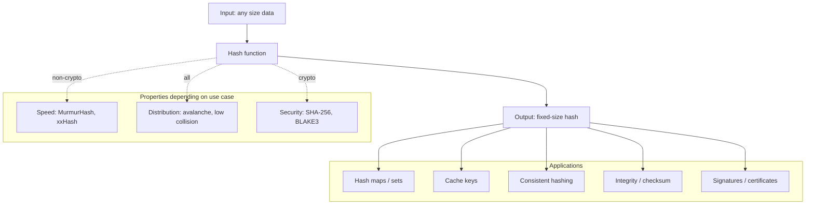

# Hashing

## Overview

**Hashing** is the operation of mapping data of arbitrary size to a fixed-size value — the **hash** — using a deterministic function. Same input always produces the same output; small changes to the input produce wildly different outputs; the output looks random but isn't. From this simple primitive, an enormous portion of modern computing is built: hash maps (the most-used data structure in software), cache keys, checksums, content-addressable storage, cryptographic signatures, password storage, blockchains, deduplication, sharding, A/B test bucketing, and dozens of other things.

This file covers what a hash function actually is, the difference between **non-cryptographic** hashes (designed for speed and even distribution — MurmurHash, xxHash, FNV) and **cryptographic** hashes (designed for security and resistance to attack — SHA-256, BLAKE3), how they're used in mobile engineering for things like A/B testing, cache keys, deduplication, and ETags, the failure modes hash collisions produce, and Staff-level concerns like consistent hashing for sharding, perfect hashing for static lookup tables, and why you should never roll your own cryptographic hash.

---

## Why It Exists

Three problems made hashing inevitable:

1. **Lookup tables need fast indexing.** If you have a million keys and want O(1) lookup, you need to map each key to a slot in an array. A hash function does this: hash the key, modulo the array size, lookup the slot.
2. **Equality on large objects is expensive.** Comparing two 4MB images byte-by-byte is slow. Hash each image once, compare 32-byte hashes — O(1) probabilistic equality. If the hashes differ, the images differ. If they match, they're almost certainly identical (with cryptographic hashes, certainly identical for practical purposes).
3. **Verifying integrity without trusting the messenger.** A file downloaded from the internet might be tampered with. If you know the expected hash from a trusted source, you can verify the file's hash matches. The Linux ISO download, the Android SDK, every package manager — all use hashing for integrity.

The mobile-specific motivations layer on top:

- **Battery and bandwidth costs.** Re-downloading a 4MB image is expensive. Hashing the URL into a cache filename means the cache reuses bytes you already have. ETag-based revalidation lets the server say "no change" in 200 bytes instead of resending megabytes.
- **Offline determinism.** A/B testing without a server roundtrip needs a deterministic, client-side way to assign a user to a bucket. Hashing the user ID gives every device the same answer without coordination.
- **Cryptographic verification.** App Links, certificate pinning, payment tokenization all rely on collision-resistant hashes to verify identity without sending secrets.

The cost of getting it wrong: hash-flooding DoS attacks (predictable hashes letting attackers force collisions), broken cryptographic hashes (MD5 and SHA-1 are no longer secure), and hash-map degradation (a 10x slowdown when collisions cluster).

---

## Historical Context

1. **Hans Peter Luhn, IBM (1953).** Invented the hash table concept in an internal IBM memo. The first practical use of "map key to slot via a function."
2. **MD5 (1991).** Ron Rivest's Message Digest 5; a cryptographic hash widely used in the 1990s. Found to be broken (practical collisions) in 2004. Still used today for non-security purposes (file fingerprints, ETags).
3. **SHA-1 (1995).** NSA's Secure Hash Algorithm; replaced MD5. Found to have practical collisions in 2017 (Google's SHAttered attack). Phased out from security uses, still common for Git commits and old Subversion repos.
4. **SHA-256 (2001).** Part of the SHA-2 family; the current default cryptographic hash for most applications including Bitcoin, modern code signing, Android App Links.
5. **MurmurHash (2008).** Austin Appleby's non-cryptographic hash; fast, well-distributed. Used in Hadoop, Cassandra, Lucene, Redis.
6. **xxHash (2012).** Yann Collet's even faster non-cryptographic hash; up to 5 GB/s on modern CPUs.
7. **BLAKE3 (2020).** Modern cryptographic hash, faster than SHA-256, parallelizable.
8. **Consistent hashing (Karger et al., 1997).** A hashing scheme that minimizes data movement when the number of buckets changes; the foundation of distributed caches (Memcached, CDN routing).
9. **Bloom filters (Burton Bloom, 1970).** A space-efficient probabilistic structure using multiple hash functions to test set membership with false positives but no false negatives.

The arc: from basic lookup tables (1950s) through cryptographic hashes (1990s+) to specialized algorithms for distributed systems (consistent hashing, Bloom filters) and the modern split between "fast and well-distributed" (MurmurHash, xxHash) and "fast and collision-resistant against attackers" (SHA-256, BLAKE3).

---

## First Principles

### 1. A hash function is deterministic

```kotlin
val h1 = "hello".hashCode()
val h2 = "hello".hashCode()
// h1 == h2 — always
```

Same input → same output. Always. If a "hash function" varied across calls, it would be useless for lookup tables (you couldn't find what you stored).

### 2. The output is fixed-size

A SHA-256 hash is always 256 bits (32 bytes), regardless of input size. A 1-byte input and a 1GB input both hash to 32 bytes. This is what makes hashes useful as identifiers and lookup keys.

### 3. Collisions are mathematically inevitable

If you map infinite possible inputs to finite outputs (say, 2^256 possible outputs for SHA-256), there must be inputs that collide. The pigeonhole principle is unavoidable.

For SHA-256, there are 2^256 possible outputs — more than the number of atoms in the observable universe. Practical collisions are computationally infeasible. For a weaker hash like a 32-bit `hashCode()`, there are only 4 billion outputs; collisions happen frequently in real data sets.

### 4. Avalanche property

A good hash function exhibits the **avalanche effect**: a one-bit change in input flips ~50% of output bits. This is what makes hashes "look random."

```
hash("hello") = 5d41402abc4b2a76b9719d911017c592
hash("hellp") = 1f6f4862cf94bdcc83c8bf2017a85d4f
```

One letter change, completely different output. This property is what prevents predictability and clustering.

### 5. Two families: non-cryptographic vs cryptographic

**Non-cryptographic** hashes (MurmurHash, xxHash, CityHash, FNV):
- Fast. xxHash can exceed 5 GB/s on a modern CPU.
- Well-distributed (good avalanche).
- **Not secure against adversaries** — an attacker who knows the algorithm can construct inputs that collide deliberately.

**Cryptographic** hashes (SHA-256, SHA-3, BLAKE3, BLAKE2):
- Slower (still fast — hundreds of MB/s).
- **Collision-resistant**: computationally infeasible for anyone, including attackers, to find two inputs that hash to the same output.
- **Preimage-resistant**: given a hash, infeasible to find any input that produces it.
- **Second-preimage-resistant**: given an input, infeasible to find a different input with the same hash.

Use non-cryptographic for performance-critical lookup; use cryptographic when an adversary can choose inputs (passwords, file integrity, signatures, identifiers in security contexts).

### 6. `hashCode()` is the JVM contract

Kotlin's `hashCode()` is inherited from Java's `Object.hashCode()`. The contract:

- If `a == b`, then `a.hashCode() == b.hashCode()`. (Required.)
- If `a.hashCode() == b.hashCode()`, then `a` may or may not equal `b`. (Collisions are allowed.)
- `hashCode()` must be consistent across calls on the same object during a JVM run. (Required.)

Breaking the contract breaks `HashMap`, `HashSet`, `LinkedHashMap`, Compose `key` parameters, and dozens of other things.

---

## Mental Model

Think of a hash function as a **deterministic blender**. You put any size of input in, you get a small, fixed-size pile of output out. The output looks like noise. The function isn't reversible — you can't reconstruct the original from the output. But the same input always produces the same output, so you can use the output as a *fingerprint* of the input.

Imagine a parking garage with 1000 numbered spots. Every car gets parked in the spot equal to the hash of its license plate, mod 1000. If you want to find a specific car, you compute the same hash and go to that spot. You don't have to search the whole garage — O(1) lookup. The catch: if two cars happen to hash to the same spot (collision), you need a fallback (chain them, probe the next spot). A good hash function spreads cars evenly across the garage so collisions are rare.

For cryptographic hashes, add this property: the parking attendant (or anyone watching) can verify that the car parked in spot 537 is supposed to be there (by re-hashing the license plate) but can't deduce the license plate from the spot number alone (preimage resistance) and can't deliberately design a different car that wants the same spot (collision resistance).

---

## Internal Mechanics

### `String.hashCode()` in Java/Kotlin

```kotlin
// JDK's actual algorithm for String.hashCode()
fun String.javaHashCode(): Int {
    var h = 0
    for (c in this) {
        h = 31 * h + c.code
    }
    return h
}
```

`31` is chosen because it's an odd prime — multiplying by it has good bit-spreading properties and is one less than a power of two (32), so the JVM can compile `31 * h` as `(h << 5) - h`. The result is a signed 32-bit integer (~4 billion possible values).

For most strings, distribution is reasonable. But the function is *not* cryptographic — given a target hash, an attacker can construct a string that produces it, which historically led to **hash-flooding DoS** attacks on web servers (POST a JSON body with thousands of colliding keys, brick the parser). Modern JVMs randomize `String.hashCode()` (since Java 8) or use treeified bins in `HashMap` (since Java 8 also) to mitigate this.

### MurmurHash3 (non-cryptographic, fast, well-distributed)

```kotlin
// Simplified MurmurHash3 for 32-bit output
fun murmur3(key: ByteArray, seed: Int = 0): Int {
    val c1 = 0xcc9e2d51.toInt()
    val c2 = 0x1b873593.toInt()
    var h1 = seed
    val nBlocks = key.size / 4

    for (i in 0 until nBlocks) {
        var k1 = key.getInt(i * 4)
        k1 *= c1
        k1 = Integer.rotateLeft(k1, 15)
        k1 *= c2
        h1 = h1 xor k1
        h1 = Integer.rotateLeft(h1, 13)
        h1 = h1 * 5 + 0xe6546b64.toInt()
    }
    // ... tail and finalization
    return h1
}
```

Two multiplies, two rotates, two xors per 4-byte block. The carefully-chosen constants (`c1`, `c2`) give excellent avalanche characteristics. MurmurHash3 is roughly 2-4x faster than `String.hashCode()` while producing better-distributed output.

### SHA-256 (cryptographic, collision-resistant)

SHA-256 processes input in 512-bit blocks. Each block goes through 64 rounds of bit manipulation: rotations, XORs, additions, and use of a constant table. The final state (256 bits across 8 32-bit words) is the output.

You don't implement SHA-256 by hand for production use — you use the platform crypto library:

```kotlin
import java.security.MessageDigest

fun sha256(data: ByteArray): ByteArray {
    val digest = MessageDigest.getInstance("SHA-256")
    return digest.digest(data)
}

val hash = sha256("hello".toByteArray())
// 32-byte array; conventionally hex-encoded for display
```

On Android, this is hardware-accelerated on devices with crypto extensions (most ARMv8+ devices since 2014).

### Locality-Sensitive Hashing (LSH)

Unlike traditional hashes that aim to avoid collisions (the avalanche effect), LSH intentionally maximizes collisions for similar items. It is used to quickly identify near-duplicate documents or perform nearest-neighbor searches in high-dimensional spaces (e.g., image similarity, recommendation engines) without an expensive $O(N)$ similarity scan.

### Open addressing vs separate chaining in hash tables

When two keys hash to the same slot in a hash table, you need a strategy:

- **Separate chaining**: each slot is a list (or, in modern JDK `HashMap`, a tree when the list grows large). New collisions append to the list.
- **Open addressing**: probe a sequence of alternate slots until you find an empty one.

JDK's `HashMap` uses separate chaining with treeification: chains of length > 8 are converted to red-black trees, giving O(log n) worst-case lookup even under collision attacks.

### Load factor and resizing

A hash table with N keys in M slots has *load factor* N/M. As N/M approaches 1.0, collisions multiply and performance degrades. Hash tables typically resize (double M) when load factor exceeds a threshold (0.75 in `HashMap`).

Resizing is O(N) — every key must be rehashed and placed into the new slot count. Amortized cost is O(1) per insert, but pathological insertion patterns can cause concentrated cost.

---

## Architecture



---

## Production Example

### Deterministic A/B test bucketing without a server roundtrip

```kotlin
import com.google.common.hash.Hashing

fun bucketForUser(userId: String, experimentKey: String, buckets: Int = 100): Int {
    val input = "$userId::$experimentKey"
    val hash = Hashing.murmur3_32().hashString(input, Charsets.UTF_8).asInt()
    return Math.floorMod(hash, buckets)
}

// Usage:
val variant = if (bucketForUser(userId, "checkout_v2") < 50) "treatment" else "control"
```

The hash is computed on-device in microseconds. Two devices belonging to the same user produce the same bucket, so the user never sees the variant flicker. The experiment platform can read the same logic server-side to attribute conversions.

Salt with the experiment key so a user landing in the 50% bucket for experiment A doesn't correlate with the 50% bucket for experiment B (orthogonality).

### Image cache keys

```kotlin
import java.security.MessageDigest

fun cacheKey(url: String): String {
    val sha = MessageDigest.getInstance("SHA-256").digest(url.toByteArray())
    return sha.joinToString("") { "%02x".format(it) }
}

// Disk cache:
val cacheFile = File(cacheDir, "img-${cacheKey(url)}")
```

Filename is deterministic from URL. Two different URLs effectively never produce the same filename (collision probability for SHA-256 over millions of URLs is essentially zero). Cache lookups don't require any index — the filename *is* the index.

### ETags for HTTP cache revalidation

The server stores `etag = sha256(response_body)`. The first response includes `ETag: abc123`. The client stores response + etag. On the next request, the client sends `If-None-Match: abc123`. The server hashes the current response body; if the hash matches, it returns `304 Not Modified` with no body. Saved bandwidth: the size of the body.

```http
GET /api/menu HTTP/1.1
If-None-Match: "sha256-abc123..."

HTTP/1.1 304 Not Modified
ETag: "sha256-abc123..."
Cache-Control: public, max-age=3600
```

OkHttp on Android handles this automatically when the server sends ETags and the cache is configured.

### Consistent hashing for distributed cache

A distributed cache with 100 nodes needs to route requests for each key to a deterministic node. Naïve approach: `node = hash(key) % 100`. Problem: adding one node changes the modulus, so almost every key remaps and the cache is effectively wiped.

Consistent hashing: arrange both nodes and keys on a circle (0 to 2^32). Each key is owned by the next node clockwise on the circle. Adding a node only redistributes the keys that previously belonged to the *next* node on the circle — about 1/N of the data, not all of it.

Used in: Memcached client libraries, Cassandra, Riak, Akamai's CDN, AWS DynamoDB partition routing.

---

## Android Example

### App Links verification via SHA-256 fingerprint

App Links verify ownership by hashing the app's signing certificate and comparing to a hash you publish:

```json
// https://example.com/.well-known/assetlinks.json
[{
  "relation": ["delegate_permission/common.handle_all_urls"],
  "target": {
    "namespace": "android_app",
    "package_name": "com.example.app",
    "sha256_cert_fingerprints": [
      "14:6D:E9:83:C5:73:06:50:D8:EE:B9:95:2F:34:FC:64:16:A0:83:42:E6:1D:BE:A8:8A:04:96:B2:3F:CF:44:E5"
    ]
  }
}]
```

When the user taps a link, Android hashes the installed app's certificate using SHA-256 and compares to the published fingerprint. If they match, the link opens the app directly; if not, the disambiguation dialog appears. This prevents a malicious app from claiming ownership of someone else's domain.

### Certificate pinning

OkHttp pins specific certificates by their SHA-256 hash:

```kotlin
val pinner = CertificatePinner.Builder()
    .add("api.example.com", "sha256/AAAAAAAAAAAAAAAAAAAAAAAAAAAAAAAAAAAAAAAAAAA=")
    .build()

val client = OkHttpClient.Builder()
    .certificatePinner(pinner)
    .build()
```

During TLS handshake, OkHttp checks that one of the certificates in the chain has a SHA-256 hash matching the pin. If not, the connection is rejected. This defends against compromised CAs issuing rogue certs.

### Idempotency keys

Charges and payment operations use client-generated UUIDs (essentially random tokens) as idempotency keys. The server hashes the key to a database row; if the same key arrives twice (network retry), the row already exists and the server returns the original result without re-executing.

UUIDs are 128-bit and effectively collision-free for any number of operations a mobile app will perform. Cryptographically random UUIDv4 is the standard.

### Compose `key` parameter

```kotlin
LazyColumn {
    items(messages, key = { it.id }) { message ->
        MessageRow(message)
    }
}
```

The `key` function tells Compose how to identify items across recompositions. Internally, Compose stores items in a hash-keyed slot table. If `key` is not stable (e.g., uses the index), reordering causes wrong items to be recomposed, animated, or recycled. The Compose key contract is exactly `hashCode()` + `equals()` — the same contract as `HashMap`.

---

## Tradeoffs

**Advantages of hashing in general**

- O(1) average lookup in hash maps and sets.
- O(1) integrity check (compare two hashes instead of two large bodies).
- Deterministic routing without coordination (sharding, A/B bucketing).
- Compact identifiers for arbitrary-size data.

**Disadvantages**

- Collisions degrade performance from O(1) to O(n) worst case.
- Order is lost (a `HashSet` has no defined iteration order).
- Cryptographic hashes are computationally expensive vs equality comparison on small data.
- Hash-flooding DoS attacks exploit predictable non-cryptographic hashes.

**When not to use**

- For ordered data — use `TreeMap` / `TreeSet`.
- For small fixed sets — direct enumeration is faster than hashing.
- For data with known patterns (sequential IDs) — modulo can be enough.
- For passwords — use a slow, adaptive password hash like Argon2, not SHA-256 (see Security Considerations).

---

## Failure Modes

**Broken `equals`/`hashCode` contract.** A class that has custom `equals()` but doesn't override `hashCode()` causes `HashMap` to "lose" entries — they hash to one slot but `equals()` doesn't find them again. Mitigation: always override both. Kotlin's `data class` does this automatically.

**Hash collisions cluster the table.** If two heavily-used keys hash to the same slot, the linked list/tree at that slot grows. `HashMap.get(key)` degrades from O(1) to O(log n) or worse. Mitigation: use cryptographic hashes for adversarial inputs; or use Java 8+ which treeifies long chains.

**Hash-flooding DoS.** Attacker sends inputs that all hash to the same slot, making the hash map quadratic. Killed servers running PHP, Java, Python, Ruby until ~2012. Mitigation: randomized seeds (JDK does this), treeified bins (JDK 8+), or cryptographic hash for the lookup table.

**Resize stutter.** A hash table at 99% load factor blocks while resizing, copying all entries. UI thread stutter. Mitigation: presize the map when you know the count; use `HashMap(expectedSize)`.

**MD5/SHA-1 for security.** Both are cryptographically broken — attackers can construct collisions. Using either for any security purpose (signatures, certificates, file integrity against tampering) is dangerous. Mitigation: use SHA-256 minimum; prefer BLAKE3 for new code.

**Unsalted password hash.** Storing `sha256(password)` for authentication lets attackers use rainbow tables to crack any user whose password they crack once. Mitigation: salt each user with a unique random value; use a slow KDF (Argon2id, scrypt, bcrypt).

**Truncated hash for security.** Taking the first 8 bytes of SHA-256 (64-bit) is no longer collision-resistant — birthday-bound attacks succeed in ~2^32 operations. Mitigation: use full hash output.

**Bloom filter false positives ignored.** Bloom filters can say "definitely not present" or "maybe present." Treating "maybe present" as "yes, present" causes correctness bugs. Mitigation: always verify with the authoritative source on a positive.

---

## Performance Considerations

- **`String.hashCode()` caches** the result after first computation in modern JVMs. Subsequent calls are free.
- **MurmurHash and xxHash** can hash multi-GB/s on modern CPUs. For most apps, hashing is never the bottleneck.
- **SHA-256** is hundreds of MB/s; hardware-accelerated on ARMv8+ and most x86_64 chips. Per-frame use (e.g., during scrolling) is fine.
- **Hash map memory overhead**: `HashMap` allocates an array of slots (initial 16, doubled on resize) plus a `Node` per entry. For 1M entries, expect ~50MB of overhead beyond the keys/values themselves.
- **Load factor 0.75 is the sweet spot.** Lower wastes memory; higher slows lookups.
- **`equals` and `hashCode` for big data classes.** Computing equality on a class with 30 fields is slow. Kotlin's `data class` auto-generates both, but consider whether you really need value equality or whether reference equality (`===`) is enough.

---

## Reliability Considerations

- **Avoid hashing for security without consulting the team's crypto guidelines.** Common mistakes (truncation, missing salt, broken algorithm) are catastrophic.
- **Test `equals`/`hashCode` together.** Property-based tests can verify the contract for many random instances.
- **Pin hash algorithm versions in protocols.** "SHA-256 hash of …" is a contract. Migrating to a different algorithm requires a versioned protocol.
- **Be defensive about collisions in security-critical paths.** Even cryptographic hash collisions, while astronomically improbable, become possible if you use a truncated or non-collision-resistant hash. Audit security paths.

---

## Security Considerations

- **Passwords need a slow KDF.** Argon2id is the modern default. bcrypt or scrypt are acceptable. SHA-256 alone is too fast — attackers can brute-force billions of guesses per second on a GPU.
- **HMAC over raw hash for message authentication.** `sha256(secret + message)` is *not* secure. Use HMAC-SHA-256 instead — it resists length-extension attacks.
- **Hash sensitive identifiers before logging.** If a user ID appears in logs, hashing it (with a server-side salt) preserves correlation while preventing log mining.
- **Subject to side-channel attacks in HMAC verification.** Use constant-time comparison (`MessageDigest.isEqual()` in Java, or hand-rolled XOR-and-OR pattern) when comparing security-sensitive hashes; `String.equals()` is timing-variable and leaks information.
- **Don't reuse the same hash for different security purposes.** Hashing for password storage, for session tokens, and for signature verification are three different jobs with different algorithms (Argon2, secure random, HMAC).
- **Hash collisions in security contexts have outsized impact.** A single SHA-1 collision proved sufficient to break the Git ecosystem's security model for repositories using SHA-1. Migrate fully to SHA-256.

---

## Observability

- **Hash collision rates as a metric.** If you operate a custom hash-based service, log collision counts. Spikes indicate adversarial inputs or a flawed algorithm.
- **`HashMap` resize counts.** Available via JFR (Java Flight Recorder); spikes during high-throughput operations are a sign that initial sizing is wrong.
- **Hash latencies in profilers.** SHA-256 over large payloads shows up in CPU profilers as `MessageDigest$Delegate.engineDigest`. If it dominates, consider streaming the data and hashing incrementally.

---

## Staff Engineer Thinking

**Pick the right family for the job.** Performance lookup → MurmurHash/xxHash. Security → SHA-256 or BLAKE3. Passwords → Argon2. Knowing which family applies is the most important decision.

**Use the platform's hash library, not a hand-rolled one.** Cryptographic hash implementations have side-channel concerns, edge cases, and platform optimizations. Use `MessageDigest`, Guava's `Hashing`, or a maintained library. Never write SHA-256 yourself for production.

**Audit `equals`/`hashCode` consistency on data class hierarchies.** Mixing inheritance with `data class` can produce surprises (Kotlin's `data class` can't extend another `data class`; manual equals/hashCode is needed for inheritance chains).

**Watch for hash-based DoS in any code processing untrusted input.** Hashing user-supplied keys into a `HashMap` is a potential vector. JDK 8+ mitigates this; older systems may not.

**Treat hashes as opaque content.** Don't parse hash output, derive secondary keys from it, or use prefixes for routing without considering that "the first byte of a SHA-256 hash" has only 256 possible values.

**For consistent hashing, use a virtual-node scheme.** Naïve consistent hashing has uneven distribution. Virtual nodes (each physical node owns 100 random points on the ring) give near-uniform distribution.

**Hash-of-the-hash patterns require care.** Hashing a SHA-256 with another SHA-256 doesn't necessarily improve security; it can break it (preimage attacks composed). Use HMAC for composition.

**Document the hash protocol.** If your wire format includes hashes, document algorithm, encoding (hex vs base64), salt, and key derivation. "We hash this with SHA-256" is incomplete — too many decisions left implicit.

---

## Common Misconceptions

**"Hashing is encryption."** It's not. Encryption is reversible (with a key); hashing is one-way. Don't store passwords as encrypted text — store as hashed.

**"SHA-256 is secure for passwords."** It's not — it's too fast. Attackers run billions of guesses per second on GPUs. Use Argon2id for passwords.

**"MD5 is fine for non-security uses."** Generally yes, but be cautious — if an attacker can submit inputs and observe your behavior, MD5 collisions can be weaponized in surprising ways. Use a non-cryptographic hash explicitly designed for the use case (xxHash, MurmurHash) where possible.

**"`hashCode()` collisions are rare."** For 32-bit hashes over arbitrary input, collisions are surprisingly common — about 1 in 65,000 for random pairs (birthday bound). Real-world clustered data is worse.

**"A bigger hash is always more secure."** Bigger helps against collision attacks but doesn't help against weak algorithms. SHA-1 with 160 bits is broken; truncated SHA-256 to 64 bits is also broken; full SHA-256 is currently secure.

**"Hashing twice is more secure than once."** Sometimes yes (PBKDF2 iterates), sometimes no (composition of hashes can be weaker than expected). Use established constructions (HKDF, HMAC, KDFs) rather than rolling your own.

**"`HashSet` is faster than `ArrayList.contains()` always."** For small N (< 10), `ArrayList` is often faster because the constant factor of hashing dominates. Crossover happens around 10-50 elements.

---

## Probing Questions

1. Why does Kotlin's `data class` auto-generate both `equals()` and `hashCode()`? What goes wrong if you generate only one?
2. A `HashMap` shows 99% load factor and slow lookups. Walk through the resize process and what you'd do to prevent it next time.
3. Explain why SHA-256 is unsuitable for password storage despite being a strong cryptographic hash.
4. A user reports that their A/B test bucket changes every time they reinstall the app. What's the most likely root cause and how do you fix it?
5. Why is `Math.abs(hashCode()) % buckets` subtly wrong? (Hint: `Integer.MIN_VALUE`.)
6. Walk through the SHA-256 verification step Android performs when opening a verified App Link.
7. Explain hash-flooding DoS attacks and how modern `HashMap` implementations mitigate them.
8. A teammate proposes `sha256(secret + message)` for API authentication. What's wrong and what should they do instead?
9. Consistent hashing minimizes data movement on cluster resize. Walk through what happens when you add a node, and why it's only ~1/N of keys that move.
10. Compose's `key = { it.id }` parameter calls `equals()` and `hashCode()` on the result. What can go wrong if `it.id` is unstable across recompositions?

## Answer Key

1. **Why does Kotlin's `data class` auto-generate both `equals()` and `hashCode()`? What goes wrong if you generate only one?**
   `hashCode()` must obey the contract that equal objects have equal hash codes. If you override `equals()` but not `hashCode()`, equal objects will likely have different hash codes and get lost in HashMaps (they'll be searched in the wrong bucket).
2. **A `HashMap` shows 99% load factor and slow lookups. Walk through the resize process and what you'd do to prevent it next time.**
   Resize creates a new array double the size, re-hashes every existing key, and assigns them to new buckets (O(N) cost). Prevent it by pre-sizing the map: `HashMap((expectedSize / 0.75).toInt())`.
3. **Explain why SHA-256 is unsuitable for password storage despite being a strong cryptographic hash.**
   SHA-256 is designed to be extremely fast (hundreds of MB/s). Attackers can use GPUs to brute-force billions of guesses per second. Password storage requires slow, adaptive hashes like Argon2id or bcrypt to make brute-forcing computationally infeasible.
4. **A user reports that their A/B test bucket changes every time they reinstall the app. What's the most likely root cause and how do you fix it?**
   The hashing input likely relies on a non-persistent installation ID (like a random UUID generated on first launch) instead of a stable user ID. Fix it by hashing a stable `userId` instead.
5. **Why is `Math.abs(hashCode()) % buckets` subtly wrong? (Hint: `Integer.MIN_VALUE`.)**
   `Math.abs(Integer.MIN_VALUE)` is `Integer.MIN_VALUE` (a negative number) because it overflows a 32-bit signed integer. Modulo on a negative number can yield a negative bucket index, throwing an `ArrayIndexOutOfBoundsException`.
6. **Walk through the SHA-256 verification step Android performs when opening a verified App Link.**
   Android fetches the `assetlinks.json` from the domain, which contains allowed SHA-256 fingerprints. It hashes the signing certificate of the installed app and verifies it matches one of the fingerprints in the JSON before auto-verifying the App Link.
7. **Explain hash-flooding DoS attacks and how modern `HashMap` implementations mitigate them.**
   Attackers craft thousands of inputs that intentionally collide to the same bucket in a hash map, degrading O(1) lookups to O(N) and causing a CPU-exhaustion DoS. Modern HashMaps mitigate this by converting buckets from linked lists to red-black trees when they grow too long.
8. **A teammate proposes `sha256(secret + message)` for API authentication. What's wrong and what should they do instead?**
   It is vulnerable to length-extension attacks. If the attacker knows the hash of `secret + message`, they can often compute the hash of `secret + message + their_own_extension` without knowing the secret. They should use HMAC-SHA-256 instead.
9. **Consistent hashing minimizes data movement on cluster resize. Walk through what happens when you add a node, and why it's only ~1/N of keys that move.**
   Keys are placed on a ring. A new node takes a position on the ring and takes over only the keys between its position and the preceding node. The rest of the ring is unaffected, so only the keys previously mapped to the immediately clockwise node are reassigned (~1/N keys).
10. **Compose's `key = { it.id }` parameter calls `equals()` and `hashCode()` on the result. What can go wrong if `it.id` is unstable across recompositions?**
    If `it.id` is unstable, Compose sees it as a completely new item and a deleted old item. It will lose all internal state (e.g., scroll position, text input, animations) associated with the item and unnecessarily re-render it from scratch.

---

## Further Reading

In this repository:

- [`../engineering-fundamentals/caching.md`](../engineering-fundamentals/caching.md) — hashing as the foundation of cache keys and invalidation.
- [`../engineering-fundamentals/complexity-analysis.md`](../engineering-fundamentals/complexity-analysis.md) — Big-O analysis of hash table operations.
- [`../distributed-systems/idempotency.md`](../distributed-systems/idempotency.md) — idempotency keys and how they're hashed for deduplication.
- [`../engineering-fundamentals/time-and-clocks.md`](../engineering-fundamentals/time-and-clocks.md) — Hybrid Logical Clocks use hash-like fingerprints.
- [`../android/networking-and-security/security-and-keystore.md`](../android/networking-and-security/security-and-keystore.md) — certificate pinning, hardware-backed key storage.
- [`../mobile-system-design/a-b-testing-infrastructure.md`](../mobile-system-design/a-b-testing-infrastructure.md) — deterministic hashing for client-side bucketing.

External:

- *Introduction to Algorithms* by Cormen, Leiserson, Rivest, Stein (CLRS), Chapter 11 — hash tables, universal hashing, perfect hashing.
- David Karger et al., *"Consistent Hashing and Random Trees"* (1997) — the foundational consistent-hashing paper.
- Adam Langley, *"Always use HMAC, never use H(secret || message)"* (imperialviolet.org) — accessible explanation of why naive hash composition is broken.
- NIST Special Publication 800-63B, *Digital Identity Guidelines* — current authoritative guidance on password hashing.
- Yann Collet, [xxHash documentation](https://cyan4973.github.io/xxHash/) — benchmarks, design rationale.
- Austin Appleby, [MurmurHash3 reference](https://github.com/aappleby/smhasher) — the official implementation.
