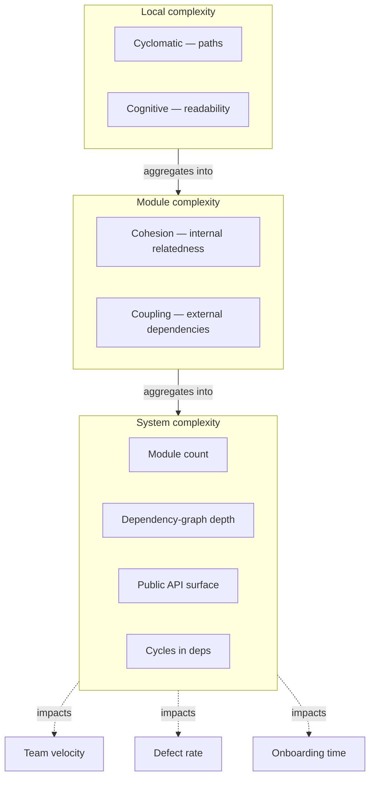
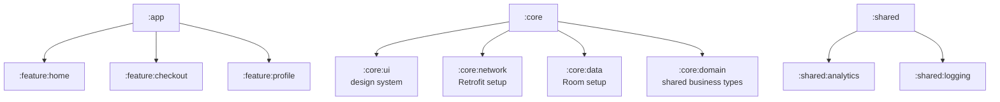

# System Complexity

## Overview

**System complexity** is the cost a software system imposes on the humans who work with it — to read, understand, modify, test, and operate. It is distinct from algorithmic complexity (Big-O of time and space, covered in [`../engineering-fundamentals/complexity-analysis.md`](../engineering-fundamentals/complexity-analysis.md)). Algorithmic complexity asks "how does runtime scale?" System complexity asks "how does cognitive cost scale?" — and the answer determines whether your team ships in a week or struggles for months.

Multiple measures exist. **Cyclomatic complexity** counts independent paths through a function — a proxy for how many test cases are needed and how hard the function is to debug. **Cognitive complexity** (Campbell's metric, used by SonarQube) measures how hard code is to read for humans, weighting nesting and breaks-in-flow. **Coupling** measures how many modules depend on each other; **cohesion** measures how related the contents of a module are. **Halstead metrics** measure operator and operand counts as a proxy for effort. None is perfect; all together give a picture of how expensive it is to evolve a system.

This file covers the four practical complexity dimensions Staff engineers monitor — control-flow (cyclomatic), readability (cognitive), structural (coupling and cohesion), and architectural (number of modules, depth of abstractions, breadth of dependencies). It explains the tools that measure them (Detekt, SonarQube, Konsist), the thresholds that matter in mobile codebases, and the patterns that reduce complexity without sacrificing capability. The Staff-level skill is recognizing that an apparent feature gap is often a complexity ceiling — the team can't add the feature cleanly because the existing structure makes change too expensive.

---

## Why It Exists

Three observations forced system complexity to become a first-class engineering concern:

1. **Software lifetime cost dominates.** Studies (Boehm, Brooks, McConnell) consistently show maintenance is 60-80% of total software cost. Code is read 10x more than it's written. Complexity that slows reading multiplies the lifetime cost.
2. **Defects scale super-linearly with complexity.** Empirical work by Capers Jones, NIST, and others shows defect rates correlate strongly with complexity metrics. A function with cyclomatic complexity 20 has roughly 4x the defect rate of one with complexity 5 — not 4x, exponentially worse.
3. **Onboarding scales with complexity.** A codebase a new engineer can productively contribute to in a week vs three months has dramatically different system complexity. For mobile teams with rotation, this directly drives velocity.

The mobile-specific layer: Android codebases face unique complexity drivers. Multiple architecture patterns (MVVM, MVI, Clean) get mixed. Multiple platforms (XML + Compose). Multiple lifecycle systems (Activity, Fragment, ViewModel, Composable). Multiple async paradigms (Threads, RxJava, Coroutines). Each historical layer adds complexity that survives long after it's needed. A 5-year-old Android app often has 8 different ways to load images and 4 different DI systems.

Without explicit measurement and policy, complexity accretes silently. By the time it's noticeable in lost velocity, it's already expensive to remove. The principle exists because complexity is the dominant long-term cost and the easiest thing to ignore.

---

## Historical Context

1. **Thomas McCabe, *"A Complexity Measure"* (1976).** Introduced cyclomatic complexity, the first widely-adopted code-level complexity metric. Defined the formula: V(G) = E − N + 2P, where E and N are edges and nodes in the control flow graph.
2. **Maurice Halstead, *"Elements of Software Science"* (1977).** Halstead metrics based on operator/operand counts — measures effort, time, and bug-prediction proxies.
3. **Edward Yourdon and Larry Constantine, *Structured Design* (1979).** Defined coupling and cohesion as foundational design metrics. Argued that low coupling + high cohesion = manageable systems.
4. **Glenford Myers' *The Art of Software Testing* (1979) and *Composite/Structured Design* (1978).** Used cyclomatic complexity to determine test case requirements.
5. **Steve McConnell, *Code Complete* (1993, rev. 2004).** Popularized practical complexity thresholds in industry: function complexity ≤ 10, file complexity ≤ 200 lines, nesting ≤ 4.
6. **Robert C. Martin (Uncle Bob), Clean Code (2008).** Codified Single Responsibility, Open-Closed, and other complexity-reducing principles into mainstream practice.
7. **Adam Tornhill, *Your Code as a Crime Scene* (2015).** Statistical analysis showing complexity hotspots (high churn + high complexity) predict ~80% of bugs.
8. **G. Ann Campbell, *"Cognitive Complexity"* (2018, SonarSource).** New metric specifically measuring human readability, distinct from cyclomatic. Standard in modern lint tools.
9. **Modern dependency-graph linting (Konsist, ArchUnit, Detekt).** Tools that enforce module-level architectural constraints to bound coupling.
10. **Industry evidence (Forsgren et al., *Accelerate*, 2018).** Engineering productivity research showing low-complexity, fast-feedback codebases produce 2-4x more output than complexity-burdened ones.

The arc: from single-metric measures (McCabe 1976) to multi-dimensional analysis (cyclomatic + cognitive + architectural) and from individual-file metrics to whole-codebase analysis with churn-weighted complexity.

---

## First Principles

### 1. Cyclomatic complexity

The number of linearly independent paths through a function. Equivalently, the count of decision points + 1.

```kotlin
fun classify(n: Int): String {              // start: 1
    if (n < 0) return "negative"             // +1
    if (n == 0) return "zero"                // +1
    if (n < 10) return "small"               // +1
    if (n < 100) return "medium"             // +1
    return "large"                            // (no branch)
}
// Cyclomatic complexity: 5
```

Practical thresholds:
- **1–4**: simple, easy to test.
- **5–10**: still manageable.
- **11–20**: complex, requires careful review.
- **20+**: untestable in practice; refactor.

Detekt's default threshold is 15 for functions and 600 for files.

### 2. Cognitive complexity

Cognitive complexity (Campbell's metric) measures *human readability*, not paths. Nested control flow, recursion, and breaks-in-flow are weighted heavier than flat structures.

```kotlin
fun process(input: Input): Result {
    if (input.isValid) {                     // +1
        for (item in input.items) {           // +1, +1 (nesting)
            if (item.isRelevant) {            // +1, +2 (nesting)
                results.add(process(item))    // +1 (recursion)
            }
        }
    }
    return Result(results)
}
// Cognitive complexity: 7 (higher than cyclomatic ~3 because of nesting)
```

The metric is more aligned with how hard the code feels to read. SonarQube reports both metrics.

### 3. Coupling: how dependent modules are

**Afferent coupling (Ca)**: number of types that depend *on* this module.
**Efferent coupling (Ce)**: number of types this module depends *on*.

A core utility module has high Ca (many depend on it) and low Ce (it depends on little). An application top layer has the opposite.

**Instability (I) = Ce / (Ca + Ce)**. Ranges 0 (stable, only depended on) to 1 (unstable, only depending on others). Stable modules should be abstract; unstable modules should be concrete. The *abstractness vs instability* plot reveals architectural problems.

### 4. Cohesion: how related a module's contents are

**LCOM** (Lack of Cohesion in Methods) measures whether a class's methods all use the same fields. Low LCOM means the methods are tightly related; high LCOM means the class is doing multiple unrelated things.

A `UserService` that has methods using only `user` fields and methods using only `payment` fields has low cohesion — it should probably be two services.

### 5. Halstead metrics

Counts of distinct operators and operands. Used to derive:
- **Volume**: code length × log2(vocabulary). Proxy for cognitive size.
- **Effort**: estimated time to read and understand.
- **Bugs predicted**: empirical formula based on volume.

Less widely used now than cyclomatic + cognitive, but still useful for codebase-wide trends.

### 6. Architectural complexity at scale

Module count, dependency-graph depth, dependency-graph width, cycle count, public-API surface. A 200-module project with a 15-deep dependency graph is hard to navigate; a 200-module project with a 3-deep wide graph is fine.

Tools like Konsist and ArchUnit enforce architectural rules: "no feature module depends on another feature module," "domain layer doesn't depend on data layer," etc.

---

## Mental Model

Think of system complexity as **the cognitive tax you pay every time you touch the code**. Simple code is "tax-free" — read once, understand fully, modify confidently. Complex code is "high-tax" — read three times, miss subtleties, modify with anxiety. The tax compounds across team members, across years, across features.

There are three distinct taxes:

1. **Local tax** (within a function): cyclomatic + cognitive complexity. "How hard is this function to understand?"
2. **Module tax** (within a class/file): cohesion + coupling. "How focused and reusable is this module?"
3. **System tax** (across modules): architectural complexity. "How navigable is the codebase?"

You pay all three on every change. A team that doesn't measure them silently absorbs the cost as "everything takes longer than it used to."

Another framing: think of complexity as **dark matter**. You can't see it directly in any single PR. But it accumulates. Eventually it dominates the system — gravitational effects (slow builds, fragile tests, broken assumptions) become impossible to ignore. By that point, removing it is enormously expensive.

The discipline is **periodic measurement and bounded growth**: track the metrics, set thresholds, refactor proactively. You don't have to be at zero complexity; you have to keep it below the level where it dominates.

---

## Internal Mechanics

### Cyclomatic complexity computation

Build the control flow graph: each statement is a node; control transfers (if, while, for, return, throw) are edges. The cyclomatic number is `E − N + 2P` where E = edges, N = nodes, P = connected components.

For most practical purposes, just count decision points and add 1: `if`, `else if`, `case`, `&&`, `||`, `?:`, `?.let { }`, and so on.

Detekt computes this for every function in your codebase and reports the worst offenders.

### Cognitive complexity computation

For each control-flow statement:
- Add 1 for each break-in-flow (`if`, `else`, `for`, `while`, `try`, `catch`, `switch`).
- Add 1 extra for each level of nesting beyond the first.
- Add 1 for non-`if/else` aggregating logical operators (`&&`, `||` in a single condition).
- Recursion adds 1.
- Lambdas without nested control flow add 0.

```kotlin
fun foo(x: Int): Int {
    if (x > 0) {                  // +1
        if (x > 10) {             // +1 +1 (nesting)
            return 100
        }
    }
    return 0
}
// Cognitive complexity: 3
```

Designed to weight readability over rigor.

### Coupling and cohesion analysis tools

**Detekt** reports per-module coupling via `:detektMetrics`. **Konsist** lets you write tests that enforce architectural constraints:

```kotlin
@Test fun `feature modules don't depend on each other`() {
    Konsist.scopeFromProduction()
        .files
        .filter { it.path.contains("/feature/") }
        .assertFalse { file ->
            file.imports.any { it.name.contains("feature.") && it.name != file.packagee?.fqName }
        }
}
```

**ArchUnit** does the same for Java. Both can fail CI when violations are introduced.

### Module-graph depth

Gradle's `:moduleDependencies` task and `--scan` reveal the module-dependency DAG. Tools like Gradle Dependency Analysis Plugin highlight unused dependencies and graph anomalies.

### Identifying complexity hotspots

Adam Tornhill's approach: weight code-complexity metrics by **churn** (number of commits touching the file in the last N months). High complexity + high churn = hotspot. These predict the majority of bugs and are the highest-leverage refactor targets.

Tools: `codescene.io`, custom scripts running `git log` against `detekt` output.

---

## Architecture



Complexity at every level cascades upward into team-level outcomes.

---

## Production Example

### Refactoring a complexity hotspot

A `CheckoutViewModel` has cyclomatic complexity 47, cognitive complexity 89, and 23 commits in the last 3 months — a classic hotspot.

```kotlin
class CheckoutViewModel : ViewModel() {
    fun handleEvent(event: CheckoutEvent) {
        when (event) {
            is CheckoutEvent.Submit -> {
                if (state.value.items.isEmpty()) {
                    _state.update { it.copy(error = "Cart is empty") }
                } else if (state.value.address == null) {
                    _state.update { it.copy(error = "Address required") }
                } else if (state.value.paymentMethod == null) {
                    _state.update { it.copy(error = "Payment required") }
                } else if (!state.value.termsAccepted) {
                    _state.update { it.copy(error = "Terms required") }
                } else if (state.value.couponCode != null && !validateCoupon()) {
                    _state.update { it.copy(error = "Invalid coupon") }
                } else {
                    submitOrder()
                }
            }
            // ...20 more event types
        }
    }
}
```

After: extract validation into a `CheckoutValidator` and dispatch to event handlers.

```kotlin
class CheckoutValidator {
    fun validate(state: CheckoutState): ValidationResult {
        return when {
            state.items.isEmpty() -> ValidationResult.Error("Cart is empty")
            state.address == null -> ValidationResult.Error("Address required")
            state.paymentMethod == null -> ValidationResult.Error("Payment required")
            !state.termsAccepted -> ValidationResult.Error("Terms required")
            else -> ValidationResult.Valid
        }
    }
}

class CheckoutViewModel : ViewModel() {
    private val validator = CheckoutValidator()
    private val orderSubmitter = OrderSubmitter()

    fun handleEvent(event: CheckoutEvent) {
        when (event) {
            is CheckoutEvent.Submit -> trySubmit()
            // each event type delegates to a single-responsibility function
        }
    }

    private fun trySubmit() {
        when (val result = validator.validate(state.value)) {
            is ValidationResult.Valid -> orderSubmitter.submit(state.value)
            is ValidationResult.Error -> _state.update { it.copy(error = result.message) }
        }
    }
}
```

Cyclomatic drops to ~6 per function. Cognitive drops to ~10. Tests become small and focused. Future event types add a single function each.

### Enforcing architectural rules with Konsist

```kotlin
@Test fun `domain layer doesn't depend on data layer`() {
    Konsist.scopeFromProduction()
        .files
        .filter { it.path.contains("/domain/") }
        .assertFalse { file ->
            file.imports.any { it.name.contains(".data.") }
        }
}

@Test fun `feature modules don't depend on each other`() {
    val featurePaths = listOf("/feature/checkout/", "/feature/profile/", "/feature/home/")
    Konsist.scopeFromProduction()
        .files
        .filter { it.path in featurePaths }
        .assertFalse { file ->
            featurePaths.any { feature ->
                feature != file.path && file.imports.any { it.name.contains(feature.replace("/", ".")) }
            }
        }
}
```

These tests run in CI. A PR that adds a forbidden dependency fails the build, preventing accidental coupling growth.

---

## Android Example

### Limiting per-file complexity with Detekt

```yaml
# detekt.yml
complexity:
  CyclomaticComplexMethod:
    threshold: 15
  CognitiveComplexMethod:
    threshold: 15
  LongMethod:
    threshold: 60
  LongParameterList:
    functionThreshold: 6
    constructorThreshold: 7
  NestedBlockDepth:
    threshold: 4
  TooManyFunctions:
    thresholdInFiles: 20
    thresholdInClasses: 15
    thresholdInObjects: 15
```

Detekt runs in CI and as a pre-commit hook. New code violating thresholds fails the build. Existing code is grandfathered with a baseline file; new code can't add to the baseline.

### Reducing recompositions via composable simplicity

A composable with cognitive complexity 30 (many conditionals, mutable state, side effects) is hard to verify for correctness *and* it causes broader recompositions because Compose's analysis can't determine stability. Simplifying:

```kotlin
@Composable
fun CheckoutButton(state: CheckoutState, onSubmit: () -> Unit) {
    val enabled = remember(state) {
        state.items.isNotEmpty()
            && state.address != null
            && state.paymentMethod != null
            && state.termsAccepted
    }
    Button(onClick = onSubmit, enabled = enabled) {
        Text("Submit Order")
    }
}
```

The validation logic is pulled into a `remember` block. The button itself has cognitive complexity 1. The compose runtime can confidently skip recomposition when `state` is unchanged.

### Module graph at the right depth

A common mobile codebase pattern:



Depth: 3 levels (app → feature → core). Width: 7-12 modules. Build time scales well because feature modules build in parallel. The architecture is navigable; an engineer can predict where new code goes.

Anti-pattern: 100 micro-modules with 15 levels of depth. Tools spend more time evaluating Gradle config than compiling code; engineers can't find anything.

---

## Tradeoffs

**Advantages of low complexity**

- **Faster modification.** Less cognitive overhead per change.
- **Lower defect rate.** Empirical correlation is strong.
- **Easier onboarding.** New engineers ramp up faster.
- **Better testability.** Simple functions need few test cases.
- **Better build performance.** Modular codebases recompile only what changed.

**Disadvantages**

- **Over-decomposition.** Splitting a focused class into 12 micro-classes adds coupling and friction. There's a sweet spot.
- **Excessive abstraction layers.** Each layer is a thing to read; too many hide the actual logic.
- **Premature modularization cost.** Splitting an app into 50 modules before it has 5 features is wasted effort.
- **Tool-imposed limits constrain expressiveness.** Sometimes a 15-line `when` is genuinely the right answer; arbitrary limits force ugly refactors.

**When complexity is acceptable**

- For genuinely complex domain logic (tax calculations, scheduling, game rules) — the complexity is real and pushing it into "simpler" forms can obscure rather than clarify.
- For one-shot scripts or prototypes — complexity reduction is investment that doesn't pay back.
- For hot performance paths — sometimes inlined branchy code is faster than abstracted, and the cost is contained.

---

## Failure Modes

**God class with cyclomatic complexity 80.** Untestable; every change risks breaking something elsewhere. Mitigation: refactor by extracting cohesive sub-responsibilities into separate classes.

**Module that everyone depends on.** A `:core:everything` package starts as a shared library and becomes a build bottleneck because any change forces all features to rebuild. Mitigation: split by responsibility (`:core:network`, `:core:database`, `:core:design-system`); enforce via Konsist.

**Cycles in module dependencies.** Gradle refuses to build. The cycle indicates a structural problem: usually, a "core" type depends on a "feature" type because of bad ordering. Mitigation: introduce an interface in core that features implement; or move the type to the right module.

**Coupling-by-import-explosion.** A class with 35 imports is depending on too many things. Hard to test; hard to evolve. Mitigation: review the import list; many can be eliminated by depending on smaller interfaces.

**Cognitive complexity buried in lambdas.** A function with low cyclomatic complexity but a 50-line lambda inside is just as hard to read. Mitigation: extract complex lambdas as named functions.

**Architectural drift.** Without enforcement, a codebase starts clean and accumulates "just this one violation" until the architecture is unrecognizable. Mitigation: lint rules + architectural tests + visible dashboard.

**Refactor paralysis.** A complex codebase is too risky to refactor, so it grows more complex. Mitigation: **boy-scout-rule** — always leave code slightly cleaner than you found it; over months this compounds.

**Premature decomposition.** Splitting too early creates many small files with little content; navigating them is its own complexity. Mitigation: wait for the natural seam to appear (the second feature, the third copy); decompose then.

---

## Performance Considerations

- **Complex code is slower for the compiler.** Kotlin compilation time scales with function size and complexity; trimming complex functions reduces incremental build time.
- **Build performance scales with module complexity.** Wide, flat module graphs build faster than tall, narrow ones.
- **Lint runs scale with code size and complexity.** Detekt on a 500K-line monolith may take minutes; on properly modularized code, runs in seconds per changed module.

---

## Reliability Considerations

- **Defect rates correlate with cyclomatic complexity.** Empirical industry data shows ~exponential relationship past complexity 10.
- **Complex code resists testing.** Coverage targets are easier to hit on simple code; difficult code often has token tests that don't actually verify behavior.
- **Onboarding-failure rate correlates with system complexity.** A new engineer who never gets productive is a hidden but enormous cost.
- **MTBF (mean time between failures) decreases with complexity.** Operational reliability requires comprehensible code.

---

## Security Considerations

- **Complex code hides security bugs.** Vulnerabilities like SQL injection, path traversal, and use-after-free are dramatically more common in complex functions where edge cases aren't visible.
- **Auditing scales with complexity.** A security review of a 1000-line function takes 20x longer than 50 simple functions of 20 lines each.
- **Complex authentication/authorization logic is a red flag.** Authorization spread across many conditionals is almost certainly missing cases. Simplify to a small policy engine.

---

## Observability

- **Track complexity metrics in CI.** Detekt + sonarqube + Konsist output rolled into a dashboard showing trends.
- **Identify hotspots via complexity × churn.** Files with both high complexity and high commit count are bug magnets.
- **Module-build time as a complexity signal.** A module taking 60s to compile when others take 5s probably has internal complexity worth investigating.
- **Lint violations over time.** Trend graphs show whether the team is reducing or adding complexity.

---

## Staff Engineer Thinking

**Treat complexity as a budget.** Every team has a finite budget for complexity in a codebase. Spend it on the genuinely-complex (core domain logic) and starve it elsewhere (utilities, glue code, plumbing).

**Bound complexity with lint rules, then track exceptions.** A `complexity: max 15` rule with no exceptions is easy to enforce. Exceptions should require justification and have remediation plans.

**Architectural tests pay back fast.** A 20-line Konsist test that enforces "feature modules don't depend on each other" prevents months of cleanup later.

**Refactor hotspots, not everything.** The 80/20 rule applies hard: ~20% of files have ~80% of bugs and ~80% of churn. Focus refactoring there.

**Measure cognitive complexity, not just cyclomatic.** Two functions with cyclomatic 10 can have wildly different readability. Cognitive complexity catches what cyclomatic misses.

**Don't over-decompose for the metrics.** Splitting a focused 30-line function into three 10-line functions to "hit the metric" makes the code worse. The metrics are signals, not goals.

**Make the architecture visible.** A diagram showing module dependencies, updated quarterly, surfaces decay. Teams that don't see their architecture decay don't know they need to act.

**Coupling matters more than module count.** A 200-module project can be simpler than a 20-module project if the 200 are well-isolated. Number of modules isn't the metric — *dependencies between them* is.

**Use the Stable Dependencies Principle.** Modules should depend in the direction of stability. Volatile modules depend on stable ones, not the reverse.

---

## Common Misconceptions

**"Cyclomatic complexity is the complete picture."** It misses readability concerns, coupling, and architectural issues. Use it as one of several lenses.

**"Lower complexity always means better code."** Some domain problems are genuinely complex; obscuring that with surface-level "simplification" makes things worse.

**"Modularity solves all complexity problems."** Modularity solves *some* problems (build time, ownership) and *creates* others (coordination, API design). Use it deliberately.

**"You can't measure cognitive load directly."** You can measure proxies (cognitive complexity, time to onboard, code-review duration). They correlate strongly enough to act on.

**"Complexity metrics are gameable."** They are, but the gaming is usually visible to a reviewer. A `when` flattened by extracting to functions with cryptic names is worse than the original — code review catches it.

**"More tests reduce complexity."** Tests verify behavior; they don't reduce structural complexity. Some heavily-tested code is still hard to change.

**"Refactoring is risky, so we shouldn't do it."** Not refactoring is also risky — slowly, then suddenly. The compound interest of unaddressed complexity is far higher than the risk of careful refactoring.

---

## Probing Questions

1. Walk through computing cyclomatic complexity by hand for a 40-line function with nested `if`s, a `for` loop, and two `when` blocks.
2. What's the difference between cyclomatic and cognitive complexity? Give a code example where they diverge significantly.
3. Define afferent and efferent coupling. Plot a hypothetical core utility module's stability/instability metric.
4. Why does Detekt have separate thresholds for `LongMethod` and `LongParameterList`? What does each protect against?
5. Adam Tornhill's "complexity × churn = hotspot" formulation: explain why churn matters and why it identifies high-value refactor targets.
6. Walk through how Konsist or ArchUnit can enforce architectural rules. Give a code example of a rule and explain how it fails when violated.
7. A `CheckoutViewModel` has cyclomatic complexity 67. List three sequential refactoring steps and what each accomplishes.
8. A 200-module Android project has a 15-deep dependency graph. Build times balloon. What's the structural problem and how do you fix it?
9. Why is cohesion harder to measure than coupling? Give an example where LCOM-1 metric gives a misleading score.
10. Your team adds a CI check that fails when cyclomatic complexity exceeds 15. Three weeks later, hot-fix PRs are routinely blocked. How do you respond?

---

## Answer Key

1. **Walk through computing cyclomatic complexity by hand...**
   Start with a base score of 1, and add 1 for every branching decision point (`if`, `for`, `while`, `&&`, `||`, `case`).
2. **What's the difference between cyclomatic and cognitive complexity?**
   Cyclomatic counts the mathematical number of execution paths, while cognitive complexity measures human readability by heavily penalizing nested loops, conditionals, and breaks in flow.
3. **Define afferent and efferent coupling.**
   Afferent coupling (Ca) is the number of external modules that depend *on* your module. Efferent coupling (Ce) is the number of modules your module depends *on*.
4. **Why does Detekt have separate thresholds for `LongMethod` and `LongParameterList`?**
   `LongMethod` prevents functions from having low cohesion (doing too much), while `LongParameterList` prevents high coupling (depending on too many external components).
5. **Adam Tornhill's "complexity × churn = hotspot" formulation...**
   High complexity only incurs a tax when the code is modified. High churn indicates frequent modification, so complex files with high churn are the highest-leverage targets for refactoring.
6. **Walk through how Konsist or ArchUnit can enforce architectural rules.**
   They parse the codebase's AST or bytecode and run tests against the dependency graph, failing the CI build if, for example, a domain class imports a UI class.
7. **A `CheckoutViewModel` has cyclomatic complexity 67...**
   You can extract data validation to a pure `Validator` class, delegate analytics to an `AnalyticsTracker`, and break large state machines into polymorphism or smaller cohesive functions.
8. **A 200-module Android project has a 15-deep dependency graph...**
   The deep graph prevents parallel compilation and balloons build times. The fix is to flatten the architecture into a wider, shallower graph using shared interfaces.
9. **Why is cohesion harder to measure than coupling?**
   Coupling is easily quantified by counting imports; cohesion is semantic and requires judging whether internal fields and methods logically belong together, which mechanical metrics like LCOM can misinterpret.
10. **Your team adds a CI check that fails when cyclomatic complexity exceeds 15...**
    Examine if the threshold is too strict for the specific domain, introduce baselines to grandfather legacy code, and educate the team on extracting cohesive sub-components instead of hacking the metric.

## Further Reading

In this repository:

- [`../engineering-fundamentals/complexity-analysis.md`](../engineering-fundamentals/complexity-analysis.md) — algorithmic complexity (Big-O of time and space).
- [`../engineering-fundamentals/coupling-vs-cohesion.md`](../engineering-fundamentals/coupling-vs-cohesion.md) — structural complexity in depth.
- [`../principles/simplicity.md`](../principles/simplicity.md) — simplicity as a first principle.
- [`../principles/single-responsibility.md`](../principles/single-responsibility.md) — cohesion at the class level.
- [`../principles/least-knowledge.md`](../principles/least-knowledge.md) — Demeter as coupling reduction.
- [`../principles/locality-of-reference.md`](../principles/locality-of-reference.md) — common-closure principle.
- [`../android/build-tooling/gradle-and-build-systems.md`](../android/build-tooling/gradle-and-build-systems.md) — build performance and module complexity.

External:

- Thomas McCabe, *"A Complexity Measure"* (IEEE, 1976) — the cyclomatic complexity paper.
- G. Ann Campbell, *"Cognitive Complexity: A new way of measuring understandability"* (SonarSource, 2018) — the cognitive metric.
- Adam Tornhill, *Your Code as a Crime Scene* (Pragmatic, 2015) — churn × complexity hotspot analysis.
- Steve McConnell, *Code Complete* (Microsoft Press, 2nd ed. 2004) — practical complexity guidelines.
- Robert C. Martin, *Clean Architecture* (Prentice Hall, 2017) — architectural complexity and the Stable Dependencies Principle.
- *Accelerate* by Forsgren, Humble, Kim (IT Revolution, 2018) — empirical evidence linking complexity-related practices to organizational performance.
- Konsist documentation (kotest.io/konsist) — Kotlin architectural-rule testing.
- Detekt documentation (detekt.dev) — Kotlin static analysis with complexity thresholds.
