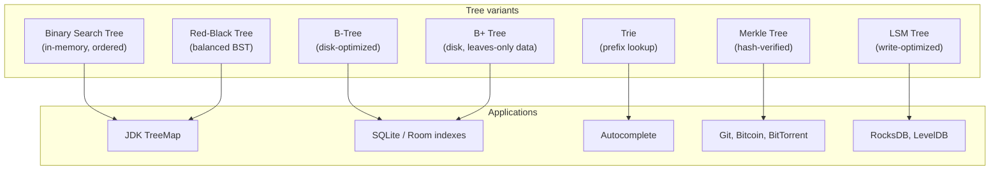

# Trees

## Overview

A **tree** is a hierarchical data structure consisting of nodes connected by edges, with exactly one path between any two nodes and no cycles. Every tree has a **root** node at the top, **internal** nodes with children, and **leaf** nodes at the bottom. Trees model anything hierarchical: file systems, organization charts, UI layouts, parse trees, decision trees, syntax trees, DOM trees, and many distributed-systems primitives (Merkle trees, B-trees, tries).

For mobile engineers, trees appear constantly: every Android `View` hierarchy is a tree, every Jetpack Compose UI is a tree of composables, every parser (XML, JSON, Kotlin compiler) builds an abstract syntax tree, every SQLite index is a B-tree, every Git commit graph (acyclic but not strictly a tree) descends from Merkle trees. Understanding tree algorithms — depth-first vs breadth-first traversal, balancing, hashing, and lookup — is core to understanding why your app frames drop, why your queries are slow, why your sync conflicts, and why your build takes 45 minutes.

This file covers the fundamental tree concepts (root, parent, child, depth, height), common tree types (binary, balanced, B-tree, trie, Merkle), the two traversal strategies (DFS and BFS) with their tradeoffs, the algorithms that make trees useful (rotation for balance, hashing for verification, prefix matching for autocomplete), and how each shows up in mobile development.

---

## Why It Exists

Trees exist because **hierarchy is the natural structure for most real-world data**. The world is full of "X contains Y, Y contains Z" relationships: directories hold files, screens hold layouts hold views, organizations have departments hold teams hold individuals, documents have sections hold paragraphs hold sentences. A flat list can model these relationships only by encoding parent IDs as references, losing the structural benefits trees provide.

The structural benefits are concrete:

1. **Logarithmic-time lookup in balanced trees.** A million-key B-tree of order 100 has depth ~3. Three disk reads find any key. Compare to a linear scan: a million reads.
2. **Efficient ordered iteration.** In-order traversal of a balanced BST visits keys in sorted order in O(n).
3. **Cheap hierarchical operations.** Computing a directory's total size, a UI layout's total height, a document's word count — all are post-order traversals.
4. **Fast set membership for strings via tries.** Type-ahead autocomplete on a 100K-word dictionary works in microseconds.
5. **Cryptographic verification of large collections via Merkle trees.** Git, blockchain, Cassandra anti-entropy — all verify huge data sets with logarithmic-size proofs.

The cost when trees go bad: an unbalanced binary tree degrades to a linked list, turning O(log n) into O(n). A view hierarchy that's 20 layers deep stresses the Android rendering pipeline. A Merkle tree with a bad hash function loses its integrity guarantees. Trees are powerful, but the wrong tree (or a tree used wrong) is catastrophic.

---

## Historical Context

1. **Knuth's *The Art of Computer Programming*, Volume 1 (1968).** Donald Knuth's foundational chapters on tree data structures. Defined the vocabulary still used.
2. **Binary search tree (1960s).** The simplest "lookup tree" — unbalanced versions appear in early FORTRAN, balanced versions arrive with AVL.
3. **AVL tree (Adelson-Velsky, Landis, 1962).** The first self-balancing BST. Rebalances on insertion/deletion to keep height O(log n).
4. **Red-black tree (1972, named 1978).** Less strictly balanced than AVL but simpler invariants. Used in JDK's `TreeMap`, C++ `std::map`, Linux kernel scheduler.
5. **B-tree (Bayer & McCreight, 1972).** Designed for disk storage; each node holds many keys, reducing tree depth and disk seeks. Foundation of every modern database index (SQLite, MySQL, PostgreSQL).
6. **Trie (Fredkin, 1960).** Prefix tree for string lookup. Foundation of autocomplete, spell-check, IP routing tables.
7. **Merkle tree (Ralph Merkle, 1979).** A binary tree of hashes for verifying large data sets. Foundation of Bitcoin, Git, BitTorrent, IPFS.
8. **B+ tree (1970s-80s).** Variant of B-tree where all data lives in leaves; internal nodes are pure index. Used in most modern relational databases.
9. **R-tree (Guttman, 1984).** Spatial index for geographic queries. Foundation of map tile queries, geofencing.
10. **LSM tree (O'Neil et al., 1996).** Log-structured merge tree. Foundation of LevelDB, RocksDB, Cassandra, ScyllaDB — write-optimized variants used in mobile databases too.

The arc: from in-memory binary trees (1960s) to disk-optimized B-trees (1970s) to specialized variants for distributed systems (Merkle, LSM) and spatial data (R-trees). Each variant trades off complexity, branching factor, and what's optimized for.

---

## First Principles

### 1. Vocabulary

- **Root.** The single top node. Every tree has exactly one root.
- **Parent / child.** A node directly above (parent) or below (child) another.
- **Sibling.** Two nodes sharing a parent.
- **Leaf.** A node with no children.
- **Internal node.** A node with at least one child.
- **Depth.** Distance from root to node. Root has depth 0.
- **Height.** Distance from node to its deepest descendant leaf. A leaf has height 0.
- **Subtree.** A node and all its descendants.
- **Degree.** Number of children of a node.
- **Binary tree.** Every node has at most 2 children.
- **N-ary tree.** Every node has at most N children.
- **Balanced.** Height is O(log n) where n is the number of nodes. Specifics vary by tree type.

### 2. Traversal: DFS vs BFS

```
        A
       / \
      B   C
     / \   \
    D   E   F
```

**Depth-first** (DFS) visits along a path to the deepest leaf, then backtracks:

- **Pre-order** (root, left, right): A, B, D, E, C, F
- **In-order** (left, root, right): D, B, E, A, C, F
- **Post-order** (left, right, root): D, E, B, F, C, A

**Breadth-first** (BFS) visits level by level: A, B, C, D, E, F.

DFS uses a stack (or recursion); BFS uses a queue. DFS uses O(height) extra memory; BFS uses O(width) extra memory. Pick based on what you're looking for: BFS for "nearest match" or "shortest path"; DFS for "complete a subtree before moving on" (e.g., layout measurement).

### 3. Balanced vs unbalanced trees

```kotlin
// Inserting 1, 2, 3, 4, 5 into an unbalanced BST:
//   1
//    \
//     2
//      \
//       3
//        \
//         4
//          \
//           5
```

Becomes a linked list. Lookups are O(n).

A self-balancing tree rotates nodes on insertion to maintain bounded height. AVL, red-black, B-trees, and variants all use some form of rebalancing.

### 4. Hashing and trees: Merkle trees

A Merkle tree is a binary tree where each internal node holds the hash of its two children's values.

```
          H(H(A) + H(B), H(H(C) + H(D)))         <- root hash
                /                         \
       H(H(A) + H(B))           H(H(C) + H(D))
         /        \              /          \
      H(A)      H(B)          H(C)       H(D)
       |          |             |           |
      data A   data B        data C      data D
```

Two consequences:

1. **The root hash fingerprints the entire data set.** If any leaf changes, the root changes.
2. **You can verify a specific leaf with O(log n) other hashes.** "Prove this leaf is in the tree" requires only the sibling hashes along the path to the root.

This is what makes Git, Bitcoin, and BitTorrent's verification work.

### 5. Tries for prefix matching

A trie is a tree where each path from root to a node spells a string. Used for autocomplete, IP routing, spell-checking.

```
            root
          /  |  \
         c   a   t
         |   |   |
         a   p   o
         |   |   |
         r   p   d
                 |
                 a
                 y
```

Looking up "ape" walks `root → a → p`, hits dead end → not in the trie. Looking up "apple" would require adding `→ l → e` to the existing `a → p` path. Lookup is O(key length), independent of trie size. Compare to a hash set, which is O(key length) for hashing plus O(1) lookup — comparable. Tries win when prefix matching is needed.

---

## Mental Model

Think of a tree as a **family tree of relationships** where each member has at most one parent. The root is the founder. Descendants flow down. Leaves are the youngest with no kids yet. Every relative has exactly one chain of ancestors back to the root.

Traversal strategies are analogous to "how do I introduce everyone at the family reunion?" Depth-first: introduce each branch fully before moving on (here's the founder, here's his first child, his first child's first grandchild, and so on, all the way to the youngest descendant of that branch, then back up to start on the next branch). Breadth-first: introduce by generation (founder, then all children, then all grandchildren).

For balanced trees, picture a well-organized family: each generation has roughly twice as many people as the last. Height stays manageable as the family grows. An unbalanced tree is what happens when everyone has just one child — the tree is tall, narrow, and slow to navigate.

For Merkle trees, picture a notarized family ledger: every person has a signature derived from their two children's signatures. Change any descendant's signature and the chain breaks all the way up. The signature at the very top "represents" the entire family in a tamper-evident way.

---

## Internal Mechanics

### Binary search tree insertion and lookup

```kotlin
class BSTNode<T : Comparable<T>>(
    val value: T,
    var left: BSTNode<T>? = null,
    var right: BSTNode<T>? = null
)

fun <T : Comparable<T>> insert(root: BSTNode<T>?, value: T): BSTNode<T> {
    if (root == null) return BSTNode(value)
    when {
        value < root.value -> root.left = insert(root.left, value)
        value > root.value -> root.right = insert(root.right, value)
        // value == root.value: don't insert duplicates
    }
    return root
}

fun <T : Comparable<T>> contains(root: BSTNode<T>?, value: T): Boolean {
    if (root == null) return false
    return when {
        value < root.value -> contains(root.left, value)
        value > root.value -> contains(root.right, value)
        else -> true
    }
}
```

Insertion and lookup are O(h) where h is the height. For a balanced tree, h = O(log n); for an unbalanced one, h = O(n).

### Red-black tree rotation (sketch)

```
Left rotation:
       y                x
      / \              / \
     x   c    -->     a   y
    / \                  / \
   a   b                b   c
```

After insertion, you walk back up to the root checking invariants. If two consecutive red nodes appear (red-black invariant violation), rotate and re-color. The result is height stays within `2*log(n+1)`.

JDK's `TreeMap` uses red-black trees. Looking up a key is guaranteed O(log n).

### Trie insertion and lookup

```kotlin
class TrieNode {
    val children: MutableMap<Char, TrieNode> = mutableMapOf()
    var isEnd: Boolean = false
}

class Trie {
    private val root = TrieNode()

    fun insert(word: String) {
        var node = root
        for (c in word) {
            node = node.children.getOrPut(c) { TrieNode() }
        }
        node.isEnd = true
    }

    fun contains(word: String): Boolean {
        var node = root
        for (c in word) {
            node = node.children[c] ?: return false
        }
        return node.isEnd
    }

    fun wordsWithPrefix(prefix: String): List<String> {
        var node = root
        for (c in prefix) {
            node = node.children[c] ?: return emptyList()
        }
        val results = mutableListOf<String>()
        collectWords(node, prefix, results)
        return results
    }

    private fun collectWords(node: TrieNode, current: String, out: MutableList<String>) {
        if (node.isEnd) out.add(current)
        for ((c, child) in node.children) {
            collectWords(child, current + c, out)
        }
    }
}
```

Lookup is O(key length). The trie has up to 26 (or however many character) children per node — a wide tree, not a deep one. Memory is proportional to total characters across all keys.

For mobile autocomplete on a 100,000-word dictionary, a trie with all words pre-inserted is ~10-20MB and lookup is microseconds.

### Merkle tree construction and verification

```kotlin
import java.security.MessageDigest

fun hash(data: ByteArray): ByteArray =
    MessageDigest.getInstance("SHA-256").digest(data)

fun merkleRoot(leaves: List<ByteArray>): ByteArray {
    var level: List<ByteArray> = leaves.map { hash(it) }
    while (level.size > 1) {
        val next = mutableListOf<ByteArray>()
        for (i in 0 until level.size step 2) {
            val left = level[i]
            val right = if (i + 1 < level.size) level[i + 1] else left
            next.add(hash(left + right))
        }
        level = next
    }
    return level[0]
}

// Verify a leaf is part of the tree given the root and a proof path:
fun verifyMerkleProof(
    leaf: ByteArray,
    proof: List<Pair<ByteArray, Boolean>>,   // hash and "is left sibling?"
    expectedRoot: ByteArray
): Boolean {
    var current = hash(leaf)
    for ((sibling, isLeftSibling) in proof) {
        current = if (isLeftSibling) hash(sibling + current) else hash(current + sibling)
    }
    return current.contentEquals(expectedRoot)
}
```

For a tree with 1 million leaves, the proof for any leaf is just 20 sibling hashes (log2(1M) ≈ 20). Verifying that a leaf is in the tree, given the proof, takes 20 hashes — fast and bandwidth-cheap.

### B-tree node structure for disk-optimized indexing

A B-tree node holds up to ~100 keys (depending on order) and corresponding child pointers. Each node is sized to fit a disk page (typically 4KB or 16KB). Looking up a key reads one node per level of depth; for 100M rows at order 100, depth is ~4. Four disk reads find any row — vs millions for a linear scan.

SQLite, MySQL InnoDB, PostgreSQL, and Room (which uses SQLite) all use B-trees (or B+ trees) for indexes. Understanding why is what lets you decide when to add an index.

### LSM trees for write-heavy workloads

LSM (Log-Structured Merge) trees buffer writes in memory, periodically flush sorted runs to disk, and merge runs in the background. Writes are O(1) amortized, reads are O(log n × log levels). Used in RocksDB (the engine inside many mobile and embedded databases), Cassandra, and write-heavy mobile sync logs.

---

## Architecture



---

## Production Example

### Git's commit graph as Merkle DAG

Git stores everything as Merkle-tree-like structures:

- A **blob** is hashed content. SHA-1 (transitioning to SHA-256) of the file's bytes.
- A **tree** object holds (filename, blob hash) tuples — a directory.
- A **commit** holds (root tree hash, parent commit hashes, metadata).

The commit hash is a fingerprint of: everything in the source tree, all the metadata, and all parent commits transitively. Tampering with any file in any historical commit invalidates every subsequent commit's hash. This is why `git commit --amend` rewrites every subsequent commit hash.

### SQLite B-tree indexes

Every `CREATE INDEX` in Room or SQLite creates a B-tree index. A 1M-row table with an index on `userId` lets `WHERE userId = ?` queries find the matching rows in 3-4 disk reads. Without the index, the engine scans the entire table.

```kotlin
@Entity(indices = [Index(value = ["userId"])])
data class Message(
    @PrimaryKey val id: Long,
    val userId: Long,
    val text: String,
    val timestamp: Long
)
```

The index *is* a B-tree. Maintaining it has a write cost (every insert updates the index), but for read-heavy workloads it's almost always worth it.

### Autocomplete via trie

A typeahead search box backed by a 50,000-place location database. On each keystroke, you want top-10 matches in <20ms.

```kotlin
val trie = Trie().apply {
    locations.forEach { insert(it.name.lowercase()) }
}

fun search(prefix: String, limit: Int): List<String> =
    trie.wordsWithPrefix(prefix.lowercase()).take(limit)
```

Lookup is bounded by prefix length, not dataset size. Performance is constant as the dataset grows.

### Merkle anti-entropy in Cassandra

Cassandra nodes periodically exchange Merkle tree summaries of their data ranges. If two replicas have identical Merkle roots, they're in sync. If not, the tree comparison narrows down the differing range to a small subset, and only that subset is repaired. Without Merkle trees, replicas would have to send all their data to compare.

---

## Android Example

### View hierarchy as a tree

```xml
<ConstraintLayout>           <!-- root -->
    <LinearLayout>           <!-- internal -->
        <TextView />         <!-- leaf -->
        <ImageView />        <!-- leaf -->
    </LinearLayout>
    <FrameLayout>            <!-- internal -->
        <Button />           <!-- leaf -->
    </FrameLayout>
</ConstraintLayout>
```

The Android rendering pipeline traverses this tree three times per frame: `onMeasure` (DFS computing sizes), `onLayout` (DFS positioning children), `onDraw` (DFS painting). A tree 20 layers deep magnifies the per-node cost 20x. The `Layout Inspector` and `Hierarchy Viewer` tools visualize the tree and surface depth issues.

### Compose's slot table is a flattened tree

Jetpack Compose represents the UI hierarchy as a tree of composables, but stores it as a flat **slot table** — an array of slots that the recomposer reads in order. The tree structure is implicit in start/end groups within the array.

```kotlin
@Composable
fun Greeting(name: String) {
    Column {
        Text("Hello, $name")
        Text("Welcome back.")
    }
}
```

The slot table contains entries for the Column, both Texts, and their state. When `name` changes, the recomposer can update only the slots that read `name`, leaving the rest of the tree alone. This is "surgical recomposition" — a tree edit at logarithmic cost.

### Kotlin Compiler AST

When you write Kotlin, the compiler parses your code into an Abstract Syntax Tree:

```kotlin
fun greet(name: String) = "Hello, $name"

// Becomes:
// FunctionDeclaration
//   name: "greet"
//   parameters: [Parameter(name="name", type="String")]
//   body: BinaryExpression
//     operator: "+"
//     left: StringLiteral("Hello, ")
//     right: TemplateExpression(name)
```

Detekt and Android Lint rules visit this AST to enforce style rules. A custom rule banning `Thread.sleep()` traverses the AST looking for `CallExpression` nodes with the target name.

### Merkle-tree-based delta sync

A mobile app with a 100MB local SQLite database. Sync to server: compute Merkle root locally and server-side. If they match, nothing to sync. If they don't, walk the tree to find the differing subtree, then sync only that — typically a few KB instead of 100MB.

---

## Tradeoffs

**Advantages**

- **Hierarchical data fits naturally.** Anything with a parent-child structure maps to a tree.
- **Logarithmic operations on balanced trees.** Lookup, insert, delete all O(log n).
- **Specialized variants for specific access patterns.** B-trees for disk, tries for prefix, Merkle for verification.
- **Range queries are efficient.** In-order traversal of a BST gives sorted output.

**Disadvantages**

- **Random pointer access defeats cache locality.** Each node lookup may be a cache miss.
- **Balancing has cost.** Rotations on insertion add overhead.
- **Unbalanced trees are worst case.** Naïve BST on sorted input degenerates to a linked list.
- **Memory overhead per node.** Each pointer plus per-node metadata (parent, color, balance factor) — often 24-48 bytes of overhead per data element.

**When not to use**

- For random-access by index (use arrays / lists).
- For unordered sets of small data (use hash sets — O(1) instead of O(log n)).
- For frequent end insertions where order doesn't matter (use a deque or list).
- For data accessed sequentially (a flat sorted array is cache-friendlier).

---

## Failure Modes

**Unbalanced BST.** Inserting sorted data into a naïve BST produces a linked list. Mitigation: use a self-balancing variant (`TreeMap` in Kotlin/Java is red-black).

**Deep view hierarchy on Android.** 20-level deep `LinearLayout` chains cause measure/layout/draw cost to multiply. Mitigation: flatten with `ConstraintLayout`, refactor with `merge` tag, or migrate to Compose.

**Recursion stack overflow.** A 100,000-node tree traversed recursively blows the JVM stack (~10K frames typical). Mitigation: use iterative traversal with an explicit stack, or `tailrec` if applicable.

**Merkle tree with collision-vulnerable hash.** A Merkle tree using MD5 is no longer cryptographically secure — attackers can construct colliding leaves. Mitigation: use SHA-256 minimum.

**Trie memory blow-up.** A trie storing a million long random strings can use hundreds of MB. Mitigation: use a compressed trie (radix tree / Patricia trie) or a different structure (DAWG).

**B-tree insertion on a write-heavy workload.** Each insert may split a node, rippling up. Mitigation: use an LSM tree if write throughput dominates.

**Tree traversal on shared mutable state.** Modifying the tree during traversal causes inconsistencies and potential infinite loops. Mitigation: snapshot the tree, use immutable persistent structures, or lock the traversal.

**Compose key collisions.** `LazyColumn(items, key = { it.title })` with duplicate titles makes recomposition unpredictable. Mitigation: use globally-unique IDs as keys.

---

## Performance Considerations

- **Cache locality.** Trees stored as pointer-chasing structures (node references) miss cache often. Array-based heaps (e.g., binary heaps for priority queues) hit cache well.
- **Branching factor matters.** B-trees with high branching factor (100-200) are faster than binary trees on disk because each node read covers more keys.
- **Recursion depth.** For very deep trees, recursive traversal can be 10-100x slower than iterative due to function call overhead.
- **Merkle tree construction is O(n).** For a million leaves, that's a million hashes — non-trivial but manageable.
- **Trie memory.** Each character in inserted keys allocates a node. For very large vocabularies, use compressed/radix tries.
- **Compose recomposition cost** scales with the number of slots in the slot table. Deep trees with many composables are slower than shallow ones.

---

## Reliability Considerations

- **Test tree invariants.** Property-based testing catches edge cases (empty tree, single-node, all-left-children, balanced) that example-based tests miss.
- **Immutable trees are safer for concurrency.** Modifying a tree from multiple threads without synchronization corrupts it; immutable persistent trees (functional Trees, used in Clojure, Scala, etc.) are intrinsically thread-safe.
- **Snapshots for long traversals.** A long-running traversal (e.g., crawling a directory tree) should snapshot the structure or accept races.
- **Merkle proofs require collision-resistant hashes.** Without that, the security property collapses.

---

## Security Considerations

- **Merkle trees with weak hashes can be forged.** SHA-1 collisions allowed Bitcoin and Git's models to be questioned; migration to SHA-256 is in progress.
- **Trie-based autocomplete leaks data via timing.** A long search prefix on a user-specific trie reveals the size and shape of the user's data. Use constant-time lookups for sensitive contexts.
- **B-tree index leaks via timing.** Database query times depend on tree depth and leaf size; can be a side channel for inferring stored values.
- **Deep tree depth-of-field DoS.** A malicious user submitting deeply-nested JSON or XML can cause stack overflow during parsing. Mitigation: depth limits in parsers.

---

## Observability

- **Tree depth metrics.** For B-trees and SQLite indexes, monitor average tree depth — drift up means rebalancing isn't keeping pace.
- **Cache hit rate.** Hash and tree structures both benefit from caches; instrument hit/miss for hot trees.
- **Compose recomposition counts.** Surfaces inefficient tree traversal in UI.
- **Merkle root divergence rate.** In sync systems, frequent root mismatches indicate replication lag or data corruption.

---

## Staff Engineer Thinking

**Pick the tree variant for the access pattern.** Lookups: BST or hash. Disk: B-tree. Prefix: trie. Verification: Merkle. Range queries: BST or B-tree. The wrong tree is 100x slower than the right one.

**Most apps don't need to implement tree algorithms.** Use `TreeMap`, `TreeSet`, `Room` for indexes, `Coil`/`Glide` for cached images. The benefit of understanding trees is recognizing what you're using, not rolling your own.

**Hierarchy depth is a performance metric.** Whether it's view hierarchy, package depth, abstract syntax tree depth, or dependency graph depth — each level multiplies cost. Audit depth regularly.

**Treat Compose's slot table as a tree edit operation.** Adding state, conditionals, and lambdas changes the tree shape; the recomposer detects this via group keys. Stable keys = surgical updates; unstable = full re-render.

**Use Merkle trees for any "did anything change?" check on large data.** Sync, anti-entropy, integrity verification. The space-time tradeoff is excellent.

**B-tree fundamentals are SQL index fundamentals.** Understanding why an index works, why composite indexes have ordering rules, and why range queries are fast on indexed columns all comes from B-tree internals.

**Compress representations when memory matters.** A trie with 10M entries can be a radix tree at 10x less memory, or a DAWG at 100x less memory. The tradeoff is build time vs steady-state size.

---

## Common Misconceptions

**"All trees are binary."** They're not. B-trees have up to 200 children per node. The DOM, view hierarchy, and JSON trees are arbitrary-arity.

**"Balanced trees are always faster."** For very small N or for write-heavy patterns, simpler structures (linked lists, arrays) can outperform.

**"Merkle trees prevent tampering."** They detect tampering. Prevention requires the holder of the root hash to be trusted or independently verifiable.

**"Trie is always better than hash for strings."** Hash is O(1) for membership; trie is O(key length). For pure membership without prefix queries, hash is usually faster.

**"Tree traversal is always recursive."** Iterative traversal with an explicit stack/queue is equivalent and avoids stack overflow.

**"Compose UI is a static tree."** It's a tree that changes shape on every recomposition. The slot table is reused; the tree of composables is reconstructed.

**"B-trees are obsolete because hash tables are O(1)."** Not for ordered data and range queries. SQL indexes are B-trees specifically because they support `WHERE x BETWEEN a AND b`.

---

## Probing Questions

1. Walk through what happens to an unbalanced BST when you insert 1, 2, 3, 4, 5 in order. Why is this catastrophic for lookup?
2. Why does Android's view rendering use depth-first traversal for measure/layout/draw rather than breadth-first?
3. Explain how a Merkle tree lets you verify a single leaf without downloading the entire data set.
4. SQLite uses B-trees for indexes. Why are B-trees better than binary search trees for disk-based storage?
5. A trie with one million long words uses 200MB. What variants reduce the memory?
6. Compose's "slot table" is described as a "flat representation of a tree." How does the recomposer use this representation to update only changed subtrees?
7. Red-black trees are common in JDK collections. What invariants make them balanced, and why are rotations needed on insert?
8. A Cassandra cluster uses Merkle trees for anti-entropy. Walk through the operation: two replicas exchange roots, then walk the tree. What information is exchanged at each step?
9. Why is recursive tree traversal vulnerable to stack overflow on real-world inputs, and how do you mitigate?
10. Compare BFS and DFS for finding a file in a directory hierarchy. When is each appropriate?

## Answer Key

1. **Walk through what happens to an unbalanced BST when you insert 1, 2, 3, 4, 5 in order. Why is this catastrophic for lookup?**
   Each inserted element is strictly greater than the previous, so it becomes the right child of the previous leaf. The tree degenerates into a linked list. Lookup degrades from O(log N) to O(N).
2. **Why does Android's view rendering use depth-first traversal for measure/layout/draw rather than breadth-first?**
   Measure and layout require parents to know the sizes of their children, and children to be constrained by their parents. DFS naturally completes a child subtree before resolving the parent, which fits hierarchical measurement and drawing order (Z-index).
3. **Explain how a Merkle tree lets you verify a single leaf without downloading the entire data set.**
   The root hash commits to the whole tree. To verify a leaf, you only need the hashes of its siblings along the path to the root (log N hashes). You hash them together and if the computed root matches the trusted root, the leaf is verified.
4. **SQLite uses B-trees for indexes. Why are B-trees better than binary search trees for disk-based storage?**
   B-trees have a high branching factor (many keys per node), meaning each node is the size of a disk block. They are much shallower than binary trees, minimizing the number of slow disk seeks required to traverse from root to leaf.
5. **A trie with one million long words uses 200MB. What variants reduce the memory?**
   Radix trees (Patricia tries) compress paths where nodes only have a single child into a single node with a string label. DAWGs (Directed Acyclic Word Graphs) compress duplicate suffixes as well.
6. **Compose's "slot table" is described as a "flat representation of a tree." How does the recomposer use this representation to update only changed subtrees?**
   The slot table uses groups with start and end indices to implicitly represent hierarchy. When state changes, Compose skips over groups that don't read that state by jumping their end index, bypassing entire subtrees surgically without recursive traversal.
7. **Red-black trees are common in JDK collections. What invariants make them balanced, and why are rotations needed on insert?**
   Invariants like "no two adjacent red nodes" and "every path has the same number of black nodes" constrain the maximum height to ~2*log N. Rotations (and recoloring) are needed to restore these invariants when an inserted node violates them.
8. **A Cassandra cluster uses Merkle trees for anti-entropy. Walk through the operation: two replicas exchange roots, then walk the tree. What information is exchanged at each step?**
   Replicas exchange root hashes. If they differ, they exchange children hashes. They recursively descend only into branches where hashes mismatch, narrowing down to the exact data ranges that differ without sending unchanged data over the network.
9. **Why is recursive tree traversal vulnerable to stack overflow on real-world inputs, and how do you mitigate?**
   Recursive traversal uses a JVM call stack frame for every level of depth. Deep trees (e.g. 10K+ nodes) exceed the stack limit. Mitigate by using iterative traversal with an explicit heap-allocated stack (e.g., `ArrayDeque`).
10. **Compare BFS and DFS for finding a file in a directory hierarchy. When is each appropriate?**
    BFS finds the file closest to the root (shallowest match first) but uses O(width) memory. DFS explores deep paths first and uses O(height) memory. Use BFS if the file is likely near the root, DFS to minimize memory or exhaustively search one directory before others.

---

## Further Reading

In this repository:

- [`graphs.md`](graphs.md) — trees are a special case of graphs (acyclic, connected, single root).
- [`hashing.md`](hashing.md) — Merkle trees depend on cryptographic hashes; tree nodes use `hashCode()`.
- [`../engineering-fundamentals/complexity-analysis.md`](../engineering-fundamentals/complexity-analysis.md) — Big-O analysis of tree operations.
- [`../engineering-fundamentals/state-machines.md`](../engineering-fundamentals/state-machines.md) — parse trees and ASTs as state machine representations.
- [`../android/compose/recomposition-and-state.md`](../android/compose/recomposition-and-state.md) — slot table mechanics.
- [`../android/data-and-di/room.md`](../android/data-and-di/room.md) — Room's index structures.
- [`../mobile-system-design/typeahead-autocomplete-search.md`](../mobile-system-design/typeahead-autocomplete-search.md) — practical trie engineering.
- [`../distributed-systems/consensus-basics.md`](../distributed-systems/consensus-basics.md) — Merkle trees in distributed protocols.

External:

- Donald Knuth, *The Art of Computer Programming*, Volume 1, Section 2.3 — the canonical reference.
- *Introduction to Algorithms* by CLRS, Chapters 12-13 — BSTs, red-black trees.
- *Database Internals* by Alex Petrov — B-tree, B+-tree, LSM tree internals with code.
- Ralph Merkle, *"Protocols for Public Key Cryptosystems"* (1980) — the original Merkle tree paper.
- Edward Fredkin, *"Trie Memory"* (1960) — original trie paper.
- The Bitcoin whitepaper (Satoshi Nakamoto, 2008) — Merkle trees in cryptocurrency context.
- Android Developers, *"Optimize your layout hierarchy"* — view tree depth and rendering cost.
