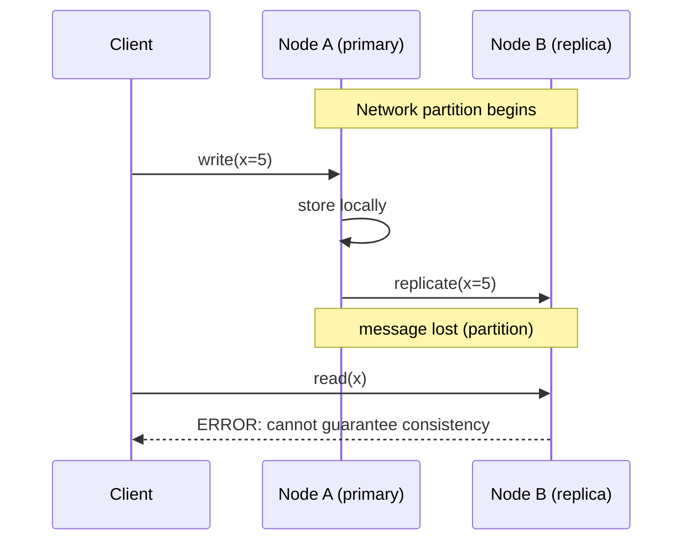
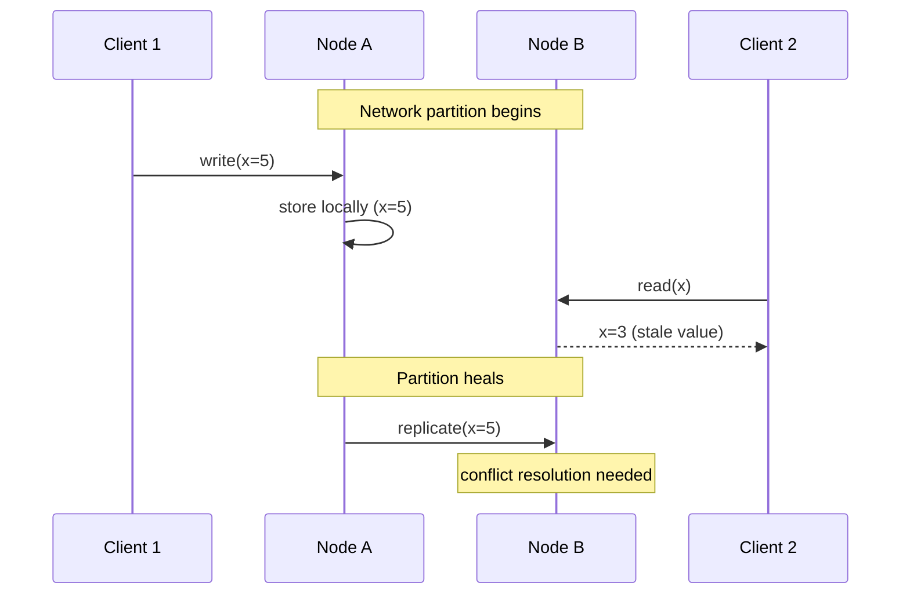
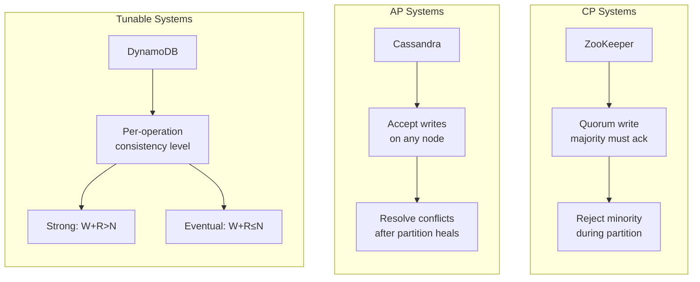

# CAP Theorem

## Overview

The **CAP theorem** (Brewer's theorem) states that a distributed data store cannot simultaneously provide more than two of the following three guarantees: **Consistency** (every read receives the most recent write), **Availability** (every request receives a non-error response), and **Partition tolerance** (the system continues to operate despite network partitions between nodes). Since network partitions *will* happen in any real distributed system, the practical choice is between consistency and availability during a partition — not between all three.

---

## Why It Exists

Distributed systems replicate data across multiple nodes for fault tolerance, latency, and throughput. The fundamental tension: when a network partition separates two replicas, should the system refuse to serve requests (consistent but unavailable) or serve potentially stale data (available but inconsistent)?

What was broken before CAP was formalized: engineers designed distributed systems as if they could have everything — strong consistency, perfect availability, and partition tolerance simultaneously. They couldn't, and the failures were confusing because nobody had a framework to explain why. Systems advertised as "consistent and available" would silently become inconsistent during network failures, or would hang and become unavailable without explanation.

CAP gave the industry a vocabulary to reason about these tradeoffs explicitly. It's imperfect (the theorem is often oversimplified), but it forced every distributed database designer to state, up front, what happens when the network fails.

---

## Historical Context

1. **Eric Brewer's conjecture (2000).** Presented as a keynote at the ACM Symposium on Principles of Distributed Computing (PODC). Stated informally: pick two of three.
2. **Gilbert and Lynch proof (2002).** Formalized and proved the conjecture as a theorem. The proof showed that no distributed system can provide all three guarantees in an asynchronous network that can drop messages.
3. **Post-CAP era (2010s).** Brewer himself wrote "CAP Twelve Years Later: How the 'Rules' Have Changed" (2012), acknowledging that the theorem is often oversimplified. The industry moved toward nuanced models: tunable consistency (Cassandra), per-operation consistency levels (DynamoDB), and frameworks like PACELC that extend CAP.
4. **Modern practice.** Today, no serious distributed database designer uses "CP vs AP" as the only lens. CAP is treated as a *starting point* for reasoning, not a complete framework. But the vocabulary it introduced — consistency, availability, partition tolerance — remains universal.

---

## First Principles

### The three properties, precisely

**Consistency (C).** Every read receives the result of the most recent write or an error. This is *linearizability* — the strongest consistency model. All nodes see the same data at the same instant, as if there were a single copy.

**Availability (A).** Every request to a non-failed node receives a response — not an error, not a timeout. The system continues to serve, even if some nodes are unreachable.

**Partition tolerance (P).** The system continues to operate despite arbitrary message loss or delay between nodes. A network partition is when some nodes can communicate and others cannot.

### The actual theorem

In the presence of a network partition (P), a distributed system must choose between Consistency (C) and Availability (A). You cannot have both.

The "pick two" framing is misleading because:

1. **Partitions are not optional.** In any real network, partitions happen — cables are cut, switches fail, cloud regions lose connectivity. A system that doesn't tolerate partitions is a single-node system, not a distributed system.
2. **The choice only matters during a partition.** When the network is healthy, a well-designed system can provide both strong consistency and high availability. CAP only forces a choice *during* a partition.
3. **The choice is not binary.** Systems can choose different trade-offs for different operations, different data, or different failure scenarios.

### What happens during a partition

Imagine two database replicas, A and B, that cannot communicate. A client writes to A. Another client reads from B.

- **CP choice:** B refuses to serve the read (or returns an error) because it cannot verify that it has the latest write. Consistent but unavailable.
- **AP choice:** B serves whatever data it has. Available but potentially inconsistent — the client might read stale data.

There is no third option. If B serves a response, it might be stale (not consistent). If B guarantees freshness, it must wait for A (not available during the partition).

---

## Mental Model

A chain of two retail stores.

Both stores sell the same products and share a price database. Normally, when Store A changes a price, it immediately notifies Store B. Customers at either store always see the same price. This is the no-partition state — you get consistency *and* availability.

Now the phone line between the stores goes down (a network partition).

Store A drops the price of coffee from $5 to $3.

**CP behavior:** Store B stops selling coffee until it can confirm the price with Store A. "Sorry, this product is temporarily unavailable." Consistent (no customer sees wrong prices) but unavailable (Store B can't sell coffee).

**AP behavior:** Store B continues selling coffee at $5. Available (customers can buy coffee) but inconsistent (Store B charges the old price). When the phone line is restored, the stores reconcile — but the inconsistency existed during the partition.

The choice depends on what's worse: refusing to sell, or selling at the wrong price.

---

## Internal Mechanics

### CP system behavior



The replica refuses to serve because it might have stale data. This is the behavior of systems like ZooKeeper, etcd, and Consul during a minority partition.

### AP system behavior



Both nodes serve requests. Writes during the partition create conflicts that must be resolved when the partition heals. This is the behavior of Cassandra, DynamoDB, and Riak.

### Quorum-based tuning

Many modern systems use quorum reads and writes to tune the consistency-availability spectrum:

```kotlin
// N = number of replicas
// W = write quorum (number of replicas that must acknowledge a write)
// R = read quorum (number of replicas that must respond to a read)
//
// If W + R > N: strong consistency (at least one replica in the read set
//               saw the latest write)
// If W + R <= N: eventual consistency (possible to read stale data)

data class QuorumConfig(val n: Int, val w: Int, val r: Int) {
    val isStronglyConsistent: Boolean = w + r > n
}

// Common configurations:
val strongConsistency = QuorumConfig(n = 3, w = 2, r = 2)  // W+R=4 > 3
val writeHeavy       = QuorumConfig(n = 3, w = 1, r = 3)  // W+R=4 > 3
val readHeavy        = QuorumConfig(n = 3, w = 3, r = 1)  // W+R=4 > 3
val eventual         = QuorumConfig(n = 3, w = 1, r = 1)  // W+R=2 <= 3
```

This is not a binary CP/AP choice — it's a dial that trades consistency for availability per operation.

---

## Architecture



The architecture of your distributed data store determines where you land on the CAP spectrum. The choice is not made once — modern systems make it per operation, per table, or per data category.

---

## Production Example

**CP systems:**

- **ZooKeeper / etcd.** Configuration and coordination services. During a partition, the minority partition becomes read-only (or unavailable). Consistency is paramount because stale configuration data can cause cascading failures.
- **Google Spanner.** Globally-consistent transactions via TrueTime. During a partition, Spanner's affected spans become unavailable rather than serving potentially inconsistent data.
- **PostgreSQL (single-primary replication).** Synchronous replicas are CP: if the replica is unreachable, writes block.

**AP systems:**

- **Cassandra.** All nodes accept reads and writes during a partition. Conflicts are resolved by last-writer-wins (using wall-clock timestamps — see [`../engineering-fundamentals/time-and-clocks.md`](../engineering-fundamentals/time-and-clocks.md) for why this is imperfect).
- **DynamoDB (in eventual consistency mode).** Reads from any replica; may return stale data.
- **DNS.** The classic AP system. DNS caches serve stale records during upstream failures. Availability is more important than immediate consistency.
- **CouchDB.** Multi-master replication with conflict detection.

**Tunable systems:**

- **DynamoDB.** Supports both eventually consistent reads (AP) and strongly consistent reads (CP, but with higher latency and lower availability).
- **Cassandra.** Supports tunable consistency levels per query: `ONE`, `QUORUM`, `ALL`.

---

## Android Example

Mobile applications are inherently partition-tolerant — the phone's network connection is the most unreliable link in the system. Every offline-capable Android app is making the AP choice implicitly:

```kotlin
class OrderRepository(
    private val localDb: OrderDao,      // local Room database
    private val remoteApi: OrderApi     // backend API
) {
    // AP behavior: always serve from local cache
    fun getOrders(): Flow<List<Order>> = localDb.observeAll()

    // AP write: accept locally, sync when possible
    suspend fun placeOrder(order: Order) {
        localDb.insert(order.copy(syncStatus = SyncStatus.PENDING))
        // background sync will push to server when network is available
    }

    // Background sync: resolve conflicts when partition heals
    suspend fun sync() {
        val pending = localDb.getPending()
        for (order in pending) {
            try {
                val serverOrder = remoteApi.submitOrder(order)
                localDb.update(order.copy(
                    syncStatus = SyncStatus.SYNCED,
                    serverId = serverOrder.id
                ))
            } catch (e: ConflictException) {
                // Server rejected — another device modified this order
                val serverVersion = remoteApi.getOrder(order.serverId)
                val resolved = conflictResolver.resolve(local = order, remote = serverVersion)
                localDb.update(resolved)
            }
        }
    }
}
```

The local database is the AP system. The phone and server are two nodes. The mobile network is the partition. The `sync()` function runs when the partition heals and resolves conflicts.

See [`../reference-architectures/offline-first-app.md`](../reference-architectures/offline-first-app.md) for the full pattern.

---

## Tradeoffs

**Choosing CP (consistency over availability)**

- Pro: clients never see stale or conflicting data.
- Pro: simpler application logic — no conflict resolution needed.
- Con: system becomes unavailable (or degraded) during partitions.
- Use when: financial transactions, configuration data, leader election, locks.

**Choosing AP (availability over consistency)**

- Pro: system always serves requests, even during partitions.
- Pro: higher perceived uptime for end users.
- Con: clients can see stale data; conflicting writes must be resolved.
- Use when: social feeds, shopping carts, content delivery, mobile offline.

**Hidden costs**

- CP systems that "never serve stale data" may still serve *nothing* — and nothing is often worse than stale data for user-facing applications.
- AP systems push conflict resolution to the application. "Eventually consistent" is easy to say and hard to implement correctly.
- Tunable consistency adds operational complexity — each team must choose the right level, and mistakes are silent.

**When the theorem doesn't apply**

- Single-node systems. CAP applies to distributed data stores. A single Postgres instance is not subject to CAP.
- Systems that can afford to be unavailable during partitions (internal batch systems, nightly jobs). Just choose CP and accept the downtime.

---

## Failure Modes

**Split brain.** During a partition, both sides believe they are the primary. Both accept writes. When the partition heals, conflicting writes must be reconciled. This is the worst-case failure mode for CP systems that fail to detect the partition correctly.

**Stale reads accepted as truth.** In AP systems, a client reads stale data and makes a decision based on it (e.g., "this item is in stock" when it's been sold). The decision is wrong. Mitigation: design application logic to tolerate staleness — validate at the point of action, not at the point of read.

**Quorum misconfiguration.** W + R ≤ N when strong consistency was intended. The system appears to work during normal operation and silently serves stale reads. Mitigation: validate quorum arithmetic at startup; monitor consistency violations.

**Partition detection failure.** The system doesn't realize a partition has occurred and continues as if the network is healthy. Both sides diverge silently. Mitigation: heartbeats, lease-based leadership, and explicit partition detection.

**Conflict resolution bugs.** AP systems that use application-level conflict resolution are only as correct as the resolver. A bug in the resolver corrupts data silently. Mitigation: test conflict resolution with adversarial inputs; log all resolutions for audit.

---

## Performance Considerations

- **CP cost:** Quorum writes are slower (must wait for W replicas). During partitions, unavailability is the "performance" cost — latency becomes infinite.
- **AP cost:** Writes are fast (any single node). Conflict resolution on partition heal adds burst processing.
- **Quorum cost:** Latency is dominated by the slowest of the W or R replicas. Adding replicas improves fault tolerance but increases tail latency.
- **Network:** Partitions themselves add no computational cost, but partition detection and healing add network traffic.
- **Mobile:** Every network transition (WiFi → cellular → airplane mode) is a micro-partition. Fast partition detection and graceful offline behavior are performance-critical for mobile UX.

---

## Reliability Considerations

- CAP is a *constraint on reliability design*, not a reliability technique. Knowing where you sit on the CAP spectrum tells you what failures to expect and prepare for.
- **CP reliability:** The system is "correct or unavailable." Reliability means maximizing uptime within this constraint (more replicas, faster failover).
- **AP reliability:** The system is "available but sometimes inconsistent." Reliability means minimizing the staleness window and handling conflicts correctly.
- **Error budgets** ([`../observability/error-budgets.md`](../observability/error-budgets.md)) should account for partition-induced unavailability (CP) or staleness (AP).

---

## Security Considerations

- **Stale authorization data.** An AP system serving stale access-control data can grant access to revoked users during a partition. Mitigation: use CP for authorization decisions, or set very short TTLs on cached permissions.
- **Split-brain writes.** During a partition, writes accepted on both sides can include security-sensitive data (role changes, permission grants). Conflict resolution must treat security mutations with extra care.
- **Partition as an attack vector.** An attacker who can induce a network partition can force a CP system to become unavailable (denial of service) or force an AP system to serve stale data (data integrity attack).

---

## Observability

- **Partition detection latency.** How long before the system recognizes a partition? Monitor heartbeat timeouts.
- **Consistency violations.** For AP systems, periodically compare replicas and count divergences. This should be a dashboard metric.
- **Unavailability during partition.** For CP systems, track how long minority-side nodes were unable to serve. This feeds into SLO calculations.
- **Conflict rate.** For AP systems, count conflicts detected during partition healing. A spike means the partition was long or writes were concurrent.
- **Staleness metrics.** For eventually consistent reads, measure the age of the data returned. Report as a histogram.

Canonical: [`../observability/slis.md`](../observability/slis.md), [`../observability/slos.md`](../observability/slos.md).

---

## Staff Engineer Thinking

**State your system's CAP position explicitly.** "Our database is AP with tunable per-query consistency" is a precise, useful statement. "Our database is highly available and consistent" is not — it's aspirational, not architectural.

**Choose CP or AP per data, not per system.** In the same application, user profiles can be AP (stale profiles are tolerable) while payment state is CP (stale payment state is not). Many systems run a CP store and an AP store side by side.

**Treat partitions as inevitable, not exceptional.** Design for the partition case first, then optimize for the no-partition case. Most teams do the opposite — they design for the happy path and discover their partition behavior in production.

**Push back on "we need both."** When stakeholders ask for strong consistency and perfect availability, the correct response is: "during a partition, which do you want?" This is the question CAP forces, and it's the Staff engineer's job to ensure it's answered before the system is built.

**Know when CAP is the wrong lens.** For many systems, the interesting trade-offs are not C vs A during partition but latency vs consistency during normal operation. PACELC (Partition: Availability vs Consistency; Else: Latency vs Consistency) is a more complete framework for these cases.

---

## Common Misconceptions

**"Pick two of three."** Misleading. Partitions are not optional in real networks. The real choice is C or A *during* a partition. Outside of partitions, you can have both.

**"CAP means you can't have consistency and availability."** You can — when there's no partition. CAP says you can't have both *during* a partition.

**"MongoDB is CP."** It depends on the configuration. With majority write concern and majority read concern, MongoDB is CP. With lower write concern, it's closer to AP. The label depends on the settings, not the product.

**"Eventual consistency means inconsistent."** No. It means the system will converge to a consistent state given enough time without new writes. The window of inconsistency is bounded by replication lag, not unbounded.

**"CAP applies to microservices."** CAP is about *data stores*, not service architectures. A microservice calling another microservice is subject to different trade-offs (latency, failure handling) that CAP doesn't directly address.

---

## Probing Questions

1. A network partition splits a three-node cluster into a group of 2 and a group of 1. A CP system and an AP system each handle this differently. Describe both behaviors.
2. Why are network partitions considered inevitable in distributed systems?
3. Cassandra uses last-writer-wins for conflict resolution during partition healing. What can go wrong? (Link to [`../engineering-fundamentals/time-and-clocks.md`](../engineering-fundamentals/time-and-clocks.md).)
4. An e-commerce app stores product inventory counts. Should this be CP or AP? Justify your answer, including the failure mode you're accepting.
5. Explain quorum reads and writes (W + R > N). Why does this guarantee strong consistency?
6. Why is the "pick two" framing of CAP misleading?
7. A mobile app stores user preferences locally and syncs to a server. Where does this sit in the CAP model?
8. Google Spanner claims to be "effectively CA." How does it achieve this, and what assumption makes it possible?
9. DynamoDB supports both eventually consistent and strongly consistent reads. What are the trade-offs between them?
10. When is CAP the wrong framework for analyzing a system's trade-offs? What framework would you use instead?

---

## Further Reading

In this repository:

- [`consistency-models.md`](consistency-models.md) — the full spectrum of consistency models beyond CAP's binary.
- [`idempotency.md`](idempotency.md) — safe retries during partition-induced failures.
- [`delivery-semantics.md`](delivery-semantics.md) — message delivery guarantees under partition.
- [`consensus-basics.md`](consensus-basics.md) — how CP systems achieve agreement.
- [`vector-clocks.md`](vector-clocks.md) — conflict detection for AP systems.
- [`crdts.md`](crdts.md) — data structures that converge without coordination (AP-friendly).
- [`../engineering-fundamentals/fault-tolerance.md`](../engineering-fundamentals/fault-tolerance.md) — the broader fault-tolerance context.
- [`../reference-architectures/offline-first-app.md`](../reference-architectures/offline-first-app.md) — a mobile AP architecture.

External:

- Eric Brewer, *CAP Twelve Years Later: How the "Rules" Have Changed* (2012). Brewer's own nuancing of the theorem.
- Seth Gilbert and Nancy Lynch, *Brewer's Conjecture and the Feasibility of Consistent, Available, Partition-Tolerant Web Services* (2002). The formal proof.
- Daniel Abadi, *Consistency Tradeoffs in Modern Distributed Database System Design* (2012). Introduces PACELC.
- Martin Kleppmann, *Designing Data-Intensive Applications*, Chapter 9. The most accessible modern treatment.
